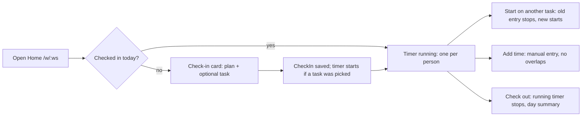

# M2 Time Implementation Plan

> **For agentic workers:** REQUIRED SUB-SKILL: Use superpowers:subagent-driven-development (recommended) or superpowers:executing-plans to implement this plan task-by-task. Steps use checkbox (`- [ ]`) syntax for tracking.

**Goal:** Check in and out, one running timer per person, manual time entries, a Home / My day page, and an Admin hourly-cost editor, so hours and cost come from real logging in the demo.

**Architecture:**
- The time rules live in the mock API (`src/mocks/time.ts`, `src/mocks/rates.ts`) behind the existing `Api` contract and `lib/http.ts` mapping.
- Each write publishes one `timeLogged` realtime event; other tabs invalidate the affected queries.
- Pages read through new hooks in `src/api/time.ts` and `src/api/rates.ts`. A running timer's clock is always worked out from `startedAt` and a ticking `now`, never kept as a counter.

**Tech Stack:** React 19, TS ~6, Vite 8, Tailwind v4, TanStack Query, React Router, Zustand, Vitest + fake-indexeddb.

**Spec:** `docs/superpowers/specs/2026-10-26-spark-flow-company-system-design.md` (§2 time logging, §3 `TimeEntry`/`CheckIn`/`Rate` and derived values, §4.2 `time.*` and `rates.*`, §4.3 permissions, §5 Home and phone bar, §6 first flow, §8 M2, §9 tests).

## Flow



## Global Constraints

- Everything in `CLAUDE.md` holds:
  - semantic tokens only; `Sheet` only for modals and `MenuPanel` only for menus;
  - no toasts or spinners, only the `LoadingBar` and pulse skeletons;
  - sentence-case, verb-first copy, `…` while pending, ` · ` separators, `—` for empty;
  - one primary button per view; logical direction classes only (`src/rtl.test.ts`);
  - light, dark, 390px and RTL must all work.
- Components import from `@/api/*` and `@/lib/*`, never `@/mocks`. The transport switch points stay `lib/api.ts`, `lib/http.ts` and `lib/realtime.ts`.
- §4.3 permissions:
  - Check-in, timer and adding your own time (`time.logOwn`) are open to every role.
  - Rates and cost (`rates.view`, `cost.view`) are Admin only.
  - A non-admin never receives a rate in any response.
- §2: one running timer per user; starting another task stops the last.
- §3: `CheckIn.day` is the local `YYYY-MM-DD`; a running entry has `endedAt: null`; `task.loggedHours` counts a running entry up to now.
- Each mock write is one `db.update` (one IndexedDB transaction) and is permission-checked inside it with `requireCan`.
- Every mutation goes through the global MutationCache, which invalidates everything. Sheets close on success, and errors show as sentences beside the cause.
- The `formatClock` and `formatHours` helpers (Task 3) are the only way pages show durations.

## Review Focus

1. **Two tabs.**
   - The timer is started in tab A while tab B shows Home.
   - Tab B's timer bar and Home switch to the running entry without a reload.
   - Starting a different task in tab B stops tab A's entry; there is never more than one running entry.
   - Test: Task 1 `time.test.ts › starting a timer stops the running one` plus `keysForEvent › timeLogged`. Browser check in Task 6.
2. **A reload or a sleeping laptop.**
   - The clock shows the true elapsed time from `startedAt`, not a count that restarted at zero.
   - Test: Task 3 `format.test.ts › elapsedMs and formatClock`.
3. **A manual entry that overlaps.**
   - An entry overlapping another of mine or the running timer is refused, with the sentence under the form. Nothing is stored.
   - So is one that ends before it starts, ends in the future, or runs over 12 hours.
   - Test: Task 1 `time.test.ts › addManual rejects…`, plus Task 4 `manualEntry.test.ts` for the same copy client-side.
4. **Forgot to check out yesterday.**
   - Today's Home shows the check-in card, not "already checked in".
   - Checking out closes the latest open check-in and stops the running entry, whatever day it started.
   - Test: Task 1 `time.test.ts › check-out closes yesterday's open check-in`.
5. **A Member types `/settings/rates`.**
   - The page says "You don't have access to hourly costs." and the API returns 403.
   - Test: Task 2 `rates.test.ts › only admins read or change rates`, plus a browser check.

---

### Task 1: Time API — check-in, timer, manual entries

**Files:**
- Modify `src/api/types.ts`: the new types and the `Api.time` methods.
- Modify `src/mocks/time.ts`, `src/lib/http.ts`, `src/lib/realtime.ts`, `src/mocks/realtime.ts` (only if the hub needs the new event type), `src/api/queryKeys.ts` and `src/lib/dates.ts`.
- Tests: `src/mocks/time.test.ts`, `src/lib/http.test.ts`, `src/lib/dates.test.ts`, `src/api/queryKeys.test.ts`.

**Interfaces — Produces:**
```ts
// types.ts
export type TimeTarget = { taskId: string } | { projectId: string }
export type MyDay = { day: string; checkIn: CheckIn | null; running: TimeEntry | null; entries: TimeEntry[] } // entries: mine that started on `day`, newest first
export type NewManualEntry = TimeTarget & { startedAt: string; endedAt: string; note: string }
Api.time = {
  list(projectId): Promise<ProjectTime>            // unchanged (M1)
  today(): Promise<MyDay>
  checkIn(input: { plan: string; target?: TimeTarget }): Promise<MyDay>
  checkOut(): Promise<MyDay>
  start(target: TimeTarget): Promise<MyDay>
  stop(): Promise<MyDay>
  addManual(entry: NewManualEntry): Promise<TimeEntry>
}
// realtime.ts: RealtimeEvent gains { type: 'timeLogged'; userId: string; projectId: string | null }
// queryKeys.ts: qk.myDay = () => ['time', 'me']; keysForEvent('timeLogged') → [qk.myDay(), ['tickets'], ['projects', 'time']]
// dates.ts: localDay(date: Date): string  // 'YYYY-MM-DD' in the browser's zone
```

**Rules and copy (mock; 400 `badRequest` unless noted):**
- `today()`:
  - `day = localDay(now())`; `checkIn` = mine with that day, else null.
  - `running` = my entry with `endedAt === null` from any day.
  - `entries` = mine whose `localDay(startedAt) === day`.
- `checkIn`:
  - One per day: "You've already checked in today."
  - The plan is trimmed and must not be empty: "Write a line about today's plan." The limit is 500 characters.
  - With a `target`, it then starts a timer exactly as `start` does.
- `start(target)`:
  - A `taskId` must exist ("That task doesn't exist."), and its project comes from the task.
  - A task that's done is refused: "That task is done. Reopen it to log time."
  - A `projectId` must exist.
  - If my running entry is already on the same target, return unchanged.
  - Otherwise close my running entry at `now` and add `{ source: 'timer', endedAt: null, note: '' }`, both in the same `db.update`.
- `stop()`: with nothing running, "No timer is running."; otherwise `endedAt = now`.
- `checkOut()`:
  - Closes my latest open check-in from any day, setting `checkedOutAt = now`, and stops my running entry.
  - With no open check-in: "You haven't checked in today."
- `addManual(entry)`, checked in this order:
  - `endedAt <= startedAt` → "The end is before the start."
  - `endedAt > now` → "Time can't be logged in the future."
  - Over 12 h → "One entry can be up to 12 hours."
  - An overlap with any of my entries, with the running one counted up to `now` → "That overlaps time you already logged."
  - A note over 200 characters → "Keep the note under 200 characters."
  - Then store it with `source: 'manual'`.
- Permissions: every write calls `requireCan(data, 'time.logOwn')` inside its `db.update`.
- Events: every write publishes `{ type: 'timeLogged', userId: me.id, projectId }` on the hub. `projectId` is the entry's project, or null for a check-in without a target.
- HTTP:
  - `GET /api/time/today`, `POST /api/time/check-in` with body `{plan, target?}`, `POST /api/time/check-out`;
  - `POST /api/time/start` with body `TimeTarget`, `POST /api/time/stop`, `POST /api/time/entries` with body `NewManualEntry`.

- [ ] **Step 1: Write the failing tests.** In `time.test.ts`, drive the mock with a clock you can move: `createMockApi(db, hub, () => now)`, starting at today, 09:00 local. The seed is built around the real date and holds entries only for earlier working days, so "today" must be the real today: `let now = new Date(); now.setHours(9, 0, 0, 0)`. A step to "tomorrow" means adding one day to `now`.
  - `today() starts empty for a fresh day`: `checkIn === null`, `running === null`, `entries` length 0. The seed has no entries for today.
  - `check-in once per day, plan required`:
    - `checkIn({ plan: ' ' })` rejects with "Write a line about today's plan."
    - `checkIn({ plan: 'Auth work' })` → `checkIn.plan === 'Auth work'`.
    - A second `checkIn` rejects with "You've already checked in today."
  - `check-in with a task starts its timer`: `checkIn({ plan: 'x', target: { taskId: 't-nex-101' } })` → `running.taskId === 't-nex-101'`, `running.projectId === 'p-nex'`, `source === 'timer'`.
  - `starting a timer stops the running one`:
    - Start on `t-nex-101`, move `now` 30 min, start on `t-nex-102`.
    - The `t-nex-101` entry has `endedAt` equal to the second start time.
    - Exactly one of my entries has `endedAt === null`.
    - Starting `t-nex-102` again keeps the same running entry `id`.
  - `start refuses a done task`: `t-nex-103` is done in the seed, so it rejects with "That task is done. Reopen it to log time."
  - `stop`: rejects "No timer is running." first; after `start`, `stop()` → `running === null` and the entry is closed.
  - `check-out closes yesterday's open check-in`:
    - Check in and start at today 17:00, then set `now` to tomorrow 09:00.
    - `today().checkIn === null`, `today().running` is still yesterday's entry.
    - `checkOut()` → that check-in has `checkedOutAt` set and `running === null`.
    - `checkOut()` again rejects "You haven't checked in today."
  - `addManual rejects end before start, the future, over 12 hours, overlaps and long notes`: one assertion per sentence above.
    - The overlap case: first add 08:00–08:30, then try 08:15–08:45.
    - Also try one that overlaps the running timer.
  - `addManual stores a manual entry and the hours count`:
    - Add 07:00–08:30 on `t-nex-101`.
    - `tickets.get('NEX-101').loggedHours` grows by 1.5, and the entry has `source: 'manual'`.
  - `every role may log its own time`: `viewAs('u-8')`, which is Tarek (Member), can `checkIn` and `start`.
  - `each write publishes timeLogged`: subscribe to the hub and collect events; `start` publishes `{ type: 'timeLogged', userId: 'u-1', projectId: 'p-nex' }`.
- Also:
  - In `http.test.ts`, the six routes, methods and bodies.
  - In `dates.test.ts`, `localDay(new Date(2026, 9, 28, 23, 30)) === '2026-10-28'`.
  - In `queryKeys.test.ts`, `keysForEvent({type:'timeLogged',…})` equals the three keys above.
- [ ] **Step 2:** Run `npx vitest run src/mocks/time.test.ts src/lib/http.test.ts src/lib/dates.test.ts src/api/queryKeys.test.ts`. Expected: FAIL, because `today`, `localDay` and the rest are not defined.
- [ ] **Step 3:** Implement the types, `localDay`, the mock methods, the http routes, the realtime event and its key mapping. Add a client-side `onTimeLogged` listener to the realtime client the same way as `onTicketUpdated`, so `RealtimeBridge` can subscribe in Task 3.
- [ ] **Step 4:** Run the same command, then `npm test`. Expected: PASS, all green.
- [ ] **Step 5:** Commit `feat: time API — check-in, one running timer, manual entries`.

---

### Task 2: Rates API and the Hourly cost page

**Files:**
- Create `src/mocks/rates.ts`, `src/api/rates.ts` and `src/pages/settings/RatesPage.tsx`.
- Modify `src/api/types.ts`, `src/mocks/index.ts`, `src/lib/http.ts`, `src/lib/api.ts`, `src/api/queryKeys.ts`, `src/lib/paths.ts`, `src/router.tsx` and `src/pages/settings/SettingsPage.tsx`.
- Tests: `src/mocks/rates.test.ts`, `src/lib/http.test.ts`, `src/lib/paths.test.ts`.

**Interfaces — Produces:**
```ts
Api.rates = { list(): Promise<Rate[]>; update(userId: string, hourlyCost: number): Promise<Rate> }
qk.rates = () => ['rates']
paths.rates = (ws) => `/w/${ws}/settings/rates`   // PLACE regex accepts settings/rates
useRates(), useUpdateRate()  // src/api/rates.ts
```
- Mock:
  - Both methods use `requireCan(data, 'rates.view')`. The 403 copy is "You don't have access to hourly costs.": make `requireCan` call `forbidden('hourly costs')` for `rates.view`.
  - `update` checks the user exists (404) and that the cost is a finite number of 0 or more: "Hourly cost is 0 or more."
  - It upserts the rate in EGP.
- HTTP: `GET /api/rates`, `PUT /api/rates/:userId` with body `{ hourlyCost }`.
- **RatesPage**, linked from Settings as a second row, "Hourly cost":
  - The row reads "What each person costs per hour, for project cost. Admin only."
  - Gated by `useAccess('rates.view')`: show a skeleton while loading; when denied, the sentence "You don't have access to hourly costs."
  - A `PageHeader` with title "Hourly cost" and subtitle "EGP per hour. Used for project cost; only Admins see it."
  - A Card list of workspace people: avatar, name · title, a numeric input (min 0, step 10), and a "Save" ghost button that appears only once the value changes.
  - The error sits under that row.

- [ ] **Step 1: Tests.**
  - `rates.test.ts › only admins read or change rates`:
    - As Admin, `list()` has 9 rates and `update('u-3', 320)` → 320.
    - `viewAs('u-2')` (PM), then `list()` and `update()` reject with status 403.
    - `update('u-3', -1)` as Admin → "Hourly cost is 0 or more."
    - `update('u-nope', 100)` → status 404.
  - `rates.test.ts › a new rate changes project cost`: after `update('u-3', 1000)`, `projects.list('ws-eng')` gives NEX a higher `cost` than before.
  - `http.test.ts`: the two routes. `paths.test.ts`: `validSavedPlace('/w/engineering/settings/rates', …)` is true.
- [ ] **Step 2:** Run `npx vitest run src/mocks/rates.test.ts src/lib/http.test.ts src/lib/paths.test.ts`. Expected: FAIL.
- [ ] **Step 3:** Implement the mock, the routes, the hooks, the page and the Settings row.
- [ ] **Step 4:** Run `npm test && npm run build:prototype && npm run lint`. Expected: PASS.
- [ ] **Step 5:** Commit `feat: hourly cost API and editor`.

---

### Task 3: Time hooks, live clock and the timer bar

**Files:**
- Create `src/api/time.ts`, `src/lib/useNow.ts` and `src/layout/TimerBar.tsx`.
- Modify `src/lib/format.ts`, `src/layout/TopBar.tsx`, `src/layout/AppLayout.tsx`, `src/layout/RealtimeBridge.tsx` and `src/components/ui/RecordHeader.tsx`.
- Test: `src/lib/format.test.ts`, created if it doesn't exist.

**Interfaces — Produces:**
```ts
// src/api/time.ts
useMyDay(): UseQueryResult<MyDay>                       // qk.myDay()
useCheckIn(), useCheckOut(), useStartTimer(), useStopTimer(), useAddTime()  // plain mutations
// src/lib/format.ts
elapsedMs(startedAt: string, now: Date): number         // never negative
formatClock(ms: number): string                         // '0:05:09', '12:00:00'
formatHours(hours: number): string                      // '7.5h', '0h', '115h' (one decimal, trailing .0 dropped)
// src/lib/useNow.ts
useNow(intervalMs = 1000): Date                         // re-renders on the interval; no interval when intervalMs is 0
```
- **TimerBar:** renders only when `useMyDay().data.running` exists. It shows the task key and title, or the project name when there's no task; `formatClock(elapsedMs(startedAt, now))` in `tabular-nums`; and a "Stop" button ("Stopping…" while pending).
  - **Desktop (`lg:`):** a pill in the TopBar before the icon buttons.
    - `rounded-full bg-accent-soft text-accent px-3 h-9` with a small pulsing dot. The pulse is `motion-safe` only.
    - Clicking the label opens the task (`?ticket=KEY`).
  - **Phones (below `lg`):** a slim bar, `h-11 border-t border-line bg-surface/95 backdrop-blur`, fixed directly above the bottom nav.
    - While it shows, it sets `document.documentElement.style.setProperty('--timer-bar', '2.75rem')`, and removes it on unmount.
    - `RecordHeader`'s phone action bar becomes `bottom-[calc(3.5rem+var(--timer-bar,0px)+env(safe-area-inset-bottom))]`.
    - `RecordActionBarSpacer` and the `main` bottom padding in `AppLayout` add `var(--timer-bar,0px)` the same way.
- `RealtimeBridge` subscribes to `onTimeLogged` and invalidates `keysForEvent`.

- [ ] **Step 1: Test** `format.test.ts › elapsedMs and formatClock`:
  - `elapsedMs('2026-10-28T07:00:00Z', new Date('2026-10-28T08:05:09Z')) === 3_909_000`.
  - `formatClock(3_909_000) === '1:05:09'`, `formatClock(0) === '0:00:00'`, `formatClock(43_200_000) === '12:00:00'`.
  - A `startedAt` in the future gives `elapsedMs` 0.
  - `formatHours(7.5) === '7.5h'`, `formatHours(115) === '115h'`, `formatHours(0.04) === '0h'`, `formatHours(2.25) === '2.3h'`.
- [ ] **Step 2:** Run `npx vitest run src/lib/format.test.ts`. Expected: FAIL.
- [ ] **Step 3:** Implement the helpers, the hooks, `useNow`, `TimerBar` and the layout wiring.
- [ ] **Step 4:** Run `npm test && npm run build:prototype && npm run lint`. Expected: PASS.
- [ ] **Step 5:** Commit `feat: running timer bar and time hooks`.

---

### Task 4: Add time, and timer controls on tasks

**Files:**
- Create `src/pages/time/AddTimeSheet.tsx`, `src/pages/time/manualEntry.ts` and `src/pages/time/manualEntry.test.ts`.
- Modify `src/pages/projects/TicketInspector.tsx` and `src/pages/projects/TimeTab.tsx`.

**Interfaces:**
- Consumes `useStartTimer`, `useStopTimer`, `useAddTime` and `useMyDay` (Task 3), and `NewManualEntry` and `TimeTarget` (Task 1).
- Produces:
```ts
export type ManualEntryValues = { day: string /* YYYY-MM-DD */; start: string /* HH:mm */; end: string; note: string; taskId: string | null; projectId: string }
export function manualEntryErrors(v: ManualEntryValues, now: Date): Partial<Record<'end' | 'note' | 'task', string>>
export function toManualEntry(v: ManualEntryValues): NewManualEntry   // local day + time → ISO; taskId wins over projectId
export function AddTimeSheet(props: { projectId: string; taskId?: string; onClose: () => void }): JSX.Element
```
- `manualEntryErrors` uses the same sentences as Task 1, for end before start, future, over 12 h and long note. A project with no task picked is fine. The server alone checks overlaps; its error shows under the form.
- **AddTimeSheet** is a `Sheet` dialog titled "Add time", with the description of the project name, or the task key and title.
  - Fields:
    - **Task:** a select of the project's tasks, "No task" first, preset when opened from a task.
    - **Day:** defaults to today.
    - **Start and End:** `<input type="time">`; they default to the hour before now, rounded down to 15 minutes.
    - **Note:** optional.
  - Footer: Cancel and "Add time" ("Adding…" while pending).
- **Inspector**, under the fields, in a row:
  - When the task isn't done: "Start timer", or "Stop timer" if `myDay.running?.taskId === t.id`; as secondary buttons.
  - "Add time", as a ghost button.
  - The start or stop error shows under the row.
- **Time tab:** an "Add time" secondary button above the totals card, opening `AddTimeSheet` for the project.

- [ ] **Step 1: Test** `manualEntry.test.ts`:
  - `{day:'2026-10-28', start:'09:00', end:'08:00'}` → `{ end: 'The end is before the start.' }`.
  - An end after `now` → "Time can't be logged in the future."
  - 07:00 to 20:00 → "One entry can be up to 12 hours."
  - A 201-character note → "Keep the note under 200 characters."
  - A valid entry → `{}`.
  - `toManualEntry` keeps the `taskId` and builds `startedAt === new Date(2026, 9, 28, 9, 0).toISOString()`.
- [ ] **Step 2:** Run `npx vitest run src/pages/time/manualEntry.test.ts`. Expected: FAIL.
- [ ] **Step 3:** Implement the helpers, the sheet, the inspector row and the Time tab button.
- [ ] **Step 4:** Run `npm test && npm run build:prototype && npm run lint`. Expected: PASS.
- [ ] **Step 5:** Commit `feat: add time and timer controls on tasks`.

---

### Task 5: Home / My day, and the navigation for it

**Files:**
- Create `src/pages/home/HomePage.tsx`, `src/pages/home/CheckInCard.tsx`, `src/pages/home/myDay.ts` and `src/pages/home/myDay.test.ts`.
- Modify:
  - `src/router.tsx`: the `/w/:ws` index becomes Home.
  - `src/layout/LastVisitRedirect.tsx`: `/` goes to the current workspace's Home.
  - `src/layout/Sidebar.tsx`: WORK gets Home first, with the `House` icon.
  - `src/layout/MobileNav.tsx`: Home · Projects · Chat · More.
  - `src/lib/paths.ts`: `paths.home`.
- Tests: `src/lib/paths.test.ts`.

**Interfaces — Produces:**
```ts
// myDay.ts
export function greeting(now: Date, name: string): string   // 'Good morning, Nour' (<12), 'Good afternoon, Nour' (<17), else 'Good evening, Nour'; first name only
export function daySummary(entries: TimeEntry[], now: Date): { hours: number; first: string | null; last: string | null } // last = latest endedAt, or now while running
export function dueTodayOrOverdue(tasks: TaskView[], userId: string, now: Date): TaskView[] // myOpenTasks filtered to overdue or due today
// paths.ts
paths.home = (ws: string) => `/w/${ws}`
```
- **HomePage** follows `01-home-light`, kit pattern C:
  - The title is `greeting(now, persona.name)`.
  - The subtitle is `"{n} open tasks · {m} overdue"`, or "Nothing assigned to you." when n is 0.
  - Then a two-column grid (`lg:grid-cols-3`): the CheckInCard (`lg:col-span-2`) and a "Due today and overdue" card.
- **CheckInCard** has three states:
  - **Not checked in:**
    - Title "Check in". A Plan textarea with the placeholder "What will you work on today?".
    - A Task select of my open tasks ("Pick later" first), and the primary "Check in" ("Checking in…" while pending).
  - **Checked in:**
    - The plan text.
    - The running entry with the live clock and a "Stop" button; or, when stopped, "No timer running · Start one from a task." with a task select and "Start timer".
    - Today's entries: task key · title, start–end, hours.
    - `formatHours(daySummary.hours)` today; "Add time" (opens AddTimeSheet, with the project picked from the task); and the secondary "Check out".
  - **Checked out:** "Checked out at 3:05 PM · 7.5h today", plus today's entries.
  - On a day that isn't today, the card says when the check-in started. This is Review Focus 4: yesterday's timer is still running.
- **"Due today and overdue" card:**
  - Rows show the task key, title, project, Overdue chip, due date, and a "Start" ghost button. Hide the button when that task is already running.
  - Empty state: "Nothing due today."
  - Mentions of me are M3; leave no placeholder card.
- **MobileNav:** Search leaves the bottom bar, because the phone top bar already opens search. The bar is Home · Projects · Chat · More.
- **LastVisitRedirect** for `/` goes to `paths.home(workspace.slug)`. `lastVisited` stays in use by Sidebar and MobileNav for the Chat and Projects targets.

- [ ] **Step 1: Test** `myDay.test.ts`:
  - `greeting`: `new Date(2026,9,28,9)` with 'Nour El-Sayed' → 'Good morning, Nour'; 13:00 → afternoon; 18:00 → evening.
  - `daySummary`: 07:00–11:00 plus 11:30 running, at `now` 12:00 → `hours 4.5`, `first` is the 07:00 ISO, `last` is the `now` ISO. With no entries → `{ hours: 0, first: null, last: null }`.
  - `dueTodayOrOverdue`: keeps overdue tasks and those due today, drops a task due tomorrow, drops done tasks and other people's, and keeps the `myOpenTasks` order.
  - `paths.test`: `paths.home('engineering') === '/w/engineering'`.
- [ ] **Step 2:** Run `npx vitest run src/pages/home/myDay.test.ts src/lib/paths.test.ts`. Expected: FAIL.
- [ ] **Step 3:** Implement the page, the card, the routes and the navigation.
- [ ] **Step 4:** Run `npm test && npm run build:prototype && npm run lint`. Expected: PASS.
- [ ] **Step 5:** Commit `feat: Home / My day with check-in`.

---

### Task 6: Verify M2 and docs

- [ ] **Step 1:** Gates: `npm test && npm run build:prototype && npm run lint`.
- [ ] **Step 2: Browser checks.** These run in the preview pane; record them in `tasks/todo.md`. Reload the seed first.
  1. **Admin:**
     - `/` lands on Home.
     - Check in with a plan and NEX-101; the timer runs in the top-bar pill.
     - Start NEX-102 from its inspector; NEX-101's entry closes.
     - Add time 07:00–08:00 on Home; an overlapping entry shows the sentence.
     - Check out; the summary shows. NEX's hours and cost on Projects grew.
  2. **Member (Tarek):**
     - Checks in, starts MOB-104, and sees the phone timer bar at 390px above the bottom nav.
     - On a MOB project page, the RecordHeader action bar sits above the timer bar.
     - `/settings/rates` says "You don't have access to hourly costs."
  3. **Admin, Hourly cost:** change Mariam's rate; NEX's cost changes on Projects.
  4. **Two tabs:** starting a timer in tab A shows it in tab B; starting another in tab B stops A's.
  5. **Reload** with a timer running: the clock continues from the true elapsed time.
  6. Light, dark, 390px and RTL on Home, the timer bar, AddTimeSheet and Hourly cost; no console errors.
- [ ] **Step 3: Docs.**
  - `CLAUDE.md` gets a line: time rules live in `src/mocks/time.ts`, and a running clock is always `elapsedMs(startedAt, now)`.
  - `tasks/todo.md` gets the M2 section.
  - Commit `docs: M2 verification`.
- [ ] **Step 4:** One whole-branch review of M2, on opus. Then one fix pass, and the final report with rulings and deferred minors.
