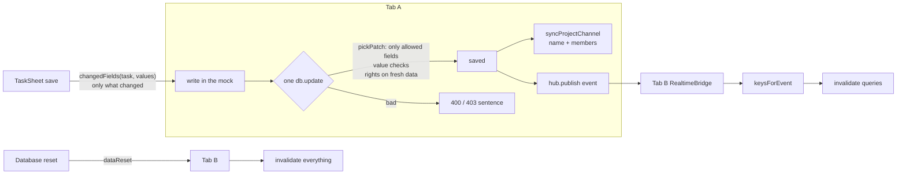

# M10: Data Integrity Implementation Plan

> **For agentic workers:** REQUIRED SUB-SKILL: Use superpowers:subagent-driven-development (recommended) or superpowers:executing-plans to implement this plan task-by-task. Steps use checkbox (`- [ ]`) syntax for tracking.

**Goal:** Close five gaps where data goes wrong without anyone seeing an error.
- **GAP-012:** other tabs miss changes.
- **GAP-014:** writes accept bad values and extra fields.
- **GAP-015:** saving a task overwrites newer changes.
- **GAP-016:** a project's chat drifts from its project.
- **GAP-024:** a removed person keeps tasks while the form shows "Unassigned".

**Architecture:**
- **Rules live in the mock** (`src/mocks/*`), so the .NET team copies one rule set. The rules are written into the spec as a new §4.4.
- **Page logic** that the node test environment can't render goes into one small pure helper file beside its page, `src/pages/projects/taskForm.ts`. M8 and M9 did the same.
- **Live updates** follow the existing pattern: each change is one event type in `RealtimeEvent`, one `on…` method on `RealtimeClient` (mock and no-op), one case in `keysForEvent`, and one line in `RealtimeBridge`.

**Tech Stack:** React 19, TypeScript, Vite, Tailwind v4, TanStack Query v5, React Router, Vitest (node environment). No new dependencies.

**Spec:**
- `GAP_AUDIT.md`: GAP-012, GAP-014, GAP-015, GAP-016 and GAP-024, including each one's Evidence and Fix approach.
- `docs/superpowers/specs/2026-10-26-spark-flow-company-system-design.md`:
  - §1: changes are "consistent across tabs".
  - §4.3: permissions.

Line numbers in the audit date from before M6 to M9. The lines below are current as of `cf0b05c..512ba45`.

## Flow



## Global Constraints

- **Copy:** English and sentence case. Errors are sentences shown near their cause. No toasts. Use `…` for pending, ` · ` as a separator and `—` for empty.
- **Error copy:** reuse the copy that already exists for a rule: "That column no longer exists.", "Give the task a title.", "That phase belongs to another project.", and "The estimate is a number of hours, 0 or more." New copy is fixed in each task.
- **Styling:** logical RTL classes only. Semantic color tokens only. Every screen works in light and dark and on a 390px phone.
- **Data access:** components import from `@/api/*` only, never `@/mocks`. The mock may import from `@/lib/*`.
- **Unstaged files:** leave the user's uncommitted edits in `src/layout/Sidebar.tsx`, `src/lib/usePermission.ts` and `src/pages/dashboard/DashboardPage.tsx` unstaged. If a task touches one of these files, stage only your own hunk, using `git hash-object -w` plus `git update-index --cacheinfo`.
- **Checks:**
  - Per task: `npm test`, `npx tsc -b`, `npm run lint`.
  - Before the final review, also run `npm run build:prototype` and `TZ=Asia/Tokyo npm test`.
- **Git:** never push or merge.

## Rulings made in this plan

These are recorded here so the executor doesn't re-decide them.

- **No 409 or If-Match in the mock (GAP-015).**
  - Saves now send only the fields that changed, and the mock checks rights inside the same write. Together these fix both user impacts in the audit:
    - A save no longer reverts a status someone else changed.
    - A stale read no longer lets an old assignee's move through.
  - Two people changing the same field still leaves the last save, as in Jira.
  - The spec records an optional `If-Match` → 409 for the backend (Task 6).
- **Unknown fields are refused (GAP-014).** A patch with a field outside the allow-list fails with 400 `Some of these fields can't be changed.` Dropping such fields silently would hide client bugs, and the mock is the backend's reference.
- **A project channel's members are exactly the project's people (GAP-016).** That means the manager, the members, and the members of its teams (`user.teamIds`). The person who created the project is no longer added just for creating it.
  - Public project channels still show to everyone, so an Admin who isn't on the project still sees it. Posting rights still come from the project.
  - The channel name is the project name's slug, deduplicated within the workspace.
- **Q6, no bulk reassign (GAP-024).** Removing people doesn't reassign or unassign their tasks.
  - The edit-project form warns who keeps open tasks.
  - The task form keeps the current assignee as an option, marked "(not on this project)", so a save doesn't clear it.
  - Bulk reassign stays out of scope.
- **A data reset makes every other tab refetch everything (GAP-012).** It doesn't clear those tabs or send them home. The seed reuses the same ids, so open pages keep working; a page whose record is gone shows its normal not-found state.

## Review Focus

1. **A board drag.** It sends `{ status, rank }`, and the assignee's own move sends `{ status }`. Both must pass the new allow-list and checks. The test is in Task 2.
2. **A seeded or drifted task whose assignee isn't on the project.** Editing its title or due date must save, and must not clear or refuse the assignee. The patch then carries no `assigneeId` (Task 3), and the mock accepts an unchanged off-project assignee (Task 2). Tests are in Tasks 2 and 3.
3. **An event that comes back to the tab that sent it.** `readChanged` invalidates the channel list in the same tab. That must not start another `markRead`, since `ChannelFeed` marks on a new newest message only. The browser check is in Task 1.
4. **A project renamed so its slug matches a normal channel** (for example "General" becoming `general`). The project's channel becomes `general-2`, and a slug near 40 characters still fits the channel-name pattern. The test is in Task 4.
5. **Sales editing a project** (no `phase.manage`). Renaming it still renames the channel. The channel sync must not need people rights when the people didn't change. The test is in Task 4.

---

### Task 1: Changes reach every open tab (GAP-012)

**Files:**
- Modify: `src/lib/realtime.ts`: `RealtimeClient`, `RealtimeEvent` and the no-op client.
- Modify: `src/mocks/realtime.ts:62-78`: `createMockRealtimeClient`.
- Modify: `src/api/queryKeys.ts`: `keysForEvent`.
- Modify: `src/layout/RealtimeBridge.tsx`.
- Modify: `src/mocks/rates.ts`, `src/mocks/files.ts`, `src/mocks/chat.ts:288`, `src/mocks/mentions.ts:68` and `src/mocks/dbApi.ts`, plus `src/mocks/index.ts:51-57` to pass `hub` to `ratesApi`, `mentionsApi`, `filesApi` and `dbApi`.
- Test: `src/api/queryKeys.test.ts`, `src/mocks/rates.test.ts`, `src/mocks/files.test.ts`, `src/mocks/chat.test.ts`, `src/mocks/mentions.test.ts`, and a new `src/mocks/dbApi.test.ts`.

**Interfaces:**
- Produces these new `RealtimeEvent` members:
  - `{ type: 'ratesChanged' }`
  - `{ type: 'filesChanged'; projectId: string }`
  - `{ type: 'readChanged'; userId: string }`
  - `{ type: 'dataReset' }`
- Each event gets a matching `RealtimeClient` method: `onRatesChanged(cb: () => void)`, `onFilesChanged(cb: (e: { projectId: string }) => void)`, `onReadChanged(cb: (e: { userId: string }) => void)` and `onDataReset(cb: () => void)`. Each returns `() => void`.
- The factories become `ratesApi(db, hub)`, `mentionsApi(db, hub)`, `filesApi(db, hub, now)` and `dbApi(db, hub)`.

- [ ] **Step 1: Write the failing tests**

In `queryKeys.test.ts`:

```ts
it('a task change also refreshes project summaries and the dashboard', () => {
  const keys = keysForEvent({ type: 'ticketUpdated', ticket: { projectId: 'p1', key: 'NEX-1' } as Ticket })
  expect(keys).toEqual(expect.arrayContaining([['tickets', 'projects'], ['dashboard']]))
})
it('rates, files, read state and a reset name what they make stale', () => {
  expect(keysForEvent({ type: 'ratesChanged' })).toEqual([qk.rates(), ['time', 'report'], ['dashboard'], qk.timeAll()])
  expect(keysForEvent({ type: 'filesChanged', projectId: 'p1' })).toEqual([qk.files('p1')])
  expect(keysForEvent({ type: 'readChanged', userId: 'u1' })).toEqual([qk.channelsAll(), qk.mentions()])
  expect(keysForEvent({ type: 'dataReset' })).toEqual([[]]) // the empty key matches every query
})
```

In each mock test, subscribe to `hub` and assert that the write publishes:
- `rates.update('u-2', 500)` publishes `{ type: 'ratesChanged' }`.
- `files.upload(…)` publishes `{ type: 'filesChanged', projectId }`.
- `chat.markRead('c-general')` publishes `{ type: 'readChanged', userId: <current user> }`.
- `mentions.markRead([id])` publishes the same.
- `db.reset()` and `db.reloadSeed()` publish `{ type: 'dataReset' }`, as Admin.
- A refused write publishes nothing. For example, `rates.update` as a member rejects with 403, and no event is published.

- [ ] **Step 2: Run the tests and watch them fail**

Run: `npx vitest run src/api/queryKeys.test.ts src/mocks/rates.test.ts src/mocks/files.test.ts src/mocks/chat.test.ts src/mocks/mentions.test.ts src/mocks/dbApi.test.ts`
Expected: FAIL. The new event types don't exist yet, so the `tsc`-checked tests also fail to compile.

- [ ] **Step 3: Implement**

- Add the four events and four client methods in both clients.
- `RealtimeBridge` calls `invalidate` for each new event.
- `keysForEvent`:
  - `ticketUpdated` adds `['tickets', 'projects']` and `['dashboard']`.
  - The four new cases return the keys in the test.
- Each mock publishes after its `db.update` resolves, never inside it.
- Update the doc comment on `dbApi.ts:7`: reset and reload now tell other tabs.

- [ ] **Step 4: Check the tests and the browser**

- Run `npm test`. Expected: all tests PASS.
- In the browser, with two tabs:
  1. Change a rate in tab A. Tab B's Rates page updates without a reload.
  2. Upload a project file in tab A. It shows in tab B's Files.
  3. Reset the demo in tab A. Tab B's lists refetch.
  4. Review Focus 3: open a channel in tab A and watch for 10 s. The network log shows one `markRead` per new message, and no repeating cycle.

- [ ] **Step 5: Commit**

`feat: rates, files, read state and resets reach every open tab`

---

### Task 2: Writes take only known fields and valid values (GAP-014)

**Files:**
- Create: `src/lib/projectPeople.ts`, moved from `TaskSheet.tsx:19-21` and `mocks/mentions.ts:15-21`.
- Modify: `src/mocks/shared.ts`.
- Modify: `src/mocks/tickets.ts`: `checkTaskInput`, `tasks.create` and `tasks.update`.
- Modify: `src/mocks/projects.ts`: `projects.update`, `phases.update` and `deliverables.update`.
- Modify: `src/mocks/mentions.ts` and `src/pages/projects/TaskSheet.tsx`, both of which now import `projectPeople`.
- Test: `src/mocks/tasks.test.ts`, `src/mocks/projects.test.ts`, and a new `src/lib/projectPeople.test.ts`.

**Interfaces:**
- Produces:
  - `projectPeople(project: Pick<Project,'managerId'|'memberIds'|'teamIds'>, users: User[]): User[]`, the same rule as today's TaskSheet copy.
  - `projectPeopleIds(project, users): Set<string>`.
  - `pickPatch<K extends string>(patch: object, allowed: readonly K[]): Partial<Record<K, unknown>>` in `mocks/shared.ts`. It throws `badRequest("Some of these fields can't be changed.")` on any key outside `allowed`, and drops `undefined` values.
- New 400 copy:
  - `That isn't a priority.`
  - `That isn't a task type.`
  - `Pick someone on the project.` (assignee)
  - `That sprint belongs to another project.`
  - `Story points are a number, 0 or more.`
  - `Pick a due date.` (an unparseable `dueAt`)
  - `That isn't a project status.`
  - `That isn't a phase status.`
  - `Pick a project manager.` (exists already, reused for update)
  - `Someone on this list doesn't exist.` (`memberIds`)
  - `That team doesn't exist.`
  - `Pick a done date.` (deliverable `doneAt`)

- [ ] **Step 1: Write the failing tests**

In `tasks.test.ts`, add `describe('task writes are checked')`. As the NEX manager:

```ts
it('refuses fields outside the patch', async () =>
  await expect(api.tasks.update('NEX-101', { key: 'X-1' } as never)).rejects.toMatchObject({ status: 400, detail: "Some of these fields can't be changed." }))
it('refuses bad values', async () => {
  const refused = async (patch: object, detail: string) => await expect(api.tasks.update('NEX-101', patch as never)).rejects.toMatchObject({ status: 400, detail })
  await refused({ priority: 'asap' }, "That isn't a priority.")
  await refused({ type: 'epic' }, "That isn't a task type.")
  await refused({ assigneeId: '<a user on no NEX team>' }, 'Pick someone on the project.')
  await refused({ sprintId: '<a sprint of another project>' }, 'That sprint belongs to another project.')
  await refused({ storyPoints: -1 }, 'Story points are a number, 0 or more.')
  await refused({ dueAt: 'soon' }, 'Pick a due date.')
})
it('create is checked the same way', async () => { /* the assigneeId and priority cases through tasks.create */ })
it('a board move and the assignee\'s own move still pass', async () => { /* Review Focus 1: { status, rank } as manager; { status } as the assignee */ })
it('an unchanged assignee who left the project can stay', async () => { /* Review Focus 2: remove the assignee from memberIds, then update { assigneeId: <same id>, title: 'x' } resolves */ })
```

In `projects.test.ts`:
- `projects.update` refuses `{ key: 'ZZ' }` and `{ channelId: 'c-x' }` with the unknown-field copy.
- It also refuses `{ status: 'gone' }`, `{ managerId: 'nobody' }`, `{ memberIds: ['nobody'] }` and `{ teamIds: ['t-none'] }`, each with its copy.
- `phases.update` refuses `{ projectId: 'p-x' }` with the unknown-field copy, and `{ status: 'x' }`.
- `deliverables.update` refuses `{ projectId: 'p-other' }` with the unknown-field copy. It also refuses `{ phaseId: <a phase of another project> }` ("That phase belongs to another project.") and `{ doneAt: 'x' }` ("Pick a done date.").

In `projectPeople.test.ts`, check that the manager, the members and the people on its teams are in, and anyone else is out.

- [ ] **Step 2: Run the tests and watch them fail**

Run: `npx vitest run src/mocks/tasks.test.ts src/mocks/projects.test.ts src/lib/projectPeople.test.ts`
Expected: the new cases FAIL because the writes resolve, and `projectPeople.test.ts` fails because the module is missing.

- [ ] **Step 3: Implement**

- **Allow-lists:** the keys of `TicketPatch`, `ProjectPatch`, `PhasePatch` and `DeliverablePatch` in `src/api/types.ts:170-189`. Write them as `readonly` arrays next to each write, typed `satisfies readonly (keyof XPatch)[]`.
- **Task fields:** `checkTaskInput` gains the checks for priority, type, assignee, sprint, story points and `dueAt`.
  - The assignee check is `assigneeId === null`, or `assigneeId === ticket?.assigneeId`, or `projectPeopleIds(project, data.users).has(assigneeId)`.
  - The sprint check is `sprintId === null`, or `sprint.projectId === projectId`.
  - `tasks.create` runs the same checks, with no current ticket.
- **Project fields:** the `projects.update` checks run on the merged `next` value.
- **Phase fields:** `phases.update` checks the phase status.
- **Deliverable fields:** `deliverables.update` checks `phaseId` and `doneAt`.
- **Validated values:**
  - Priorities: `urgent`, `high`, `medium`, `low`.
  - Types: `task`, `bug`.
  - Project statuses: `planned`, `active`, `onHold`, `delivered`.
  - Phase statuses: `notStarted`, `inProgress`, `done`.
- **Imports:** `mentions.ts` uses `projectPeopleIds`, and `TaskSheet` imports `projectPeople` from `@/lib/projectPeople`. TaskSheet no longer exports its own copy; update every importer.

- [ ] **Step 4: Run the tests and watch them pass**

Run: `npm test`
Expected: all tests PASS. Seed data must still load. If a seed task breaks a new rule, fix the seed and record a ruling in the ledger.

- [ ] **Step 5: Commit**

`fix: writes take only known fields and valid values`

---

### Task 3: Saving a task sends only what changed, checked on fresh data (GAP-015)

**Files:**
- Create: `src/pages/projects/taskForm.ts`
- Modify: `src/pages/projects/TaskSheet.tsx:88-118` (`save`)
- Modify: `src/mocks/tickets.ts`: `tasks.update`, plus `updateTicket`'s signature.
- Test: create `src/pages/projects/taskForm.test.ts`; modify `src/mocks/tasks.test.ts`.

**Interfaces:**
- Produces:
  - `changedFields(task: TaskView, fields: TicketPatch): TicketPatch`. It returns only the keys whose value differs from `task`, compared by `===` after the same normalization TaskSheet applies (`null` for an empty value).
  - `updateTicket(db, hub, key, patch, now, check?: (data: DbData, ticket: Ticket) => void)`. `check` runs inside the same `db.update` before anything is written.

- [ ] **Step 1: Write the failing tests**

In `taskForm.test.ts`, `'only the fields that changed'`:
- `changedFields(task, { ...sameAsTask, dueAt: '2026-11-01T00:00:00.000Z' })` returns `{ dueAt: '2026-11-01T00:00:00.000Z' }`.
- `changedFields(task, sameAsTask)` returns `{}`.
- `changedFields(task, { ...sameAsTask, status: 'inReview' })` returns `{ status: 'inReview' }`. Review Focus 2: an off-project assignee left untouched is not in the result.

In `tasks.test.ts`, `'rights are checked against the data the write sees'`:

```ts
// db.read() applies the tab's person, so the stale copy is taken while acting as A (NEX-101's seed assignee).
await api.users.viewAs(A)
const stale = await db.read()
await api.users.viewAs(MANAGER)
await api.tasks.update('NEX-101', { assigneeId: B })  // reassigned to B
await api.users.viewAs(A)
const staleApi = createMockApi({ ...db, read: async () => structuredClone(stale) }, hub)
await expect(staleApi.tasks.update('NEX-101', { status: 'done' })).rejects.toMatchObject({ status: 403 })
```

- [ ] **Step 2: Run the tests and watch them fail**

Run: `npx vitest run src/pages/projects/taskForm.test.ts src/mocks/tasks.test.ts`
Expected:
- `taskForm` FAILS because the module is missing.
- The stale-read test FAILS because the update resolves, since rights are checked on the stale read.

- [ ] **Step 3: Implement**

- `tasks.update` moves its `requireCan` and `checkTaskInput` calls into the `check` callback, so they run against the transaction's data.
- The early `db.read()` stays only to look up the key and return 404 fast, or goes entirely. Either is fine as long as the test passes.
- TaskSheet edit:
  - `const patch = changedFields(task, fields)`.
  - When `patch` is empty, it calls `onClose()` without a request.
  - Otherwise it sends `update.mutate({ key, patch })`.
- The assignee-only branch (`{ status }`) stays as it is.

- [ ] **Step 4: Check the tests and the browser**

- Run `npm test`. Expected: all tests PASS.
- In the browser, with two tabs:
  1. Tab A, as the manager, opens Edit task on a card.
  2. Tab B, as its assignee, moves the card to In review.
  3. Tab A changes only the due date and saves.
  4. The card stays in In review.

- [ ] **Step 5: Commit**

`fix: saving a task sends only what changed, checked on fresh data`

---

### Task 4: A project's chat follows its project (GAP-016)

**Files:**
- Modify: `src/mocks/projects.ts`: `projects.create` (`:100-131`) and `projects.update` (`:133-150`).
- Test: `src/mocks/projects.test.ts`, `src/mocks/mentions.test.ts`.

**Interfaces:**
- Consumes: `projectPeopleIds` (Task 2) and `CHANNEL_NAME` (`src/lib/channelForm.ts:1`, max 40 characters).
- Produces:
  - `channelNameFor(data: DbData, workspaceId: string, projectName: string, exceptChannelId?: string): string`. It returns `slug(name)` cut to fit, or `slug-2`, `slug-3` and so on when the name is taken by another channel in the workspace. The result always matches `CHANNEL_NAME`.
  - `syncProjectChannel(data: DbData, project: Project): boolean`. It sets the channel's `name` and `memberIds` from the project, and returns whether anything changed. When something changed, `projects.update` also publishes `channelChanged`.

- [ ] **Step 1: Write the failing tests**

In `projects.test.ts`, `describe('the project channel follows the project')`:
- `'renaming the project renames its channel'`: `update(NEX, { name: 'Nexus Two' })` leads to the channel name `nexus-two`.
- `'a name taken by another channel gets a number'` (Review Focus 4):
  - Renaming to `General` gives `general-2`.
  - A 60-character name gives a channel name matching `CHANNEL_NAME`.
  - Two new projects both named `Sela` get `sela-…` names that differ.
- `'people added or removed are the channel members'`: add `u-x` to `memberIds` and remove `u-y`. The channel's `memberIds` then equals the set from `projectPeopleIds`.
- `'Sales renames a project and its channel follows'` (Review Focus 5): as Sales, `update(id, { name })` resolves, and the channel is renamed.
- `'a new project\'s channel holds its people only'`: an Admin who creates a project without being on it is not in `memberIds`.
- `'a project change publishes channelChanged for its channel'`.

In `mentions.test.ts`, `'@all in a project channel reaches people added later, not people removed'`:
1. Add `u-x` and remove `u-y` through `projects.update`.
2. Post `@all` in the project channel.
3. `u-x` gets the mention, and `u-y` doesn't.

- [ ] **Step 2: Run the tests and watch them fail**

Run: `npx vitest run src/mocks/projects.test.ts src/mocks/mentions.test.ts`
Expected: the new cases FAIL because the name and members stay as they were at create.

- [ ] **Step 3: Implement**

- `create` builds the channel with `memberIds: []`, then calls `syncProjectChannel`.
- `update` calls it after `Object.assign(project, next)`, inside the same write.
- The topic stays as set at create.

- [ ] **Step 4: Run the tests and watch them pass**

Run: `npm test`
Expected: all tests PASS. Existing chat tests that expect the creator in a new project's channel need updating to the ruling. Record each such change in the ledger.

- [ ] **Step 5: Commit**

`fix: a project's chat keeps its name and people in step`

---

### Task 5: A removed assignee stays visible (GAP-024)

**Files:**
- Modify: `src/pages/projects/taskForm.ts` (from Task 3).
- Modify: `src/pages/projects/TaskSheet.tsx:202-210`.
- Modify: `src/pages/projects/ProjectSheet.tsx` (the edit form).
- Test: `src/pages/projects/taskForm.test.ts`.

**Interfaces:**
- Consumes: `projectPeople` (Task 2), `categoryOf` (`src/lib/boardColumns.ts:13`), and `useTickets(projectId)` from `@/api/tickets`.
- Produces:
  - `assigneeOptions(people: User[], users: User[], currentId: string | null): { id: string; label: string }[]`. It lists the project's people by name. If `currentId` is set and not among them, that person comes first, labelled `<Name> (not on this project)`. An unknown id is labelled `Unknown person (not on this project)`.
  - `tasksLeftWith(removedIds: string[], tasks: TaskView[], project: Pick<Project,'board'>, users: User[]): string | null`. It counts the open tasks (not in a Done-type column) assigned to removed people. With none, it returns `null`. Otherwise it returns a sentence in one of these forms:
    - `Nour El-Sayed keeps 1 open task here. Reassign it from the board.`
    - `Nour El-Sayed and Tarek Lotfy keep 3 open tasks here. Reassign them from the board.`
    - `Nour El-Sayed, Tarek Lotfy and 2 others keep 5 open tasks here. Reassign them from the board.`

- [ ] **Step 1: Write the failing tests**

- `'the current assignee stays an option when they left the project'`:
  - The first option is `{ id: 'u-9', label: 'Mariam Fathy (not on this project)' }`.
  - When they are on the project, the option is labelled with the name alone.
- `'warns who keeps open tasks when people are removed'`: cover all three sentence forms, the singular "task"/"it" form, and that Done-type tasks don't count.
- `'nobody removed, or no open tasks, means no warning'`: returns `null`.

- [ ] **Step 2: Run the tests and watch them fail**

Run: `npx vitest run src/pages/projects/taskForm.test.ts`
Expected: FAIL, because the two functions are not exported.

- [ ] **Step 3: Implement**

- TaskSheet's Assignee select renders `assigneeOptions(people, users, task?.assigneeId ?? null)` after "Unassigned".
- In edit mode, ProjectSheet reads `useTickets(project.id)` and computes `removed = project.memberIds.filter((id) => !values.memberIds.includes(id))`.
  - Team removals count too. Compare `projectPeople` before and after.
  - It shows `tasksLeftWith(…)` as `<p className="text-sm text-amber-700 dark:text-amber-300">` under the People field.
  - The save button stays as it is: the line is a warning, not a block.

- [ ] **Step 4: Check the tests and the browser**

- Run `npm test`. Expected: all tests PASS.
- In the browser, in light, dark and at 390px:
  1. In Edit project, untick a member who has open tasks. The warning names them and their task count.
  2. Save, then open one of their tasks. The assignee reads `<Name> (not on this project)`.
  3. Change the due date and save. The assignee is kept.

- [ ] **Step 5: Commit**

`fix: a removed assignee stays visible and the project form says who keeps tasks`

---

### Task 6: Write the rules down

**Files:**
- Modify: `docs/superpowers/specs/2026-10-26-spark-flow-company-system-design.md`: add §4.4 "Write rules" after §4.3.
- Modify: `GAP_AUDIT.md`: the Status section and the Status lines of GAP-012, 014, 015, 016 and 024.
- Modify: `docs/demo-script.md`: add one line under the story that edits a project.

**What §4.4 says.** One line each:
- Each write's allow-list and the values it checks, as in Task 2, with the exact 400 copy.
- A task patch carries only changed fields. Rights and values are checked in the same transaction as the write.
- Optional `If-Match: <updatedAt>` → 409 "This task changed since you opened it." This is for the backend; the prototype doesn't send it.
- A project channel's name is the deduplicated slug of the project name, and its members are the project's people. Both are kept in step on every project write.
- Removing people leaves their tasks assigned. The forms say so.
- The live events, their payloads, and what each makes stale, including `dataReset`.

- [ ] **Step 1: Write the three docs, and check every rule against the code it describes**
- [ ] **Step 2: Commit:** `docs: M10 write rules, audit status and demo note`

---

### Finish

1. Run the full checks: `npm test`, `TZ=Asia/Tokyo npm test`, `npx tsc -b`, `npm run lint` and `npm run build:prototype`. All are clean.
2. Run one whole-branch review on the M10 range, from the commit before Task 1 to HEAD, on the most capable model, with this plan's Review Focus.
3. Make one fix pass for Critical and Important findings. Defer the minors.
