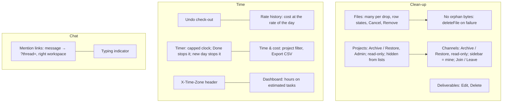

# M11: Remaining Medium Gaps Implementation Plan

> **For agentic workers:** REQUIRED SUB-SKILL: Use superpowers:subagent-driven-development (recommended) or superpowers:executing-plans to implement this plan task-by-task. Steps use checkbox (`- [ ]`) syntax for tracking.

**Goal:** Close the last 13 Medium gaps in `GAP_AUDIT.md` (GAP-009, 018–023, 025–029, 033) and the small issues deferred from the M9 and M10 reviews, in one milestone.

**Architecture:**
- **Rules live in the mock** (`src/mocks/*`), so the .NET team copies one rule set. They are added to spec §4.4 in the last task.
- **Page logic** that the node test environment can't render goes into small pure helpers beside their page, as in M8–M10.
- **Live updates** use the existing events: `channelChanged`, `projectChanged`, `filesChanged`, `timeLogged` and `ratesChanged`. Typing uses the existing `userTyping` event, adding only the sending side.
- **One stored-data change:** rate history (Task 9) bumps `DB_VERSION` from 5 to 6, with migration step `5`. Every other new field is optional (`archivedAt?: string | null`), the way `Ticket.archivedAt` was added, so it needs no migration.

**Tech Stack:** React 19, TypeScript, Vite, Tailwind v4, TanStack Query v5, React Router, Vitest (node environment). No new dependencies.

**Spec:**
- `GAP_AUDIT.md`: GAP-009, 018, 019, 020, 021, 022, 023, 025, 026, 027, 028, 029 and 033. Read each finding's Evidence and Fix approach. The line numbers in the audit are stale; the file:line references in this plan are current as of `526d47e`.
- The deferred minors from the M9 and M10 reviews, listed in Tasks 15 and 16.
- `docs/superpowers/specs/2026-10-26-spark-flow-company-system-design.md`: §4.3 (permissions) and §4.4 (write rules).

## Flow

## Global Constraints

- **Copy:**
  - English, sentence case, verb-first buttons.
  - `…` for pending, ` · ` as a separator, `—` for empty.
  - Errors are sentences near their cause. No toasts.
  - One primary (red) button per view.
- **Shared UI:**
  - Confirmations use `ConfirmDeleteSheet` (`src/components/ConfirmDeleteSheet.tsx`). Use `tone="primary"` for something you can undo (archive) and the default danger tone for a permanent removal.
  - The only loader is the `LoadingBar` plus pulse skeletons. No spinners.
- **Styling:**
  - Logical RTL classes only.
  - Semantic color tokens only.
  - Status colors follow `bg-{c}-50 text-{c}-700 dark:bg-{c}-500/15 dark:text-{c}-300`.
- **Phones and themes:** every screen works in light and dark and on a 390px phone.
- **Data access:** components import from `@/api/*` only. `src/lib/api.ts`, `src/lib/http.ts` and `src/lib/realtime.ts` are the only places that know which backend is in use. Every new `Api` method also gets its `http.ts` route.
- **Mock writes:**
  - One `db.update` per write.
  - Rights and values are checked inside it.
  - The event is published after the write resolves.
- **The user's uncommitted edits** in `src/layout/Sidebar.tsx`, `src/lib/usePermission.ts` and `src/pages/dashboard/DashboardPage.tsx` stay unstaged.
  - They make `dashboard.view` honour `managesAny`. They were checked: tsc and all 521 tests pass with them, and they don't conflict with M8–M10.
  - Tasks 5, 6, 10 and 12 touch Sidebar and DashboardPage. Edit those files around the user's hunks, and stage only your own hunks, using `git hash-object -w` plus `git update-index --cacheinfo`.
- **Checks:**
  - Per task: `npm test`, `npx tsc -b`, `npm run lint`.
  - Before the review, also run `npm run build:prototype` and `TZ=Asia/Tokyo npm test`.
- **Git:** never push or merge.

## Rulings made in this plan

- **Projects are archived, not deleted (GAP-023).**
  - A hard delete would have to cascade through tasks, comments, time, files and chat, and it would rewrite past cost.
  - Archiving is Admin only, through a new action `project.archive`.
  - An archived project is hidden from lists, the sidebar, search and the dashboard. It still opens by its address, and its hours stay in the Time & cost report.
  - All writes on it are refused until it is restored.
- **The sidebar lists my channels (GAP-018).** It shows channels I'm a member of, plus the project channels of projects I'm on.
  - Any other public channel is reached through search, and its page offers **Join channel**.
  - **Leave channel** is in the channel menu, except on project channels, whose members follow the project (M10).
  - DMs are not archived.
- **Upload "progress" is per-file state, not bytes (GAP-020), for project files.** A task comment already keeps its files when posting fails, so Try again works there. Each row is queued, uploading, uploaded or failed, with Cancel and Try again.
  - The mock writes to IndexedDB, and `fetch` reports no upload progress.
  - Byte progress over XHR is left for the backend build.
- **Rates keep their history (GAP-025).**
  - Each change adds a row with `effectiveFrom`.
  - A time entry costs the rate that was in effect when it started.
  - A change made on the same day replaces that day's row, so correcting a typo doesn't create history.
- **Time zones go in a header (GAP-029).** Every HTTP request sends `X-Time-Zone: <IANA zone>`, and the backend works out "today" and report weeks in that zone. The mock already runs in the person's browser, so it is unchanged.
- **Small issues not taken:**
  - A channel whose messages fail to load stays unread. Marking it read would mark unseen messages read.
  - The resetting tab's single extra refetch is harmless.
  - Neither gets a task.

## Review Focus

1. **Archiving a project with a running timer, an open edit sheet or someone viewing its channel.**
   - The timer stops, as when a task is archived.
   - The sheet's save fails with `This project is archived. Restore it first.`
   - The channel becomes read-only live.
   - Tests are in Task 6.
2. **An old rate row with no `effectiveFrom`, or an entry older than the first rate.**
   - Migration 5 gives each existing rate `effectiveFrom: '1970-01-01T00:00:00.000Z'`.
   - An entry older than every rate uses the earliest rate, never 0 or a crash.
   - The test is in Task 9.
3. **Several files dropped, then one fails or is cancelled.**
   - The others still upload.
   - The failed row keeps its reason and offers Try again.
   - No bytes are left behind for a cancelled or failed file.
   - Tests are in Tasks 1 and 2.
4. **A Done-type column, a renamed one, or a custom one.** "Moving to Done stops the timer" goes by column type (`categoryOf`), not by the id `done`. The test is in Task 11.
5. **A mention from another workspace, or of a message whose channel was archived.**
   - The link uses the mention's own workspace.
   - An archived channel still opens read-only, with its banner.
   - The test is in Task 8.

---

### Task 1: No orphan bytes (GAP-020, part 1)

**Files:**
- Modify: `src/mocks/store/types.ts:10-11`, `src/mocks/store/idbStore.ts:97-102`, the memory store, and `src/mocks/db.ts:68-69,232-239`. Add `deleteFile`.
- Modify: `src/mocks/files.ts:35-54` and `src/mocks/comments.ts` (`create`: the `putFile` loop, then `db.update`).
- Test: `src/mocks/files.test.ts`, `src/mocks/comments.test.ts`.

**Interfaces:**
- Produces:
  - `MockStore.deleteFile(id: string): Promise<void>`
  - `MockDb.deleteFile(id: string): Promise<void>`

- [ ] **Step 1: Write the failing tests**

- `'a comment refused after its bytes were saved leaves no bytes behind'`:
  - Archive the task between the first read and the write. Do this by archiving first, then calling `create`, which is refused inside the write.
  - Then `db.getFile(<the attachment id>)` is `null`.
  - Find the id by spying on `db.putFile` through `{ ...db, putFile: (id, b) => (ids.push(id), db.putFile(id, b)) }`.
- `'a project upload refused in the write leaves no bytes behind'`: do the same with a member removed from the project between the read and the write. Use a stale `read`, as in M10 Task 3.

- [ ] **Step 2: Run them and watch them fail**

Run: `npx vitest run src/mocks/files.test.ts src/mocks/comments.test.ts`
Expected: FAIL, because `deleteFile` is missing or the bytes are still there.

- [ ] **Step 3: Implement**

- Add `deleteFile` to both stores and to `MockDb`.
- In both uploads, wrap the `db.update` in try/catch. On any error, `await Promise.all(ids.map(db.deleteFile))` and rethrow.
- A failure part-way through the `putFile` loop deletes the files already written.

- [ ] **Step 4:** Run `npm test`. Expected: all PASS.
- [ ] **Step 5: Commit:** `fix: a refused upload leaves no file bytes behind`

---

### Task 2: Project files: several per drop, row states, cancel, remove (GAP-021, GAP-020 part 2)

**Files:**
- Modify: `src/api/types.ts:324-328`, adding `files.remove(id: string): Promise<void>` and `upload(projectId, file, signal?: AbortSignal)`.
- Modify: `src/lib/http.ts:156-164`, adding `DELETE /api/files/:id` and passing `signal` to `request`.
- Modify: `src/mocks/files.ts`, adding `remove` and the signal check.
- Modify: `src/api/projects.ts:70-75`, adding `useRemoveFile`.
- Modify: `src/lib/fileTypes.ts:19-46`. `acceptFiles` refuses empty files with `That file is empty.`, the mock's copy.
- Modify: `src/pages/projects/ProjectFiles.tsx`.
- Create: `src/pages/projects/uploadQueue.ts`.
- Test: `src/mocks/files.test.ts`, `src/lib/fileTypes.test.ts`, and a new `src/pages/projects/uploadQueue.test.ts`.

**Interfaces:**
- Produces:
  - `type UploadRow = { id: string; name: string; state: 'queued' | 'uploading' | 'done' | 'failed' | 'cancelled'; error: string | null }`
  - `queueRows(files: File[], accept: (f: File) => string | null): UploadRow[]`. Files that `accept` refuses start as `failed`, with its sentence.
  - `rowLabel(row: UploadRow): string`, which returns `Waiting…`, `Uploading…`, `Uploaded`, `Cancelled`, or the row's error.
- The mock's `files.remove(id)` is allowed for the uploader (`uploadedBy === me.id`) or anyone with `phase.manage` on the project (the manager or an Admin). Anyone else gets 403 with `You can only remove files you added.`
- `remove` deletes the `projectFiles` row, deletes the `attachments` row and its bytes when nothing else references them, logs `file.removed` (new ActivityKind, subject = file name), and publishes `filesChanged`.
- The signal: if `signal?.aborted` before or after the bytes are written, the mock throws `new DOMException('Cancelled', 'AbortError')` and deletes the bytes (Task 1 does the cleanup).

- [ ] **Step 1: Write the failing tests**

In the mock:
- `'the uploader removes a file; it leaves the list, its bytes and the history says so'`
- `'the manager can remove anyone's file; another member gets 403 with "You can only remove files you added."'`
- `'an upload cancelled before the write saves nothing'`: use `const c = new AbortController(); c.abort()`. The upload rejects with `{ name: 'AbortError' }`, `files.list` is unchanged, and no bytes remain.

In `uploadQueue`:
- `'three files queue in order; a refused one starts failed with its reason'`
- `'labels'`: each state's text, exactly as listed above.

In `fileTypes`:
- `'an empty file is refused with "That file is empty."'`

- [ ] **Step 2: Run them and watch them fail**

Run: `npx vitest run src/mocks/files.test.ts src/pages/projects/uploadQueue.test.ts src/lib/fileTypes.test.ts`
Expected: FAIL.

- [ ] **Step 3: Implement**

- The input gets `multiple`. The drop handler takes every file instead of `list?.[0]`.
- Uploads run one at a time, in order. Each row shows `rowLabel(row)`:
  - An uploading row has **Cancel**, which aborts its own `AbortController`.
  - A failed row has **Try again**.
  - A finished row clears after the file list refetches.
- Each file row gets a ⋯ `MenuPanel` with **Remove file**, shown to the uploader, the manager and Admins.
  - Confirm with `ConfirmDeleteSheet`, danger tone, titled `Remove <name>?`.
  - The body reads `It's removed for everyone on the project.`
- Add `'file.removed'` to `ActivityKind` with the text `removed the file <subject>` in `src/lib/activityText.ts`, plus its test.

- [ ] **Step 4: Check the tests and the browser**

- Run `npm test`. Expected: all PASS.
- In the browser, at 390px and in dark mode:
  1. Drop three files, one of them empty. Two upload; the empty one reads `That file is empty.`
  2. Cancel a slow one, using the mock latency.
  3. Remove a file.
- [ ] **Step 5: Commit:** `feat: project files take several at once, show each upload, cancel and remove`

---

### Task 3: Deliverables can be edited and removed (GAP-022)

**Files:**
- Modify: `src/api/types.ts` (`deliverables.remove(id): Promise<void>`) and `src/lib/http.ts:104-108` (`DELETE /api/deliverables/:id`).
- Modify: `src/mocks/projects.ts` (deliverables) and `src/api/projects.ts` (`useRemoveDeliverable`).
- Modify: `src/pages/projects/DeliverableSheet.tsx` (optional `deliverable` prop) and `src/pages/projects/OverviewTab.tsx:57-70`.
- Modify: `src/api/types.ts` ActivityKind (`'deliverable.removed'`) and `src/lib/activityText.ts`.
- Test: `src/mocks/projects.test.ts`, `src/lib/activityText.test.ts`.

**Interfaces:**
- `deliverables.remove` needs `project.edit`, like `create` and `update`. It logs `deliverable.removed` (subject = title) through the `write()` helper, so `projectChanged` is published.

- [ ] **Step 1: Write the failing tests**

- `'removing a deliverable takes it off the list and writes history'`
- `'a member can't remove one (403)'`
- `'activity text: "removed the deliverable <title>"'`

- [ ] **Step 2: Run them and watch them fail**

Run: `npx vitest run src/mocks/projects.test.ts src/lib/activityText.test.ts`
Expected: FAIL.

- [ ] **Step 3: Implement**

- DeliverableSheet edit mode:
  - Title `Edit deliverable`, button `Save deliverable` (pending `Saving…`).
  - Fields prefilled.
  - Sends `changedFields`-style, only the keys that changed. Write this inline; there are only three fields.
- Each deliverable row in OverviewTab gets a ⋯ `MenuPanel`, shown when `canEdit`, with **Edit deliverable** and **Delete deliverable**.
- Delete confirms with `ConfirmDeleteSheet`, danger tone, titled `Delete <title>?`, body `This can't be undone.`

- [ ] **Step 4:** Run `npm test`, then check the browser: edit a title, then delete one.
- [ ] **Step 5: Commit:** `feat: deliverables can be edited and deleted`

---

### Task 4: Channels can be archived and are then read-only (GAP-018, part 1)

**Files:**
- Modify: `src/api/types.ts`: `Channel` (`:96`) and `StoredChannel` (`:158`) get `archivedAt?: string | null`; `chat` gets `archiveChannel(id)` and `restoreChannel(id)`, both returning `Promise<Channel>`.
- Modify: `src/lib/http.ts` (`POST /api/channels/:id/archive`, `/restore`).
- Modify: `src/mocks/chat.ts`: `checkCanPost` (`:85-91`), the new writes, and `channels` (`:251-256`).
- Modify: `src/mocks/comments.ts` (`create`).
- Modify: `src/api/chat.ts` hooks, `src/pages/chat/ChannelMenu.tsx:12-42` and `src/pages/chat/ChannelPage.tsx`.
- Test: `src/mocks/chat.test.ts`.

**Interfaces:**
- Produces: `isArchived(c: { archivedAt?: string | null }): boolean` in `src/lib/channels.ts`.
- **Who may archive:**
  - For a normal channel: a member, or an Admin.
  - For a project channel: refused with 400 `This channel follows its project.` Task 6 archives it with its project.
  - For a DM: refused with 400 `Conversations can't be archived.`
- Both writes publish `channelChanged`.
- **Read-only:**
  - `checkCanPost` refuses with 400 `This channel is archived.` That covers send, reply, react, edit and delete.
  - `comments.create` on a task whose project channel is archived is refused with the same copy.
- `chat.channels` still returns archived channels, with `archivedAt` set. Lists filter them out (Task 5).

- [ ] **Step 1: Write the failing tests**

- `'a member archives a channel; sending, replying, reacting, editing and deleting are then refused'`
- `'restore makes it writable again'`
- `'a project channel and a DM can't be archived here'` (check both copies)
- `'a non-member of a private channel can't archive it (403)'`
- `'archive publishes channelChanged'`

- [ ] **Step 2: Run them and watch them fail**

Run: `npx vitest run src/mocks/chat.test.ts`
Expected: FAIL.

- [ ] **Step 3: Implement**

- ChannelMenu gets **Archive channel**, confirmed with `ConfirmDeleteSheet tone="primary"`:
  - Title `Archive #<name>?`
  - Body `No one can post in it until it's restored. Its messages stay.`
- An archived ChannelPage replaces the composer with a line, `This channel is archived.`, plus a secondary **Restore channel** button for anyone allowed.

- [ ] **Step 4:** Run `npm test`, then check the browser in light and dark: archive, restore.
- [ ] **Step 5: Commit:** `feat: channels can be archived, read-only until restored`

---

### Task 5: The sidebar lists my channels; join and leave (GAP-018, part 2)

**Files:**
- Modify: `src/lib/channels.ts`, adding the `sidebarChannels` helper.
- Modify: `src/layout/useSidebarGroups.ts:21`.
- Modify: `src/layout/Sidebar.tsx`. Stage only your own hunk.
- Modify: `src/layout/searchShortcuts.ts:~52`. Leave archived channels out of search.
- Modify: `src/api/types.ts`: `chat.join(id)` and `chat.leave(id)`, both returning `Promise<Channel>`.
- Modify: `src/lib/http.ts`, `src/mocks/chat.ts`, `src/api/chat.ts`, `ChannelMenu.tsx` and `ChannelPage.tsx`.
- Test: `src/lib/channels.test.ts`, `src/mocks/chat.test.ts`.

**Interfaces:**
- Produces: `sidebarChannels(channels: Channel[], meId: string, myProjectChannelIds: Set<string>): Channel[]`. It keeps a channel that isn't archived and either lists `meId` in `memberIds` or is in `myProjectChannelIds`. DMs are unaffected; they keep their own group.
- **`join`:** public, non-project, non-archived channels only.
  - Otherwise it is refused with `You can only join public channels.` or `This channel is archived.`
- **`leave`:**
  - A project channel is refused with `This channel follows its project.`
  - A DM is refused with `You can't leave a conversation.`
  - An empty `memberIds` is allowed.
  - Both publish `channelChanged`.

- [ ] **Step 1: Write the failing tests**

- `'sidebar keeps my channels and my projects' channels, not other public or archived ones'`
- In the mock:
  - `'join adds me; leave removes me'`
  - `'join a private or archived channel is refused'`
  - `'leave a project channel or a DM is refused'`

- [ ] **Step 2: Run them and watch them fail**

Run: `npx vitest run src/lib/channels.test.ts src/mocks/chat.test.ts`
Expected: FAIL.

- [ ] **Step 3: Implement**

- The sidebar uses `sidebarChannels`, with `myProjectChannelIds` taken from the projects I'm on (`projectPeopleIds`) that aren't archived.
- ChannelPage shows a primary **Join channel** button, in place of the composer, for a public channel I'm not in.
- ChannelMenu gets **Leave channel** with no confirm. Leaving takes you to the workspace Home.
- MobileNav's `validSavedPlace` still accepts public channels, which are reachable by address.

- [ ] **Step 4:** Run `npm test`, then check the browser. Seed Youssef sees fewer channels; search finds `#backend`; Join; Leave.
- [ ] **Step 5: Commit:** `feat: the sidebar lists your channels; join and leave public ones`

---

### Task 6: Projects can be archived by Admins (GAP-023)

**Files:**
- Modify: `src/lib/permissions.ts` (`Action` + `'project.archive'`, Admin only) and `src/lib/permissions.test.ts`.
- Modify: `src/api/types.ts`:
  - `Project` and `ProjectSummary` get `archivedAt?: string | null`.
  - `projects` gets `archive(id)` and `restore(id)`, both returning `Promise<Project>`.
  - `projects.list(workspaceId, opts?: { archived?: boolean })`.
- Modify: `src/lib/http.ts`.
- Modify: `src/mocks/projects.ts` (`summaries` `:~117`, new writes) and `src/mocks/dashboard.ts` (`inScope` `:12-18`).
- Modify: the project write paths listed below, `src/api/projects.ts`/`src/api/tickets.ts` hooks, `ProjectsPage.tsx`, `ProjectPage.tsx`, `searchShortcuts.ts`, `useSidebarGroups.ts`, `MobileNav.tsx` and `useCanLog`.
- Test: `src/mocks/projects.test.ts`, `src/mocks/dashboard.test.ts`, `src/mocks/time.test.ts`, and a new `src/mocks/archivedProject.test.ts`.

**Interfaces:**
- Produces: `requireOpenProject(project: Project): void` in `src/mocks/projects.ts`. It throws 400 `This project is archived. Restore it first.`
- `requireOpenProject` is called inside these writes:
  - `projects.update`, `addColumn`, `deleteColumn`, `setBoard`
  - phases: create, update, remove, reorder
  - deliverables: create, update, remove
  - `tasks.create` and `tasks.update` (archive and restore of tasks too)
  - `comments.create`, update and remove
  - `files.upload` and `files.remove`
  - time logging onto the project: `time.ts` `resolveTarget`
- **Archiving, in one write:**
  - Sets `archivedAt`.
  - Archives its channel (`channel.archivedAt`).
  - Stops running timers on its tasks, as `setArchived` does for a task.
  - Logs `project.archived`; restoring logs `project.restored`.
  - Publishes `projectChanged`, `channelChanged`, and `timeLogged` for each stopped timer.
- **Restoring** reverses both `archivedAt` fields.
- **Lists:**
  - `summaries()` leaves archived projects out unless `opts.archived`, which returns only archived ones.
  - `projects.get(ws, key)` still returns an archived project.
  - The dashboard's `inScope` leaves them out.
  - The time report keeps their hours.

- [ ] **Step 1: Write the failing tests**

In `archivedProject.test.ts`:
- `'archive is Admin only'` (PM and Sales get 403)
- `'an archived project leaves the list and the dashboard, still opens by key, and keeps its hours in the report'`
- `'every write on an archived project is refused with "This project is archived. Restore it first."'`: loop over one call per path listed above.
- `'archiving stops running timers on its tasks and archives its channel'` (Review Focus 1)
- `'restore reopens it and its channel'`

In `permissions.test.ts`:
- `'project.archive is Admin only'`

- [ ] **Step 2: Run them and watch them fail**

Run: `npx vitest run src/mocks/archivedProject.test.ts src/lib/permissions.test.ts`
Expected: FAIL.

- [ ] **Step 3: Implement**

- **ProjectsPage:** a `Show archived` chip, kept in `?archived=1`, lists archived projects with an `Archived` status pill (`bg-neutral` style tokens).
- **ProjectPage:**
  - For Admins, the header ⋯ menu gets **Archive project**, confirmed with `ConfirmDeleteSheet tone="primary"`. Title `Archive <name>?`; body `It leaves the lists and the dashboard, and nothing in it can change until it's restored. Its time stays in reports.`
  - An archived project shows a banner, `This project is archived.`, with **Restore project** for Admins, and hides every edit button.
- **Other lists:** the sidebar, MobileNav, search and `useCanLog` leave archived projects out.
- **Activity:** add `project.archived` and `project.restored` to `ActivityKind` and to `activityText` (`archived the project`, `restored the project`).

- [ ] **Step 4: Check the tests and the browser**

- Run `npm test`.
- In the browser, as Youssef:
  1. Archive Sela booking. It leaves Projects, the sidebar and the dashboard; `#sela-booking` is read-only.
  2. Show archived, then Restore.
  3. Review Focus 1: with a timer running on one of its tasks in another tab, archiving stops the timer.
- [ ] **Step 5: Commit:** `feat: Admins archive and restore projects; an archived project is read-only`

---

### Task 7: Undo a check-out (GAP-009)

**Files:**
- Modify: `src/api/types.ts:309-313`, adding `time.undoCheckOut(): Promise<MyDay>`.
- Modify: `src/lib/http.ts:~114` (`POST /api/time/check-out/undo`), `src/mocks/time.ts:173-181`, `src/api/time.ts` (`useUndoCheckOut`) and `src/pages/home/CheckInCard.tsx:146-170`.
- Test: `src/mocks/time.test.ts`.

**Interfaces:**
- `undoCheckOut` reopens today's check-in (`day === localDay(now)`) when it was checked out, by setting `checkedOutAt = null`.
  - The stopped timer stays stopped.
  - With no checked-out check-in today, it is refused with 400 `You haven't checked out today.`
  - It publishes `timeLogged`.
  - It needs `time.logOwn`.

- [ ] **Step 1: Write the failing tests**

- `'undo reopens today's check-in; the person is "checked in now" again on the dashboard'`
- `'undo with no check-out today is refused'`
- `'undo doesn't reopen yesterday's'`

- [ ] **Step 2: Run them and watch them fail**

Run: `npx vitest run src/mocks/time.test.ts`
Expected: FAIL.

- [ ] **Step 3: Implement**

After a check-out today, CheckInCard shows a secondary **Undo check-out** button (pending `Undoing…`) next to `Checked out at …`.

- [ ] **Step 4:** Run `npm test`, then check the browser: check out, then undo.
- [ ] **Step 5: Commit:** `feat: a check-out can be undone the same day`

---

### Task 8: Mentions open the message, in its own workspace (GAP-019)

**Files:**
- Modify: `src/api/types.ts:215-218`. `MentionItem` gets `workspaceId: string`.
- Modify: `src/mocks/mentions.ts:34-56`, setting `workspaceId` from the channel, or from the comment's project.
- Modify: `src/lib/mentionLink.ts:5-13` and `src/lib/mentionLink.test.ts`.
- Modify: `src/layout/NotificationsMenu.tsx:36-42` and `src/pages/home/HomePage.tsx`.
- Test: `src/mocks/mentions.test.ts`, `src/lib/mentionLink.test.ts`.

**Interfaces:**
- Produces: `mentionLink(item: MentionItem, workspaces: { id: string; slug: string }[], projects: { id: string; key: string }[]): string | null`. It returns:
  - for a message: `paths.channel(slug, channelId)` plus `?thread=<messageId>`
  - for a reply: the same, with the parent's id
  - for a comment: the project's Tasks tab plus `?ticket=<key>`
  - `null` when the workspace is unknown
- `slug` is the item's own workspace's.

- [ ] **Step 1: Write the failing tests**

- `'a message mention opens its thread'`
- `'a mention from another workspace links into that workspace'` (Review Focus 5)
- In the mock: `'each mention carries its workspace'`

- [ ] **Step 2: Run them and watch them fail**

Run: `npx vitest run src/lib/mentionLink.test.ts src/mocks/mentions.test.ts`
Expected: FAIL.

- [ ] **Step 3: Implement**

The bell and Home pass `useWorkspaces().data`. A `null` link shows the item without a link.

- [ ] **Step 4:** Run `npm test`, then check the browser: click a message mention. The thread inspector opens on that message.
- [ ] **Step 5: Commit:** `fix: a mention opens its message, in the right workspace`

---

### Task 9: Rates keep their history; cost uses the rate of the day (GAP-025)

**Files:**
- Modify: `src/api/types.ts:74`. `Rate` becomes `{ id: string; userId: string; hourlyCost: number; currency: 'EGP'; effectiveFrom: string }`.
- Modify: `src/mocks/db.ts`: `DB_VERSION` becomes 6, and the keyed check at `:107` treats rates by `id`.
- Modify: `src/mocks/migrations.ts`, adding step `5`.
- Modify: `src/mocks/seed.ts:483` (seed rows get ids and `effectiveFrom`) and `src/mocks/rates.ts`.
- Create: `src/lib/rates.ts`.
- Modify: `src/mocks/derive.ts:52-53`, `src/mocks/report.ts:17`, `src/pages/projects/timeTotals.ts:13-15`, `src/pages/projects/TimeTab.tsx:60,93` and `src/pages/settings/RatesPage.tsx:17-55`.
- Test: `src/lib/rates.test.ts` (new), `src/mocks/migrations.test.ts`, `src/mocks/rates.test.ts`, `src/mocks/db.test.ts`, `src/mocks/report.test.ts`.

**Interfaces:**
- Produces:
  - `rateAt(rates: Rate[], userId: string, at: string): number`. It returns the hourly cost of the latest row for that user with `effectiveFrom <= at`, or the earliest row when `at` is before all of them, or 0 when the user has no rate.
  - `currentRates(rates: Rate[]): Rate[]`, the latest row per user.
- **`rates.update(userId, hourlyCost)`:**
  - Appends a row with `effectiveFrom = now`.
  - If the user's latest row is from the same local day, it replaces that row instead.
  - It publishes `ratesChanged`.
- **`rates.list()` and `time.list().rates`** return every row, so the client can price past entries.
- **Migration `5`:** each old rate gets `id: 'r-<userId>'` and `effectiveFrom: '1970-01-01T00:00:00.000Z'`.

- [ ] **Step 1: Write the failing tests**

In `rates.test.ts` (lib):
- `'rateAt picks the row in effect, the earliest before all rows, 0 without a rate'` (Review Focus 2)
- `'currentRates keeps the latest per person'`

In the mock:
- `'a new rate changes cost only from today on'`: entries from last week keep their old cost.
- `'two changes on one day keep one row'`

In migrations:
- `'5 → 6 gives every rate an id and the start of time'`

In db:
- `'a v5 export imports and is upgraded'`

- [ ] **Step 2: Run them and watch them fail**

Run: `npx vitest run src/lib/rates.test.ts src/mocks/rates.test.ts src/mocks/migrations.test.ts src/mocks/db.test.ts`
Expected: FAIL.

- [ ] **Step 3: Implement**

- Every cost computation calls `rateAt(rates, entry.userId, entry.startedAt)`.
- RatesPage edits `currentRates`, and under each person shows `Since <formatDate(effectiveFrom)>`, or `—` for the migrated start of time.

- [ ] **Step 4:** Run `npm test`, then check the browser. Change a rate; the dashboard cost changes only by today's hours.
- [ ] **Step 5: Commit:** `feat: rates keep their history and cost uses the rate of the day`

---

### Task 10: "Over estimate" compares like with like (GAP-026)

**Files:**
- Modify: `src/api/types.ts:207-211`. `DashboardProject` gets `estimatedLoggedHours: number`, the hours logged on its tasks that have an estimate.
- Modify: `src/mocks/dashboard.ts:48-56`, `src/pages/dashboard/dashboardCard.ts:11-15` and its test.
- Test: `src/mocks/dashboard.test.ts`, `src/pages/dashboard/dashboardCard.test.ts`.

**Interfaces:**
- `over = estimateHours !== null && estimatedLoggedHours > estimateHours`
- `hoursLine` returns `<estimatedLoggedHours>h of <estimateHours>h estimated · <loggedHours>h in all`, or the unchanged `<loggedHours>h · no estimate`.

- [ ] **Step 1: Write the failing tests**

- `'hours on unestimated tasks and on no task don't count toward over'`
- The line's exact text, with and without an estimate.

- [ ] **Step 2: Run them and watch them fail**

Run: `npx vitest run src/mocks/dashboard.test.ts src/pages/dashboard/dashboardCard.test.ts`
Expected: FAIL.

- [ ] **Step 3: Implement as specified above**

DashboardPage holds a user hunk, so stage only yours.

- [ ] **Step 4:** Run `npm test`, then check the browser on the dashboard.
- [ ] **Step 5: Commit:** `fix: the dashboard's over-estimate compares hours on estimated tasks`

---

### Task 11: A forgotten timer stops (GAP-027)

**Files:**
- Modify: `src/mocks/tickets.ts` (`updateTicket`) and `src/mocks/time.ts` (`checkIn` `:156-171`).
- Modify: `src/layout/TimerBar.tsx:70,124`, `src/pages/home/CheckInCard.tsx:70` and `src/lib/format.ts`.
- Test: `src/mocks/tasks.test.ts`, `src/mocks/time.test.ts`, and a new `src/lib/hours.test.ts`.

**Interfaces:**
- Produces: `runningClock(startedAt: string, now: Date): { ms: number; capped: boolean }` in `src/lib/hours.ts`. `ms` is capped at `MAX_ENTRY_HOURS`.
- **Status change:** a status change into a Done-type column (`categoryOf(project, status) === 'done'`) stops running timers on that task, in the same write. It publishes `timeLogged` per stopped person.
- **New day:** a check-in on a new day also stops my timer if it started on an earlier day, ending at `entryEnd`.

- [ ] **Step 1: Write the failing tests**

- `'moving a task to a Done-type column stops its timers, whatever the column is called'` (Review Focus 4: use a custom done column)
- `'checking in on a new day stops yesterday's timer'`
- `'the running clock stops at 12 h and says so'`: `runningClock` with 13 h gives 12 h and `capped: true`.

- [ ] **Step 2: Run them and watch them fail**

Run: `npx vitest run src/mocks/tasks.test.ts src/mocks/time.test.ts src/lib/hours.test.ts`
Expected: FAIL.

- [ ] **Step 3: Implement**

TimerBar and CheckInCard show the capped clock. When `capped`, they add `12 h limit reached · Stop it`, where "Stop it" is the existing stop button's action.

- [ ] **Step 4:** Run `npm test`, then check the browser: drag a running task to Done, and its timer stops.
- [ ] **Step 5: Commit:** `fix: a timer stops when its task is done, on a new day, and at 12 h on screen`

---

### Task 12: Time & cost: filter by project, export CSV (GAP-028)

**Files:**
- Create: `src/lib/csv.ts`.
- Modify: `src/pages/time/TimeCostPage.tsx`, `src/mocks/time.ts:139-148` (`report` takes `opts?: { projectId?: string }`), `src/api/types.ts:322`, `src/lib/http.ts:126` (`&projectId=`) and `src/api/time.ts` (key includes `projectId`).
- Test: `src/lib/csv.test.ts` (new), `src/mocks/report.test.ts`.

**Interfaces:**
- Produces:
  - `toCsv(rows: (string | number)[][]): string`. Quote fields that contain `,`, `"` or a newline, double the quotes, join lines with `\r\n`, and start with a BOM (``) so Excel reads UTF-8.
  - `downloadCsv(name: string, csv: string): void`, which uses a Blob plus an object URL and revokes it after the click.
- `time.report(workspaceId, days, opts?)` with `projectId` limits everything to that project.

- [ ] **Step 1: Write the failing tests**

- `'quotes commas, quotes and newlines; BOM; CRLF'`
- `'report for one project only'`

- [ ] **Step 2: Run them and watch them fail**

Run: `npx vitest run src/lib/csv.test.ts src/mocks/report.test.ts`
Expected: FAIL.

- [ ] **Step 3: Implement**

- TimeCostPage gets a `Project` select ("All projects" plus the workspace's projects, including archived ones), kept in `?project=`.
- A secondary **Export CSV** button exports the table on screen:
  - The header row is the table's column titles.
  - Money is plain numbers, with an `EGP` column header suffix.
  - The file is named `time-<by>-<days>d.csv`.

- [ ] **Step 4:** Run `npm test`, then check the browser: export, and open the CSV.
- [ ] **Step 5: Commit:** `feat: Time & cost filters by project and exports CSV`

---

### Task 13: Requests say the person's time zone (GAP-029)

**Files:**
- Modify: `src/lib/http.ts:22-26` (`request`) and `src/lib/http.test.ts`.
- Modify: `src/api/types.ts`, to document `day` as "the local day in the request's `X-Time-Zone`".

**Interfaces:**
- Every request sets `X-Time-Zone` to `Intl.DateTimeFormat().resolvedOptions().timeZone`, or to `UTC` when that is empty.

- [ ] **Step 1: Write the failing test**

`'every request sends X-Time-Zone'`: with a capturing `fetchFn`, `headers.get('X-Time-Zone')` equals the resolved zone.

- [ ] **Step 2: Run it and watch it fail**

Run: `npx vitest run src/lib/http.test.ts`
Expected: FAIL.

- [ ] **Step 3: Implement**

- [ ] **Step 4:** Run `npm test` and `TZ=Asia/Tokyo npx vitest run src/lib/http.test.ts`.
- [ ] **Step 5: Commit:** `feat: requests send the person's time zone`

---

### Task 14: Typing indicator (GAP-033)

**Files:**
- Modify: `src/lib/realtime.ts`, adding `sendTyping(channelId: string, userId: string): void` to `RealtimeClient` and a no-op in the unconnected client.
- Modify: `src/mocks/realtime.ts`, which publishes `userTyping`.
- Modify: `src/pages/chat/Composer.tsx:26-47,189-195`, adding `onTyping?: () => void`, called at most once every 2 s while typing.
- Modify: `src/pages/chat/ChannelPage.tsx` and `src/pages/chat/ChannelFeed.tsx`.
- Create: `src/pages/chat/typingLine.ts`.
- Test: `src/pages/chat/typingLine.test.ts` (new), `src/mocks/realtime.test.ts`.

**Interfaces:**
- Produces: `typingLine(names: string[]): string | null`. It returns:
  - with nobody: `null`
  - with one name: `<A> is typing…`
  - with two: `<A> and <B> are typing…`
  - with three or more: `Several people are typing…`
- The page excludes my own id. The hub also delivers to my own tab.

- [ ] **Step 1: Write the failing tests**

- Each of the four `typingLine` forms.
- `'sendTyping publishes userTyping for the channel and person'`

- [ ] **Step 2: Run them and watch them fail**

Run: `npx vitest run src/pages/chat/typingLine.test.ts src/mocks/realtime.test.ts`
Expected: FAIL.

- [ ] **Step 3: Implement**

- The line renders above the composer as `text-xs text-fg-muted`, at a fixed height so the composer doesn't jump.
- It reads `useUiStore` `activeTypers(channelId)`, which expires after 3 s.

- [ ] **Step 4:** Run `npm test`, then check two tabs (Youssef and View as Mariam): typing in one shows `Mariam Fathy is typing…` in the other.
- [ ] **Step 5: Commit:** `feat: chat shows who is typing`

---

### Task 15: Write-path small issues (deferred from M9 and M10)

**Files:** `src/mocks/tickets.ts`, `src/mocks/projects.ts`, `src/mocks/shared.ts`, `src/mocks/tasks.test.ts`, `src/mocks/projects.test.ts`.

**Interfaces:**
- **Archived first:** `updateTicket` checks `archivedAt` before `check`. An archived task answers `This task is archived. Restore it first.` to anyone.
- **Create checks in the write:** `createTicket(db, hub, input, clock, check?: (data: DbData) => void)`. `tasks.create` moves `requireCan`, `checkTaskInput` and the linked-message check into it.
- **Text fields:** produces `text(value: unknown, field: string): string` in `shared.ts`. A non-string throws 400 `<Field> must be text.`, for example `Title must be text.`; otherwise it returns the value trimmed. It is used for task `title`/`description`, project `name`/`clientName`/`description`, and phase and deliverable `name`/`title`.
- **Links:** each link must be `{ label: string; url: string }`, or `Each link needs a label and an address.`
- **Unknown phase:** an unknown `phaseId`, on a task or a deliverable, gives 400 `That phase no longer exists.` (not "belongs to another project", and not a 404).
- **Slug fallback:** a project name with no Latin letters or digits uses the project key, lowercased, for its channel name (for example `sk`).

- [ ] **Step 1: Write the failing tests:** one per bullet above, with the exact copy.
- [ ] **Step 2: Run them and watch them fail**

Run: `npx vitest run src/mocks/tasks.test.ts src/mocks/projects.test.ts`
Expected: FAIL.

- [ ] **Step 3: Implement**
- [ ] **Step 4:** Run `npm test`.
- [ ] **Step 5: Commit:** `fix: clearer refusals, create checked in its write, key fallback for channel names`

---

### Task 16: Chat and inspector small issues (deferred from M9)

**Files:** `src/pages/chat/ChannelFeed.tsx:67-72`, `src/pages/chat/markRead.ts`, `src/pages/chat/markRead.test.ts`, `src/pages/projects/TicketInspector.tsx:99,208-210`.

**Interfaces:**
- `shouldMarkRead(prev, newest, visible, settled: boolean)`. A mark waits until the messages query is no longer fetching (`settled = !messages.isFetching`), so cached messages don't mark newer, unseen ones read.
- TicketInspector closes its edit sheet when the task becomes archived: render it only when `!archived`, plus `useEffect(() => { if (archived) setEditing(false) }, [archived])`.

- [ ] **Step 1: Write the failing test**

`'a channel opened on cached messages waits for the refetch before marking read'`:
- `shouldMarkRead(null, 'm1', true, false)` is `false`.
- `shouldMarkRead(null, 'm1', true, true)` is `true`.

- [ ] **Step 2: Run it and watch it fail**

Run: `npx vitest run src/pages/chat/markRead.test.ts`
Expected: FAIL.

- [ ] **Step 3: Implement both changes**

- [ ] **Step 4: Check the tests and the browser**

- Run `npm test`.
- In the browser, with two tabs: one has the edit sheet open; the other archives the task. The sheet closes.
- [ ] **Step 5: Commit:** `fix: read marks wait for fresh messages; an archived task's edit sheet closes`

---

### Task 17: Write it down

**Files:**
- `docs/superpowers/specs/2026-10-26-spark-flow-company-system-design.md`:
  - §4.3 gets a row for archiving a project (Admin).
  - §4.4 gets these rules: archived projects and channels, join and leave, file removal rights, rate history and `rateAt`, undo check-out, timers stopping, `X-Time-Zone`, `userTyping` sending, the text and links checks, and the new events.
- `GAP_AUDIT.md`:
  - An `M11` line in the Status section.
  - A Status line under GAP-009, 018–023, 025–029 and 033, each with its commit.
- `docs/demo-script.md`: one line each for archiving a project, file multi-upload and remove, undo check-out, Export CSV, and the typing line.

- [ ] **Step 1: Write the three docs, and check every rule against the code it describes**
- [ ] **Step 2: Commit:** `docs: M11 rules, audit status and demo notes`

---

### Finish

1. Run the full checks: `npm test`, `TZ=Asia/Tokyo npm test`, `npx tsc -b`, `npm run lint` and `npm run build:prototype`. All are clean.
2. Run one whole-branch review on the M11 range, on the most capable model, with this plan's Review Focus.
3. Make one fix pass for Critical and Important findings. Defer the minors.
