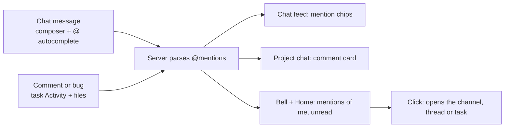

# M3 Collaboration Implementation Plan

> **For agentic workers:** REQUIRED SUB-SKILL: Use superpowers:subagent-driven-development (recommended) or superpowers:executing-plans to implement this plan task-by-task. Steps use checkbox (`- [ ]`) syntax for tracking.

**Goal:** People write in chat with `@` autocomplete, comment and report bugs (with images, video and files) on tasks, each comment also shows as a card in the project's chat, and mentions of me reach the bell and Home.

**Architecture:**
- **Writes:** posting a message, reply or comment goes through new `Api.chat.send/reply`, `Api.comments.*` and `Api.mentions.*` methods. The mock reuses the existing `sendMessage`/`addReply` (now with parsed mentions) and the M1 upload checks.
- **Mention syntax:** one shared module, `src/lib/mentions.ts`, parses and splits mention text. The mock and the pages both use it.
- **Live updates and bell state:** a new `commentAdded` realtime event refreshes Activity and mentions in other tabs. Read state for mentions is stored per user in the document (`mentionReads`, `DB_VERSION` 3).

**Tech Stack:** React 19, TS ~6, Vite 8, Tailwind v4, TanStack Query, React Router, Vitest + fake-indexeddb.

**Spec:** `docs/superpowers/specs/2026-10-26-spark-flow-company-system-design.md`. This plan covers:
- §2: where comments and bugs live;
- §3: the `Comment` and `Mention` types and the mention syntax;
- §4.2: `comments.*`, `chat.send/reply` and `mentions.mine()`;
- §4.3: who may comment and chat;
- §5: the Task inspector Activity, the Chat composer, and mentions on Home;
- §6: the first flow, G → H;
- §7: render text only, with chips built from parsed ids;
- §8: M3;
- §9: mention-parsing tests.

## Flow



## Global Constraints

- Everything in `CLAUDE.md` holds:
  - semantic tokens only; `Sheet` only for modals and `MenuPanel` only for menus;
  - no toasts or spinners; one primary button per view;
  - sentence-case, verb-first copy, `…` while pending;
  - logical direction classes (`src/rtl.test.ts`);
  - light, dark, 390px and RTL must all work.
- Components import from `@/api/*` and `@/lib/*`, never from `@/mocks`.
- §7: message, comment and project text renders as **text**, never HTML. Mention chips are built from parsed ids. File `src`/`href` values go through `safeFileUrl`.
- §4.3 `collab.post`: chat, comments and uploads are open to Admin, Sales and the project's manager, and to Members on projects they're on.
  - A project channel uses its project for this check.
  - Other channels: public ones are open to the workspace. A private channel needs channel membership: "You're not in this channel."
- §3 mention syntax:
  - `@all`;
  - `@[Name](userId)`, which only the autocomplete inserts;
  - `@KEY-n` for a task;
  - `@KEY` for a project.
- Mentions are parsed on the server. Unknown users, tasks and projects stay plain text when rendered.
- Every write is one `db.update` with `requireCan` inside, and publishes its realtime event. Mutations go through the global invalidate-all MutationCache.

## Review Focus

1. **A mention that isn't real.** `@NEX-999`, `@ZZZ`, `@[Ghost](u-nope)`, or an e-mail like `a@b.com`, renders as plain text: no chip, and no notification for anyone.
   - Test: Task 3 `mentions.test.ts › segments leaves unknown and e-mail text as text`.
2. **A mention notifies the right people, once.**
   - You never get a notification for your own message.
   - `@all` notifies the channel's members, or for a comment the project's people. Someone mentioned twice in one message gets one item.
   - Marking an item read survives a reload and is per person.
   - Test: Task 5 `mentions.test.ts › mine…`.
3. **A Member writing in a project they're not on, or in a private channel they're not in.**
   - The 403 sentence shows under the composer, and nothing is stored.
   - Test: Task 2 `chat.test.ts › send refuses…` and Task 4 `comments.test.ts › refuses…`.
4. **A comment with a bad file** (empty, over 25 MB, a disallowed type, or more than 5 files): refused with the M1 sentence, and nothing is stored, neither the comment nor its bytes.
   - Test: Task 4 `comments.test.ts › rejects bad files…`.
5. **Typing `@` in the middle of text, inside a word, or after a deleted mention.**
   - The popup opens only at a word start and closes on space, Esc or blur.
   - Choosing an option replaces just the `@query` and leaves the caret after the inserted mention.
   - Test: Task 3 `mentionQuery.test.ts`.

---

### Task 1: M2 carry-over fixes

These are the six cheap M2 minors, as agreed after the M2 review.

**Files:**
- Modify `src/pages/time/manualEntry.ts`, `src/pages/time/AddTimeSheet.tsx`, `src/lib/useNow.ts`, `src/pages/projects/TimeTab.tsx`, `src/layout/TimerBar.tsx` and `src/pages/settings/SettingsPage.tsx`.
- Test: `src/pages/time/manualEntry.test.ts`.

**Changes:**
- **Move the default times.** `defaultTimes(now: Date): { day: string; start: string; end: string }` moves from `AddTimeSheet.tsx` to `manualEntry.ts` and is exported. It returns the hour before `now`, rounded down to 15 minutes. When that hour would start before midnight, it uses yesterday 22:45 to 23:45 instead.
- **Midnight wording.** In `manualEntryErrors`, an end earlier than the start (by the clock) now reads "An entry can't run past midnight. Add it as two entries." An end equal to the start still reads "The end is before the start."
- **`useNow`** sets `now` to `new Date()` as soon as the interval changes, not only on the first tick.
- **TimeTab** uses `useNow(60_000)` instead of a `useMemo` frozen at mount.
- **TimerBar:**
  - Drop `role="status"` and the ticking `aria-label` from the pill and the bar.
  - The clock span gets `role="timer"`.
  - A visually hidden `<span aria-live="polite">` says "Timer running on {KEY or project}". It changes only when the running entry changes.
  - A failed Stop shows its message in a small line, under the pill or in the bar, instead of only in `title`.
- **SettingsPage:** render the Card only when at least one row is allowed; otherwise show "Nothing to set up here yet."

- [ ] **Step 1: Tests.**
  - `defaultTimes(new Date(2026, 9, 28, 0, 5))` → `{ day: '2026-10-27', start: '22:45', end: '23:45' }`.
  - `defaultTimes(new Date(2026, 9, 28, 14, 7))` → `{ day: '2026-10-28', start: '13:00', end: '14:00' }`.
  - `manualEntryErrors(v({ start: '22:00', end: '01:00' }), now)` → `{ end: "An entry can't run past midnight. Add it as two entries." }`.
  - Change the existing `end before start` case to equal times, `09:00`–`09:00`.
- [ ] **Step 2:** Run `npx vitest run src/pages/time/manualEntry.test.ts`. Expected: FAIL, because `defaultTimes` isn't exported and the copy differs.
- [ ] **Step 3:** Implement the six changes.
- [ ] **Step 4:** Run `npm test && npm run build:prototype && npm run lint`. Expected: PASS. Then browser-check the timer pill's live region and the Settings page as a Member.
- [ ] **Step 5:** Commit `fix: M2 carry-overs — midnight entries, live clocks, timer a11y, Settings`.

---

### Task 2: Chat write API with parsed mentions

**Files:**
- Create `src/lib/mentions.ts`, which holds the mention regex and the `parseMentions` and `parseTicketKeys` helpers moved out of `src/mocks/text.ts`.
- Modify:
  - `src/mocks/text.ts`: it now re-exports from `@/lib/mentions`.
  - `src/mocks/chat.ts`, `src/mocks/index.ts`, `src/api/types.ts`, `src/lib/http.ts`.
  - `src/api/chat.ts`: add `useSendMessage` and `useReply`.
- Tests: `src/mocks/chat.test.ts`, `src/lib/http.test.ts`, and `src/lib/mentions.test.ts`, which moves the existing `text.test.ts` cases.

**Interfaces — Produces:**
```ts
Api.chat.send(channelId: string, content: string): Promise<ChatMessage>
Api.chat.reply(messageId: string, content: string): Promise<ThreadReply>
// src/lib/mentions.ts
export const MENTION: RegExp                      // the §3 syntax (global)
export function parseMentions(content: string): Mention[]
export function parseTicketKeys(content: string): string[]
```
- Mock rules:
  - The text is trimmed. Empty → "Write a message first."; over 4000 characters → "Keep the message under 4000 characters."
  - Permission: a project channel (`projects.find(p => p.channelId === channel.id)`) uses `requireCan(data, 'collab.post', project)`.
  - A private channel requires `channel.memberIds.includes(me.id)`, else 403 "You're not in this channel."
  - `sendMessage` and `addReply` set `mentions: parseMentions(content)`. Today they set `[]`.
- HTTP: `POST /api/channels/:id/messages` with body `{ content }`, and `POST /api/messages/:id/replies` with body `{ content }`.

- [ ] **Step 1: Tests in `chat.test.ts`.**
  - `send stores trimmed text with its mentions`: as Admin, `send('c-general', '  Hi @[Nour](u-2) about @NEX-101 and @all ')` gives content `'Hi @[Nour](u-2) about @NEX-101 and @all'`. Its mentions are `[{user,u-2},{task,NEX-101},{all,all}]`, and `linkedTicketKeys` is `['NEX-101']`.
  - `send refuses empty text, long text, a project the member isn't on, and a private channel`:
    - `'  '` → 400 "Write a message first."
    - As u-8 (Tarek, not on NEX), `send('c-p-nex', 'x')` → 403 "You don't have access to this project."
    - `c-dm-1`, a private DM between u-1 and u-2 → 403 "You're not in this channel."
  - `reply stores mentions and bumps the thread`: `reply(<a c-general message id>, 'ok @[Mariam](u-3)')` → `mentions [{user,u-3}]`, and the parent's `threadCount` goes up by 1.
  - In `http.test.ts`: the two routes and bodies.
- [ ] **Step 2:** Run `npx vitest run src/mocks/chat.test.ts src/lib/http.test.ts src/lib/mentions.test.ts`. Expected: FAIL.
- [ ] **Step 3:** Implement the module move, the API, the routes and the hooks.
- [ ] **Step 4:** Run `npm test`. Expected: PASS.
- [ ] **Step 5:** Commit `feat: chat send and reply with parsed mentions`.

---

### Task 3: Composer, mention autocomplete and chips

**Files:**
- Create `src/lib/mentionQuery.ts` (+ `src/lib/mentionQuery.test.ts`), `src/components/MentionText.tsx` and `src/pages/chat/Composer.tsx`.
- Add `segments` to `src/lib/mentions.ts`, tested in `mentions.test.ts`.
- Modify:
  - `src/pages/chat/MessageRow.tsx`: its content renders through `MentionText`.
  - `src/pages/chat/ChannelPage.tsx` and `src/pages/projects/ChatTab.tsx`: the composer goes under the feed.
  - `src/pages/chat/ThreadInspector.tsx`: a reply composer.

**Interfaces — Produces:**
```ts
// mentions.ts
export type Segment = { kind: 'text'; text: string } | { kind: 'user'; userId: string; name: string } | { kind: 'task'; key: string } | { kind: 'project'; key: string } | { kind: 'all' }
export function segments(content: string, known: { userIds: Set<string>; taskKeys: Set<string>; projectKeys: Set<string>; nameOf: (id: string) => string }): Segment[]
// mentionQuery.ts
export type MentionOption = { kind: 'all' } | { kind: 'user'; id: string; name: string; title: string } | { kind: 'project'; key: string; name: string } | { kind: 'task'; key: string; title: string }
export function activeMention(text: string, caret: number): { start: number; query: string } | null
export function mentionOptions(query: string, from: { users: User[]; projects: { key: string; name: string }[]; tasks: { key: string; title: string }[] }): MentionOption[]  // max 8
export function insertMention(text: string, at: { start: number; caret: number }, option: MentionOption): { text: string; caret: number }
// Composer.tsx
export function Composer(props: { placeholder: string; submitLabel: string; pendingLabel: string; onSubmit: (text: string) => Promise<unknown>; error?: Error | null; extra?: ReactNode }): JSX.Element
```
**Rules:**
- `activeMention`:
  - Looks back from the caret to the nearest `@`.
  - That `@` must be at the start of the text or after whitespace or `(`.
  - Between it and the caret: no whitespace, and at most 30 characters.
- `mentionOptions`:
  - Filtering: a case-insensitive prefix match on any word of a name or title, and on keys. With an empty query, the first 8.
  - Order: `@all` first when `'all'` starts with the query; then people, projects, tasks.
- `insertMention` replaces `text.slice(start, caret)` with:
  - `@[Name](id) ` for a person;
  - `@KEY ` for a project or `@KEY-n ` for a task;
  - `@all ` for everyone.
  - The caret lands after the trailing space.
- **Chips:**
  - **Person:** `bg-accent-soft text-accent rounded px-1 font-medium`, showing "@Nour El-Sayed".
  - **Task:** a link to `?ticket=KEY`.
  - **Project:** a link to `paths.project(ws, KEY)`.
  - **`@all`:** a plain chip.
  - Unknown ids and keys stay as their literal text.
- **Composer:**
  - An auto-growing textarea, up to 8 lines.
  - Enter sends, and Shift+Enter makes a new line.
  - The popup:
    - It is a `role="listbox"` under the caret line, opening upward on phones, with arrow keys, Enter/Tab to choose and Esc to close.
    - It isn't a `MenuPanel`: it's a combobox list, not a menu (ruling).
  - The submit button is primary. "Sending…" shows while pending.
  - The error sentence shows under the composer, and the text clears only on success.
- **ChannelPage, ChatTab and ThreadInspector:**
  - The composer is hidden for people who can't post.
  - In its place, a line: "You can read this channel. Only its project's people can write here."

- [ ] **Step 1: Tests.**
  - `mentionQuery.test.ts`:
    - `activeMention('hi @no', 6)` → `{start:3, query:'no'}`;
    - `activeMention('a@b', 3)` → null;
    - `activeMention('hi @no x', 8)` → null;
    - `activeMention('(@NE', 4)` → `{start:1, query:'NE'}`.
    - `mentionOptions('a', …)` puts `{kind:'all'}` first, then Ahmed (people before projects).
    - `mentionOptions('nex', …)` gives the project NEX before the tasks NEX-1xx.
    - It returns at most 8.
    - `insertMention('hi @no', {start:3,caret:6}, {kind:'user',id:'u-2',name:'Nour El-Sayed',…})` → `{ text: 'hi @[Nour El-Sayed](u-2) ', caret: 25 }`.
  - `mentions.test.ts › segments leaves unknown and e-mail text as text`: with known `u-2`, `NEX-101` and `NEX`, the text `'Hey @[Nour](u-2), see @NEX-101 in @NEX; @NEX-999 @ZZZ @[Ghost](u-x) a@b.com @all'` gives:
    - user u-2 ("Nour El-Sayed" from `nameOf`), task NEX-101 and project NEX as chips;
    - `@NEX-999 @ZZZ @[Ghost](u-x) a@b.com` as text, with `@[Ghost](u-x)` shown as `@Ghost`;
    - `{kind:'all'}` as a chip.
- [ ] **Step 2:** Run `npx vitest run src/lib/mentionQuery.test.ts src/lib/mentions.test.ts`. Expected: FAIL.
- [ ] **Step 3:** Implement the helpers, `MentionText`, `Composer` and the three places it goes.
- [ ] **Step 4:** Run `npm test && npm run build:prototype && npm run lint`. Expected: PASS.
- [ ] **Step 5:** Commit `feat: chat composer with mention autocomplete and chips`.

---

### Task 4: Comments and bugs: API, task Activity, chat cards

**Files:**
- Create `src/mocks/comments.ts` (+ `src/mocks/comments.test.ts`), `src/api/comments.ts`, `src/pages/projects/TaskActivity.tsx` and `src/components/AttachmentView.tsx`.
- Modify:
  - `src/api/types.ts`: `ChatMessage` gains `commentId?: string`.
  - `src/mocks/files.ts`: extract `checkUpload(file): void`, which throws the M1 sentences.
  - `src/mocks/index.ts`, `src/lib/http.ts`, `src/lib/realtime.ts`, `src/mocks/realtime.ts` and `src/api/queryKeys.ts`.
  - `src/pages/projects/TicketInspector.tsx`: Details | Activity tabs.
  - `src/pages/chat/MessageRow.tsx`: the card for `commentId`.

**Interfaces — Produces:**
```ts
export type CommentView = Comment & { attachments: Attachment[] }
Api.comments = {
  list(taskKey: string): Promise<CommentView[]>                                                      // oldest first
  create(input: { taskKey: string; kind: CommentKind; body: string; files: UploadFile[] }): Promise<CommentView>
}
// realtime: { type: 'commentAdded'; taskKey: string; projectId: string }
// qk.comments = (taskKey) => ['comments', taskKey]; keysForEvent('commentAdded') → [qk.comments(taskKey), qk.mentions()]
```
**Mock rules for `create`:**
- **Checks first:**
  - `requireCan(data, 'collab.post', project)`.
  - The body is trimmed: empty → "Write a comment first."; over 4000 → "Keep the comment under 4000 characters."
  - Up to 5 files: "Add up to 5 files at a time."
  - Each file passes `checkUpload`, with the M1 sentences for empty, too large and disallowed types.
- **Store:**
  - The bytes are written first, then the attachments, the comment and the chat card, all in one `db.update`.
  - The card goes in the project channel, as `sendMessage` would build it:
    - content `"{Bug|Comment} on {KEY}: {body}"`;
    - the attachments;
    - `commentId`;
    - `mentions` parsed from the body;
    - `linkedTicketKeys: [KEY]`.
- **Events:** publish `messageReceived` for the card, then `commentAdded`.
- **HTTP:** `GET /api/tasks/:key/comments` and `POST /api/tasks/:key/comments` (multipart: `kind`, `body` and `files`). The API is keyed by task key, like `tasks.update`.
- **Activity tab** (`TaskActivity`) in the inspector:
  - Underline tabs: Details | Activity, with the count pill on Activity.
  - Entries, oldest first: avatar, name · `timeAgo`, a red "Bug" badge for bugs, the body through `MentionText`, and the attachments.
- **`AttachmentView`:**
  - Images show as `` thumbnails; a click opens `FileViewer`.
  - `video/*` shows `<video controls>` with `preload="metadata"`.
  - Other files show as a file row that opens `FileViewer`.
  - Each `blob:` URL is created on mount with `openFile` and revoked on unmount. Every `src` goes through `safeFileUrl`.
- **The composer:**
  - The Task 3 `Composer`, with `extra` holding:
    - a bordered two-way switch, Comment | Bug;
    - a file picker and drop zone copied from `design/reference-code/src/components/ui/FileDrop.tsx`, with its imports adapted, `multiple`, and up to 5 files.
  - Submit says "Post comment" or "Report bug" ("Posting…" while pending).
- **The chat card** (`MessageRow`, when `message.commentId` is set):
  - A bordered card: the task key chip (opens `?ticket=KEY`), a "Bug" or "Comment" badge, the body through `MentionText`, and the attachments through `AttachmentView`.

- [ ] **Step 1: Tests in `comments.test.ts`.**
  - `create stores the comment, its files and a card in the project chat`:
    - As u-5, post a bug on `NEX-105` with body `'Still broken for @[Mariam](u-3)'` and one PNG `Blob`.
    - `list('NEX-105')` ends with it, with one attachment whose bytes are stored.
    - `c-p-nex` messages include one with that `commentId`, content starting `'Bug on NEX-105: '`, mentions `[{user,u-3}]` and the attachment.
  - `refuses a member who isn't on the project, an empty body`: u-8 on `NEX-101` → 403; a body of `'  '` → "Write a comment first."
  - `rejects bad files and stores nothing`:
    - A 0-byte file → "That file is empty."
    - A `.exe` → "That type of file can't be added."
    - 6 files → "Add up to 5 files at a time."
    - After each, the comment count, attachments and `db.getFile` are unchanged.
  - `publishes messageReceived then commentAdded`.
  - In `http.test.ts`: the routes, with the POST body a `FormData`.
- [ ] **Step 2:** Run `npx vitest run src/mocks/comments.test.ts src/lib/http.test.ts`. Expected: FAIL.
- [ ] **Step 3:** Implement the API, Activity, `AttachmentView` and the card.
- [ ] **Step 4:** Run `npm test && npm run build:prototype && npm run lint`. Expected: PASS.
- [ ] **Step 5:** Commit `feat: task comments and bugs with files, and their chat cards`.

---

### Task 5: Mentions in the bell and on Home

**Files:**
- Create `src/mocks/mentions.ts` (+ `src/mocks/mentions.test.ts`) and `src/api/mentions.ts`.
- Modify:
  - `src/mocks/db.ts`: `DB_VERSION` becomes 3; `DbData.mentionReads: Record<string, string[]>`; `hasShape` checks it is a record.
  - `src/mocks/seed.ts`: seed `mentionReads`.
  - `src/mocks/index.ts`, `src/lib/http.ts`, `src/api/types.ts`, `src/api/queryKeys.ts`.
  - `src/layout/NotificationsMenu.tsx`: it uses the mentions API; remove the `notificationsApi` stub (delete `src/api/notifications.ts`).
  - `src/pages/home/HomePage.tsx`: a Mentions card.

**Interfaces — Produces:**
```ts
export type MentionItem = {
  id: string; source: 'message' | 'reply' | 'comment'; authorId: string; excerpt: string; createdAt: string; read: boolean
  channelId: string | null; messageId: string | null; taskKey: string | null; projectId: string | null
}
Api.mentions = { mine(): Promise<MentionItem[]>; markRead(ids: string[]): Promise<void> }   // newest first, max 50
qk.mentions = () => ['mentions', 'me']; keysForEvent message/reply also adds qk.mentions()
useMyMentions(), useMarkMentionsRead()
```
**Rules:**
- **Which items are mine:** every message, reply and comment in my workspace, not written by me, that mentions me:
  - by `{user, me}`;
  - or by `@all`, when I'm a member of the channel, or, for a comment, one of the project's people (manager, members, team members).
  - Comments whose card is a chat message count once, as a `comment`; skip the card message.
- **Excerpt:** the text with each `@[Name](id)` shown as `@Name`, cut to 120 characters with `…`.
- **Read state:** `read` is whether the id is in `mentionReads[me]`. `markRead(ids)` adds the ids, keeping each only once.
- **Seed:** every mention item older than 24 hours is marked read for every user, so the bell starts with only the latest few.
- **Links:**
  - a message → `/w/:ws/c/:channelId`;
  - a reply → `/w/:ws/c/:channelId?thread=:messageId`;
  - a comment → `/w/:ws/p/:projectKey/tasks?ticket=:taskKey`.
  - The workspace slug comes from `useCurrentWorkspace`.
- **HTTP:** `GET /api/mentions` and `POST /api/mentions/read` with body `{ ids }`.
- **Bell:**
  - The `NotificationsMenu` list is the mention items:
    - `kind: 'mention'`, with the `AtSign` icon and the `bg-accent-soft text-accent` tone;
    - title "{Author} mentioned you";
    - text = the excerpt.
  - The unread count, the "Unread" filter and "Mark all read" keep working, and choosing an item marks it read and opens its link.
  - Polling stays at its current interval, and realtime events refresh it.
- **Home:** a "Mentions" Card under "Due today and overdue", in the right column.
  - It shows the latest 5, with the author avatar, "{Author} · {timeAgo}" and the excerpt.
  - Clicking one opens it and marks it read.
  - Empty state: "No mentions yet."
- **Migration:** a stored `DB_VERSION` 2 document reads as outdated, so the app loads the new seed. This is the existing M0 path; check that it still works.

- [ ] **Step 1: Tests in `mentions.test.ts`.**
  - `mine lists mentions of me, newest first, without my own`:
    - As Admin, `chat.send('c-general', 'Ping @[Nour](u-2)')`, then `viewAs('u-2')`.
    - `mine()[0]` is `{ source: 'message', authorId: 'u-1', excerpt: 'Ping @Nour', read: false, channelId: 'c-general' }`.
    - As u-1, `mine()` doesn't include that message.
  - `@all notifies channel members; a comment notifies the project's people`:
    - `send('c-backend', 'Deploy at 5 @all')` as Admin.
    - u-2 (a member) gets it; u-8 (not in c-backend) doesn't.
    - A comment `'@all please test'` on `MOB-104` reaches u-5 (on MOB) and not u-3 (not on MOB). It reaches them once, as a `comment`, not as the card message as well.
  - `one item per message even when mentioned twice`.
  - `markRead persists per person`: Admin sends `'Standup moved @all'` in `c-backend`. As u-2, `markRead([id])` makes it `read: true`. As u-6, also in `c-backend`, the same item is still `read: false`.
  - `seed starts with old mentions read`: every `mine()` item older than 24 h is `read: true`.
  - `db.test.ts`: an import missing `mentionReads` is refused (400), as the other shape checks are.
  - `http.test.ts`: the two routes.
- [ ] **Step 2:** Run `npx vitest run src/mocks/mentions.test.ts src/mocks/db.test.ts src/lib/http.test.ts`. Expected: FAIL.
- [ ] **Step 3:** Implement the mock, the version bump, the seed, the hooks, the bell and the Home card.
- [ ] **Step 4:** Run `npm test && npm run build:prototype && npm run lint`. Expected: PASS.
- [ ] **Step 5:** Commit `feat: mentions in the bell and on Home`.

---

### Task 6: Verify M3 and docs

- [ ] **Step 1:** Gates: `npm test && npm run build:prototype && npm run lint`.
- [ ] **Step 2: Browser checks.** Reload the seed first, and record everything in `tasks/todo.md`.
  1. **Admin in `#general`:**
     - Type `@no` and choose Nour, then `@NEX-1` and choose NEX-101, then send.
     - The chips render. The task chip opens the inspector; the project chip opens the project.
     - Shift+Enter makes a new line.
  2. **Nour:**
     - The bell shows "Youssef mentioned you" as unread. Clicking it opens `#general`, and it becomes read.
     - Home's Mentions card shows it.
     - Reply in the thread with `@all`. Mariam, a `#general` member, gets it.
  3. **Salma (Member, QA) on NEX-105, the task inspector's Activity tab:**
     - Report a bug with a PNG, a short MP4 and a PDF, and the text `@[Mariam]` chosen from the popup.
     - The Activity entry shows the image thumbnail, the video player and the file row.
     - `#nexus-core` shows the Bug card. Mariam's bell has it.
     - A 0-byte file shows the sentence, and nothing posts.
  4. **Tarek (Member, not on NEX) in `#nexus-core`:** no composer, and the read-only line instead. A typed `?ticket=NEX-101` shows Activity, but its composer is replaced by the same line.
  5. **Two tabs:** a message sent in tab A appears in tab B, and tab B's bell count rises without a reload.
  6. **Plain text and layout:**
     - A message containing `<b>hi</b>` shows the literal text.
     - Light, dark, 390px and RTL on the Chat composer and popup, Activity and the bell, with no sideways scroll and no console errors.
- [ ] **Step 3: Docs and commit.**
  - `CLAUDE.md` gets a line: mention syntax and parsing live in `src/lib/mentions.ts`; chips are built from parsed ids only; comments post a card in the project chat.
  - `tasks/todo.md` gets the M3 section.
  - Commit `docs: M3 verification`.
- [ ] **Step 4:** One whole-branch review of M3, on opus. Then one fix pass, and the final report with rulings and deferred minors.
