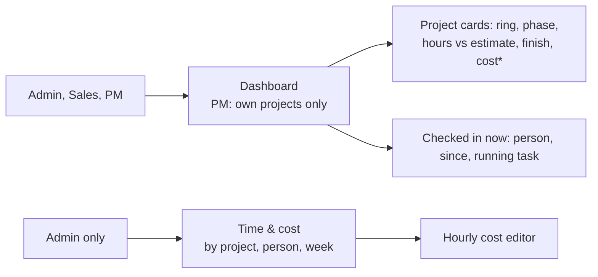

# M4 Manager and Polish Implementation Plan

> **For agentic workers:** REQUIRED SUB-SKILL: Use superpowers:subagent-driven-development (recommended) or superpowers:executing-plans to implement this plan task-by-task. Steps use checkbox (`- [ ]`) syntax for tracking.

**Goal:**
- A manager dashboard: per project, its phase, progress, hours against the estimate, the expected finish, cost (Admin only) and who worked in the last 7 days; plus a "Checked in now" list.
- An Admin Time & cost page: hours and cost by project, by person and by week, with a link to the rates editor.
- A seed for the demo story, the polish fixes that matter on Thursday, and a full end-to-end pass.

**Architecture:**
- Two new read APIs in the mock behind the `Api` contract and the `lib/http.ts` mapping: `dashboard.*`, and `time.report`. The figures come from `derive.ts`/`hours.ts` and never come from the page.
- Both pages reuse the kit's chart components already in `src/components/charts/*` (`ProgressRing`, `BarList`, `ColumnChart`, `ChartCard`).
- Permissions go through `can()`:
  - `dashboard.view`: Admin and Sales see every project; a PM sees the projects they manage.
  - `timeCost.view`: Admin only.

**Tech Stack:** React 19, TS ~6, Vite 8, Tailwind v4, TanStack Query, React Router, Vitest.

**Spec:** `docs/superpowers/specs/2026-10-26-spark-flow-company-system-design.md`. This plan covers:
- §1: check-in is shown to the person and to managers of their projects;
- §3: derived values;
- §4.2: `dashboard.projects()`;
- §4.3: Dashboard and Time & cost rows;
- §5: the Dashboard, Time & cost and Teams screens, and the sidebar groups;
- §6: the demo personas and story;
- §8: M4 and its cut line;
- §9: the end-to-end pass.

## Flow



\* Cost is shown to Admins only.

## Global Constraints

- Everything in `CLAUDE.md` holds:
  - semantic tokens only; `Sheet` only for modals and `MenuPanel` only for menus;
  - no toasts or spinners;
  - one primary button per view;
  - sentence-case copy, `—` for empty, ` · ` separators;
  - logical direction classes;
  - light, dark, 390px and RTL must all work.
- **Charts:** red for the key series plus greys, at most 4 series, and the takeaway in the title (CLAUDE.md "Charts"). No chart library: use `src/components/charts/*`.
- **Money:** `formatMoney`/`formatCompact` ("EGP 1.2M"). Hours: `formatHours`. Use `tabular-nums` everywhere.
- **Cost and rates** never reach a non-admin, in any response (spec §4.3).
- **Periods:**
  - "Last 7 days" (rolling) for "who worked this week". A rolling window avoids choosing a week start.
  - The Time & cost periods are 7 days, 30 days and 90 days, rolling, ending now.
  - Report weeks start on **Sunday**, local time, because Spark Systems works Sunday to Thursday.
- **Check-in visibility (§1):**
  - The person sees their own (Home).
  - "Checked in now" shows Admin everyone, and a PM the people on projects they manage.
  - Sales doesn't get the list.

## Review Focus

1. **A PM opens `/dashboard`.** They see only the projects they manage, and "Checked in now" lists only people on those projects.
   - A Member typing the URL sees "You don't have access to the dashboard." and the API returns 403.
   - Test: Task 1 `dashboard.test.ts › scope per role`.
2. **Cost leaking.** As Sales or PM, no dashboard or report payload has a non-null `cost` or any rate.
   - Test: Task 1 `dashboard.test.ts › no cost for non-admins` and Task 3 `report.test.ts › admin only`.
3. **A running timer at report time.** It counts up to now, capped at 12 h as in M2, in every total.
   - The project, person and week totals all agree with each other and with the project's `loggedHours`.
   - Test: Task 3 `report.test.ts › totals agree`.
4. **An entry that crosses a period or week edge.** It counts only the part inside the period or week; hours aren't counted twice.
   - Test: Task 3 `report.test.ts › clips at the edges`.
5. **An empty period or a new project.**
   - With no time logged: "No time logged in this period.", and the chart isn't drawn with zero-height bars.
   - A project with no tasks shows a ring at 0% and an estimate of "—".
   - Test: Task 3 `report.test.ts › empty`, plus a browser check.

---

### Task 1: Dashboard API

**Files:**
- Create `src/mocks/dashboard.ts` (+ `src/mocks/dashboard.test.ts`) and `src/api/dashboard.ts`.
- Modify `src/api/types.ts`, `src/mocks/index.ts`, `src/lib/http.ts`, `src/lib/api.ts`, `src/api/queryKeys.ts`, and `src/mocks/shared.ts` (the 403 wording).
- Tests: `src/lib/http.test.ts`.

**Interfaces — Produces:**
```ts
export type DashboardProject = ProjectSummary & {
  phaseName: string | null                        // current phase, or null when every phase is done / none
  estimateHours: number | null                    // Σ task estimates; null when no task has one
  week: { userId: string; hours: number }[]       // last 7 days, most hours first
}
export type CheckedInNow = { userId: string; since: string; running: { taskId: string | null; projectId: string; startedAt: string } | null }
Api.dashboard = {
  projects(workspaceId: string): Promise<DashboardProject[]>   // Admin/Sales: all; PM: managed; else 403
  checkedIn(workspaceId: string): Promise<CheckedInNow[]>      // Admin: all; PM: people on managed projects; Sales: []; Member: 403
}
qk.dashboard = (ws) => ['dashboard', ws]; qk.checkedIn = (ws) => ['dashboard', 'checked-in', ws]
// keysForEvent('timeLogged') also returns ['dashboard']
```
- **Rules:**
  - Projects keep `summarize()`'s values, so `cost` is null unless the viewer may see cost.
  - `week` comes from `entryHours` over entries clipped to `[now − 7d, now]`, rounded to one decimal; people with 0 hours are left out.
  - `checkedIn` lists today's check-ins (`localDay`) with `checkedOutAt === null`, each with the person's running entry if there is one, latest check-in first.
  - The 403 copy is "You don't have access to the dashboard."
- **HTTP:** `GET /api/workspaces/:id/dashboard` and `GET /api/workspaces/:id/dashboard/checked-in`.

- [ ] **Step 1: Tests in `dashboard.test.ts`.** Use a fixed clock and the seed.
  - `scope per role`:
    - Admin and Sales (u-9) see all 4 Engineering projects.
    - Ahmed (u-4) sees exactly MOB and SEL; Nour (u-2) sees NEX and ELM.
    - Salma (u-5, a Member) → 403 "You don't have access to the dashboard." for both calls.
  - `no cost for non-admins`: every Sales and PM item has `cost === null`; for Admin, NEX's `cost > 0`.
  - `phase, estimate and week`:
    - NEX's `phaseName === 'Build'`, and ELM's is null (delivered).
    - NEX's `estimateHours` equals the sum of its tasks' estimates.
    - A manual entry of 2 h for u-3 yesterday on NEX puts u-3 in NEX's `week` with hours ≥ 2; an entry 10 days ago doesn't count.
  - `checked in now`:
    - After `viewAs('u-8')` + `checkIn({plan:'x', target:{taskId:'t-mob-104'}})`, Admin's `checkedIn` includes u-8 with `running.taskId === 't-mob-104'`.
    - Ahmed (who manages MOB) sees u-8; Nour (NEX and ELM) doesn't see u-8; Sales gets `[]`.
    - Once u-8 checks out, u-8 is gone.
  - In `http.test.ts`: the two routes.
- [ ] **Step 2:** Run `npx vitest run src/mocks/dashboard.test.ts src/lib/http.test.ts`. Expected: FAIL.
- [ ] **Step 3:** Implement the API, the routes, the keys and the hooks (`useDashboard(ws)`, `useCheckedIn(ws)`).
- [ ] **Step 4:** Run `npm test`. Expected: PASS.
- [ ] **Step 5:** Commit `feat: dashboard API with per-role scope`.

---

### Task 2: Dashboard page and the MANAGE group

**Files:**
- Create `src/pages/dashboard/DashboardPage.tsx` and `src/pages/dashboard/dashboardCard.ts` (+ `src/pages/dashboard/dashboardCard.test.ts`).
- Modify `src/router.tsx`, `src/lib/paths.ts` (`paths.dashboard`), `src/layout/Sidebar.tsx` (a MANAGE group with Dashboard; Time & cost arrives in Task 3), `src/layout/MobileNav.tsx` (drawer only) and `src/lib/paths.test.ts`.

**Interfaces — Produces:**
```ts
export type CardFacts = { ring: number; hoursLine: string; finishLine: string; late: boolean; over: boolean }
export function cardFacts(p: DashboardProject, now: Date): CardFacts
// ring = round(progress*100); hoursLine = "115h of 120h" | "115h · no estimate"; over = estimate != null && loggedHours > estimate
// finishLine = "Expected 20 Nov 2026" (+ " · due 25 Oct" when late); late = !delivered && isPastDue(dueDate) || expectedFinish > dueDate
```
- **Page:**
  - The `PageHeader` reads "Dashboard", with the subtitle "Every project in {ws}." for Admin and Sales, and "The projects you manage." for a PM.
  - Below it, the kit's 4 KPI tiles:
    - Active projects;
    - Overdue tasks: the sum of `overdueCount`;
    - Hours in the last 7 days: the sum of `week`;
    - Cost to date: the sum of `cost`, Admin only. For others, "Checked in now" (a count) takes this tile.
  - A grid of project cards follows, `lg:grid-cols-2`, with "Checked in now" in a narrow column on `xl`.
- **Project card:**
  - Logo initials, the name and key, and the phase (`phaseName ?? 'Delivered' | '—'`).
  - A `ProgressRing` labelled "{n}% done".
  - `hoursLine`, red when `over`.
  - `finishLine`, red when `late`.
  - Cost (Admin only).
  - "Last 7 days": up to 4 avatars with hours, and "+n" for the rest.
  - A click opens `paths.project(ws, key)`.
- **Checked in now:**
  - Rows: an avatar, the name, "since 8:30 AM", and the running task (key · title) or "No timer running".
  - Empty state: "No one is checked in right now."
- **Access:**
  - `useAccess('dashboard.view')` drives the page: a skeleton while loading, and when denied the sentence "You don't have access to the dashboard." with a link Home.
  - The sidebar item uses the same `permission: 'dashboard.view'`.

- [ ] **Step 1: Tests.**
  - `dashboardCard.test.ts`:
    - ring 0 for a project with no tasks;
    - `hoursLine` "115h of 120h", "8h · no estimate" and "0h · no estimate";
    - `over` true when logged > estimate;
    - `late` true when expected finish > due, or past due and not delivered;
    - `finishLine` for a late project, "Expected 28 Oct 2026 · due 25 Oct".
  - `paths.test`: `paths.dashboard('engineering') === '/w/engineering/dashboard'`, and `validSavedPlace` accepts it.
- [ ] **Step 2:** Run `npx vitest run src/pages/dashboard/dashboardCard.test.ts src/lib/paths.test.ts`. Expected: FAIL.
- [ ] **Step 3:** Implement the page, the route, the MANAGE group and the drawer entry.
- [ ] **Step 4:** Run `npm test && npm run build:prototype && npm run lint`. Expected: PASS.
- [ ] **Step 5:** Commit `feat: manager dashboard`.

---

### Task 3: Time & cost report

**Files:**
- Create `src/mocks/report.ts` (+ `src/mocks/report.test.ts`) and `src/pages/time/TimeCostPage.tsx`.
- Modify:
  - `src/api/types.ts` and `src/api/time.ts`: `useTimeReport`.
  - `src/mocks/time.ts`: the `report` method.
  - `src/lib/http.ts`, `src/lib/paths.ts` (`paths.timeCost`), `src/router.tsx` and `src/layout/Sidebar.tsx` (MANAGE: Time & cost, with `permission: 'timeCost.view'`).
  - `src/lib/dates.ts`: `weekStart(date): Date`, a Sunday at 00:00 local, tested in `dates.test.ts`.

**Interfaces — Produces:**
```ts
export type ReportPeriod = 7 | 30 | 90
export type ReportRow = { hours: number; cost: number }
export type TimeReport = {
  from: string; to: string
  totals: ReportRow & { people: number }
  byProject: (ReportRow & { projectId: string })[]       // most hours first
  byPerson: (ReportRow & { userId: string; rate: number })[]
  byWeek: (ReportRow & { weekStart: string })[]           // oldest first, every week in range (zero weeks included)
}
Api.time.report(workspaceId: string, days: ReportPeriod): Promise<TimeReport>   // timeCost.view, else 403 "You don't have access to time and cost."
// pure, in report.ts: buildReport(entries, rates, projectIdsInWorkspace, from: Date, to: Date): TimeReport
```
- **Rules:**
  - Each entry is clipped to `[from, to]`, and a running entry counts up to `min(now, start + 12 h)` (use `entryEnd`).
  - An entry that spans a week boundary is split between the weeks.
  - Cost per entry is hours × the person's rate, and a missing rate counts 0.
  - Hours and cost are rounded only for display; the data keeps full precision, so the three groupings sum exactly to the totals.
- **HTTP:** `GET /api/workspaces/:id/time-report?days=30`.
- **Page** (`/w/:ws/time`, after `12-payments`):
  - The header reads "Time & cost", with the subtitle "Hours logged and what they cost, by project, person and week."
  - The period control (pill on a track) offers 7 days, 30 days and 90 days, default 30, kept in `?days=`.
  - 4 tiles: Hours · Cost · Average cost per hour · People who logged time.
  - Underline tabs, kept in `?by=`: By project | By person | By week.
  - **By project:** a `DataTable` with Project (name and key), Hours, Cost and Share (`BarList`-style bar).
  - **By person:** Person, Rate, Hours and Cost, with an "Edit hourly costs" secondary button linking to `paths.rates`.
  - **By week:** a `ColumnChart` of hours per week, one red series, titled "{peak week} had the most hours", plus the table.
  - Empty state: "No time logged in this period."
  - Gated by `useAccess('timeCost.view')`, with the same denial pattern as the Rates page.

- [ ] **Step 1: Tests.**
  - `report.test.ts`, on a pure `buildReport` with hand-made entries:
    - `totals agree`: the sums of `byProject`, `byPerson` and `byWeek` hours each equal `totals.hours` (`toBeCloseTo`), and the same for cost.
    - `clips at the edges`: an entry from `from − 1 h` to `from + 1 h` counts 1 h. An entry from Saturday 23:00 to Sunday 01:00 puts 1 h in each week.
    - `running entries count to now, at most 12 h`.
    - `empty`: no entries gives totals of 0, `byProject` `[]`, and `byWeek` with every week at 0.
    - `admin only`, via the mock API: Sales and PM → 403 "You don't have access to time and cost."; Admin → `totals.cost > 0`.
  - `dates.test.ts`: `weekStart(new Date(2026, 9, 28, 15))` (a Wednesday) → `new Date(2026, 9, 25)` (Sunday), and a Sunday maps to itself.
  - In `http.test.ts`: the route.
- [ ] **Step 2:** Run `npx vitest run src/mocks/report.test.ts src/lib/dates.test.ts src/lib/http.test.ts`. Expected: FAIL.
- [ ] **Step 3:** Implement `buildReport`, the API, the page, the route and the sidebar item.
- [ ] **Step 4:** Run `npm test && npm run build:prototype && npm run lint`. Expected: PASS.
- [ ] **Step 5:** Commit `feat: time and cost report`.

---

### Task 4: Teams page and the demo story seed

**Files:**
- Create `src/pages/teams/TeamsPage.tsx`.
- Modify `src/router.tsx`, `src/lib/paths.ts` (`paths.teams`), `src/layout/Sidebar.tsx` (WORK: Teams, after My tasks), `src/mocks/seed.ts` and `src/mocks/seed.test.ts`.

**What it does:**
- **Teams page** (`/w/:ws/teams`, after `09-clients-list`), read-only:
  - One card per team: the name, the member count, and the members' avatars, names and titles.
  - Below that, the projects the team is on, as links.
  - Editing teams is past the spec's cut line (§8), so the subtitle says "Teams and who is in them."
- **Seed: the demo story for "now":**
  - Today, Nour (u-2), Mariam (u-3) and Hossam (u-6) are checked in from `now − 3 h`. Each has a running timer on one of their seeded tasks (NEX-101, NEX-106 and NEX-107), started at `now − 1 h`.
  - This keeps Admin, Tarek (u-8), Salma (u-5) and Ahmed (u-4) free to check in live during the demo.
  - The existing tests that check in as u-1 or u-8 keep working.

- [ ] **Step 1: Tests in `seed.test.ts`.**
  - `seed has three people checked in now, each with one running timer`: for u-2, u-3 and u-6, a check-in for `localDay(now)` with `checkedOutAt === null`, and exactly one entry with `endedAt === null`.
  - Nobody else has a running entry.
  - u-1, u-4, u-5 and u-8 have no check-in today.
- [ ] **Step 2:** Run `npx vitest run src/mocks/seed.test.ts`. Expected: FAIL.
- [ ] **Step 3:** Implement the seed change, the Teams page, the route and the sidebar item.
- [ ] **Step 4:** Run `npm test && npm run build:prototype && npm run lint`. Expected: PASS. If an M2 or M3 test assumed no one was checked in, fix that test's setup with a ruling.
- [ ] **Step 5:** Commit `feat: teams page and a live demo seed`.

---

### Task 5: Polish for Thursday

These are the deferred minors a demo is most likely to hit, from the M1 to M3 reviews. Each fix is small; the pure ones get a test first.

**Changes:**
1. **Back after creating a project** (M1). `ProjectsPage` clears `?new` with `replace` before it navigates to the new project.
2. **An old saved view** (M1). `TasksTab` uses `isView(lastView) ? lastView : 'board'`.
   - Test: `uiStore.test` or a pure `viewOf(asked, saved)` in `TasksTab`'s module; prefer the pure function.
3. **An unknown `?sprint=`** (M1) is ignored, just as an unknown `?phase=` is. Test it in `taskFilters.test` via the same helper.
4. **Escape on the `@` list** (M3). The list stays shut for the same `@word`. `dismissedAt` resets only when `mention.start` changes, not on every change.
5. **A send error after switching channels** (M3). `send.reset()` runs when `channelId` changes, in ChannelPage and ChatTab.
6. **Read-only wording** (M3). `readOnlyFor(channel, project)` returns:
   - a project channel → "You can read this channel. Only its project's people can write here.";
   - a private channel → "You can read this channel. Only its members can write here."
   - Test it (pure).
7. **A screenshot-only bug** (M3). A comment can have files and no text.
   - Server: the body is required only when there are no files ("Write a comment first.").
   - The card content becomes "Bug on NEX-105" with no colon when there's no body, and the composer allows sending with files only.
   - Test it in `comments.test`.
8. **FileDrop's refused lines** (M3) clear when the parent empties `files` after a successful post.
9. **The bell's "Loading…"** (M3) becomes 3 pulse rows.
10. **HEIC and unplayable video** (M3). `AttachmentView` uses `previewOf(name) === 'image'` for ``. A video whose type `document.createElement('video').canPlayType(mime)` returns `''` for shows as the file row (Download) instead.

- [ ] **Step 1: Tests.**
  - `viewOf('backlog' as never, 'backlog' as never) === 'board'`.
  - `filterTasks` with an unknown sprint id, through the TasksTab helper `validSprint(id, sprints)`, gives `null`.
  - `readOnlyFor` for both channel kinds.
  - `comments.test › a bug with only a file is fine; neither text nor file is refused`.
- [ ] **Step 2:** Run the new tests. Expected: FAIL.
- [ ] **Step 3:** Implement items 1–10.
- [ ] **Step 4:** Run `npm test && npm run build:prototype && npm run lint`. Expected: PASS.
- [ ] **Step 5:** Commit `fix: polish for the demo`.

---

### Task 6: Full end-to-end pass, docs, review

- [ ] **Step 1:** Gates.
- [ ] **Step 2: Browser, the whole demo script.** Reload the seed first, and record each check in `tasks/todo.md`.
  1. **Flow 2 (§6), Sales → PM → tasks → time → dashboard:**
     - Karim creates "Sela kiosk" (waterfall) with Ahmed as PM.
     - Ahmed adds phases and two tasks, one with a due date and one with an estimate.
     - Tarek checks in on one task, then adds 1 h of time.
     - Ahmed's Dashboard shows the project with hours, and Tarek under "Checked in now".
  2. **Flow 1 (§6), a member's day:**
     - Salma opens Home and checks in on NEX-105.
     - She reports a bug with a screenshot and `@Mariam` in Activity.
     - The card appears in `#nexus-core`, and Mariam's bell shows it.
     - Salma switches her timer to NEX-108, then checks out, and the day summary shows.
  3. **Admin's Dashboard:** 4 projects; NEX's cost; the three seeded people under "Checked in now".
  4. **Admin's Time & cost:**
     - Across 7, 30 and 90 days, the totals agree with the tabs.
     - By week shows the chart.
     - "Edit hourly costs" opens the rates page; changing a rate changes the cost.
  5. **Access:**
     - Sales has a Dashboard with no cost and no "Checked in now".
     - A PM sees only their own projects.
     - A Member gets the denial sentence for `/dashboard` and `/time`, and sees no MANAGE group.
  6. **The polish items** from Task 5, each once.
  7. **Light, dark, 390px and RTL** on the Dashboard, Time & cost and Teams. A second tab: a timer started in tab A shows in tab B's "Checked in now". No console errors in a fresh tab.
- [ ] **Step 3: Docs.**
  - `CLAUDE.md` gets a line: the dashboard and report figures come from the mock (`dashboard.ts`, `report.ts`) using `derive`/`hours`, never from the page; cost only with `cost.view`.
  - `tasks/todo.md` gets the M4 section.
  - A new `docs/demo-script.md` holds the demo script: personas, the order of steps, and Database → Reload seed before the demo.
  - Commit `docs: M4 verification and demo script`.
- [ ] **Step 4:** One whole-branch review of M4, on opus. Then one fix pass, and the final report with rulings and deferred minors. Then ask about merging `feat/company-system`; don't merge or push unasked.
