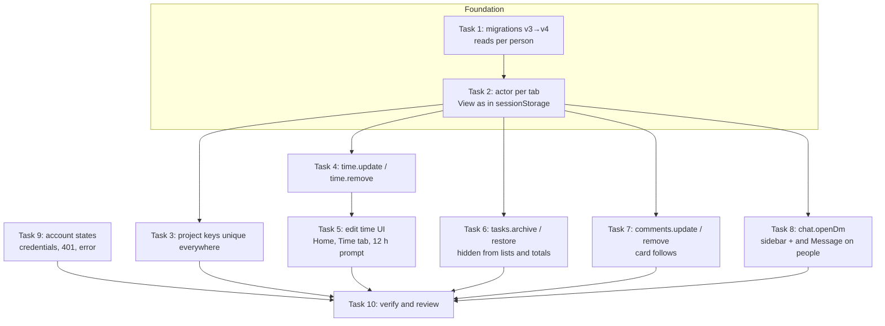

# M6: High Gaps Implementation Plan

> **For agentic workers:** REQUIRED SUB-SKILL: Use superpowers:subagent-driven-development (recommended) or superpowers:executing-plans to implement this plan task-by-task. Steps use checkbox (`- [ ]`) syntax for tracking.

**Goal:** Close the 8 High findings of `GAP_AUDIT.md`:

| Gap | What it adds |
|---|---|
| GAP-001 | Fix or delete a time entry |
| GAP-002 | Archive and restore a task |
| GAP-003 | Start a DM |
| GAP-004 | Edit and delete a comment or bug |
| GAP-005 | Read state per person |
| GAP-006 | "View as" per tab |
| GAP-007 | Project keys unique everywhere |
| GAP-008 | Account and sign-in states for the backend build |

GAP-030 (database migrations) also goes in, because GAP-005 needs it.

**Architecture:** Same layers as before:
- Each change goes through `types.ts` → mock (one `db.update` with the permission check inside) → `http.ts` route → `src/api` hook → UI, and publishes an existing event (`timeLogged`, `ticketUpdated`, `messageChanged`, `commentAdded`, `channelChanged`).
- Two changes sit underneath the rest:
  - **Migrations:** the mock database gets a migration chain, so `DB_VERSION` 3 → 4 keeps the data.
  - **Acting person per tab:** "who is acting" moves out of the shared document into a per-tab **actor**. The mock applies it to every read and write.
- Removals are soft: a task gets `archivedAt` and a comment gets `deletedAt`. A time entry is the exception; it really goes, since nothing else points at it.

**Tech Stack:** React 19, TS ~6, Vite 8, Tailwind v4, TanStack Query, React Router, dnd-kit, Vitest + fake-indexeddb. No new dependencies.

**Spec:**
- `GAP_AUDIT.md` (findings GAP-001 to 008 and GAP-030, with their evidence).
- `docs/superpowers/specs/2026-10-26-spark-flow-company-system-design.md`: §1 (consistent across tabs; check-in visibility), §4.3 permissions, §10 out of scope (real sign-in).

## Flow

## Decisions this plan makes (confirm or change before approving)

1. **GAP-002: a task is archived, not deleted.**
   - Its time and cost stay on the project, and it can be restored.
   - Archived tasks leave the board, the list, My tasks, the dashboard and project totals (task count, progress, overdue). Their logged hours still count toward the project's hours and cost.
   - A running timer on the task stops in the same write.
2. **GAP-001: who can edit or delete a time entry.**
   - The person who logged it can, and so can an Admin. PMs can't (product question Q3).
   - A running entry can't be edited or deleted; you stop it first.
   - An edit is checked again for overlap, future time and the 12 h limit, the same way as a new manual entry.
3. **GAP-003: DMs.**
   - A DM has you plus 1 to 8 others.
   - Opening a DM with exactly the same people returns the one that exists.
   - DMs can't be renamed. Leaving a DM is P2.
4. **GAP-004: who can edit or delete a comment or bug.**
   - Only the author can. Files can't be changed on edit.
   - Delete is soft: the comment reads "This comment was deleted." and its chat card reads "This message was deleted."
5. **GAP-006: "View as" belongs to the tab.**
   - The choice is kept in `sessionStorage` (`spark-flow.viewAs`).
   - A new tab starts as the document's default person, the seed's admin.
   - Other open tabs aren't touched.
6. **GAP-007: the quick fix.**
   - A project key is unique across all workspaces: "Key NEX is already used."
   - The full scoping by workspace is deferred.
   - An existing browser document that already has a duplicate is left alone, since reload seed clears it.
7. **GAP-008: the small part only.**
   - Requests send `credentials: 'include'`, and a 401 is never retried.
   - The shell shows "We couldn't load your account." with Try again, or, on 401, "You're signed out." with a Sign in link to `${VITE_API_URL}/signin?returnTo=<current URL>`. That URL is an assumption for the .NET team.
   - Real sign-in, sign-out and sessions stay out of scope (spec §10).

## Global Constraints

- **Layers:** components import `@/api/*` and `@/lib/*` only, never `@/mocks`. Every new `Api` method has an `http.ts` route.
- **Writes:** every mock write is one `db.update` with `requireCan` (or the module's check) inside the callback, and publishes an event.
- **Design kit:**
  - semantic tokens only, logical RTL classes only (`src/rtl.test.ts`);
  - light, dark, 390px and RTL must all hold;
  - modals use `Sheet`, menus use `MenuPanel`;
  - no toasts and no spinners;
  - errors are sentences near their cause;
  - one primary button per view.
- **Copy rules:** sentence case, buttons start with a verb, pending labels end in `…`, separators are ` · `, empty values are `—`.
- **Exact copy:**
  - "Edit entry" · "Delete entry" · "Delete this entry?" · "Stop the timer first."
  - "You can only change your own time." (403) · "Stopped at the 12 h limit · Fix it"
  - "Archive task" · "Restore task" · "This task is archived." · "Show archived (n)"
  - "Edit comment" · "Delete comment" · "This comment was deleted." · "You can only change your own comments." (403)
  - "New message" · "Open conversation" · "Message" · "Pick at least one person." · "A conversation can have up to 9 people."
  - "We couldn't load your account." · "You're signed out." · "Sign in" · "Try again"
- **Sheet confirms:** use the shared delete-confirm component that Task 7 extracts from `MessageActions.tsx`.
- **Tests:** `npm test` passes under `TZ=Africa/Cairo` and `TZ=Asia/Tokyo`, `npm run lint` passes, and `npm run build:prototype` passes.

## Review Focus

1. **Two tabs as two people.** Tab A is "View as Mariam" and tab B is Admin. Each tab's messages, tasks and reads are saved as its own person, and reloading a tab keeps that tab's person. *(Test in Task 2.)*
2. **An old v3 document opens on the new build.** Nothing is lost. The existing channel reads go to the document's default person, and everyone else starts with their channels unread or read as the seed builds them. *(Test in Task 1.)*
3. **Editing an entry so it overlaps another entry of the same person is refused.** Editing it onto itself, the same range, is allowed. *(Test in Task 4.)*
4. **An archived task's key** in a chat chip, a mention or an old link still opens the task panel, which says it is archived and offers Restore to its manager. *(Test in Task 6 for `tickets.get`; browser check in Task 6.)*
5. **Opening a DM twice, in either order of people, lands on one conversation.** *(Test in Task 8.)*

---

### Task 1: Migrations, and read state per person (GAP-030, GAP-005)

**Files:**
- Modify: `src/mocks/db.ts` (`DB_VERSION = 4`, `DbData.reads`, `conditionOf`, `run`), `src/mocks/chat.ts` (`withUnread`, `markRead`), `src/mocks/seed.ts` (`reads`)
- Create: `src/mocks/migrations.ts`
- Test: `src/mocks/db.test.ts`, `src/mocks/chat.test.ts`

**Interfaces:**
- `DbData.reads: Record<string /* userId */, Record<string /* channelId */, string /* ISO */>>`.
- `migrations: Record<number, (doc: Record<string, unknown>) => void>`, keyed by the version it upgrades *from*. `migrate(doc): DbData | null` runs each step from `doc.version` up to `DB_VERSION`. It returns null when a step is missing, and then the document is reseeded as today.
- The step 3 → 4 is `reads = { [doc.currentUserId]: doc.reads }`.

- [ ] **Step 1: Write the failing tests.**
  - In `db.test.ts`:
    - `'a v3 document is migrated, not reseeded: its records stay and reads move to the default person'`. Store a v3 doc with an extra message, then read it: the message is there, `version` is 4, and `reads` is `{ 'u-1': {...old} }`.
    - `'a document older than any migration is still reseeded'`, for version 1.
  - In `chat.test.ts`:
    - `'read state is per person: my markRead does not clear the badge for someone else'`.
    - `'deleted messages do not count as unread'`. This covers GAP-017's half, which is tested here because `withUnread` is touched.
- [ ] **Step 2: Run** `npx vitest run src/mocks/db.test.ts src/mocks/chat.test.ts`. Expected: FAIL. The v3 doc is reseeded and the read state is shared.
- [ ] **Step 3: Implement.**
  - `migrations.ts` holds the chain.
  - `run` migrates inside the same transaction when the condition is `outdated` and `migrate` succeeds.
  - `withUnread` and `markRead` key on `data.currentUserId`.
  - The seed writes `reads` for each person.
  - Update the comment at `db.ts:48`.
- [ ] **Step 4: Run** `npm test`. Expected: PASS. If the "reseeds an older doc" test asserted version 3, change its fixture to version 1 and record that in the ledger.
- [ ] **Step 5: Commit** `feat: database migrations; channel read state per person`.

### Task 2: The acting person per tab (GAP-006)

**Files:**
- Create: `src/mocks/actor.ts`
- Modify: `src/mocks/db.ts` (`createDb` options, `run`), `src/mocks/users.ts` (`viewAs`, `me`), `src/mocks/index.ts` (the browser db uses `sessionActor()`)
- Test: `src/mocks/users.test.ts`

**Interfaces:**
- `type Actor = { get(): string | null; set(userId: string): void }`.
- `memoryActor(): Actor` is the default for tests. `sessionActor(key = 'spark-flow.viewAs'): Actor` wraps every `sessionStorage` call in try/catch and falls back to memory.
- `createDb(store, seed, now?, actor: Actor = memoryActor())`.
- In `run`: when `actor.get()` names a user who exists, set `data.currentUserId` to it before `fn`. When the transaction saves, it writes back the document's own `currentUserId`, so the stored default never changes.
- `users.viewAs(userId)` checks that the user exists, calls `actor.set`, and writes nothing to the document. The same check is done in a read.

- [ ] **Step 1: Write the failing tests** in `users.test.ts`:
  - `'two dbs on one store with their own actors act as their own person'`. A `viewAs('u-3')` on db A changes neither `me()` nor `send()`'s sender on db B, and A's message is sent by u-3.
  - `'the stored default person never changes'`.
  - `'an actor naming a user who no longer exists falls back to the default'`.
- [ ] **Step 2: Run** `npx vitest run src/mocks/users.test.ts`. Expected: FAIL. B follows A.
- [ ] **Step 3: Implement** as in the Interfaces block. The browser's `mockDb` in `src/mocks/index.ts` passes `sessionActor()`.
- [ ] **Step 4: Run** `npm test`. Expected: PASS.
- [ ] **Step 5: Browser check.** View as Mariam in tab A, and tab B stays Admin. Send a message from each tab: the senders differ. Reload tab A: it is still Mariam.
- [ ] **Step 6: Commit** `feat: View as belongs to the tab`.

### Task 3: Project keys unique across workspaces (GAP-007)

**Files:**
- Modify: `src/mocks/projects.ts:76`, `src/pages/projects/ProjectSheet.tsx` (a 400 whose detail starts with "Key " shows under the Key field instead of the footer). `takenKeys` (`ProjectsPage.tsx:230`) stays this workspace's list; the mock is the check across workspaces.
- Test: `src/mocks/projects.test.ts`

- [ ] **Step 1: Write the failing test** `'a key used in another workspace is refused'`. `projects.create({ workspaceId: 'ws-design', key: 'NEX', … })` → 400 "Key NEX is already used."
- [ ] **Step 2: Run** `npx vitest run src/mocks/projects.test.ts`. Expected: FAIL (it resolves).
- [ ] **Step 3: Implement:** drop the `workspaceId` condition from the uniqueness check. Show a server 400 under the Key field.
- [ ] **Step 4: Run** `npm test`. Expected: PASS.
- [ ] **Step 5: Commit** `fix: project keys are unique across workspaces`.

### Task 4: Edit and delete a time entry, API (GAP-001)

**Files:**
- Modify: `src/api/types.ts` (`TimeEntryPatch`, `Api['time']`), `src/mocks/time.ts`, `src/lib/http.ts`, `src/api/time.ts`
- Test: `src/mocks/time.test.ts`

**Interfaces:**
- `type TimeEntryPatch = Partial<Pick<NewManualEntry, 'startedAt' | 'endedAt' | 'note'>> & { target?: TimeTarget }`.
- `Api['time'].update(id: string, patch: TimeEntryPatch): Promise<TimeEntry>`.
- `Api['time'].remove(id: string): Promise<void>`.
- Routes: `PATCH /api/time/entries/{id}`, `DELETE /api/time/entries/{id}`. Hooks: `useUpdateTime()`, `useRemoveTime()`.
- Extract `checkEntry(data, userId, { start, end, note, target }, at: number, ignoreId?: string): { projectId, taskId, note }` from `addManual`, so the end, future, 12 h, note and overlap checks run once for both. `ignoreId` skips the entry being edited in the overlap check.
- Rights: the owner, or `role === 'admin'`. Anyone else gets 403 "You can only change your own time." A running entry gets 400 "Stop the timer first."
- Each write publishes `timeLogged` for the entry's project, and also for the old project when the target moves.

- [ ] **Step 1: Write the failing tests** in `time.test.ts`, under `describe('editing time')`:
  - `'the owner moves an entry to another task and time'`.
  - `'an edit is checked like a new entry: end before start, future, over 12 h, overlap with another entry'`. Each gives a 400 with the existing sentences.
  - `'an edit onto its own range is allowed'`.
  - `'a running entry can't be edited or deleted'` → "Stop the timer first."
  - `'someone else's entry is refused; an admin may change it'`.
  - `'remove takes the hours off the project and publishes timeLogged'`.
  - `'a forgotten 12 h timer entry can be cut to its real end'`.
- [ ] **Step 2: Run** `npx vitest run src/mocks/time.test.ts`. Expected: FAIL (`update` is not a function).
- [ ] **Step 3: Implement** as in the Interfaces block.
- [ ] **Step 4: Run** `npm test`. Expected: PASS.
- [ ] **Step 5: Commit** `feat: edit and delete a time entry (api)`.

### Task 5: Edit and delete a time entry, UI (GAP-001)

**Files:**
- Modify: `src/pages/time/AddTimeSheet.tsx` (edit mode), `src/pages/time/manualEntry.ts` (`valuesOf(entry)`), `src/pages/home/CheckInCard.tsx` (entry rows), `src/pages/projects/TimeTab.tsx` (rows)
- Create: `src/pages/time/EntryActions.tsx` (⋯ `MenuPanel`: Edit entry, Delete entry)
- Test: `src/pages/time/manualEntry.test.ts`

**Interfaces:**
- `valuesOf(entry: TimeEntry, now: Date): ManualEntryValues` (local day, HH:mm, note, task or project).
- `AddTimeSheet({ …, entry?: TimeEntry })`: with an entry, its title is "Edit entry" and its primary button is "Save" / "Saving…".
- `capped(entry: TimeEntry): boolean` lives in `src/lib/hours.ts`. It is true when a timer entry's `endedAt − startedAt` equals `MAX_ENTRY_HOURS`.

- [ ] **Step 1: Write the failing tests.**
  - `'valuesOf gives back the entry's day, times and note'`.
  - `'capped is true only for a timer entry stopped at 12 h'`.
- [ ] **Step 2: Run** `npx vitest run src/pages/time/manualEntry.test.ts src/lib`. Expected: FAIL.
- [ ] **Step 3: Implement.**
  - Show ⋯ on my own closed entries, and on everyone's for an Admin, on Home and in the Time tab.
  - Delete entry opens the shared confirm ("Delete this entry?", with "Delete entry" / "Deleting…").
  - A capped entry shows "Stopped at the 12 h limit · Fix it", a link that opens the sheet.
- [ ] **Step 4: Run** `npm test && npm run lint`. Expected: PASS.
- [ ] **Step 5: Browser check.**
  - Fix a seeded entry's end, and the project hours change.
  - Delete an entry.
  - As a Member, there's no ⋯ on others' entries in the Time tab.
  - Check light, dark and 390px.
- [ ] **Step 6: Commit** `feat: fix or delete your time entries`.

### Task 6: Archive and restore a task (GAP-002)

**Files:**
- Modify: `src/api/types.ts` (`Ticket.archivedAt?: string | null`, `Api['tasks']`, `Api['tickets'].list(projectId, opts?)`), `src/mocks/tickets.ts`, `src/mocks/derive.ts`, `src/mocks/dashboard.ts`, `src/lib/http.ts`, `src/api/tickets.ts`, `src/pages/projects/TicketInspector.tsx`, `src/pages/projects/TasksTab.tsx` / `ProjectBacklog.tsx`
- Test: `src/mocks/tasks.test.ts`, `src/mocks/derive.test.ts`

**Interfaces:**
- `Api['tasks'].archive(key: string): Promise<TaskView>` and `restore(key: string): Promise<TaskView>`. Both need `task.manage` and publish `ticketUpdated`.
- `archive` also closes any running entry on the task, at now, in the same write, and publishes `timeLogged` when it did.
- `tickets.list(projectId, opts?: { archived?: boolean })`: by default it returns non-archived tasks; with `archived: true`, only archived ones. Route: `?archived=true`. Hook: `useArchivedTasks(projectId)`.
- `tickets.get` still returns an archived task, with `archivedAt` set.
- `derive` leaves archived tasks out of `taskCount`, `progress`, `overdueCount` and `expectedFinish`. It still counts their time entries in hours and cost.

- [ ] **Step 1: Write the failing tests.**
  - `'the manager archives a task: it leaves the list and the totals, keeps its hours, and get still finds it'`.
  - `'archiving stops a running timer on it'`.
  - `'restore brings it back'`.
  - `'a member is refused'` → 403.
  - `'list with archived: true returns only archived tasks'`.
- [ ] **Step 2: Run** `npx vitest run src/mocks/tasks.test.ts src/mocks/derive.test.ts`. Expected: FAIL.
- [ ] **Step 3: Implement.**
  - **Inspector button.** The inspector gets an "Archive task" button (ghost) next to its "Edit task" button (`TicketInspector.tsx:97`), with the shared confirm, for `task.manage`.
  - **Archived task panel.** An archived task's panel shows "This task is archived." and, for its manager, a "Restore task" button. Time actions are hidden there.
  - **List view.** It gets a "Show archived (n)" toggle, kept in `?archived=1`. Archived rows are muted.
- [ ] **Step 4: Run** `npm test && npm run lint`. Expected: PASS.
- [ ] **Step 5: Browser check.**
  - Archive NEX-110: it leaves the board and the counts change.
  - Its `@NEX-110` chip still opens the panel, which shows the archived line.
  - Restore it.
  - Check light, dark and 390px.
- [ ] **Step 6: Commit** `feat: archive and restore tasks`.

### Task 7: Edit and delete a comment or bug (GAP-004)

**Files:**
- Modify: `src/api/types.ts` (`Comment.editedAt?`, `Comment.deletedAt?`, `Api['comments']`), `src/mocks/comments.ts`, `src/mocks/chat.ts` (the card follows), `src/mocks/mentions.ts` (skip deleted comments), `src/lib/http.ts`, `src/api/comments.ts`, `src/pages/projects/TaskActivity.tsx`, `src/pages/chat/MessageActions.tsx`
- Create: `src/components/ConfirmDeleteSheet.tsx`, extracted from `MessageActions`
- Test: `src/mocks/comments.test.ts`, `src/mocks/mentions.test.ts`

**Interfaces:**
- `Api['comments'].update(id: string, body: string): Promise<CommentView>` and `remove(id: string): Promise<void>`. Routes: `PATCH` and `DELETE /api/comments/{id}`. Hooks: `useUpdateComment()`, `useRemoveComment()`.
- Author only, with `collab.post` on the project; anyone else gets 403 "You can only change your own comments." The body follows the create rules: it can't be empty unless the comment has files, and it must be under 4000 characters.
- **Edit:** set `editedAt`. The card (found by `commentId`) gets content `"<Bug|Comment> on KEY: body"`, mentions parsed again, and `editedAt`.
- **Remove:** set `deletedAt`, `body: ''` and `attachmentIds: []`. The card is soft-deleted the way `chat.remove` does it.
- Both publish `messageChanged` for the card and `commentAdded` for the task.
- `ConfirmDeleteSheet({ open, title, description, actionLabel, pendingLabel, onConfirm: () => Promise<unknown>, onClose })`.

- [ ] **Step 1: Write the failing tests.**
  - `'the author edits a comment: the text, editedAt and the card change, and mentions are parsed again'`.
  - `'remove leaves a placeholder and soft-deletes the card'`.
  - `'someone else is refused'`.
  - `'a deleted comment leaves the mentions feed'`.
- [ ] **Step 2: Run** `npx vitest run src/mocks/comments.test.ts src/mocks/mentions.test.ts`. Expected: FAIL.
- [ ] **Step 3: Implement.**
  - TaskActivity rows get a ⋯ menu (Edit comment, Delete comment) for the author.
  - Edit happens in place with the `Composer` edit mode.
  - A deleted comment reads "This comment was deleted.", and an edited one shows "· edited".
  - `MessageActions` switches to `ConfirmDeleteSheet`. That also settles the M5 review note on DeleteDialog vs Sheet.
- [ ] **Step 4: Run** `npm test && npm run lint`. Expected: PASS.
- [ ] **Step 5: Browser check.** Edit a bug's text: the panel and the #nexus-core card both change. Delete it. Check light, dark and 390px.
- [ ] **Step 6: Commit** `feat: edit and delete comments and bugs`.

### Task 8: Start a DM (GAP-003)

**Files:**
- Modify: `src/api/types.ts` (`Api['chat'].openDm`), `src/mocks/chat.ts`, `src/lib/http.ts` (`POST /api/workspaces/{id}/dms`), `src/api/chat.ts` (`useOpenDm`), `src/layout/Sidebar.tsx` (the Direct messages group always shows, with a "+"), `src/pages/teams/TeamsPage.tsx` (a "Message" button on each person but you)
- Create: `src/pages/chat/NewMessageSheet.tsx`
- Test: `src/mocks/chat.test.ts`

**Interfaces:**
- `Api['chat'].openDm(workspaceId: string, userIds: string[]): Promise<Channel>`.
- The members are me plus the unique `userIds` other than me.
  - 0 others → 400 "Pick at least one person."
  - More than 8 others → 400 "A conversation can have up to 9 people."
  - Unknown users → 404.
- The same member set (in any order) returns the existing DM and publishes nothing. Otherwise it creates `{ kind: 'dm', name: null, topic: '', isPrivate: true }` and publishes `channelChanged`.
- `NewMessageSheet({ workspaceId, workspaceSlug, onClose })`: a people checklist with a filter box. Its primary button is "Open conversation" / "Opening…", and it navigates to the DM.

- [ ] **Step 1: Write the failing tests.**
  - `'openDm creates a DM with me and them, and lists it to us only'`.
  - `'the same people in any order get the same DM, and nothing is published'`.
  - `'no one else, or more than 8 others, is refused'`.
- [ ] **Step 2: Run** `npx vitest run src/mocks/chat.test.ts`. Expected: FAIL.
- [ ] **Step 3: Implement.** In `Sidebar.tsx`, stage only this task's hunks, as in M5 Task 6, because that file holds someone else's uncommitted edits.
- [ ] **Step 4: Run** `npm test && npm run lint`. Expected: PASS.
- [ ] **Step 5: Browser check.**
  - Use the sidebar "+" to pick Salma and Hossam: a group DM opens.
  - Do it again with the same two people: the same DM opens.
  - Use Teams → "Message" on Mariam.
  - As Tarek, the group DM isn't listed.
  - Check 390px: the drawer "+" works.
- [ ] **Step 6: Commit** `feat: start a direct message`.

### Task 9: Account states for the backend build (GAP-008, the small part)

**Files:**
- Modify: `src/lib/http.ts` (`credentials: 'include'`), `src/api/retry.ts` (401 is never retried), `src/lib/useRole.ts` (expose `error`), `src/layout/AppLayout.tsx` (an account gate)
- Create: `src/layout/AccountState.tsx`
- Test: `src/lib/http.test.ts`, `src/api/retry.test.ts`

**Interfaces:**
- `useRole()` also returns `error: ApiError | null`.
- `AccountState({ error, onRetry })`:
  - For a 401, it shows "You're signed out." and a "Sign in" link to `apiUrl('/signin') + '?returnTo=' + encodeURIComponent(location.href)`.
  - For anything else, it shows "We couldn't load your account." and "Try again".
- AppLayout renders it in place of the page when `me` failed.

- [ ] **Step 1: Write the failing tests.**
  - `'requests send cookies'`: the `fetchFn` receives `credentials: 'include'`.
  - `'a 401 is not retried'`.
- [ ] **Step 2: Run** `npx vitest run src/lib/http.test.ts src/api/retry.test.ts`. Expected: FAIL.
- [ ] **Step 3: Implement** as in the Interfaces block. Note the `/signin?returnTo=` assumption in `CLAUDE.md` under Commands / backend switch.
- [ ] **Step 4: Run** `npm test && npm run lint && npm run build:prototype`. Expected: PASS.
- [ ] **Step 5: Browser check.** In the prototype, make `users.me` throw once through the dev helper or a temporary override. The account state shows, and Try again recovers.
- [ ] **Step 6: Commit** `feat: account error and signed-out states`.

### Task 10: Verify, update the audit, review

- [ ] **Step 1: Run** `TZ=Africa/Cairo npm test`, `TZ=Asia/Tokyo npm test`, `npm run lint` and `npm run build:prototype`. Expected: all green.
- [ ] **Step 2: Browser pass** as Admin, Nour (PM), Mariam (member) and Karim (sales), with two tabs as two people (Review Focus 1). Check light, dark, 390px and RTL. Use a fresh tab for the console: no errors.
- [ ] **Step 3: Update the docs.** In `GAP_AUDIT.md`, mark GAP-001 to 008 and GAP-030 as fixed, with their commits. Add a Story 5 to `docs/demo-script.md`: fix a time entry, archive a task, start a DM, edit a bug. Commit both: `docs: M6 audit status and demo story`.
- [ ] **Step 4: Whole-branch review.** One review on the most capable model over `<M6 base>..HEAD`, given this plan's Review Focus. Then one fix pass, each fix RED → GREEN. Minors are deferred.
