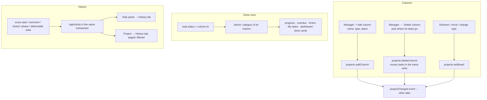

# M7: Custom Columns and History Implementation Plan

> **For agentic workers:** REQUIRED SUB-SKILL: Use superpowers:subagent-driven-development (recommended) or superpowers:executing-plans to implement this plan task-by-task. Steps use checkbox (`- [ ]`) syntax for tracking.

**Goal:**
- **Custom columns.** Each project's manager can add and delete board columns. Every column has a **type**: To do, In progress or Done. The type, not the column's name, decides what "done" means for progress, overdue checks, timers, My tasks and the dashboard.
- **History.** Every task gets a **History** of who changed what and when, and every project gets a **History** feed of its tasks, comments, board and phases.

**Architecture:**
- **A task's status is a column id.** The 5 statuses the app has today become the default column ids (`backlog`, `todo`, `inProgress`, `inReview`, `done`), so existing tasks keep working without a rewrite.
- **Columns carry a type.** `Project.board` becomes `BoardColumn[] = { id, label, category }`, where `category` is `'todo' | 'inProgress' | 'done'`.
- **"Is it done?" asks the column's type.** The mock derives `category` onto every `TaskView`, and every `status === 'done'` check in the mock and the pages switches to that category.
- **History is one log per project.** The mock appends to an `activity` collection inside the same `db.update` as the change it records, through one helper.
- **A new live event.** `projectChanged` carries board, phase, project and deliverable writes to other tabs, which also covers that part of GAP-012.
- **The database goes to `DB_VERSION` 5** through the migration chain from M6: board columns get the new shape, and an empty `activity` collection is added.

**Tech Stack:** React 19, TS ~6, Vite 8, Tailwind v4, TanStack Query, React Router, dnd-kit, Vitest + fake-indexeddb. No new dependencies.

**Spec:**
- `tasks/jira-slack-gap-checklist.md`: §A4 (add and delete columns, custom workflows) and §D P2 ("Task history, a per-task work log in the panel, and a project 'Recent activity' feed").
- `GAP_AUDIT.md`: the capability matrix's Board column row, and GAP-012 for project writes.
- `docs/superpowers/specs/2026-10-26-spark-flow-company-system-design.md`: §3 derived values (overdue is never true when the task is done), and §4.3 permissions.

## Flow

## Decisions this plan makes (confirm or change before approving)

1. **Three types.**
   - The column types are To do, In progress and Done. Backlog counts as To do, and In review counts as In progress.
   - Every project keeps at least one column of each type.
   - A board has at most 10 columns.
2. **Deleting a column moves its tasks.**
   - You pick where they go; the default is the first other column of the same type.
   - The move and the delete are one write.
   - No chat card is posted for each moved task. History records one project line, plus one line per moved task.
3. **A new task starts in the first To do column** of the board, in board order.
4. **Column colours follow the type:** grey for to do, amber for in progress, emerald for done. The 5 default columns keep the colours they have today (Backlog neutral, To do sky, In review violet).
5. **Who changes columns:** adding, deleting, renaming, moving and changing a column's type need `phase.manage`, which means the project's manager or an Admin, as in M5.
6. **History.**
   - **What it records:** created, field changes (from → to), moved between columns, archived and restored, and comment added, edited or deleted (the kind only, never the text). It also records column and phase changes, project edits, and deliverable changes.
   - **What it leaves out:**
     - Rank-only moves aren't recorded.
     - A description change is recorded as "changed the description", without the text.
     - Time entries are left out on purpose. Entry times are personal, so they stay in the Time tab, which is gated (GAP-011).
   - **Who sees it:** everyone who can open the project. Nothing is ever edited or deleted.
7. **Where it shows:**
   - In the task panel, the existing "Activity" tab (comments) is renamed **Comments** and gets a **History** tab beside it.
   - Projects get a fifth tab, **History**, with the chips All · Tasks · Board · Comments, 30 entries a page, and "Load older".
8. **The seed** writes a "created" history line for every seeded task, at its `createdAt` and by its reporter, so History isn't empty in the demo.

## Global Constraints

- **Layers and writes:**
  - Components import `@/api/*` and `@/lib/*` only.
  - Every new `Api` method has an `http.ts` route.
  - Every mock write is one `db.update` with its permission check inside, and publishes an event.
- **Design kit:**
  - Semantic tokens only; logical RTL classes only.
  - Light, dark, 390px and RTL must all hold.
  - Use `Sheet` and `MenuPanel`, the shared `ConfirmDeleteSheet`, no toasts, errors as sentences, one primary button.
- **Copy rules:** sentence case, buttons start with a verb, pending labels end in `…`, separators are ` · `, empty values are `—`.
- **Exact copy:**
  - **Column actions:** "Add column" · "Delete column" · "Change type" · "Type" · "To do" · "In progress" · "Done"
  - **Column errors:** "Each type needs at least one column." · "A board can have up to 10 columns." · "That column no longer exists."
  - **Delete confirm:** "Delete {name}?" · "Its {n} tasks move to" · "Move them to" · "Deleting…"
  - **Tabs:** "History" · "Comments"
  - **History feed:** "Load older" · "Nothing has happened here yet."
- **History lines** follow these patterns (names and labels come from the entry and the directory, and an em dash stands for an empty value):
  - "{actor} created {KEY}"
  - "{actor} moved {KEY} from {from} to {to}"
  - "{actor} changed the {field} of {KEY} from {from} to {to}"
  - "{actor} changed the description of {KEY}"
  - "{actor} archived {KEY}" · "{actor} restored {KEY}"
  - "{actor} commented on {KEY}" · "{actor} reported a bug on {KEY}" · "{actor} edited a comment on {KEY}" · "{actor} deleted a comment on {KEY}"
  - "{actor} added the column {name} ({type})" · "{actor} renamed the column {from} to {to}" · "{actor} moved the column {name}" · "{actor} changed the column {name} to {type}"
  - "{actor} deleted the column {name} and moved {n} tasks to {to}"
  - "{actor} added the phase {name}" · "{actor} changed the phase {name}" · "{actor} removed the phase {name}"
  - "{actor} edited the project" · "{actor} added the deliverable {title}" · "{actor} changed the deliverable {title}"
- **Field labels** in history lines: title, status, priority, assignee, phase, sprint, due date, estimate, type, story points.
- **Gates:** `npm test` passes under `TZ=Africa/Cairo` and `TZ=Asia/Tokyo`, and `npm run lint` and `npm run build:prototype` pass.

## Review Focus

1. **Done follows the type, not the name.** A task in a custom Done-type column named "Shipped":
   - counts toward progress;
   - is never overdue;
   - refuses a new timer;
   - leaves My tasks;
   - posts the "Done" chat card when moved there.

   A task in a renamed "Done" column whose type is In progress counts as open. *(Tests in Task 1.)*
2. **Deleting a column while another tab drags a card onto it.** The drop gets 400 "That column no longer exists.", and the card goes back with that sentence above the board. *(Tests in Tasks 2 and 3.)*
3. **An old v4 document** (board as `{status, label}[]` or missing, no `activity`) migrates without losing anything. Custom names and order are kept, and the types come from the old status ids. *(Test in Task 1.)*
4. **A task's history after its column was deleted** still reads with the deleted column's name, because each entry keeps label snapshots. *(Test in Task 6.)*
5. **History never leaks private text.** Comment bodies, time entries and anything from a private channel stay out of the log, and a comment deleted later leaves its "commented on" line with no text. *(Test in Task 5.)*

---

### Task 1: Column types, and done-ness by type (the foundation)

**Files:**
- Modify:
  - `src/api/types.ts` (`StatusCategory`, `BoardColumn`, `TicketStatus = string`, `TaskView.category`, `TaskEvent.status` as string plus `statusLabel`);
  - `src/lib/boardColumns.ts` (rewritten), `src/lib/statuses.ts` (defaults with categories);
  - `src/mocks/migrations.ts` (4 → 5), `src/mocks/db.ts` (`DB_VERSION = 5`, `activity` in `COLLECTIONS` and `DbData`);
  - `src/mocks/derive.ts`, `src/mocks/dashboard.ts`, `src/mocks/time.ts`, `src/mocks/tickets.ts` (sort by board order, status validation, default column), `src/mocks/taskEvents.ts`, `src/mocks/seed.ts`;
  - `src/pages/projects/{taskFilters,TicketRow,TicketInspector,ticketPills,ProjectBoard,TaskSheet}.tsx/ts`, `src/pages/time/AddTimeSheet.tsx`, `src/pages/chat/TaskEventCard.tsx`.
- Test: `src/lib/boardColumns.test.ts`, `src/mocks/db.test.ts`, `src/mocks/derive.test.ts`, `src/mocks/tickets.test.ts`, `src/mocks/time.test.ts`, `src/pages/projects/taskFilters.test.ts`

**Interfaces:**
- `type StatusCategory = 'todo' | 'inProgress' | 'done'`.
- `type BoardColumn = { id: string; label: string; category: StatusCategory }`.
- `type TicketStatus = string`: a column id of the task's project.
- `TaskView.category: StatusCategory`, derived on every read.
- `TaskEvent` keeps `status?: string` and adds `statusLabel?: string`, the column's name when the card was posted. `TaskEventCard` reads it, which settles the M5 "Ready to ship" minor.
- `DEFAULT_COLUMNS: BoardColumn[]` in `lib/statuses.ts`: `backlog`/Backlog/todo, `todo`/To do/todo, `inProgress`/In progress/inProgress, `inReview`/In review/inProgress, `done`/Done/done.
- `lib/boardColumns.ts`:
  - `columnsOf(project): BoardColumn[]` returns `project.board` when it has columns, else `DEFAULT_COLUMNS`.
  - `columnOf(project, status): BoardColumn | undefined`.
  - `categoryOf(project, status): StatusCategory` returns `'todo'` for an unknown id.
  - `columnLabel(project, status)` returns `'—'` for an unknown id.
  - `firstOf(project, category): BoardColumn`.
  - `moveColumn(columns, id, to)`.
  - `columnErrors(columns): string | null` checks, in order:
    - "Name each column.";
    - "Keep column names under 30 characters.";
    - "Two columns can't share a name.";
    - "Each type needs at least one column.";
    - "A board can have up to 10 columns.".
- Migration 4 → 5:
  - Each project's `board` becomes `{ id: old.status, label, category: LEGACY[old.status] }`, filled to the 5 defaults as `boardColumns` did in M5.
  - A missing board becomes `DEFAULT_COLUMNS`.
  - `activity = []`.

- [ ] **Step 1: Write the failing tests.**
  - `boardColumns.test.ts`: `columnsOf` falls back to the defaults; `categoryOf` maps the 5 defaults and a custom column; each `columnErrors` message.
  - `db.test.ts`: `'a v4 document migrates: custom names and order are kept, types come from the old ids, activity starts empty'`.
  - `derive.test.ts`: `'a task in a Done-type column named Shipped counts as done: progress, never overdue'`, and `'a column named Done with type In progress counts as open'`.
  - `tickets.test.ts`:
    - `'status must be a column of the project'` → 400 "That column no longer exists.";
    - `'a new task starts in the first To do column'`;
    - `'moving into any Done-type column posts the done card, with the column name'`.
  - `time.test.ts`: `'a timer is refused on a task in a Done-type column'`.
  - `taskFilters.test.ts`: `'myOpenTasks leaves out tasks of every Done-type column'`.
- [ ] **Step 2: Run** `npx vitest run src/lib src/mocks src/pages/projects/taskFilters.test.ts`. Expected: FAIL.
- [ ] **Step 3: Implement.**
  - **Mock done checks.** Replace every task `status === 'done'` / `!== 'done'` in the mock with the category: `derive.ts:19,44,54`, `dashboard.ts`, `time.ts:24`, `taskEvents.ts`.
  - **Page done checks.** Replace them with `t.category`: `taskFilters.ts:25`, `TicketRow.tsx:75`, `TicketInspector.tsx:157,182`, `AddTimeSheet.tsx:90`.
  - **Leave phase status alone.** `PhaseStatus` keeps its own `'done'`.
  - **Board.** `ProjectBoard`, the selects and `StatusPill` read `columnsOf(project)`. Tints come from `statusTint[id] ?? categoryTint[category]`.
  - **Sorting.** `byStatusThenRank` sorts by the board's column order.
- [ ] **Step 4: Run** `npm test && npm run lint && npm run build:prototype`. Expected: PASS.
- [ ] **Step 5: Browser check.** The board looks the same as before; drag, done cards, progress and My tasks are unchanged. Check light, dark and 390px.
- [ ] **Step 6: Commit** `feat: board columns have a type; done follows the type`.

### Task 2: Add and delete columns (API)

**Files:**
- Modify: `src/api/types.ts` (`Api['projects']`), `src/mocks/projects.ts`, `src/lib/realtime.ts` + `src/mocks/realtime.ts` + `src/layout/RealtimeBridge.tsx` (`projectChanged`), `src/api/queryKeys.ts`, `src/lib/http.ts`, `src/api/projects.ts`
- Test: `src/mocks/projects.test.ts`, `src/api/queryKeys.test.ts`

**Interfaces:**
- `projects.addColumn(projectId: string, input: { label: string; category: StatusCategory; after?: string }): Promise<Project>`. It gets a `newId('col')` id. Without `after` it goes at the end.
- `projects.deleteColumn(projectId: string, columnId: string, moveTo: string): Promise<Project>`. In the same write it moves the column's non-archived and archived tasks to `moveTo`, at the end of that column (ranks after its last), and keeps the board valid.
- `projects.setBoard(projectId, columns)` takes the new shape. Ids must be exactly the board's current ids; labels, order and categories can change. It is checked with `columnErrors`.
- All three need `phase.manage` and publish `projectChanged { projectId }`. `deleteColumn` also publishes `ticketUpdated` for each moved task.
- Event `projectChanged { projectId }` maps to `[['tickets'], ['projects'], ['dashboard'], qk.projectHistory(projectId)]`. `['tickets']` covers project summaries (`qk.projects` is `['tickets','projects',ws]`) and task lists; `['projects']` covers phases, deliverables and project time. `qk.projectHistory` comes from Task 4, so add it to the mapping in that task.
- Routes:
  - `POST /api/projects/{id}/board/columns`
  - `DELETE /api/projects/{id}/board/columns/{columnId}?moveTo=`
  - `PUT /api/projects/{id}/board`
- Hooks: `useAddColumn()`, `useDeleteColumn()`, and `useSetBoard()` (already exists).
- Phase, deliverable and project writes in `projects.ts` publish `projectChanged` too.

- [ ] **Step 1: Write the failing tests.**
  - `'the manager adds a column after another, typed'`.
  - `'delete moves its tasks to the chosen column in one write'`, which checks status, rank order and events.
  - `'the last column of a type can't be deleted'`.
  - `'more than 10 columns is refused'`.
  - `'moveTo must be another column of the board'`.
  - `'sales and members are refused'`.
  - `'phase, deliverable and project writes publish projectChanged'`.
  - In `queryKeys.test.ts`: the mapping for `projectChanged`.
- [ ] **Step 2: Run** `npx vitest run src/mocks/projects.test.ts src/api/queryKeys.test.ts`. Expected: FAIL.
- [ ] **Step 3: Implement** as in the Interfaces block.
- [ ] **Step 4: Run** `npm test`. Expected: PASS.
- [ ] **Step 5: Commit** `feat: add and delete board columns (api); projectChanged reaches other tabs`.

### Task 3: Add and delete columns (board UI)

**Files:**
- Create: `src/pages/projects/ColumnSheet.tsx` (add, or change type), `src/pages/projects/DeleteColumnSheet.tsx`
- Modify: `src/pages/projects/ProjectBoard.tsx` (a "+ Add column" tile after the last column; the ⋯ menu gets "Change type" and "Delete column"), `src/pages/projects/TasksTab.tsx`

**Interfaces:**
- **`ColumnSheet({ project, column?, onClose })`.**
  - Fields: Name; Type (three radios: To do / In progress / Done); Place ("After" a column, add only).
  - Primary button: "Add column" / "Adding…", or "Save" / "Saving…".
- **`DeleteColumnSheet({ project, column, count, onClose })`.**
  - Title: "Delete {name}?".
  - When `count > 0`: the line "Its {n} tasks move to" and a "Move them to" select. It defaults to the first other column of the same type, else the first other column.
  - Danger button "Delete column".
  - The menu item is disabled, with the hint "Each type needs at least one column.", when it is the last column of its type.
- **The "+ Add column" tile** is a dashed 296px column (`w-[85%]` on phones). It is shown only with `onBoard` and fewer than 10 columns.

- [ ] **Step 1: Write the failing test** in `src/lib/boardColumns.test.ts`: `'the default move-to column is the first other column of the same type, else the first other'` (`defaultMoveTo(columns, id)`).
- [ ] **Step 2: Run** `npx vitest run src/lib/boardColumns.test.ts`. Expected: FAIL.
- [ ] **Step 3: Implement** `defaultMoveTo` and the two sheets. Show a 400 from a drop onto a deleted column ("That column no longer exists.") through the existing board error line.
- [ ] **Step 4: Run** `npm test && npm run lint`. Expected: PASS.
- [ ] **Step 5: Browser check.**
  - As Nour, add "QA" (In progress) after In progress and drag a card into it.
  - Delete "QA", moving its card to In review.
  - The Delete item of the only Done column is disabled.
  - In a second tab, the board updates.
  - As Mariam, there's no "+" and no menu.
  - Check light, dark, 390px and RTL.
- [ ] **Step 6: Commit** `feat: add and delete board columns`.

### Task 4: The activity log for tasks

**Files:**
- Modify: `src/api/types.ts` (`ActivityEntry`, `FieldChange`, `Api['activity']`), `src/mocks/tickets.ts` (create, update, archive, restore, and `deleteColumn`'s moves through `updateTicket`), `src/mocks/index.ts`, `src/lib/http.ts`, `src/api/queryKeys.ts`
- Create: `src/mocks/activity.ts` (`logActivity`, `activityApi`), `src/api/activity.ts`
- Test: `src/mocks/activity.test.ts`

**Interfaces:**
- `type ActivityKind`, one of:
  - `'task.created' | 'task.changed' | 'task.moved' | 'task.archived' | 'task.restored'`
  - `'comment.added' | 'comment.edited' | 'comment.deleted'`
  - `'column.added' | 'column.renamed' | 'column.moved' | 'column.typed' | 'column.deleted'`
  - `'phase.added' | 'phase.changed' | 'phase.removed'`
  - `'project.changed' | 'deliverable.added' | 'deliverable.changed'`
- `type FieldChange = { field: string; from: string | null; to: string | null; fromLabel?: string; toLabel?: string }`. The labels are snapshots for statuses, phases and sprints.
- `type ActivityEntry = { id: string; projectId: string; taskKey: string | null; actorId: string; at: string; kind: ActivityKind; changes: FieldChange[]; subject?: string /* column, phase or deliverable name; comment kind */; count?: number }`.
- `logActivity(data: DbData, entry: Omit<ActivityEntry, 'id' | 'at' | 'actorId'>, at: string): void` pushes the entry with the current user as the actor.
- `diffTask(before: Ticket, after: Ticket, data): FieldChange[]` covers the fields in Global Constraints. It skips `rank` and `updatedAt`. A description change carries `from` and `to` as null.
- A status change logs `task.moved` and the other fields log `task.changed`, both from the same update.
- `Api['activity']`:
  - `forTask(key: string): Promise<ActivityEntry[]>`, newest first;
  - `forProject(projectId: string, cursor?: string): Promise<Page<ActivityEntry>>`, newest first, 30 per page, with an opaque cursor as in `chat.messages`.
- Routes: `GET /api/tasks/{key}/history`, `GET /api/projects/{id}/history?cursor=`.
- Keys: `qk.taskHistory(key)` and `qk.projectHistory(projectId)`. `ticketUpdated` → both; `projectChanged` → `projectHistory`.

- [ ] **Step 1: Write the failing tests** in `activity.test.ts`:
  - `'create logs task.created by the current person'`.
  - `'an update logs moved and changed separately, with from/to and label snapshots; rank-only logs nothing'`.
  - `'archive and restore are logged'`.
  - `'deleting a column logs one column.deleted with the count and a task.moved per task'`.
  - `'forProject pages newest first by cursor'`.
- [ ] **Step 2: Run** `npx vitest run src/mocks/activity.test.ts`. Expected: FAIL.
- [ ] **Step 3: Implement** as in the Interfaces block.
- [ ] **Step 4: Run** `npm test`. Expected: PASS.
- [ ] **Step 5: Commit** `feat: an activity log for tasks (api)`.

### Task 5: The activity log for comments, the board, phases, deliverables and the project

**Files:**
- Modify: `src/mocks/comments.ts`, `src/mocks/projects.ts` (setBoard diff → renamed / moved / typed; add; delete; phases; deliverables; update)
- Test: `src/mocks/activity.test.ts`

- [ ] **Step 1: Write the failing tests.**
  - `'a comment, a bug, an edit and a delete are logged without their text'`.
  - `'setBoard logs one entry per renamed, moved or retyped column'`.
  - `'phase and deliverable changes and a project edit are logged'`.
  - `'nothing from chat messages or time entries is logged'`.
- [ ] **Step 2: Run** `npx vitest run src/mocks/activity.test.ts`. Expected: FAIL.
- [ ] **Step 3: Implement.** Every listed write calls `logActivity` in its own `db.update`.
- [ ] **Step 4: Run** `npm test`. Expected: PASS.
- [ ] **Step 5: Commit** `feat: comments, board, phases and deliverables in the activity log`.

### Task 6: History in the task panel

**Files:**
- Create: `src/lib/activityText.ts` (`describeActivity`), `src/pages/projects/HistoryList.tsx`
- Modify: `src/pages/projects/TicketInspector.tsx` (tabs: Details · Comments · History)
- Test: `src/lib/activityText.test.ts`

**Interfaces:**
- `describeActivity(entry: ActivityEntry, ctx: { nameOf(id: string): string; columnLabel(status: string): string | undefined; phaseName(id: string): string | undefined; withKey: boolean }): string`.
  - It produces the patterns in Global Constraints.
  - Values: label snapshots are used when the live name is gone; dates go through `formatDate`; estimates through `formatHours`; an empty value is `—`.
  - `withKey: false` drops " of {KEY}" and the like inside a task's own history.
- `HistoryList({ entries, users, project, withKey, onLoadMore?, loadingMore? })` shows each line with its avatar, the line itself, and `timeAgo` with `formatWhen` as a title. A list with nothing in it shows "Nothing has happened here yet."

- [ ] **Step 1: Write the failing tests** in `activityText.test.ts`, one per pattern, including:
  - `'a move into a deleted column reads with its snapshot name'`;
  - `'inside a task's history the key is dropped'`;
  - `'an empty value reads as —'`.
- [ ] **Step 2: Run** `npx vitest run src/lib/activityText.test.ts`. Expected: FAIL.
- [ ] **Step 3: Implement.** The panel tab "Activity" becomes "Comments", and "History" uses `useTaskHistory(key)`.
- [ ] **Step 4: Run** `npm test && npm run lint`. Expected: PASS.
- [ ] **Step 5: Browser check.** Change NEX-101's due date and move it: History shows both lines with from → to. Check light, dark and 390px.
- [ ] **Step 6: Commit** `feat: task history in the task panel`.

### Task 7: The project History tab

**Files:**
- Modify: `src/lib/paths.ts` (`projectTabs` gains `'history'`, which also covers the last-visit check), `src/pages/projects/ProjectPage.tsx`, `src/api/activity.ts` (`useProjectHistory`, infinite)
- Create: `src/pages/projects/HistoryTab.tsx`, `src/pages/projects/historyFilter.ts`
- Test: `src/pages/projects/historyFilter.test.ts`, `src/lib/paths.test.ts`

**Interfaces:**
- `historyFilter(entries: ActivityEntry[], show: 'all' | 'tasks' | 'board' | 'comments'): ActivityEntry[]`.
  - `tasks` = `task.*`.
  - `board` = `column.*` and `phase.*` and `deliverable.*` and `project.changed`.
  - `comments` = `comment.*`.
- The chip choice is kept in `?show=`.

- [ ] **Step 1: Write the failing tests.**
  - `historyFilter`: each chip.
  - `paths`: `'history is a project tab'`.
- [ ] **Step 2: Run** `npx vitest run src/pages/projects/historyFilter.test.ts src/lib/paths.test.ts`. Expected: FAIL.
- [ ] **Step 3: Implement.** The tab is in the order Overview · Tasks · Chat · Time · History. It lists entries with task keys as links that open the inspector, and "Load older" fetches the next page.
- [ ] **Step 4: Run** `npm test && npm run lint`. Expected: PASS.
- [ ] **Step 5: Browser check.** After Tasks 3 and 6 actions, the feed shows the column and task lines. Check the chips, Load older, 390px (the tab strip scrolls), dark and RTL.
- [ ] **Step 6: Commit** `feat: project history`.

### Task 8: Seed history, and the demo

**Files:** `src/mocks/seed.ts` (a `task.created` per seeded task, at its `createdAt` by its reporter), `src/mocks/seed.test.ts`, `docs/demo-script.md` (Story 6), `tasks/jira-slack-gap-checklist.md` (tick add/delete columns and task history and activity feed)

- [ ] **Step 1: Write the failing test** `'every seeded task has a created entry, and entries are by real people'`.
- [ ] **Step 2: Run** `npx vitest run src/mocks/seed.test.ts`. Expected: FAIL.
- [ ] **Step 3: Implement** the seed entries, then write Story 6: add a QA column, move a card, delete the column, read the task's and the project's History.
- [ ] **Step 4: Run** `npm test`. Expected: PASS.
- [ ] **Step 5: Commit** `feat: seeded history; docs: M7 demo story and checklist`.

### Task 9: Verify and review

- [ ] **Step 1: Run** `TZ=Africa/Cairo npm test`, `TZ=Asia/Tokyo npm test`, `npm run lint` and `npm run build:prototype`. Expected: all green.
- [ ] **Step 2: Browser pass** as Admin, Nour (PM), Mariam (member) and Karim (sales), with two tabs (Review Focus 2). Check light, dark, 390px and RTL. Use a fresh tab for the console: no errors.
- [ ] **Step 3: Whole-branch review.** One review on the most capable model over `<M7 base>..HEAD` with this plan's Review Focus. Then one fix pass, each fix RED → GREEN; minors are deferred.
