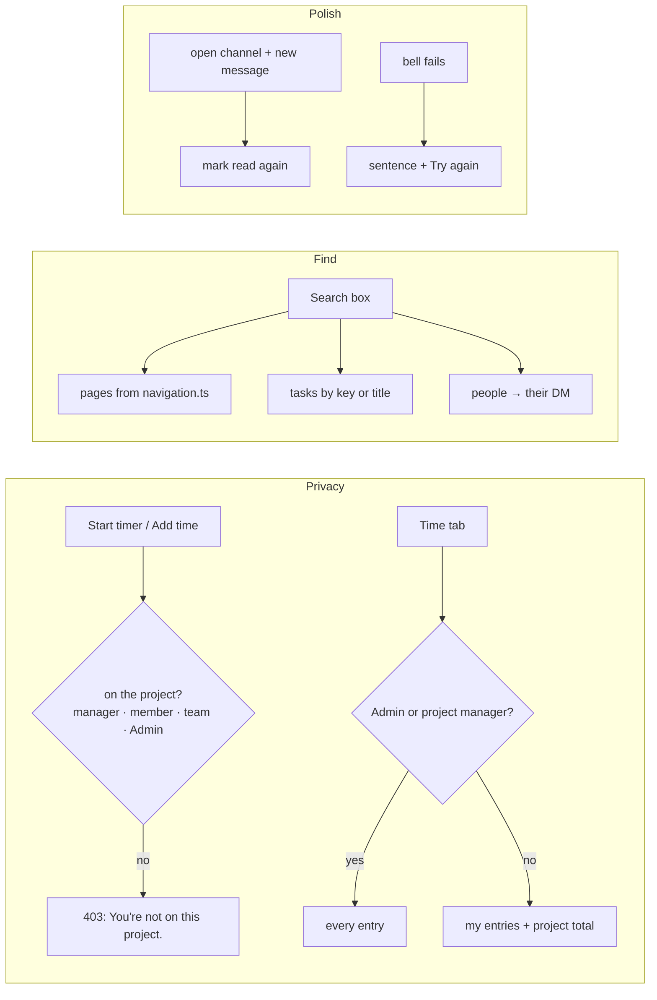

# M8: Privacy and Polish Implementation Plan

> **For agentic workers:** REQUIRED SUB-SKILL: Use superpowers:subagent-driven-development (recommended) or superpowers:executing-plans to implement this plan task-by-task. Steps use checkbox (`- [ ]`) syntax for tracking.

**Goal:** Close the Medium gaps from `GAP_AUDIT.md` that people meet first, and the minors deferred from the M5–M7 reviews:
- **Time privacy:** who can log time on a project and who can read its entries (GAP-010, GAP-011).
- **Search:** pages, tasks and people (GAP-013).
- **Unread:** the channel you're in stays read (GAP-017).
- **The bell:** an error state when mentions fail to load (GAP-032).
- **The phone drawer:** focus behaviour (GAP-031).
- **Batches of the deferred minors.**

**Architecture:** No new subsystems. Each fix goes through the existing layers: the mock check, the `Api`, the hook, then the page.
- **Time privacy** is enforced in the mock, so the .NET team copies one rule. A new project-scoped action, `time.logOn`, covers logging on a project, and `time.logOwn` stays for your own day (check-in, check-out, stop). `time.list` scopes its entries to the viewer.
- **Search** reads one page list in `navigation.ts`. Tasks and people are added to `workspaceShortcuts`.
- **Everything else is local.**

**Tech Stack:** React 19, TS ~6, Vite 8, Tailwind v4, TanStack Query, React Router, dnd-kit, Vitest. No new dependencies.

**Spec:**
- `GAP_AUDIT.md`: GAP-010, 011, 013, 017, 031 and 032.
- The deferred-minor lists from M5, M6 and M7, as reported.
- `docs/superpowers/specs/2026-10-26-spark-flow-company-system-design.md`:
  - §1: check-in is "shown to the person and to managers of their projects".
  - §4.3: permissions.

## Flow

## Decisions this plan makes (confirm or change before approving)

1. **Logging time** needs to be on the project: its manager, a member, or in one of its teams. Admins can log on any project. Sales can log only where they are on the project. The refusal is 403 "You're not on this project."
2. **Reading a project's time:**
   - Admins and the project's manager see every entry.
   - Everyone else sees only their own entries, and the project's total hours. The total stays in the project summary, so no new data is exposed.
   - The Time tab says "Only you and the project's manager see your entries." to non-managers.
3. **Search pages:**
   - The page list moves into `navGroups` in `navigation.ts`, and search uses it.
   - The sidebar keeps its own list until the uncommitted `Sidebar.tsx` edits are settled. A follow-up then switches the sidebar to `navGroups`.
   - The dashboard entry in search follows the role. A PM sees it, matching today's sidebar for the pm role.
4. **Search results:**
   - Up to 5 tasks: by key (prefix) or title (contains), from live tasks only.
   - Up to 5 people: by name or title. Picking a person opens your DM with them (`openDm`).
5. **Unread:** an open, visible channel marks itself read whenever its newest message changes. Thread replies still don't count as unread (product question Q8 is left open).
6. **Archived tasks** refuse status changes and new comments in the mock, with 400 "This task is archived. Restore it first." The panel shows the status as a pill and hides the comment box.

## Global Constraints

- **Imports:** components import `@/api/*` and `@/lib/*` only.
- **Mock writes:** every mock write is one `db.update` with its check inside, and publishes an event.
- **Kit rules:**
  - semantic tokens only, and logical RTL classes only;
  - light, dark, 390px and RTL must all hold;
  - `Sheet` and `MenuPanel` only, no toasts;
  - errors are sentences near their cause;
  - one primary button per view.
- **Copy rules:** sentence case, verb-first buttons, `…` for pending labels, ` · ` as the separator, `—` for empty values.
- **Exact copy:**
  - "You're not on this project." (403)
  - "Only you and the project's manager see your entries."
  - "This task is archived. Restore it first."
  - "Mentions didn't load." with "Try again"
  - "Trying…"
  - "Couldn't open the conversation."
- **Gates:** `npm test` passes under `TZ=Africa/Cairo` and `TZ=Asia/Tokyo`, `npm run lint` passes, and `npm run build:prototype` passes.
- **`src/layout/Sidebar.tsx`, `src/lib/usePermission.ts`, `src/pages/dashboard/DashboardPage.tsx`:** these hold someone else's uncommitted edits. Stage only this plan's hunks in them, as in M5 and M6.

## Review Focus

1. **A member who left a project.** They have past entries but are no longer on it. They can't start new time there. They still see their own old entries in its Time tab, and its totals still include them. *(Test in Task 1.)*
2. **A PM of project A opening project B's Time tab** (not its manager) sees only their own entries on B. *(Test in Task 1.)*
3. **Search for "NEX-1"** lists NEX-1, NEX-10… in key order. An archived task isn't offered, and a private channel or a DM you're not in never appears. *(Test in Task 2.)*
4. **A channel open in a background tab** (document hidden) does not mark itself read, so its unread badge still shows when you come back. *(Test in Task 3: the `shouldMarkRead` helper.)*
5. **The phone drawer:**
   - Escape closes it.
   - Focus starts inside it, Tab stays inside it, and focus returns to the menu button on close.
   - Opening a sheet from it (New channel, New message) still works.

   *(Browser check in Task 4.)*

---

### Task 1: Time privacy (GAP-010, GAP-011)

**Files:**
- Modify:
  - `src/lib/permissions.ts`: a new action `time.logOn` (project-scoped: `isOn`, or admin). `time.logOwn` stays as it is, for check-in, check-out and stop, which name no project.
  - `src/mocks/time.ts`: `start`, `checkIn` with a target, `addManual` and `update` (a new target) check the target's project; `list` scopes entries.
  - `src/pages/time/AddTimeSheet.tsx`: lists only projects you can log on.
  - `src/pages/projects/TicketInspector.tsx`: hides Start timer / Add time when you can't log.
  - `src/pages/home/HomePage.tsx`: the task picker already lists only your own tasks, so no change is needed; check that.
  - `src/pages/projects/TimeTab.tsx`: shows the note.
- Test: `src/lib/permissions.test.ts`, `src/mocks/time.test.ts`

**Interfaces:**
- `can('time.logOn', { …, project })` is true for an admin, or when `isOn(ctx)`. `ProjectScoped` gains `'time.logOn'`.
- `requireCan(data, 'time.logOn', project, { userTeamIds })` is checked inside every time write that names a target (`start`, `checkIn` with a target, `addManual`, and `update` with a target). The target is resolved first.
- `time.list(projectId)` returns every entry to an admin or the project's manager, and only `e.userId === me.id` entries to anyone else. `rates` is unchanged.

- [ ] **Step 1: Write the failing tests.**
  - `permissions.test.ts`: `'time.logOn needs the project'`, covering admin, member, team member, manager, sales not on the project, and an outsider.
  - `time.test.ts`:
    - `'starting a timer or adding time on a project you are not on is refused'` → 403 "You're not on this project.";
    - `'a member sees only their own entries; the manager and an admin see all'`;
    - `'a PM of another project sees only their own entries there'`;
    - `'someone taken off a project keeps seeing their own old entries but cannot log new time'`.
- [ ] **Step 2: Run** `npx vitest run src/lib/permissions.test.ts src/mocks/time.test.ts`. Expected: FAIL.
- [ ] **Step 3: Implement.**
  - Mock: as in the Interfaces block. The 403 detail is set where `forbidden()` would say "You don't have access…".
  - UI: the AddTimeSheet project list and the inspector's time buttons use `check('time.logOn', { project, userTeamIds })`.
- [ ] **Step 4: Run** `npm test && npm run lint`. Expected: PASS.
- [ ] **Step 5: Browser check.**
  - As Tarek (MOB only): NEX-101's panel has no timer buttons, and Add time lists only Mobile App.
  - As Mariam: the NEX Time tab shows only her rows.
  - As Nour: all rows.
- [ ] **Step 6: Commit** `fix: time is logged and read by the people on the project`.

### Task 2: Search pages, tasks and people (GAP-013)

**Files:**
- Modify:
  - `src/navigation.ts`: `navGroups` holds Work (Home, Projects, My tasks, Teams) and Manage (Dashboard with `dashboard.view`, Time & cost with `timeCost.view`). Settings gets children Rates (`rates.view`) and Database (`database.manage`).
  - `src/layout/searchShortcuts.ts`: `taskShortcuts` and `peopleShortcuts`.
  - `src/layout/GlobalSearch.tsx`: feeds tasks through `useTasksOf`, people through `useUsers`, and runs `openDm` when a person is picked.
  - `src/lib/paths.ts`: page paths need the workspace slug. `NavItem.path` keeps its key, and search resolves it through `paths`.
  - `tasks/jira-slack-gap-checklist.md`: fix the "people" line.
- Test: `src/layout/searchShortcuts.test.ts`

**Interfaces:**
- `taskShortcuts(ws, tasks: TaskView[], query: string): Shortcut[]`, at most 5. A key prefix match comes first in key order, then title matches. Archived tasks are already out (they come from `useTasksOf`).
- `peopleShortcuts(users: User[], meId: string, query: string): (Shortcut & { userId: string })[]`, at most 5. It leaves out me.
- `shortcutsFor(role, slug)` now returns the Work and Manage pages the role can see.

- [ ] **Step 1: Write the failing tests.**
  - `'a member finds Home, Projects, My tasks and Teams; an admin also Dashboard, Time & cost, Rates and Database'`.
  - `'NEX-1 finds NEX-1 then NEX-10 in key order; a title word finds tasks; at most 5'`.
  - `'people match by name or title, never me, at most 5'`.
- [ ] **Step 2: Run** `npx vitest run src/layout/searchShortcuts.test.ts`. Expected: FAIL.
- [ ] **Step 3: Implement.**
  - A picked task opens the inspector (`?ticket=`) on its project's Tasks tab.
  - A picked person runs `openDm` and then navigates. A failure shows "Couldn't open the conversation." in the search panel.
- [ ] **Step 4: Run** `npm test && npm run lint`. Expected: PASS.
- [ ] **Step 5: Browser check.**
  - "dash" finds Dashboard for Admin, and not for Mariam.
  - "NEX-10" finds NEX-101….
  - "Salma" opens the DM.
  - Check at 390px (the phone search screen).
- [ ] **Step 6: Commit** `feat: search finds pages, tasks and people`.

### Task 3: Unread follows what you see; the bell's error state (GAP-017, GAP-032)

**Files:**
- Create: `src/pages/chat/markRead.ts` (`shouldMarkRead`)
- Modify: `src/pages/chat/ChannelFeed.tsx`, `src/layout/NotificationsMenu.tsx`
- Test: `src/pages/chat/markRead.test.ts`

**Interfaces:**
- `shouldMarkRead(prevNewestId: string | null, newestId: string | null, visible: boolean): boolean` is true when the tab is visible and the newest id changed.
- On `visibilitychange` back to visible, ChannelFeed marks the channel read again.
- When the mentions query fails, NotificationsMenu shows "Mentions didn't load." and a "Try again" button that refetches.

- [ ] **Step 1: Write the failing tests:** `'marks read when a new message arrives in a visible channel, not in a hidden tab, not when nothing changed'`.
- [ ] **Step 2: Run** `npx vitest run src/pages/chat/markRead.test.ts`. Expected: FAIL.
- [ ] **Step 3: Implement** as in the Interfaces block.
- [ ] **Step 4: Run** `npm test && npm run lint`. Expected: PASS.
- [ ] **Step 5: Browser check.**
  - Two tabs. While B sits on #general, A sends there. B's #general badge stays 0, and the badge on another channel still counts.
  - Force the bell's failure with a temporary throw (not committed) and see the sentence.
- [ ] **Step 6: Commit** `fix: the channel you're in stays read; the bell says when it fails`.

### Task 4: The phone drawer behaves like a dialog (GAP-031)

**Files:**
- Modify: `src/layout/MobileNav.tsx` (`MobileDrawer`)
- Create: `src/lib/useDialogFocus.ts`
- Test: none in Node (it needs the DOM); this is a browser check, recorded as a ruling as in M6 Task 5.

**Interfaces:**
- `useDialogFocus(open: boolean, ref: RefObject<HTMLElement>, onClose: () => void)`:
  - on open, it focuses the first focusable element;
  - Tab and Shift+Tab stay inside;
  - Escape calls `onClose`;
  - on close, focus returns to the element that was focused before.

  It follows `Sheet.tsx:51-56` and `Menu.tsx:48-75`.
- MobileDrawer uses it. Escape does nothing while a Sheet opened from inside the drawer is open: the Sheet handles it.

- [ ] **Step 1: Implement `useDialogFocus` and use it in MobileDrawer.**
- [ ] **Step 2: Run** `npm test && npm run lint && npm run build:prototype`. Expected: PASS.
- [ ] **Step 3: Browser check at 390px.**
  - Open the drawer: focus is on Close.
  - Tab cycles inside it, and Escape closes it.
  - Focus returns to the menu button.
  - New message opens and closes from the drawer.
- [ ] **Step 4: Commit** `fix: the phone drawer keeps focus and closes with Escape`.

### Task 5: Board and history polish (M7 minors)

**Files:**
- Modify: `src/lib/activityText.ts`, `src/mocks/activity.ts`, `src/mocks/projects.ts`, `src/mocks/taskEvents.ts`, `src/pages/projects/{ProjectBoard,DeleteColumnSheet,ColumnSheet,ticketPills}.tsx`, `src/pages/projects/TasksTab.tsx`
- Test: `src/lib/activityText.test.ts`, `src/mocks/activity.test.ts`, `src/mocks/taskEvents.test.ts`, `src/mocks/projects.test.ts`

**Changes, each pinned by a test:**
1. **History shows the name a column or phase had then.** `valueOf` uses the snapshot first and the live name as a fallback. Test: `'a line written before a rename keeps the old name'`. This flips the M7 test that expected the live name.
2. **History uses the injected clock.** `logActivity(data, entry, at)` takes `at` from the caller's `now()`, kept strictly increasing. Test: `'history times follow the api clock'`.
3. **"Edited the project" is logged only when a field changed.** Test: `'a project update that changes nothing logs nothing'`.
4. **Removing a phase logs a `task.changed` (phase) line** for each task it clears. Test: `'removing a phase logs the phase change on each of its tasks'`.
5. **The Done card is posted only when the task's type becomes done.** Moving between two Done-type columns posts a status card. Test in `taskEvents.test.ts`.
6. **A default column's hue is kept only while its type matches the default.** `tintOf(id, category)` and `StatusPill` check `DEFAULT_COLUMNS`. Test in `src/lib/boardColumns.test.ts`, with `hueKey(id, category)`.
7. **The delete sheet always shows the "Move them to" select.**
   - Its count comes from every task of the project (TasksTab passes the unfiltered list plus the archived one).
   - Test: a pure `columnTaskCount(all, archived, id)`.
8. **Board column changes don't leave a stale draft, and their errors show.**
   - The board draft clears once `onBoard` resolves or rejects.
   - Move left/right and header-drag failures show their sentence in the board's error line.
   - Browser check.
9. **The ColumnSheet type picker** supports the arrow keys (roving `tabIndex`). Browser check.

- [ ] **Step 1: Write the failing tests for changes 1–7.**
- [ ] **Step 2: Run** `npx vitest run src/lib src/mocks`. Expected: FAIL on each.
- [ ] **Step 3: Implement changes 1–9.**
- [ ] **Step 4: Run** `npm test && npm run lint`. Expected: PASS.
- [ ] **Step 5: Browser check of changes 8 and 9.**
  - Two tabs: tab B adds a column while tab A renames one, and A ends with both.
  - Arrow keys move through the type options.
- [ ] **Step 6: Commit** `fix: history keeps names of the time; board and column polish`.

### Task 6: Archived tasks and time polish (M6 minors)

**Files:**
- Modify: `src/mocks/tickets.ts`, `src/mocks/comments.ts`, `src/pages/projects/{TicketInspector,TaskActivity,TimeTab,TasksTab}.tsx`, `src/pages/home/HomePage.tsx`, `src/components/ConfirmDeleteSheet.tsx`
- Test: `src/mocks/tasks.test.ts`, `src/mocks/comments.test.ts`

**Changes:**
1. **An archived task refuses status changes and new comments** with 400 "This task is archived. Restore it first." Its panel shows a status pill and no comment box. Test: `'an archived task refuses a move and a comment'`.
2. **An archived task's entries still name it.** In the Time tab and on Home they read "NEX-101 · Title (archived)": both fetch the archived list for the label. A pure label helper is tested.
3. **ConfirmDeleteSheet:**
   - it resets its error each time it opens;
   - it can't be closed while pending (Sheet `dismissible={false}` and Cancel disabled);
   - a new `tone: 'danger' | 'primary'` prop, used as `'primary'` for Archive task.

   Browser check.
4. **"Show archived (n)"** only shows while n > 0, or while it is toggled on with n > 0. When n becomes 0 it untoggles. Browser check.

- [ ] **Step 1: Write the failing tests for changes 1 and 2.**
- [ ] **Step 2: Run** `npx vitest run src/mocks src/pages`. Expected: FAIL.
- [ ] **Step 3: Implement changes 1–4.**
- [ ] **Step 4: Run** `npm test && npm run lint`. Expected: PASS.
- [ ] **Step 5: Commit** `fix: archived tasks stay read-only and keep their names`.

### Task 7: Shell and data polish (M6 minors)

**Files:**
- Modify: `src/layout/AppLayout.tsx`, `src/layout/AccountState.tsx`, `src/pages/teams/TeamsPage.tsx`, `src/mocks/db.ts`, `src/mocks/migrations.ts`, `src/layout/useSidebarGroups.ts` (the group DM icon), `src/lib/hours.ts`
- Test: `src/mocks/db.test.ts`, `src/mocks/migrations.test.ts` (new)

**Changes:**
1. **Export** writes the document's own default person, not the tab's actor. Test: `'export while viewing as someone keeps the default person'`.
2. **Import** accepts an older export by running it through the migration chain. Test: `'a v4 export imports and is upgraded'`.
3. **The 3 → 4 migration** gives every person the default person's read map, not empty reads. Test in `migrations.test.ts`.
4. **AccountState:**
   - the Inspector is hidden while `me` has failed;
   - "Try again" reads "Trying…" while refetching.

   Browser check, with a temporary throw that isn't committed.
5. **The Teams "Message" button:**
   - an error shows as a line under the row;
   - the buttons wait until `me` has loaded.

   Browser check.
6. **A group DM shows a group icon** (`Users`) instead of one member's presence dot.
7. **The `capped` / `entryHours` doc comments** move back to their own functions.

- [ ] **Step 1: Write the failing tests for changes 1–3.**
- [ ] **Step 2: Run** `npx vitest run src/mocks/db.test.ts src/mocks/migrations.test.ts`. Expected: FAIL.
- [ ] **Step 3: Implement changes 1–7.** Stage only this plan's hunks in the three files with uncommitted edits.
- [ ] **Step 4: Run** `npm test && npm run lint`. Expected: PASS.
- [ ] **Step 5: Commit** `fix: export, import and shell polish`.

### Task 8: Verify, update the audit, review

- [ ] **Step 1: Run** `TZ=Africa/Cairo npm test`, `TZ=Asia/Tokyo npm test`, `npm run lint` and `npm run build:prototype`. Expected: all green.
- [ ] **Step 2: Browser pass** as Admin, Nour, Mariam, Tarek and Karim (Review Focus 1–5). Check light, dark, 390px and RTL. Use a fresh tab for the console: no errors.
- [ ] **Step 3: Update the docs.** In `GAP_AUDIT.md`, mark GAP-010, 011, 013, 017, 031 and 032 as fixed, with their commits. In `docs/demo-script.md`, add a line to Story 2 ("Mariam sees only her own time on Nexus Core") and to Story 4 (search "NEX-10"). Commit `docs: M8 audit status and demo notes`.
- [ ] **Step 4: Whole-branch review.** Run one review on the most capable model over `<M8 base>..HEAD` with this plan's Review Focus. Then one fix pass, each fix RED → GREEN; minors are deferred.
