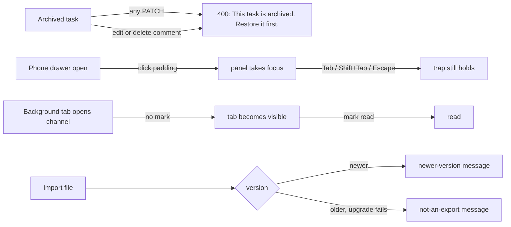

# M9: M8 Minors Implementation Plan

> **For agentic workers:** REQUIRED SUB-SKILL: Use superpowers:subagent-driven-development (recommended) or superpowers:executing-plans to implement this plan task-by-task. Steps use checkbox (`- [ ]`) syntax for tracking.

**Goal:** Fix the seven minors deferred from the M8 whole-branch review.

**Architecture:** No new subsystems. Each fix stays in the file that owns the behavior. A rule the .NET team must copy goes in the mock (`src/mocks/*`). Page logic that the node test environment can't render goes into a small pure helper beside its page, as M8 did with `timeTotals.ts` and `taskFilters.ts`.

**Tech Stack:** React 19, TypeScript, Vite, Tailwind v4, TanStack Query, React Router, Vitest (node environment). No new dependencies.

**Spec:** The M8 review's deferred minors, as reported at the end of M8. These are the seven issues the user approved on 27 Oct 2026:
1. The API still accepts changes other than status to an archived task (assignee, title, rank, estimate). Comments on an archived task can still be edited and deleted.
2. Clicking empty space inside the phone menu breaks Escape and the keyboard focus trap.
3. Admins briefly see the "only you and the manager" line while their account loads.
4. After the last archived task is restored, the next one archived appears with "Show archived" already on.
5. A channel opened straight into a background tab is marked read.
6. A malformed version-3 data file crashes the upgrade instead of reseeding.
7. The import error still says "from this version".

Authority for behavior: `docs/superpowers/specs/2026-10-26-spark-flow-company-system-design.md` and the project `CLAUDE.md`.

## Flow



## Global Constraints

- Copy is in English and sentence case. Errors are sentences shown near their cause. No toasts.
- The archived refusal copy is exactly `This task is archived. Restore it first.` It already exists in `tickets.ts`, `comments.ts` and `TaskActivity.tsx`.
- Use logical RTL classes only (`ps-`, `start-` and so on). Use semantic color tokens only.
- Every screen works in light and dark and on a 390px phone.
- Leave the user's uncommitted edits in `src/layout/Sidebar.tsx`, `src/lib/usePermission.ts` and `src/pages/dashboard/DashboardPage.tsx` unstaged. If a task touches one of these files, stage only your own hunk, using `git hash-object -w` plus `git update-index --cacheinfo`.
- Per task: `npm test`, `npx tsc -b`, `npm run lint`. Before the final review, also run `npm run build:prototype` and `TZ=Asia/Tokyo npm test`.
- Never push or merge.

## Review Focus

1. **A board drag or a column delete touching archived tasks.** Archived tasks must not make the board or a column delete fail. Task 1 checks that no caller of `updateTicket` patches an archived task, and adds a test for column delete with an archived task in the column.
2. **A drawer opened, its padding clicked, then a link clicked.** Navigation still closes the drawer, and focus goes back to the menu button. Task 2's browser step checks this.
3. **A view with an archived filter that matches none.** When a phase filter hides every archived task but other phases still have some, `?archived=1` must stay. Only a project with zero archived tasks clears it. Task 3 has a test for this.
4. **Switching channels in a visible tab.** Each channel is still marked read once its messages load. Task 4's browser step checks this.
5. **A v3 file whose `users` is an object.** Importing it must fail with the 400 "Import failed" error and write nothing. On startup, the same stored document must reseed and not crash. Task 5 tests both.

---

### Task 1: Archived tasks are fully read-only

**Files:**
- Modify: `src/mocks/tickets.ts:179` (`updateTicket`)
- Modify: `src/mocks/comments.ts:29-38` (`ownComment`)
- Modify: `src/pages/projects/TaskActivity.tsx:36` (`mine` prop)
- Test: `src/mocks/tasks.test.ts`, `src/mocks/comments.test.ts`

**Interfaces:**
- Consumes: nothing new.
- Produces: `updateTicket` refuses any patch on an archived task. `ownComment` refuses when its task is archived. Restoring the task still goes through `tasks.restore`, which does not use `updateTicket`.

- [ ] **Step 1: Write the failing tests**

In `tasks.test.ts`, add a test beside "an archived task refuses a move and a comment":

```ts
it('an archived task refuses every other change too', async () => {
  // archive NEX-101 as admin, as the neighbouring test does
  for (const patch of [{ title: 'New' }, { assigneeId: null }, { rank: 5 }, { estimateHours: 3 }])
    await expect(api.tasks.update('NEX-101', patch)).rejects.toMatchObject({ status: 400, detail: 'This task is archived. Restore it first.' })
})
it('deleting a column that holds an archived task still works', async () => { /* Review Focus 1: use the existing column-delete API and assert it resolves */ })
```

In `comments.test.ts`, add `'comments on an archived task can be neither edited nor deleted'`:
- Create a comment as its author.
- Archive the task.
- `api.comments.update(id, 'x')` and `api.comments.remove(id)` both reject with `{ status: 400, detail: 'This task is archived. Restore it first.' }`.
- The comment body is unchanged.

- [ ] **Step 2: Run the tests and watch them fail**

Run: `npx vitest run src/mocks/tasks.test.ts src/mocks/comments.test.ts`
Expected: the two new archived tests FAIL because the update or remove resolves. If the column-delete test fails, that is a real finding: rule on it and record the ruling in the ledger.

- [ ] **Step 3: Implement**

- `updateTicket`: replace the status-only check with `if (ticket.archivedAt) throw badRequest(...)`.
- `ownComment`: add the same refusal after the `deletedAt` check.
- `TaskActivity`: pass `mine={canPost && !task.archivedAt && c.authorId === me?.id}`, so the edit and delete menus go away.

- [ ] **Step 4: Run the tests and watch them pass**

Run: `npm test`
Expected: all tests PASS.

- [ ] **Step 5: Commit**

`fix: archived tasks refuse every edit, and their comments stay as they are`

---

### Task 2: The phone drawer keeps focus after a click on its padding

**Files:**
- Modify: `src/lib/useDialogFocus.ts`
- Modify: `src/layout/MobileNav.tsx:82` (the inner panel `div`)
- Test: create `src/lib/useDialogFocus.test.ts`

**Interfaces:**
- Produces: `export function wrapFocus<T>(items: T[], active: T | null, shift: boolean): T | null`. It returns the item to focus, or `null` to let the browser move focus.

- [ ] **Step 1: Write the failing test**

```ts
describe('wrapFocus', () => {
  const items = ['a', 'b', 'c']
  it('wraps at the ends', () => {
    expect(wrapFocus(items, 'c', false)).toBe('a')
    expect(wrapFocus(items, 'a', true)).toBe('c')
  })
  it('leaves the middle to the browser', () => expect(wrapFocus(items, 'b', false)).toBeNull())
  it('from the panel itself (padding clicked), Tab goes to the first and Shift+Tab to the last', () => {
    expect(wrapFocus(items, 'panel', false)).toBe('a')
    expect(wrapFocus(items, 'panel', true)).toBe('c')
    expect(wrapFocus(items, null, true)).toBe('c')
  })
  it('nothing to focus', () => expect(wrapFocus([], 'panel', false)).toBeNull())
})
```

- [ ] **Step 2: Run the test and watch it fail**

Run: `npx vitest run src/lib/useDialogFocus.test.ts`
Expected: FAIL, because `wrapFocus` is not exported.

- [ ] **Step 3: Implement**

- Add `wrapFocus` and use it in the Tab branch of `useDialogFocus`: `const to = wrapFocus(items, document.activeElement as HTMLElement | null, event.shiftKey); if (to) { event.preventDefault(); to.focus() }`.
- In `MobileDrawer`, give the inner panel `div` the attributes `tabIndex={-1}` and `outline-none`. A click on its padding then focuses the panel, which is inside `ref`, so Escape and Tab keep working.

- [ ] **Step 4: Check the tests and the browser**

- Run `npm test`. Expected: all tests PASS.
- In the browser at 390px:
  1. Open the drawer.
  2. Click empty space in the panel. Tab moves to the first item, Shift+Tab to the last, and Escape closes the drawer and returns focus to the menu button.
  3. Review Focus 2: open the drawer, click its padding, then click a link. The drawer closes.

- [ ] **Step 5: Commit**

`fix: the phone drawer keeps focus after a click on its padding`

---

### Task 3: No flash of the privacy line, and no stale "Show archived"

**Files:**
- Modify: `src/pages/projects/timeTotals.ts` and `src/pages/projects/TimeTab.tsx:32-36`
- Modify: `src/pages/projects/taskFilters.ts` and `src/pages/projects/TasksTab.tsx:85-90`
- Test: `src/pages/projects/timeTotals.test.ts`, `src/pages/projects/taskFilters.test.ts`

**Interfaces:**
- Consumes: `useRole()` returns `loading`, which is true while the persona is still the placeholder.
- Produces:
  - `showPrivacyNote(everyone: boolean, loading: boolean): boolean`
  - `staleArchivedParam(asked: boolean, archivedCount: number | undefined): boolean`. Here `undefined` means the archived list has not loaded yet.

- [ ] **Step 1: Write the failing tests**

```ts
it('the privacy line waits for the account, and is only for people who see their own time', () => {
  expect(showPrivacyNote(false, true)).toBe(false)
  expect(showPrivacyNote(true, false)).toBe(false)
  expect(showPrivacyNote(false, false)).toBe(true)
})
it('?archived=1 is cleared only once the project has no archived tasks at all', () => {
  expect(staleArchivedParam(true, 0)).toBe(true)
  expect(staleArchivedParam(true, undefined)).toBe(false) // still loading
  expect(staleArchivedParam(true, 2)).toBe(false)         // Review Focus 3: pass the unfiltered count
  expect(staleArchivedParam(false, 0)).toBe(false)
})
```

- [ ] **Step 2: Run the tests and watch them fail**

Run: `npx vitest run src/pages/projects/timeTotals.test.ts src/pages/projects/taskFilters.test.ts`
Expected: FAIL, because the two functions are not exported.

- [ ] **Step 3: Implement**

- `TimeTab`: `const { persona, loading } = useRole()`, and render the line when `showPrivacyNote(everyone, loading)`.
- `TasksTab`:
  - Read `const archivedQuery = useArchivedTasks(project.id, true)`.
  - Add `useEffect(() => { if (staleArchivedParam(params.get('archived') === '1', archivedQuery.data?.length)) setParam('archived', null) }, [...])`.
  - `setParam` already uses `replace: true`, so this adds no history entry.

- [ ] **Step 4: Check the tests and the browser**

- Run `npm test`. Expected: all tests PASS.
- In the browser:
  1. As Admin, with network throttling on, open the Time tab. No privacy line flashes.
  2. Archive one task, turn on Show archived, then restore the task. `?archived=1` leaves the URL.
  3. Archive another task. Show archived is off.

- [ ] **Step 5: Commit**

`fix: no privacy-line flash while the account loads; Show archived resets at zero`

---

### Task 4: A channel opened in a background tab stays unread

**Files:**
- Modify: `src/pages/chat/ChannelFeed.tsx:43`
- Test: `src/pages/chat/markRead.test.ts`

**Interfaces:**
- Consumes: `shouldMarkRead(prev, newest, visible)` and the existing `visibilitychange` handler.

The mount effect `useEffect(() => markRead(channelId), [channelId, markRead])` ignores visibility. Delete it. The `shouldMarkRead` effect already marks a channel once its newest message loads in a visible tab, since `seen` starts as `null`. The `visibilitychange` handler marks it when a background tab comes into view. A channel with no messages has nothing unread, so it needs no mark.

- [ ] **Step 1: Pin the rule the change now relies on**

Add `'a channel just opened is marked once its first message loads, only in a visible tab'`:
- `shouldMarkRead(null, 'm1', true)` is `true`.
- `shouldMarkRead(null, 'm1', false)` is `false`.
- `shouldMarkRead(null, null, true)` is `false`.

These assertions pass before the change. That is expected, so record it as a ledger ruling. The component itself can't be rendered in the node environment, as with M8 Task 4, so the browser step is the RED/GREEN check.

- [ ] **Step 2: RED in the browser**

1. Middle-click a channel that has unread messages, so it opens in a background tab.
2. Expected before the fix: the original tab's badge clears, which is the bug.

- [ ] **Step 3: Delete the mount effect**

- [ ] **Step 4: GREEN in the browser**

1. Repeat Step 2. The badge stays until the background tab is shown, then clears.
2. Review Focus 4: in a visible tab, switch between three channels. Each one is marked read.

Then run `npm test`. Expected: all tests PASS.

- [ ] **Step 5: Commit**

`fix: a channel opened in a background tab stays unread until you look`

---

### Task 5: Import and upgrade fail cleanly

**Files:**
- Modify: `src/mocks/migrations.ts:11`
- Modify: `src/mocks/db.ts:73` (doc comment), `:131-132` (`badImport`) and `:244` (the newer-version branch)
- Test: `src/mocks/migrations.test.ts`, `src/mocks/db.test.ts`

**Interfaces:**
- Produces: `badImport(newer = false)` returns an `ApiError` with `title: 'Import failed'`, `status: 400`, and one of two `detail` values:
  - when `newer` is true: `That export is from a newer version of Spark Flow. Update the app, then import it again.`
  - otherwise: `That file isn't a Spark Flow export.`

- [ ] **Step 1: Write the failing tests**

- `migrations.test.ts`, `'3 → 4 with users that isn\'t a list still gives the default person their map'`:
  - Input: `migrate({ version: 3, currentUserId: 'u1', users: {}, reads: { c1: 'T1' } }, 4)` does not throw.
  - Expected: `reads` equals `{ u1: { c1: 'T1' } }`.
- `db.test.ts`, `'a newer export says so; a broken one says it isn\'t an export'`:
  - Importing `{ app: 'spark-flow', version: DB_VERSION + 1, exportedAt: 'T', data: {} }` rejects with the newer detail.
  - Importing `{ app: 'spark-flow', version: 3, exportedAt: 'T', data: { version: 3, currentUserId: 'u1', users: {} } }` rejects with `{ status: 400, detail: "That file isn't a Spark Flow export." }`.
  - After both, the data is unchanged (Review Focus 5).
- `db.test.ts`, `'a stored v3 document with broken users reseeds on start'`:
  - Put that document in a memory store.
  - `createDb(...).read()` resolves to seeded data with `version === DB_VERSION`.

- [ ] **Step 2: Run the tests and watch them fail**

Run: `npx vitest run src/mocks/migrations.test.ts src/mocks/db.test.ts`
Expected:
- The migration test FAILS with `TypeError: ... .map is not a function`.
- The copy test FAILS on `detail`.
- The reseed test FAILS with the TypeError.

- [ ] **Step 3: Implement**

- `migrations.ts`: `Array.isArray(doc.users) ? doc.users : []`, and skip entries with no `id`.
- `db.ts`:
  - Split the guard on line 244 so `bundle.version > DB_VERSION` throws `badImport(true)`.
  - Every other failure throws `badImport()`.
  - Update the doc comment on line 73 to say "an export from this or an older version".

- [ ] **Step 4: Run the tests and watch them pass**

Run: `npm test`
Expected: all tests PASS.

- [ ] **Step 5: Commit**

`fix: a broken old file reseeds or is refused; import says why`

---

### Finish

- Run the full checks: `npm test`, `TZ=Asia/Tokyo npm test`, `npx tsc -b`, `npm run lint` and `npm run build:prototype`. All are clean.
- Run one whole-branch review on the M9 range, from the commit before Task 1 to HEAD.
- Make one fix pass for Critical and Important findings. Defer the minors.
