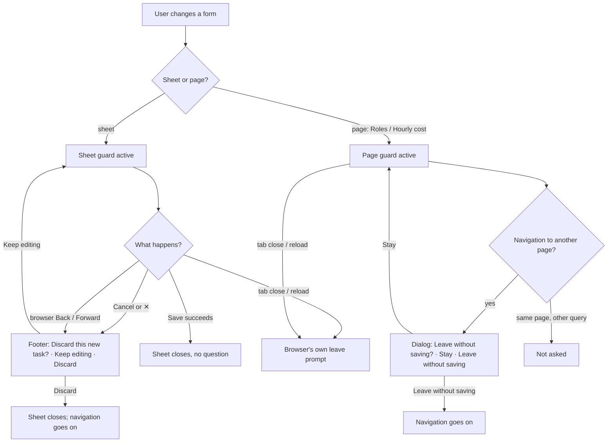

# UX Phase 1: Critical usability — Implementation Plan

> **For agentic workers:** REQUIRED SUB-SKILL: Use superpowers:subagent-driven-development (recommended) or superpowers:executing-plans to implement this plan task-by-task. Steps use checkbox (`- [ ]`) syntax for tracking.

**Goal:** fix the seven Phase 1 findings of the UX audit: no form loses typed work, "Overdue" means late only, project chat has room, deletes for good need typing, a new task shows itself, Restore channel works, and phones can fix time.

**Architecture:** one app-wide "unsaved changes" guard (a small store, one router blocker in the shell, a `dirty` prop on `Sheet`) that every form joins; a second derived task flag `overEstimate` next to `overdue` from the mock to the pages; a "fill" layout mode in `AppLayout` that the project Chat tab uses; four small fixes in their own files.

**Tech Stack:** React 19, TypeScript, React Router 8 (`useBlocker`, data router), TanStack Query, zustand, Tailwind v4, Vitest (jsdom + browser).

**Spec:** `docs/ux-audit/2026-11-09-ui-ux-audit.md`, Phase 1 (items 1.1–1.7) and section 7 (rule changes). Decisions the audit left open are in [Decisions](#decisions) below; the questions at the end of this file need answers before Task 1.

## Global Constraints

- Hard rules in `CLAUDE.md`: semantic tokens only; status colours `bg-{c}-50 text-{c}-700 dark:bg-{c}-500/15 dark:text-{c}-300`; `Sheet` for every modal; no toasts, spinners or overlays; one red primary per view; sentence case; `…` for pending; logical direction classes only (`src/rtl.test.ts`).
- Every changed screen works in light and dark and at 390 px.
- Pages import from `@/api/*` only, never `@/mocks`.
- Nothing derived is stored: `overEstimate` is worked out on read in `mocks/derive.ts`, like `overdue`.
- No new `Api` method in this phase (so `mocks/audit.test.ts` needs no new entry).
- Test first for every task (`npx vitest run <file>`); the phase ends green on `npx tsc -b`, `npm run lint`, `npm test` (the known `RichComposer.browser` "unknown /word" failure excepted) and `npm run build:prototype`.
- Work on branch `feat/ux-phase-1` in worktree `Spark_Flow/.worktrees/ux-phase-1`, cut from `origin/dev` (15555e7). One commit per task. No push until asked; never touch `main`.

## Decisions

These fix what the audit left open. Change them only through the questions at the end.

**D1. Two task flags** (1.1).
- `overdue` = not done and past its due date (date only).
- `overEstimate` = not done, `estimateHours > 0` and `loggedHours > estimateHours`.
- A task can be both. Done tasks are neither.
- `ProjectSummary.overdueCount` counts `overdue`; new `overEstimateCount` counts `overEstimate`.
- `expectedFinish` shifts when any task is `overdue || overEstimate` (today's behaviour kept).

**D2. How they show** (1.1).
- Pills: `OverduePill` stays red "Overdue"; new `OverEstimatePill` amber "Over estimate" (`bg-amber-50 text-amber-700 dark:bg-amber-500/15 dark:text-amber-300`). Both show when both apply.
- Card and row hours ("21.9 / 6 h") turn amber when `overEstimate`, not red.
- Home: the card stays "Due today and overdue" and now lists only date-late or due-today tasks. Subtitle: "2 open tasks · 1 overdue", plus " · 1 over estimate" only when that count is above 0.
- My tasks: order overdue first, then over estimate, then nearest due date. Subtitle as Home's.
- Overview "Hours logged" sub: "10 tasks · 2 overdue", plus " · 3 over estimate" when above 0.
- Backlog phase header: " · 2 overdue" (red) and " · 3 over estimate" (amber), each only when above 0.
- Projects: the "Overdue" tile and column now count date-late tasks only (no new column).
- Dashboard: tile "Overdue tasks" = sum of `overdueCount`, with sub "N over estimate" when above 0. Project card gets a second fact "Over estimate" next to "Overdue tasks".
- Dashboard table: `DashboardStats.overdue` is renamed `attention`; each row adds `overdue`, `overEstimate`, `loggedHours`, `estimateHours`. Heading "N tasks need attention" / "No tasks need attention". Due cell: "Overdue · 6 Nov" (red), "Over estimate · 21.9 / 6 h" (amber), or both joined with " · ". Sort: overdue rows by due date first, then over-estimate-only rows by key.

**D3. Unsaved changes** (1.2).
- One store of active guards; the newest guard answers.
- A **sheet guard** asks only when the user presses Cancel, ✕, or the browser's Back/Forward (a POP navigation). The question is a line in the sheet's own footer: "Discard this new task?" (or "Discard your changes?" on an edit) with **Keep editing** (secondary) and **Discard** (danger). No second dialog.
- A **page guard** (Roles matrix, Hourly cost rows) asks on any navigation that changes the pathname, in a `Sheet` dialog: title "Leave without saving?", description "N changes aren't saved.", buttons **Stay** (secondary) and **Leave without saving** (danger).
- While any guard is active, closing or reloading the tab triggers the browser's own `beforeunload` prompt.
- A form's own Save never asks: its closing navigation is a PUSH/REPLACE, which a sheet guard doesn't block.
- `PhasesSheet` stops being `dismissible`.

**D4. Delete for good** (1.4): `ArchivedPage`'s `DeleteSheet` becomes `components/ui/DeleteDialog` with `confirmText = record.ref` (project key, task key or channel name) and `removes` built from `record.includes` (only the non-zero parts, e.g. "12 tasks", "4 files"), plus the existing sentences about the audit log and the project's channel. Deleting a role keeps its plain confirm: only a role nobody holds can be deleted, so no data goes with it.

**D5. New task result** (1.5): after a create, the task panel opens on the page you are on (`withInspector(params, { kind: 'ticket', key })`). This applies to the project header's New task (every tab) and the sidebar "+".

**D6. Restore channel** (1.6): the button shows only with `useChannelRights(channel).archive`. A manager without it reads "Only Admins can restore channels." in its place. The mock's 403 says "Only admins can restore channels." on a restore.

**D7. Phone time** (1.7): each phone list item in the project Time tab ends with `<EntryRowExtras entry={e} compact />`, the same as the desktop table's actions cell.

**D8. Project Chat tab** (1.3).
- A route `handle.fill` can be a boolean or `(params) => boolean`; `p/:projectKey/:tab` gets `fill: (p) => p.tab === 'chat'`.
- `AppLayout` "fill" mode: the page doesn't scroll; `main` is a flex column with the normal page padding, the content fills the height, and on phones it stops above the bottom bar and timer bar (same `pb` as a pane). It keeps the canvas background (not the chat surface).
- On the Chat tab `ProjectPage` shows `RecordHeader` with `compact` (no meta row; no phone action bar — on phones the actions sit in a ⋯ menu on the title row), no phase bar, no `RecordActionBarSpacer`.
- "Open in Chat" moves to the end of the tab row (`ProjectTabs` `end` slot) and the channel box fills the rest (`flex-1 min-h-0`, no fixed height).
- Not in this phase: removing the channel's own Files tab (audit 2.5, Phase 2) and the phone composer toolbar (5.2, Phase 5).

## Review Focus

1. **A form's Save in a sheet held by the address** (Projects `?new=1`, Users `?person=`): closing after Save must not ask or block. Pinned in Task 1 (blocker ignores PUSH/REPLACE for sheet guards) and Task 2 (Projects create closes with no question).
2. **Two guards at once** (Roles: Add role sheet open while the matrix has changes): only the newest answers, and when the sheet closes the page guard still works. Pinned in Task 1.
3. **A task both late and over its estimate**: both pills, counted in both counts, one dashboard row saying both. Pinned in Tasks 5 and 6.
4. **The project Chat tab on a phone with a running timer**: the message box is visible without scrolling the page. Pinned in Task 10 (layout check at 390 × 844 with `--timer-bar` set).
5. **A dirty sheet when the tab is closed or reloaded**: the browser asks; a clean one doesn't. Pinned in Task 1.

---

### Task 1: Unsaved-changes guard (store, blocker, `Sheet` question)

**Files:**
- Create: `src/lib/unsavedChanges.ts`, `src/layout/UnsavedChangesBlocker.tsx`, `src/components/ui/LeaveGuard.tsx`
- Modify: `src/components/ui/Sheet.tsx`, `src/layout/AppLayout.tsx` (mount the blocker once)
- Test: `src/lib/unsavedChanges.test.ts`, `src/components/ui/Sheet.test.tsx`, `src/layout/UnsavedChangesBlocker.test.tsx`

**Interfaces:**
- Produces:
  - `type GuardScope = 'sheet' | 'page'`
  - `type UnsavedGuard = { id: string; scope: GuardScope; ask: (leave: () => void, stay: () => void) => void }`
  - `useUnsavedGuards` (zustand): `{ guards: UnsavedGuard[]; add(g: UnsavedGuard): void; remove(id: string): void }`
  - `useUnsavedChanges(dirty: boolean, scope: GuardScope, ask: UnsavedGuard['ask']): void` — adds a guard while `dirty`, removes it when clean or unmounted; `ask` read through a ref.
  - `shouldBlock(guards: UnsavedGuard[], nav: { historyAction: 'POP' | 'PUSH' | 'REPLACE'; from: string; to: string }): boolean` — pure; newest guard decides: sheet → `historyAction === 'POP'`; page → `from !== to` (pathnames).
  - `UnsavedChangesBlocker()` — `useBlocker` with `shouldBlock`; when blocked, calls the newest guard's `ask(blocker.proceed, blocker.reset)`; adds a `beforeunload` listener while `guards.length > 0`.
  - `Sheet` new props: `dirty?: boolean`, `discardQuestion?: string` (default "Discard your changes?"). Exports `SheetCancelButton({ children = 'Cancel' })` (secondary `Button` that asks when dirty) and `useSheetClose(): () => void`.
  - `LeaveGuard({ dirty, description }: { dirty: boolean; description: string })` — page guard; renders the D3 "Leave without saving?" sheet when asked.

- [ ] **Step 1: Write the failing tests**
  - `unsavedChanges.test.ts`: `shouldBlock` → `[]` never; newest sheet guard blocks POP only; newest page guard blocks `/a`→`/b`, not `/a`→`/a?x=1`; with a page guard under a sheet guard, the sheet decides; `useUnsavedChanges` adds when dirty and removes on clean and on unmount.
  - `Sheet.test.tsx` (jsdom): clean ✕ and `SheetCancelButton` call `onClose`; dirty ✕ shows "Discard your changes?" and does not close; **Keep editing** hides the line; **Discard** calls `onClose`; `discardQuestion="Discard this new task?"` shows that text.
  - `UnsavedChangesBlocker.test.tsx` (jsdom, `createMemoryRouter`): with a dirty sheet guard, `router.navigate(-1)` calls `ask`, and `leave` completes the navigation; `router.navigate('/x')` (PUSH) is not blocked; a page guard blocks a PUSH to another path and `stay` keeps the location; `beforeunload` `preventDefault` is called only while a guard is active.
- [ ] **Step 2: Run them and see them fail** — `npx vitest run src/lib/unsavedChanges.test.ts src/components/ui/Sheet.test.tsx src/layout/UnsavedChangesBlocker.test.tsx` → FAIL (modules missing).
- [ ] **Step 3: Implement** the interfaces above. In `Sheet`, ✕ and `SheetCancelButton` go through one `requestClose`; the guard's `ask` sets the same footer question with `leave`/`stay` from the blocker. The question replaces the footer's buttons while shown (a sheet without a footer shows it in a footer row).
- [ ] **Step 4: Run the tests and see them pass.**
- [ ] **Step 5: Commit** — `feat(forms): ask before discarding changed sheets and pages`

### Task 2: Project and time sheets join the guard

**Files:**
- Modify: `src/pages/projects/{TaskSheet,ProjectSheet,PhasesSheet,ColumnSheet,DeliverableSheet}.tsx`, `src/pages/time/AddTimeSheet.tsx`
- Test: `src/pages/projects/TaskSheet.test.tsx` (exists), `src/pages/projects/ProjectSheet.test.tsx` (create if missing), `src/pages/time/AddTimeSheet.test.tsx` (create if missing)

**Interfaces:**
- Consumes: `Sheet` `dirty` / `discardQuestion`, `SheetCancelButton` (Task 1).
- Each sheet computes `dirty` against the values it opened with (for TaskSheet also `descriptionBody`, `added.length > 0`, `removed.size > 0`, `queue.busy`). Questions: new → "Discard this new task?" / "…new project?" / "…new column?" / "…new deliverable?" / "Discard this time entry?"; edit → "Discard your changes?".
- `PhasesSheet`: remove `dismissible`.

- [ ] **Step 1: Failing tests** — TaskSheet: type a title, press Cancel → "Discard this new task?" shows and `onClose` is not called; Discard → `onClose`; an untouched sheet's Cancel closes at once. ProjectSheet: same with "Discard this new project?". AddTimeSheet: a changed note asks; untouched closes. PhasesSheet: Escape does not close.
- [ ] **Step 2: Run, see FAIL.**
- [ ] **Step 3: Implement** — pass `dirty` and `discardQuestion`; replace each footer Cancel with `SheetCancelButton`.
- [ ] **Step 4: Run, see PASS** (and the existing tests of these files).
- [ ] **Step 5: Commit** — `feat(projects): project, task, phase and time sheets ask before discarding`

### Task 3: Settings and chat forms join the guard

**Files:**
- Modify: `src/pages/settings/{UsersPage,RolesPage,RatesPage,AttendancePage,ArchivedPage}.tsx`, `src/pages/chat/{ChannelSheet,NewMessageSheet}.tsx`
- Test: `src/pages/settings/RolesPage.test.tsx`, `src/pages/settings/RatesPage.test.tsx`, `src/pages/settings/UsersPage.test.tsx` (create those missing)

**Interfaces:**
- Consumes: Task 1 (`Sheet` props, `SheetCancelButton`, `LeaveGuard`).
- Sheets: Users person sheet, Add role, Rename role, work hours (Attendance), retention (Archived), New channel, New message — each with `dirty` and the D3 wording.
- Pages: `RolesPage` renders `<LeaveGuard dirty={changes > 0} description={`${changes} ${changes === 1 ? 'change' : 'changes'} to roles aren't saved.`} />`. `RatesPage` lifts each row's `changed` to the page (`onChangedChange(userId, changed)`) and renders `<LeaveGuard dirty={changedRows > 0} description="Hourly costs you changed aren't saved." />`.

- [ ] **Step 1: Failing tests** — Roles: toggle one permission, navigate to `/settings` → "Leave without saving?"; Stay keeps the page; Leave without saving goes. Rates: change one value, navigate → asked. Users: `?person=new` sheet with a typed name → Back asks; after a successful Save the sheet closes and nothing asks (Review Focus 1).
- [ ] **Step 2: Run, see FAIL.**
- [ ] **Step 3: Implement.**
- [ ] **Step 4: Run, see PASS.**
- [ ] **Step 5: Commit** — `feat(settings): settings and chat forms ask before discarding`

### Task 4: Delete for good asks for the record's name (1.4)

**Files:**
- Modify: `src/pages/settings/ArchivedPage.tsx:290-321`
- Test: `src/pages/settings/ArchivedPage.test.tsx` (create if missing)

**Interfaces:**
- Consumes: `DeleteDialog({ title, description, confirmText, removes, onDelete, onClose })` (exists).
- `removes`: from `record.includes`, non-zero parts as "12 tasks", "1 file", "3 comments", "2 phases", "1 deliverable" (singular/plural), then "A line in the audit log stays." Description: `Delete ${record.name} for good?` stays the title; description "This can't be undone." plus, for a project, "Its channel stays, archived, and can still be restored."

- [ ] **Step 1: Failing test** — the Delete for good button is disabled until `record.ref` is typed (case-insensitive); typing it and confirming calls `api.archive.deleteForGood` (or the hook's mutation) once.
- [ ] **Step 2: Run, see FAIL.** — [ ] **Step 3: Implement.** — [ ] **Step 4: Run, see PASS.**
- [ ] **Step 5: Commit** — `fix(archive): type the record's key to delete it for good`

### Task 5: `overEstimate` in the data (1.1, mock and types)

**Files:**
- Modify: `src/mocks/derive.ts`, `src/mocks/dashboard.ts`, `src/api/types.ts` (`TaskView`, `ProjectSummary`, `DashboardStats`)
- Test: `src/mocks/derive.test.ts`, `src/mocks/dashboard.test.ts`; update expectations in `src/mocks/{projects,tasks,tickets,seed}.test.ts` where they count an over-estimate task as overdue.

**Interfaces:**
- Produces:
  - `isOverdue(task: Ticket, now: Date, category?: StatusCategory): boolean` — date only (the `logged` parameter goes).
  - `isOverEstimate(task: Ticket, logged: number, category?: StatusCategory): boolean`.
  - `TaskView = Task & { loggedHours; overdue; overEstimate: boolean; category; attachments }`.
  - `ProjectSummary.overEstimateCount: number`.
  - `DashboardStats.attention: { taskId; key; title; projectId; assigneeId; dueAt; overdue: boolean; overEstimate: boolean; loggedHours: number; estimateHours: number | null }[]` (replaces `overdue`), sorted per D2.

- [ ] **Step 1: Failing tests** — derive: past due + under estimate → `overdue` only; future due + over estimate → `overEstimate` only; both; done → neither; estimate 0 or null → never over estimate; `expectedFinish` still shifts for an over-estimate-only task; `overdueCount`/`overEstimateCount`. Dashboard: `attention` holds both kinds with flags, in D2 order.
- [ ] **Step 2: Run, see FAIL.** — [ ] **Step 3: Implement.** — [ ] **Step 4: Run, see PASS** (`npx vitest run src/mocks`).
- [ ] **Step 5: Commit** — `feat(tasks): tell overdue (date) from over estimate (hours)`

### Task 6: `overEstimate` on screen, help and rules (1.1, pages)

**Files:**
- Modify: `src/pages/projects/{ticketPills,TicketRow,TicketInspector,OverviewTab,ProjectBacklog,taskFilters}.tsx|ts`, `src/pages/home/{HomePage.tsx,myDay.ts}`, `src/pages/tasks/MyTasksPage.tsx`, `src/pages/dashboard/{DashboardPage,DashboardCharts}.tsx`, `src/help/{tasks,projects,dashboard,home}.md`, `CLAUDE.md` ("Derived values" and "Dashboard & Time and cost"), `docs/superpowers/specs/2026-10-26-spark-flow-company-system-design.md` §3 (amendment line dated 9 Nov 2026)
- Test: `src/pages/home/myDay.test.ts`, `src/pages/projects/taskFilters.test.ts`, `src/pages/dashboard/DashboardPage.test.tsx`, `src/pages/projects/TicketRow.test.tsx` (create if missing)

**Interfaces:**
- Consumes: Task 5 fields.
- Produces: `OverEstimatePill()` in `ticketPills.tsx` (D2 classes, text "Over estimate").

- [ ] **Step 1: Failing tests** — `dueTodayOrOverdue` leaves out an over-estimate-only task due later; `myOpenTasks` order: overdue, over estimate, then due date; TicketRow shows both pills for a task that is both and amber hours for over estimate; Dashboard tile "Overdue tasks" counts date-late only with sub "2 over estimate", and the table heading reads "3 tasks need attention".
- [ ] **Step 2: Run, see FAIL.** — [ ] **Step 3: Implement** per D2; update help and the rule texts. — [ ] **Step 4: Run, see PASS** (`npx vitest run src/pages src/lib/pageHelp.test.ts`).
- [ ] **Step 5: Commit** — `feat(tasks): show Over estimate apart from Overdue`

### Task 7: A new task opens its panel (1.5)

**Files:**
- Modify: `src/pages/projects/TaskSheet.tsx` (new prop), `src/pages/projects/ProjectPage.tsx`, `src/layout/NewTaskButton.tsx`
- Test: `src/layout/NewTaskButton.test.tsx` (exists), `src/pages/projects/TaskSheet.test.tsx`

**Interfaces:**
- Produces: `TaskSheet` prop `onCreated?: (task: TaskView) => void`, called after a successful create, before `onClose`.
- ProjectPage and NewTaskButton pass `onCreated={(t) => setParams((prev) => withInspector(prev, { kind: 'ticket', key: t.key }))}`.

- [ ] **Step 1: Failing tests** — TaskSheet calls `onCreated` with the created task (not on an edit); NewTaskButton: after Save the address has `ticket=<KEY>`.
- [ ] **Step 2–4: FAIL → implement → PASS.**
- [ ] **Step 5: Commit** — `feat(tasks): open a new task's panel after it's created`

### Task 8: Restore channel only for those who may (1.6)

**Files:**
- Modify: `src/pages/chat/ChannelActions.tsx:105-116`, `src/mocks/chat.ts:339-340`
- Test: `src/pages/chat/ChannelActions.test.tsx` (exists), `src/mocks/chat.test.ts`

**Interfaces:** consumes `useChannelRights(channel)` (exists).

- [ ] **Step 1: Failing tests** — a member who manages but can't archive sees "Only Admins can restore channels." and no button; an Admin sees Restore channel; the mock's restore 403 reads "Only admins can restore channels.", archive still "Only admins can archive channels.".
- [ ] **Step 2–4: FAIL → implement → PASS.**
- [ ] **Step 5: Commit** — `fix(chat): offer Restore channel only to those who may restore it`

### Task 9: Phones can change time entries (1.7)

**Files:**
- Modify: `src/pages/projects/TimeTab.tsx:125-143`
- Test: `src/pages/projects/TimeTab.test.tsx` (create if missing)

**Interfaces:** consumes `EntryRowExtras({ entry, compact })` (exists); its ⋯ trigger gets a 44 px hit area on phones (`max-sm:size-11`) in `src/pages/time/EntryActions.tsx`.

- [ ] **Step 1: Failing test** — rendered with `matchMedia` for a phone, an entry I may change shows its ⋯ button ("Time entry actions" or the existing label) in the phone list.
- [ ] **Step 2–4: FAIL → implement → PASS.**
- [ ] **Step 5: Commit** — `fix(time): edit and delete time entries on phones`

### Task 10: The project Chat tab fills the screen (1.3)

**Files:**
- Modify: `src/router.tsx` (handle on `p/:projectKey/:tab`), `src/layout/AppLayout.tsx`, `src/layout/mainCard.ts` (if the fill mode needs it), `src/components/ui/RecordHeader.tsx` (`compact`), `src/pages/projects/{ProjectPage,ProjectTabs,ChatTab}.tsx`
- Test: `src/pages/projects/ProjectTabs.browser.test.tsx` (exists) or a new `src/pages/projects/ChatTab.browser.test.tsx`; `src/layout/mainCard.test.ts`

**Interfaces:**
- Produces: route handle `fill?: boolean | ((params: Params) => boolean)`; `isFill(matches)` helper next to the existing `pane` check in `AppLayout`; `RecordHeader` prop `compact?: boolean`; `ProjectTabs` prop `end?: ReactNode`.

- [ ] **Step 1: Failing tests**
  - `isFill`: true for a match whose handle is `{ fill: (p) => p.tab === 'chat' }` with `tab: 'chat'`, false with `tab: 'tasks'`.
  - Browser test at 1280 × 720: the Chat tab's message list (`role="log"`) is at least 250 px high and the composer's editor is inside the viewport with the page not scrolled; at 390 × 844 with `--timer-bar: 44px` the composer is inside the viewport and no element is fixed over it (`elementFromPoint` at the composer's centre is inside the composer).
  - RecordHeader `compact`: no meta row; at phone width no fixed action bar, and the ⋯ menu on the title row lists New task.
- [ ] **Step 2: Run, see FAIL.**
- [ ] **Step 3: Implement** per D8.
- [ ] **Step 4: Run, see PASS** (`npx vitest run --project browser src/pages/projects`).
- [ ] **Step 5: Commit** — `feat(projects): the Chat tab fills the screen on every device`

### Task 11: Phase check and records

**Files:**
- Modify: `tasks/todo.md` (Phase 1 section with a short review), `docs/ux-audit/2026-11-09-ui-ux-audit.md` (status line per item), `public/help/*` (via `npm run help:shots`)

- [ ] **Step 1:** `npx tsc -b && npm run lint && npm test && npm run build:prototype` — all pass except the known `RichComposer.browser` "unknown /word" test.
- [ ] **Step 2:** start `npm run dev` and rerun the audit capture scripts on Dashboard, Home, My tasks, project Tasks/Chat/Time, Projects, Settings → Roles, Rates, Archived, as Admin, PM and Member, light and dark, 1440, 1280 × 720 and 390: no console errors, no sideways scroll, no new axe serious/critical.
- [ ] **Step 3:** by hand: New task → type → Cancel asks; Back on Users `?person=new` asks; Roles change → sidebar link asks; a dashboard row says "Over estimate · …"; Delete for good needs the key.
- [ ] **Step 4:** `npm run help:shots`; update `tasks/todo.md` and the audit's status lines.
- [ ] **Step 5: Commit** — `docs(ux): Phase 1 review, help pictures and audit status`

---

## Execution order and parallel work

Tasks 1 → 2 → 3 share `Sheet` and run in order. Tasks 4, 7, 8 and 9 are independent small fixes. Tasks 5 → 6 run in order. Task 10 touches `ProjectPage`, as Task 7 does, so it runs after 7. Task 11 is last.

## Questions before Task 1

1. **Over estimate (1.1):** split the task flag as in D1 and D2 (amber "Over estimate", Home and the Overdue counts by date only, the dashboard table "N tasks need attention" with both)? This changes the "Derived values" rule and the spec §3.
   *Recommended: yes, as D1–D2.*
2. **Discard question (1.2):** a line inside the sheet's footer ("Discard this new task?" · Keep editing · Discard), and a "Leave without saving?" dialog only for the Roles and Hourly cost pages?
   *Recommended: yes, as D3.*
3. **New task result (1.5):** open the new task's panel where you are, or go to the Tasks tab and highlight the card?
   *Recommended: open the panel (D5); it works the same from every page and the sidebar "+".*
4. **Project Chat tab (1.3):** compact header and no phase bar on that tab, "Open in Chat" on the tab row, and on phones New task in the ⋯ menu there? (The channel's own Files tab stays until Phase 2.)
   *Recommended: yes, as D8.*
5. **How to run it:** Native (I do every task here, one Opus review of the whole branch at the end — what you chose for task files) or Subagent-driven (a fresh agent per task plus a reviewer each)?
   *Recommended: Native with the final review: 11 tasks, Tasks 1–3 depend tightly on one interface, and the end review plus the audit capture rerun catches cross-task mistakes.*
