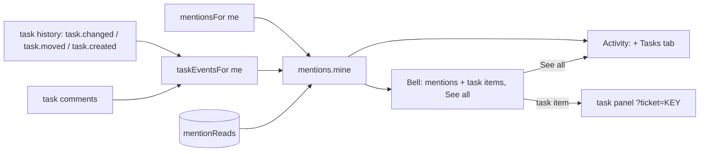

# UX Phase 2: Navigation and IA — Implementation Plan

> **For agentic workers:** REQUIRED SUB-SKILL: Use superpowers:subagent-driven-development (recommended) or superpowers:executing-plans to implement this plan task-by-task. Steps use checkbox (`- [ ]`) syntax for tracking.

**Goal:** every role finds their own work in one place, the sidebar is predictable, the bell catches task news, teams can be managed, and the address keeps state — audit items 2.1–2.8.

**Architecture:** Home and My tasks merge into one **My work** page at the workspace's own address; `modeOf` puts Settings, Preferences and Help on the Projects side; task events for the bell are worked out on read from the task history and comments and merged into the existing mentions feed (no new Api method, no DB bump); teams get create / rename / remove through the usual Api → mock → http → audit → hook path; filters and project sheets move into the address.

**Tech Stack:** React 19, TypeScript, React Router 8, TanStack Query, zustand, Tailwind v4, Vitest (jsdom + browser).

**Spec:** `spark-flow-web/docs/ux-audit/2026-11-09-ui-ux-audit.md` (main checkout, untracked), Phase 2 items 2.1–2.8 and section 7, with the user's rulings:
- 2.1 "Dashboard for all": Dashboard stays everyone's start page; Home and My tasks merge into **My work**; the start page is not role-aware.
- 2.2 "Always Projects": Settings, Preferences and Help always use the Projects sidebar; spec 5.5 is updated; Search keeps the last side.

## Global Constraints

- Hard rules in `CLAUDE.md`: semantic tokens; status colours `bg-{c}-50 text-{c}-700 dark:bg-{c}-500/15 dark:text-{c}-300`; `Sheet` for modals and `MenuPanel` / sf `Menu` for menus; no toasts or spinners; one red primary per view; sentence case; `…` for pending; logical direction classes only (`src/rtl.test.ts`); light, dark and 390 px.
- Pages import from `@/api/*` only. Nothing derived is stored.
- A new `Api` method is listed in `src/mocks/audit.test.ts` (recorded with a call that must log), has an `http.ts` route with an `http.test.ts` case, a hook in `src/api/*`, and its write calls `audit()` inside its own `db.update`.
- A new page or renamed one keeps help in `lib/pageHelp.ts` (`pageHelp.test.ts`), and a moved page keeps `workspaceMode.test.ts` honest.
- Test first for every task; the phase ends with `npx tsc -b`, `npm run lint`, `npm test` (known: `RichComposer.browser` "unknown /word"; `MessageList.browser` "Jump to latest" ×2 fail only in a worktree) and `npm run build:prototype`.
- Branch `feat/ux-phase-2` in `Spark_Flow/.worktrees/ux-phase-2`, from `origin/dev` (c2e6cb9). One commit per task. No push or merge; the user decides.

## Decisions

**D1. My work** (2.1).
- Address: the workspace's own page `/w/:ws` (today's Home) becomes My work; `/w/:ws/tasks` redirects there with its query kept. The Dashboard stays `paths.start` and where sign-in, the logo and View as land.
- Page: title **My work**, subtitle "Good morning, Mariam · 3 open tasks · 1 overdue" (+ " · N over estimate" when above 0).
  - Left (2/3): the Today card as now; under it **My tasks** — every open task assigned to me, overdue first, then over estimate, then due date (`myOpenTasks`), each row the list `TicketRow` plus a **Start** button when I may log on it and no timer runs on it. Empty: "Nothing assigned to you. Tasks assigned to you show here." with a "Browse projects" link.
  - Right (1/3): **Mentions** (5, as now, mentions only) with **See all** → Activity.
  - The "Due today and overdue" card goes: the list starts with the same tasks and keeps their Start.
- Navigation: Work = Dashboard, My work, Projects, Teams (Home and My tasks leave). Phone: More keeps My work where Home was. Search's page list follows `navGroups`.
- Every "Go to Home" (7, no-access pages) becomes "Go to Dashboard" → `paths.start`.
- Help: `home.md` becomes the My work chapter (title "My work"), `tasks.md` drops its My tasks section and links to it; `pageHelp` maps `''` to it and `tasks` stays mapped for the redirect.

**D2. Sides** (2.2): `modeOf` returns `'projects'` for `/w/:ws/settings…`, `/preferences` and `/help…`; Search stays `null` (keeps the last side). Spec 5.5 and `CLAUDE.md`'s Workspaces line say so.

**D3. Bell and Activity** (2.3).
- Three task items, worked out on read for **me** from what exists, only for actions by someone else, only on tasks I can see:
  - **Assigned to you** — a `task.changed` history entry whose `assigneeId` changed to me, or a `task.created` that set me (creation starts logging its assignee).
  - **Status changed** — a `task.moved` entry on a task assigned to me now.
  - **Comment on your task** — a comment (not a bug report's own mention, not deleted) on a task assigned to me, not already a mention of me.
- They join `api.mentions.mine()` as `MentionItem.source` `'assigned' | 'status' | 'taskComment'` and Activity's feed as kind `'task'`, read through the same `mentionReads`. No new Api method, no DB bump; old history before this change is marked read in the seed.
- Bell: an icon and sentence per source ("Nour assigned you NEX-106", "Salma moved NEX-101 to In review", "Hossam commented on NEX-107"), empty "Nothing new." and **See all** → Activity of the current workspace. Activity gets a **Tasks** tab. A task item opens the task's panel (`mentionLink`).
- `ticketUpdated` refreshes `qk.mentions()` and Activity.
- Not now: "due today" items (no event and no time-zone rule) and desktop notifications for task items.

**D4. Teams** (2.4).
- Api: `teams.create(workspaceId, name)`, `teams.rename(id, name)`, `teams.remove(id)`; all need `settings.manage`; names are unique per workspace (case-insensitive, trimmed, 1–40 characters).
- Remove is refused while any project (archived included) names the team: "Take Backend off Nexus Core first." — the same rule as a role someone holds. On success the id leaves every person's `teamIds`.
- Audit: `recordOf.team`; three recorded actions in `audit.test.ts`. Routes `POST /api/workspaces/:id/teams`, `PATCH /api/teams/:id`, `DELETE /api/teams/:id`. Writes send `peopleChanged` (refreshes all).
- Teams page: **New team** (secondary; the page keeps no red primary) in the header and a ⋯ row menu per card (Rename, Remove), only with `settings.manage`; sheets as Roles' (`AddRoleSheet`, `RenameRoleSheet`), each with the Phase 1 discard guard. Users' Edit hint links to Teams. Settings' People / Roles / Teams tiles become links (Users, Roles, Teams).

**D5. One Files list in a project** (2.5): `ChannelView` takes `hideTabs?: ChannelTab[]`; the project's Chat tab passes `['files']` (its Files tab has a Chat filter).

**D6. Workspace button** (2.6): from `lg`, a text button "Spark Engineering ⌄" (name truncated at 12rem); below `lg` the round initials stay, with the name in the menu heading ("Workspace · Spark Engineering"). The menu itself is unchanged.

**D7. Address state** (2.7).
- Chips, selects, view switches and tabs **push** (Back steps through them): Projects (`show`, `archived`, sort), Tasks tab (`phase`, `sprint`, `archived`), History (`show`), project Files (`from`, `type`), Time & cost (`days`, `by`, `project`), Attendance (`person`, `day`, `days`, tabs), Users / Audit / Archived selects. Typed search (`q`) stays **replace**.
- Activity (`tab`, `unread`), Saved (`tab`) and Drafts (`tab`) move into the address; Help keeps `q` (replace) and `group` (push).
- Project sheets move into the address: `?edit=project`, `?new=task`, `?phases=1` (opened with push, closed with replace, so Back closes them — the Phase 1 guard asks first when changed).

**D8. Small clean-ups** (2.8): "Change password · Soon" leaves the user menu; Not found's sentence becomes its `h1`; the Settings tiles are links (D4).

## Review Focus

1. **Old links**: `/w/:ws/tasks?…` and every in-app link to Home or My tasks (sidebar, phone More, search's page list, help links `help:home`, mention links to Home) land on My work. Pinned in Task 2.
2. **The bell's cross-workspace list vs Activity's one workspace**: See all goes to the current workspace's Activity; a task item from another workspace still opens in its own workspace. Pinned in Task 4.
3. **Reassigned tasks**: an "Assigned to you" item stays for the person it was assigned to even after it moves on (it comes from the history entry, not the current assignee); status and comment items follow the current assignee. Pinned in Task 3.
4. **Removing a team someone's sheet still shows** (Users Edit open while an Admin removes it in another tab): Save mustn't send the removed id. Pinned in Task 5 (the mock drops unknown team ids from a person's patch).
5. **Back through pushed filters with a changed sheet open**: the Phase 1 sheet guard still asks on Back (POP) and a filter push never closes a sheet. Pinned in Task 8.

---

### Task 1: Settings, Preferences and Help on the Projects side (2.2)

**Files:** Modify `src/lib/workspaceMode.ts`, `CLAUDE.md` (Workspaces line), `docs/flow-chat/FLOW_CHAT_REDESIGN.md` §5.5 · Test `src/lib/workspaceMode.test.ts`

- [ ] **Step 1: Failing test** — `modeOf('/w/a/settings')`, `('/w/a/settings/roles')`, `('/w/a/preferences')`, `('/w/a/help')`, `('/w/a/help/tasks')` → `'projects'`; `('/w/a/search')` → `null`.
- [ ] **Step 2–4:** FAIL → add the paths to the Projects pattern → PASS (`npx vitest run src/lib/workspaceMode.test.ts src/layout`).
- [ ] **Step 5: Commit** — `feat(shell): Settings, Preferences and Help keep the Projects sidebar`

### Task 2: My work (2.1)

**Files:** Create `src/pages/home/MyWorkPage.tsx` (from `HomePage.tsx`; delete `HomePage.tsx` and `src/pages/tasks/MyTasksPage.tsx`), `src/pages/home/MyTasksCard.tsx` · Modify `src/router.tsx`, `src/navigation.ts`, `src/layout/Sidebar.tsx`, `src/layout/MobileNav.tsx`, `src/lib/pageHelp.ts`, `src/help/home.md`, `src/help/tasks.md`, the 7 "Go to Home" pages · Test `src/pages/home/MyWorkPage.test.tsx`, `src/router.test.tsx` (or the existing route test), `src/navigation.test.ts` (create if missing)

**Interfaces:** Produces `MyWorkPage()`; `MyTasksCard({ tasks, loggable, timer, onStart })`; `navGroups` Work items `dashboard`, `home` (label "My work"), `projects`, `teams`.

- [ ] **Step 1: Failing tests** — MyWorkPage shows h1 "My work", the greeting and counts in the subtitle, the Today card, a My tasks card listing open tasks overdue → over estimate → due date with a Start button per loggable task, the Mentions card with a "See all" link to `/w/engineering/activity`, and no "Due today and overdue" card; empty list shows "Nothing assigned to you." and a "Browse projects" link. `/w/engineering/tasks?x=1` redirects to `/w/engineering?x=1`. `navGroups[0]` labels are Dashboard, My work, Projects, Teams. Each no-access page links "Go to Dashboard" to `/w/engineering/dashboard`.
- [ ] **Step 2–4:** FAIL → implement → PASS (`npx vitest run src/pages/home src/pages/settings src/pages/time src/layout src/lib/pageHelp.test.ts`).
- [ ] **Step 5: Commit** — `feat(home): My work joins Home and My tasks`

### Task 3: Task items for me, worked out on read (2.3, mock)

**Files:** Create `src/mocks/taskInbox.ts` · Modify `src/api/types.ts` (`MentionItem.source`, `ActivityItemKind`), `src/mocks/mentions.ts`, `src/mocks/activityFeed.ts`, `src/mocks/tickets.ts` (log the assignee on create), `src/mocks/seed.ts` (old items read), `src/api/queryKeys.ts` (`ticketUpdated`), `docs/flow-chat/api-contract.md` · Test `src/mocks/taskInbox.test.ts`, `src/mocks/mentions.test.ts`, `src/mocks/notifications.test.ts`

**Interfaces:** Produces `taskEventsFor(data: DbData, userId: string, now: Date): MentionItem[]` (newest first; ids `task-<historyId>` / `tcomment-<commentId>`); `MentionItem.source` adds `'assigned' | 'status' | 'taskComment'` with `taskKey`; `ActivityItemKind` adds `'task'`.

- [ ] **Step 1: Failing tests** — as Mariam: Nour assigns her NEX-110 → one `assigned` item; she assigns herself → none; Salma moves NEX-106 (Mariam's) → one `status` item naming the column; Hossam comments on NEX-106 → one `taskComment` item; a comment that mentions her is one `comment` mention, not two; after reassigning NEX-106 to Dina, Mariam keeps her old `assigned` item and gets no new status items; `markRead` of a task item works through `mentionReads`; Activity lists them as kind `task`; a project she isn't on gives none.
- [ ] **Step 2–4:** FAIL → implement → PASS (`npx vitest run src/mocks`).
- [ ] **Step 5: Commit** — `feat(inbox): task items for me in mentions and Activity`

### Task 4: The bell, Activity's Tasks tab and See all (2.3, UI)

**Files:** Modify `src/layout/NotificationsMenu.tsx`, `src/lib/mentionLink.ts`, `src/pages/chat/activityRows.ts`, `src/pages/chat/ActivityView.tsx`, `src/help/threads-activity.md`, `src/help/home.md` · Test `src/layout/shellMenus.test.tsx`, `src/pages/chat/activityRows.test.ts`, `src/pages/chat/ActivityView.test.tsx`, `src/lib/mentionLink.test.ts`

- [ ] **Step 1: Failing tests** — the bell lists "Nour assigned you NEX-110", "Salma moved NEX-106 to In review", "Hossam commented on NEX-106" beside mentions, empty "Nothing new.", and a "See all" link to the current workspace's Activity; a task item opens `/w/<its ws>/p/NEX/tasks?ticket=NEX-106`; Activity's tabs are All, Mentions, Tasks, Reactions, Threads, Reminders and Tasks filters to kind `task`.
- [ ] **Step 2–4:** FAIL → implement → PASS (`npx vitest run src/layout src/pages/chat src/lib`).
- [ ] **Step 5: Commit** — `feat(inbox): the bell and Activity show task news, with See all`

### Task 5: Teams can be made, renamed and removed (2.4, Api)

**Files:** Modify `src/api/types.ts` (`Api.teams`), `src/mocks/teams.ts`, `src/mocks/index.ts`, `src/mocks/audit.ts` (`recordOf.team`), `src/mocks/users.ts` (drop unknown team ids), `src/lib/http.ts`, `src/api/projects.ts` (hooks next to `useTeams`) · Test `src/mocks/teams.test.ts` (create), `src/mocks/audit.test.ts`, `src/lib/http.test.ts`

**Interfaces:** Produces `teams.create(workspaceId: string, name: string): Promise<Team>`, `teams.rename(id: string, name: string): Promise<Team>`, `teams.remove(id: string): Promise<void>`; hooks `useCreateTeam`, `useRenameTeam`, `useRemoveTeam`.

- [ ] **Step 1: Failing tests** — an Admin creates "Data" (trimmed); a duplicate name (any case) → 400 "There's already a team called Data."; empty or over 40 characters → 400; a Member → 403 recorded; rename; remove of a team on Nexus Core → 400 "Take Backend off Nexus Core first."; remove of an unused team takes its id off every person; a person's update with a removed team id saves without it; each write logs one audit entry; the http routes call the right method and path.
- [ ] **Step 2–4:** FAIL → implement → PASS (`npx vitest run src/mocks src/lib/http.test.ts`).
- [ ] **Step 5: Commit** — `feat(teams): create, rename and remove teams`

### Task 6: The Teams page manages teams; Settings tiles are links (2.4, 2.8)

**Files:** Modify `src/pages/teams/TeamsPage.tsx`, `src/pages/settings/SettingsPage.tsx`, `src/pages/settings/UsersPage.tsx` (hint link), `src/help/teams.md`, `docs/superpowers/specs/2026-10-26-spark-flow-company-system-design.md` §4.6 (amendment) · Test `src/pages/teams/TeamsPage.test.tsx` (create), `src/pages/settings/SettingsPage.test.tsx`

- [ ] **Step 1: Failing tests** — with `settings.manage`: a New team button opens "New team"; a typed name asks "Discard this new team?" on Cancel; Save creates it; each card's ⋯ has Rename and Remove; Remove asks "Remove Data?" and shows the server's refusal sentence under it. Without the right: no button, no ⋯. Settings' People, Roles and Teams tiles link to Users, Roles and Teams.
- [ ] **Step 2–4:** FAIL → implement → PASS.
- [ ] **Step 5: Commit** — `feat(teams): manage teams on the Teams page`

### Task 7: One Files list in a project; the workspace button names it (2.5, 2.6)

**Files:** Modify `src/pages/chat/ChannelPage.tsx` (`ChannelView` `hideTabs`), `src/pages/chat/ChannelTabs.tsx`, `src/pages/projects/ChatTab.tsx`, `src/layout/WorkspaceSwitcher.tsx` · Test `src/pages/chat/ChannelTabs.test.tsx`, `src/pages/projects/ChatTab.test.tsx`, `src/layout/shellMenus.test.tsx`

- [ ] **Step 1: Failing tests** — `ChannelTabs` with `hidden={['files']}` has no Files tab; ChatTab renders `ChannelView` with `hideTabs={['files']}`; the workspace button's text is "Spark Engineering" (visible from `lg`, class `max-lg:sr-only`) and the round initials are `lg:hidden`.
- [ ] **Step 2–4:** FAIL → implement → PASS.
- [ ] **Step 5: Commit** — `feat(shell): one Files list per project; the workspace button names the workspace`

### Task 8: The address keeps state (2.7)

**Files:** Modify the pages in D7 (`ProjectsPage`, `TasksTab`, `HistoryTab`, projects `FilesTab`, `TimeCostPage`, `AttendancePage`, `UsersPage`, `AuditLogPage`, `ArchivedPage`, `ActivityView`, `SavedView`, `DraftsView`, `HelpPage`, `ProjectPage`) · Test each page's existing test file plus `src/pages/projects/ProjectPage.test.tsx` (create if missing)

**Interfaces:** Produces `lib/searchParams.ts` `useParamState()` returning `[params, set(changes, { push?: boolean })]`, used by every page above instead of its own `setSearchParams(…, { replace: true })`.

- [ ] **Step 1: Failing tests** — on Projects, picking "Overdue" then Back returns to all projects; typing in Users' search adds no history entry per key; Activity's Tasks tab survives a reload (`?tab=tasks`); Help's `?q=timer` opens with the search filled; on a project, `?new=task` opens New task and Back closes it (asking first when changed); `?edit=project` opens Edit project; `?phases=1` opens Manage phases.
- [ ] **Step 2–4:** FAIL → implement → PASS.
- [ ] **Step 5: Commit** — `feat(shell): filters, tabs and project sheets live in the address`

### Task 9: Small clean-ups (2.8)

**Files:** Modify `src/layout/UserMenu.tsx`, `src/pages/NotFound.tsx` · Test `src/layout/shellMenus.test.tsx`, `src/pages/NotFound.test.tsx` (create)

- [ ] **Step 1: Failing tests** — the user menu has no "Change password"; Not found's sentence is a level-1 heading.
- [ ] **Step 2–4:** FAIL → implement → PASS.
- [ ] **Step 5: Commit** — `fix(shell): no Soon items; Not found has a heading`

### Task 10: Phase check and records

- [ ] **Step 1:** `npx tsc -b && npm run lint && npm test && npm run build:prototype` (known failures only).
- [ ] **Step 2:** on this branch's dev server, as Admin, PM and Member, light and dark, 1440 and 390: My work, the bell and Activity, Teams (Admin), Settings sidebar, Projects filters with Back; no console errors, no sideways scroll, no new axe serious/critical.
- [ ] **Step 3:** `npm run help:shots`; review section in `tasks/todo.md`; status line in the audit report (main checkout copy).
- [ ] **Step 4: Commit** — `docs(ux): Phase 2 review and help pictures`

---

## Execution order

Task 1 first (small, shared by Task 2's side checks). Tasks 2 → 3 → 4 in order (My work's Mentions card and See all, then the feed, then the bell). Task 5 → 6 in order. Tasks 7 and 9 are independent. Task 8 last but one (it touches the most pages), then Task 10.

## Questions before Task 1

1. **My work (2.1):** Today card and a full My tasks list (with Start) on the left, Mentions with See all on the right; the "Due today and overdue" card goes; it keeps the workspace's own address and `/tasks` redirects there?
   *Recommended: yes, as D1.*
2. **The bell (2.3):** add "Assigned to you", "Status changed" and "Comment on your task" (others' actions on tasks assigned to you), worked out from the task history with no new API; leave "due today" items and desktop pop-ups for later?
   *Recommended: yes, as D3.*
3. **Removing a team (2.4):** refuse while any project still uses the team (as a role someone holds), or remove it from those projects too (people on a project only through that team would lose it)?
   *Recommended: refuse, as D4.*
4. **Back through filters (2.7):** chips, selects and tabs push (Back steps through them) while typed search doesn't; project sheets move into the address?
   *Recommended: yes, as D7.*
5. **How to run it:** Native with one Opus review of the whole branch at the end, as in Phase 1?
   *Recommended: yes.*
