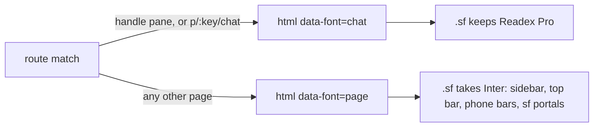
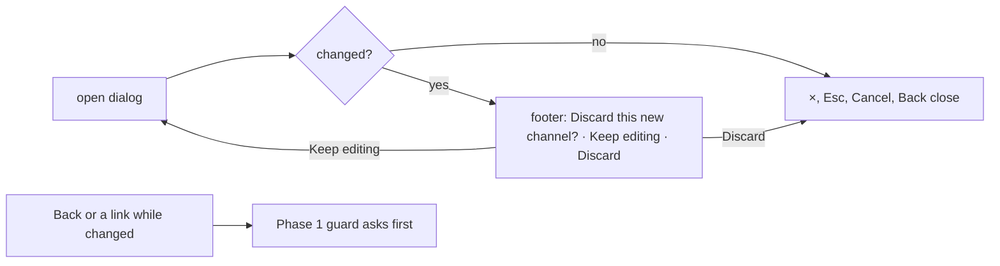

# UX Phase 3: Visual design and consistency — Implementation Plan

> **For agentic workers:** REQUIRED SUB-SKILL: Use superpowers:subagent-driven-development (recommended) or superpowers:executing-plans to implement this plan task-by-task. Steps use checkbox (`- [ ]`) syntax for tracking.

**Goal:** one product, one look, one red — audit items 3.1–3.7: shared pieces (avatar, red, danger, font per screen) look the same in chat and on pages, red means "act" or "late", dates go through `lib/format.ts`, the kit gets the building blocks pages keep copying, and dark mode and copy details are fixed.

**Architecture:** chat keeps its own look inside chat; the pieces both modules show become one: one `Avatar` component that works inside and outside `.sf`, chat's red tokens take the kit's values, one danger style, and the shell's font follows the screen through one attribute on `<html>` read by `flow-tokens.css`. Chat's New channel / New message move to the chat `Modal`, which gains `Sheet`'s discard guard; Preferences moves to the kit look. New kit blocks (`IconButton`, `SegmentedControl`, `StatTile`, `Switch`) replace hand-made copies. No Api, mock or DB change.

**Tech Stack:** React 19, TypeScript, React Router 8, Tailwind v4, Vitest (jsdom + browser), axe-core.

**Spec:** `spark-flow-web/docs/ux-audit/2026-11-09-ui-ux-audit.md` (main checkout, untracked), Phase 3 items 3.1–3.7 and section 7, with the user's rulings:
- 3.1 "Shared pieces": keep the chat look inside chat, but make shared pieces identical everywhere: one avatar style, one red, and the shell uses the page's font outside chat. Chat's New channel / New message use the chat Modal; Preferences moves to the standard look like Settings.
- 3.2 "One red: brand-500": chat red points to the kit's brand-500 #b72126; one danger style for both button sets; every delete confirm uses danger, not primary.

## Global Constraints

- Hard rules in `CLAUDE.md`: semantic tokens; status colours `bg-{c}-50 text-{c}-700 dark:bg-{c}-500/15 dark:text-{c}-300`; kit pages use `Sheet` / `MenuPanel`, chat uses `components/sf/*`; no toasts (except chat's Undo), spinners or overlays; one red primary per view; sentence case; `…` for pending; logical direction classes only (`src/rtl.test.ts`); light, dark and 390 px.
- Every rule this plan changes is written into `CLAUDE.md` ("Hard rules" / "Flow chat redesign") and `docs/flow-chat/FLOW_CHAT_REDESIGN.md` in the task that changes it.
- Chat token values change in `src/styles/flow-tokens.css` and `docs/flow-chat/design/spark-flow-tokens.json` together (`src/styles/flowTokens.test.ts` compares them and checks contrast).
- Shell files keep sf classes only (`layout/shellTokens.test.ts`, `layout/shellMenus.test.tsx`): the font changes through `--font-sans`, never through kit classes.
- Sticky parts: the top bar is 56 px (`--size-topbar`, `.sf` only) and from `lg` the page scrolls inside the main card, so sticky bars use `sticky top-14 … lg:top-0` (`AuditLogPage`). Don't change the card's inner scroller.
- Kit-copied files (`ui/Sheet`, `DateTimePicker`, `FileViewer`, `Pagination`, `FileDrop`, `StageProgress`, `DeleteDialog`) keep their class strings except where a task names the change.
- Test first for every task; the phase ends with `npx tsc -b`, `npm run lint`, `npm test` (known: `RichComposer.browser` "unknown /word"; `MessageList.browser` "Jump to latest" ×2 fail only in a worktree) and `npm run build:prototype`.
- Branch `feat/ux-phase-3` in `Spark_Flow/.worktrees/ux-phase-3`, from `origin/dev` (5210cc3). One commit per task. No push or merge; the user decides.

## Decisions

**D1. One red, one danger** (3.2).
- Chat's reds take the kit's values: `--red-600` #b72126 (brand-500), `--red-700` #9e1d21 (brand-600, the kit's hover), `--red-50` #fcf1f1 (brand-50); `--focus-ring` reads `var(--red-600)` instead of its own hex. Dark keeps `--red-400` #f2453d for chat's red text (the kit has no dark red that passes 4.5:1 except its pink `#f0979a`; brand-400 is 4.45:1 on ink-900). Fills stay brand-500 in dark, as in the kit.
- One danger style: the kit's `danger` (`bg-red-600 text-white hover:bg-red-700`) for both sets. sf gets `--danger-fill` #e7000b and `--danger-fill-hover` #c10007 (Tailwind's red-600 / red-700; white on #e7000b is 4.8:1); sf `Button` `danger` uses them and stops being a copy of `primary`.
- Every delete confirm uses danger: chat's Remove member (`ChannelMembers.tsx:242`) and Delete file (`files/FileActions.tsx:199`) change from primary; Delete message (`MessageActions.tsx:189`) is already `danger` and now looks it. Archive (project, task, channel) and confirms that destroy nothing (Mark all read, Send and notify) stay primary.

**D2. One avatar** (3.1).
- One component, `src/components/Avatar.tsx`, with the sf Avatar's API (`id`, `name`, `src?`, `size?`, `presence?`, `app?`, `decorative?`; `Facepile`, `initials`). It uses only plain Tailwind sizes and colours, so it looks the same inside and outside `.sf`. Sizes in px: `20 | 24 | 28 | 36 | 40 | 72` (default 36).
- Look (Q1): the kit's — round, two initials (strips "Dr."/"Eng."), colour from the **name** over the kit's six hues (`design/03-components.md:137-141`, as `ui/Avatar.tsx` today), presence dot `size-3 rounded-full border-2 border-surface bg-emerald-500`. The current user in the top bar stays dark (`bg-ink-800 text-white`, kit `02-app-shell.md:79`); apps (Flowbot) are `bg-ink-950 text-white`.
- `components/sf/Avatar.tsx` and `components/ui/Avatar.tsx` go; their 35 importers use the one component (kit `sm` → 24, `md` → 36; sf `sm` → 20, `md` → 28, `lg` → 36, `xl` → 72).

**D3. The font follows the screen** (3.1).
- A screen is a **chat screen** when its route is a chat page (route handle `pane`: channels and DMs, Activity, Threads, Search, Saved, Drafts & sent) or the project's Chat tab. Preferences loses `pane` (D5).
- `AppLayout` sets `document.documentElement.dataset.font` to `'chat'` or `'page'` from `screenFont(pane: boolean, pathname: string)` (`layout/mainCard.ts`).
- `flow-tokens.css` adds `:root[data-font='page'] .sf { --font-sans: <the kit's Inter stack> }`: on a page, the sidebar, top bar, phone bars and every sf portal (menus, tooltips, dialogs) use Inter; on a chat screen everything uses Readex Pro. Icons stay Tabler in the shell.

**D4. Chat's New channel and New message on the chat Modal** (3.1).
- `Modal` gains `dirty?: boolean` and `discardQuestion?: string`. While dirty, ×, Esc and Cancel show the question in the footer with "Keep editing" and "Discard" (danger), as `Sheet` does (`ui/Sheet.tsx:138-161`); Back or a link asks through the Phase 1 guard (`useUnsavedChanges`). `ModalCancelButton` closes through the same path, like `SheetCancelButton`.
- `pages/chat/ChannelSheet.tsx` → `NewChannelDialog.tsx`, `NewMessageSheet.tsx` → `NewMessageDialog.tsx`: same fields, copy and discard questions, built with sf fields as `NewFolderDialog`, the one `Avatar` and sf `Button`s. On phones the Modal stays a centred card (chat spec 6.13), not full screen (Q2).

**D5. Preferences in the kit look** (3.1). The route loses `pane`; the page uses `PageHeader`, kit `Card` sections, `Field`, kit `Button`, native radios and checkboxes (`accent-brand-500`, as Users), ui `MenuPanel` for Pause notifications, a new `components/ui/Switch.tsx` (`role="switch"`; track `bg-surface-strong`, on `bg-brand-500`; thumb `bg-surface`) and keywords as an input plus removable chips (kit `Badge` with an × `IconButton`). Every control keeps its role and accessible name.

**D6. Red means "act" or "late"** (3.3).
- `ui/ProgressBar` gains tones `'neutral'` (`bg-fg-tertiary`) and `'danger'` (`bg-red-600`). Projects table and Overview: `progress === 1 ? 'success' : behindSchedule(p, now) ? 'danger' : 'neutral'`. `behindSchedule` moves from `dashboard/dashboardCard.ts:13` into `projects/projectStats.ts` (not delivered, and past due or expected to finish after due); the Dashboard card uses it from there.
- Settings section marks: one neutral `bg-fg-subtle`.
- Chat's "Jump to latest" becomes a secondary pill (`bg-sf-surface-raised text-sf-text` with the sf line and shadow); "N new messages" and Send stay red (spec 6.2; Send is the primary).
- Unchanged: the phase bar's current phase (the kit's active state, `03-components.md:115`), Dashboard progress rings and Time & cost share bars (charts: red for the key series).

**D7. Dates** (3.4). New in `lib/format.ts`, built by hand like `formatTime` (no engine-dependent commas):
- `formatDayDivider(date, now)`: "Today", "Yesterday", "Wednesday 4 November", "Thursday 23 October 2025" (year only when not this year) (Q3).
- `formatDateTime(date)`: "Wed 4 Nov 2026, 2:00 PM" (a message's time tooltip).
- `formatDayAt(date, now)`: "today at 2:00 PM", "tomorrow at 9:00 AM", "Mon 3 Nov at 9:00 AM".
- `formatDayMonth(date, { utc? })`: "3 Oct"; `formatWeekdayDay(date)`: "Fri 23 Oct".
- `dayTicks(days: Date[])`: chart labels, the day number with the month on the first column and on each 1st ("27 Oct", "28", … "1 Nov", "2").
- Used at `chat/messageRows.ts:43`, `ChannelMessage.tsx:200`, `outbox/DraftsView.tsx:29`, `lib/notifyRules.ts:54`, `DashboardCharts.tsx:25,49`, `dashboardCard.ts:7`, `projects/phases.ts:7` (`utc: true`), `time/TimeCostPage.tsx:39`. `DateTimePicker` (kit) and `remindTimes` ("Mon 9:00 AM", fixed copy) stay.

**D8. Shared building blocks** (3.5).
- `components/ui/IconButton.tsx`: `{ label, icon, size = 'md' | 'sm', tone = 'default' | 'danger', touch?, …button }`; `label` is the `aria-label` and the `title`; `md` `size-9`, `sm` `size-8`, `touch` adds `max-sm:size-11`; `rounded-lg text-fg-muted hover:bg-surface-muted hover:text-fg aria-pressed:bg-surface-muted aria-pressed:text-fg focus-visible:outline-2 focus-visible:outline-offset-2 focus-visible:outline-brand-500 disabled:opacity-40`; danger hover `hover:bg-red-50 hover:text-red-600 dark:hover:bg-red-500/15 dark:hover:text-red-400`.
- `components/ui/SegmentedControl.tsx`: kit kinds B (`kind="switch"`, view and period) and D (`kind="form"`), class strings from `design/03-components.md:66,68`; a `radiogroup` with arrow keys and one tab stop. Replaces the Board/List switch (links → buttons that push `?view=`, as the kit's Board/List), `ProjectSheet:174`, `TaskSheet:241`, `ColumnSheet:69`, `TaskActivity:59` and Time & cost's Period. Underline tabs (kind A) stay.
- `components/ui/StatTile.tsx`: the kit `StatCard`'s look (`rounded-xl border border-line bg-surface p-4 shadow-sm sm:p-5`; label `text-xs text-fg-muted sm:text-sm`; value `mt-1 truncate text-xl font-semibold tracking-tight tabular-nums sm:text-2xl`, red with `tone="danger"`; hint `mt-1 text-xs text-fg-muted`); props `{ label, value, hint?, tone?, icon?, to?, children? }`; label and value stay siblings. Replaces Dashboard's `Tile`, Overview's `Stat` (and its Progress tile, through `children`), Time & cost's `Tile`, Audit log's `Tile` and the Settings tiles. Projects' filter tiles stay (buttons that filter).
- Main card: kit `lg:rounded-2xl` (16 px) instead of `lg:rounded-[12px]` — the frame is shared by both modules, so it follows the kit (`02-app-shell.md:22`); chat spec §5's 12 px is amended.

**D9. Dark mode details** (3.6).
- The mode switch's thumb and the white compose buttons ("+" New task, New message) become `bg-sf-ink-700` with white text in dark; light is unchanged.
- Board column tints: `head` to `dark:bg-{c}-500/15` (`projects/ticketPills.tsx:25-28`); the faint body wash stays.
- Error sentences outside a tinted box use the kit's `text-red-600 dark:text-red-400` (`ui/Field.tsx:34`): the bare `text-red-700 dark:text-red-300` ones in Users, Archived, Attendance, Audit log and Sign in move to it.
- Unchanged: avatar hues and `StageProgress` states (the kit's own values for them).

**D10. Copy details** (3.7).
- Curly ’ in every string a person reads: UI (103), mock error messages (56), help chapters (127). `src/copy.test.ts` (like `rtl.test.ts`) scans string literals, template text and JSX text in `src/**/*.{ts,tsx}` (not tests, testkits or `mocks/seed*`) and prose in `src/help/*.md` (outside code), and fails on a straight `'` between letters or after `}`.
- `FileDrop`, `ProjectFiles` and `FileViewer` use `lib/fileTypes.ts`'s size helper (FileViewer converts from KB).
- Icon-only buttons get `title` = their label: through `IconButton` (D8), and by hand on the kit-copied ones (Sheet ×, DateTimePicker, FileViewer, Pagination, FileDrop), InspectorFrame ×, the timer pill's Pause / Resume / Stop / Switch task, the collapsed sidebar links, and raw sf buttons with no Tooltip (phone search, Add reaction, remove search filter, SplitButton).

**Not in this phase:** the timer popover's lucide icons in the top bar, and the kit help and task panels beside chat — with the font following the screen they no longer show two fonts; the icon sets stay per module (CLAUDE.md).

## Review Focus

1. **Moving between a chat screen and a page** (sidebar link, Back, the mode switch, G then P): the shell, open menus and tooltips switch font with the screen; the project Chat tab and a chat panel opened on a page show one font per screen; nothing flashes the wrong font on first load. Pinned in Task 3.
2. **The dialogs' guard in layers**: Esc with an autocomplete, menu or tooltip open inside the dialog closes that layer first; Esc on a changed dialog asks; Back (POP) while changed asks once, not twice (Modal and the Phase 1 blocker). Pinned in Task 4.
3. **One person, one avatar**: the same colour and initials on Users, a task, a message and the sidebar DM (names with "Dr."/"Eng.", one-word names, deactivated people, Flowbot), readable in dark, presence dot on the sidebar's dark frame. Pinned in Task 2.
4. **Contrast after the colour changes**: chat accent text and links in dark, the danger button's focus ring in dark, the secondary "Jump to latest" pill on the dark message list, neutral progress bars on `bg-surface-muted` (3:1 for a graphic). Pinned in Tasks 1 and 6 (axe in the browser tests).
5. **Curly apostrophes where text is matched**: a mock error a page compares by text, help search ("don't" typed with a straight ’), search highlighting, and the .NET backend's own messages (unchanged, straight). Pinned in Task 12 (help search folds ’ and ').

---

### Task 1: One red, one danger (D1, 3.2)

**Files:** Modify `src/styles/flow-tokens.css`, `docs/flow-chat/design/spark-flow-tokens.json`, `src/index.css` (`--color-sf-danger-fill*`), `src/components/sf/Button.tsx`, `src/pages/chat/ChannelMembers.tsx`, `src/pages/chat/files/FileActions.tsx`, `docs/flow-chat/FLOW_CHAT_REDESIGN.md` (§3 colour table), `CLAUDE.md` · Test `src/styles/flowTokens.test.ts`, `src/components/sf/primitives.test.tsx`, `src/pages/chat/ChannelMembers.test.tsx`, `src/pages/chat/files/FileActions.test.tsx` (or the closest existing test of each confirm)

- [ ] **Step 1: Failing tests** — the design JSON's red-600 / red-700 / red-50 are #b72126 / #9e1d21 / #fcf1f1 and it lists `danger-fill` #e7000b and `danger-fill-hover` #c10007 (flowTokens checks CSS against it, and white on `danger-fill` ≥ 4.5:1); sf `Button variant="danger"` has `bg-sf-danger-fill` and not `bg-sf-accent-fill`; the Remove member and Delete file confirm buttons are danger.
- [ ] **Step 2–4:** FAIL → implement → PASS (`npx vitest run src/styles src/components/sf src/pages/chat`).
- [ ] **Step 5: Commit** — `feat(look): one red and one danger style`

### Task 2: One avatar (D2, 3.1)

**Files:** Create `src/components/Avatar.tsx`, `src/components/Avatar.test.tsx` · Delete `src/components/sf/Avatar.tsx`, `src/components/ui/Avatar.tsx` · Modify their 35 importers, `src/layout/UserMenu.tsx` (dark self avatar), `src/pages/dev/UiGallery.tsx`, `CLAUDE.md`, `FLOW_CHAT_REDESIGN.md` (avatar lines) · Test also `src/components/sf/primitives.test.tsx`, `ActivityView.test.tsx:167`, `ChannelMessage.test.tsx:126`

**Interfaces:** Produces `Avatar({ id, name, src?, size?: 20|24|28|36|40|72, presence?, app?, decorative?, className? })`, `Facepile`, `initials(name)`, `avatarTone(name)`.

- [ ] **Step 1: Failing tests** — "Dr. Nour El-Sayed" → "NE"; the same name gives the same tone class wherever it is rendered and two names can differ; `size={20}` is `size-5`; it's `rounded-full`; inside and outside an `.sf` wrapper the class list is the same; `app` is `bg-ink-950 text-white`; presence adds the emerald dot; `decorative` is `aria-hidden`, else `role="img"` named by the person.
- [ ] **Step 2–4:** FAIL → implement → move importers → PASS (`npx vitest run src/components src/pages src/layout`).
- [ ] **Step 5: Commit** — `feat(look): one avatar for people everywhere`

### Task 3: The font follows the screen (D3, 3.1)

**Files:** Modify `src/layout/mainCard.ts` (`screenFont`), `src/layout/AppLayout.tsx`, `src/styles/flow-tokens.css` (the new rule goes after the `.sf` and dark `.sf` blocks: `flowTokens.test.ts` reads the first `.sf {`), `CLAUDE.md` (Font line), `FLOW_CHAT_REDESIGN.md` · Test `src/layout/mainCard.test.ts`, `src/layout/screenFont.browser.test.tsx` (create)

**Interfaces:** Produces `screenFont(pane: boolean, pathname: string): 'chat' | 'page'`.

- [ ] **Step 1: Failing tests** — `screenFont(true, '/w/a/c/x')` → `'chat'`, `(false, '/w/a/p/NEX/chat')` → `'chat'`, `(false, '/w/a/dashboard')` → `'page'`, `(false, '/w/a/p/NEX/overview')` → `'page'`; in Chromium, with `data-font="page"` on `<html>` an `.sf` element (and an `.sf` portal at body) computes an Inter font-family, and with `"chat"` Readex Pro.
- [ ] **Step 2–4:** FAIL → implement (AppLayout sets the attribute in a layout effect from its matches) → PASS (`npx vitest run src/layout` and the browser file).
- [ ] **Step 5: Commit** — `feat(shell): the shell's font follows the screen`

### Task 4: New channel and New message on the chat Modal (D4, 3.1)

**Files:** Modify `src/components/sf/Modal.tsx` (`dirty`, `discardQuestion`, `ModalCancelButton`) · Create `src/pages/chat/NewChannelDialog.tsx`, `NewMessageDialog.tsx` (from the two sheets; delete them) · Modify `src/layout/Sidebar.tsx` (openers), `CLAUDE.md` · Test `src/components/sf/layers.test.tsx` or `Modal.test.tsx` (create), `src/pages/chat/chatSheets.test.tsx` → `chatDialogs.test.tsx`, `src/layout/Sidebar.test.tsx`

**Interfaces:** Produces `Modal` props `dirty?: boolean`, `discardQuestion?: string`; `ModalCancelButton({ children? })`.

- [ ] **Step 1: Failing tests** — a dirty Modal: Esc, × and Cancel show "Discard this new channel?" with Keep editing / Discard and don't close; Keep editing returns; Discard closes; a clean Modal closes at once; Esc with an inner menu open closes only the menu; a router Back while dirty asks once. New channel and New message open as `role="dialog"` from the sidebar, keep their fields, and create as before.
- [ ] **Step 2–4:** FAIL → implement → PASS (`npx vitest run src/components/sf src/pages/chat src/layout`).
- [ ] **Step 5: Commit** — `feat(chat): New channel and New message use the chat dialog, with the discard guard`

### Task 5: Preferences in the kit look (D5, 3.1)

**Files:** Create `src/components/ui/Switch.tsx` · Modify `src/pages/preferences/PreferencesPage.tsx`, `src/router.tsx` (no `pane`), `src/help/preferences.md` if it names the look, `CLAUDE.md` · Test `src/pages/preferences/PreferencesPage.test.tsx`, `PreferencesPage.browser.test.tsx`, `src/components/ui/Switch.test.tsx` (create)

- [ ] **Step 1: Failing tests** — Preferences has a level-1 heading "Preferences" from `PageHeader`, no `.sf` ancestor for its content, and its section cards are kit `Card`s; `Switch` is `role="switch"` with `aria-checked` and toggles on click and Space; the existing role-based tests (radios, switches, "Thursday" checkbox, "1 hour" menu item, keywords add / remove) stay green; axe and the 390 px check pass.
- [ ] **Step 2–4:** FAIL → implement → PASS (`npx vitest run src/pages/preferences src/components/ui` and the browser file).
- [ ] **Step 5: Commit** — `feat(preferences): Preferences in the standard look`

### Task 6: Red means act or late (D6, 3.3)

**Files:** Modify `src/components/ui/ProgressBar.tsx`, `src/pages/projects/projectStats.ts`, `src/pages/dashboard/dashboardCard.ts`, `src/pages/projects/ProjectsPage.tsx`, `src/pages/projects/OverviewTab.tsx`, `src/pages/settings/SettingsPage.tsx`, `src/pages/chat/MessageList.tsx` · Test `src/pages/projects/projectStats.test.ts`, `src/pages/dashboard/dashboardCard.test.ts`, `src/pages/settings/SettingsPage.test.tsx`, a ProjectsPage / Overview test, `src/pages/chat/MessageList.browser.test.tsx` (axe on the pill)

**Interfaces:** Produces `behindSchedule(p: ProjectSummary, now: Date): boolean`; `ProgressBar` `tone` adds `'neutral' | 'danger'`.

- [ ] **Step 1: Failing tests** — `behindSchedule`: delivered → false; past due → true; expected finish after due → true; on time → false; a 20 % project on time has a neutral bar, a late one a danger bar, a finished one success; Settings marks have no `bg-brand-500`; "Jump to latest" has no `bg-sf-accent-fill`.
- [ ] **Step 2–4:** FAIL → implement → PASS.
- [ ] **Step 5: Commit** — `fix(look): red only for actions and late work`

### Task 7: Dates through lib/format.ts (D7, 3.4)

**Files:** Modify `src/lib/format.ts` and the 9 sites in D7 · Test `src/lib/format.test.ts` plus the tests that pin today's strings (`messageRows.test.ts:61-62`, `ChannelMessage.test.tsx:164`, `DraftsView.test.tsx:48-50`, `notifyRules.test.ts:121-127`, `dashboardCard.test.ts:21,24`, `phases.test.ts:21-22`)

**Interfaces:** Produces `formatDayDivider(d: Date, now: Date)`, `formatDateTime(d: Date)`, `formatDayAt(d: Date, now: Date)`, `formatDayMonth(d: Date | string, opts?: { utc?: boolean })`, `formatWeekdayDay(d: Date | string)`, `dayTicks(days: Date[]): string[]`.

- [ ] **Step 1: Failing tests** — each output in D7, including the year rule, "today at", a 1 Nov tick, and `formatDayMonth('2026-10-03T00:00:00.000Z', { utc: true })` → "3 Oct"; the pinned tests updated to the new outputs ("Wednesday 4 November", "Wed 28 Oct 2026, 2:00 PM").
- [ ] **Step 2–4:** FAIL → implement → PASS (`npx vitest run src/lib src/pages`).
- [ ] **Step 5: Commit** — `fix(format): every date through lib/format.ts`

### Task 8: IconButton, and titles on icon buttons (D8, D10, 3.5, 3.7)

**Files:** Create `src/components/ui/IconButton.tsx`, `IconButton.test.tsx` · Modify `TaskAttachments.tsx:55,80`, `ProjectFiles.tsx:99`, `PhasesSheet.tsx:58,61,64`, `ProjectSheet.tsx:268`, `ProjectBoard.tsx:119`, `description/DescriptionToolbar.tsx:49`, `components/RowMenu.tsx:21`, `time/EntryActions.tsx:28`, `CommentRow.tsx:41`, `help/HelpPage.tsx:96`, `layout/PageHelpPanel.tsx:111` (touch), `OverviewTab.tsx:64`; titles on the D10 list · Test the existing tests of those files (`DescriptionEditor.browser.test.tsx:121-127`, `help.browser.test.tsx:87` 44 px), plus `IconButton.test.tsx`

**Interfaces:** Produces `IconButton({ label, icon, size?, tone?, touch?, ...ButtonHTMLAttributes })` (forwards its ref).

- [ ] **Step 1: Failing tests** — `IconButton` sets `aria-label` and `title` to `label`, renders the icon `aria-hidden`, `sm`/`md`/`touch` sizes, danger hover, `aria-pressed` passes through; Sheet's × and FileViewer's controls have a `title`.
- [ ] **Step 2–4:** FAIL → implement → replace → PASS.
- [ ] **Step 5: Commit** — `feat(ui): IconButton, and every icon button has a title`

### Task 9: SegmentedControl (D8, 3.5)

**Files:** Create `src/components/ui/SegmentedControl.tsx`, `SegmentedControl.test.tsx` · Modify `TasksTab.tsx` (ViewSwitch), `ProjectSheet.tsx:174`, `TaskSheet.tsx:241`, `ColumnSheet.tsx:69`, `TaskActivity.tsx:59`, `time/TimeCostPage.tsx:193` · Test also `TasksTab.test.tsx`, `TaskSheet.test.tsx`, `projectSheets.test.tsx`

**Interfaces:** Produces `SegmentedControl<T extends string>({ label, options: { value: T; label: string; icon?: LucideIcon; iconOnlyOnPhone?: boolean }[], value: T, onChange: (v: T) => void, kind?: 'switch' | 'form' })`.

- [ ] **Step 1: Failing tests** — a `radiogroup` named `label` with `radio`s and `aria-checked`; one tab stop; ArrowRight / ArrowLeft move and choose (wrapping); the classes of kinds B and D; on the Tasks tab, choosing List pushes `?view=list` and Back returns to Board.
- [ ] **Step 2–4:** FAIL → implement → replace → PASS.
- [ ] **Step 5: Commit** — `feat(ui): one segmented control`

### Task 10: StatTile and the main card's corner (D8, 3.5)

**Files:** Create `src/components/ui/StatTile.tsx`, `StatTile.test.tsx` · Modify `DashboardPage.tsx:31`, `OverviewTab.tsx:17,182-189` (and `formatHours`), `TimeCostPage.tsx:41`, `AuditLogPage.tsx:139`, `SettingsPage.tsx:97-130`, `src/layout/mainCard.ts:8`, `FLOW_CHAT_REDESIGN.md` §5 · Test also `DashboardPage.test.tsx:100,160`, `AuditLogPage.test.tsx:96-97`, `SettingsPage.test.tsx:33-34,73`, `src/layout/mainCard.test.ts`

**Interfaces:** Produces `StatTile({ label, value, hint?, tone?: 'danger', icon?: LucideIcon, to?: string, children? })`.

- [ ] **Step 1: Failing tests** — label and value are siblings and the value is red only with `tone="danger"`; `to` renders a link; `icon` doesn't come between label and value; the main card class has `lg:rounded-2xl`.
- [ ] **Step 2–4:** FAIL → implement → replace → PASS.
- [ ] **Step 5: Commit** — `feat(ui): one stat tile; the main card takes the kit's corner`

### Task 11: Dark mode details (D9, 3.6)

**Files:** Modify `src/layout/ModeSwitch.tsx`, `src/components/sf/Button.tsx` (`compose` tone), `src/pages/projects/ticketPills.tsx`, and the error sentences in `UsersPage`, `ArchivedPage`, `AttendancePage`, `AuditLogPage`, `SignInPage` · Test `src/layout/ModeSwitch.test.tsx`, `src/components/sf/primitives.test.tsx`, a ticketPills test, and a source test that finds no bare `text-red-700 dark:text-red-300` outside a tinted box in those pages

- [ ] **Step 1: Failing tests** — the thumb and `compose` have `dark:bg-sf-ink-700`; column heads use `dark:bg-{c}-500/15`; the listed error sentences use `text-red-600 dark:text-red-400`.
- [ ] **Step 2–4:** FAIL → implement → PASS.
- [ ] **Step 5: Commit** — `fix(look): dark mode details`

### Task 12: Copy details (D10, 3.7)

**Files:** Create `src/copy.test.ts` · Modify the UI strings, mock messages and help chapters it lists, `components/ui/FileDrop.tsx:6`, `ui/FileViewer.tsx:20`, `pages/projects/ProjectFiles.tsx:17`, `src/lib/helpMarkdown.ts` or help search (fold ’ and '), and the tests that pin changed copy · Test `src/copy.test.ts`, `src/lib/fileTypes.test.ts`, `HelpPage.test.tsx`

- [ ] **Step 1: Failing tests** — `copy.test.ts` lists every straight apostrophe in UI strings, mock messages and help prose (and passes on code, imports, comments and seed content); FileViewer shows a 300-byte file as "1 KB" like the lib; help search for "don't" finds a chapter that writes "don’t".
- [ ] **Step 2–4:** FAIL → fix the copy (and every test that matches it) → PASS (`npm test`).
- [ ] **Step 5: Commit** — `fix(copy): curly apostrophes and one file-size helper`

### Task 13: Phase check and records

- [ ] **Step 1:** `npx tsc -b && npm run lint && npm test && npm run build:prototype` (known failures only).
- [ ] **Step 2:** on this branch's dev server, as Admin and Member, light and dark, 1440 and 390: a channel, Activity, Dashboard, a project (Overview, Tasks, Chat), Users, Preferences, New channel and New message; one font per screen, one avatar per person, reds as D1/D6; no console errors, no sideways scroll, no new axe serious or critical.
- [ ] **Step 3:** `npm run help:shots`; review section in `tasks/todo.md`; status line in the audit report (main checkout copy).
- [ ] **Step 4: Commit** — `docs(ux): Phase 3 review and help pictures`

---

## Execution order

Task 1 first (tokens the dialogs and danger buttons use). Then 3.1 in order: 2 → 3 → 4 → 5 (the audit puts 3.1 before the rest). Then 6, 7, 8 → 9 → 10 (IconButton first: SegmentedControl and StatTile follow its focus style), 11. Task 12 last but one, because it touches the most files; then 13.

## Questions before Task 1

1. **Avatar (3.1):** one round avatar coloured by name, the kit's look (as Spark CRM), in chat too; the current user stays dark in the top bar? Or chat's ink rounded squares everywhere?
   *Recommended: round and coloured, as D2.*
2. **Chat dialogs (3.1):** the chat Modal gains the discard guard (×, Esc, Cancel and Back ask when changed) and stays a centred card on phones, not full screen?
   *Recommended: yes, as D4.*
3. **Chat day dividers (3.4):** "Wednesday 4 November" (full words, day before month, year only when not this year), or the short "Wed 4 Nov"?
   *Recommended: the full words, as D7.*
4. **Progress (3.3):** progress bars grey, green at 100 %, red only when behind schedule; the phase bar keeps its red current phase (the kit's active state)?
   *Recommended: yes, as D6.*
5. **How to run it:** Native with one Opus review of the whole branch at the end, as in Phases 1 and 2?
   *Recommended: yes.*
