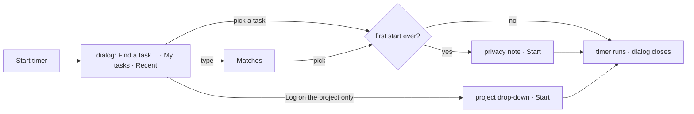

# UX Phase 4: Forms, tables, dashboards and workflows — Implementation Plan

> **For agentic workers:** REQUIRED SUB-SKILL: Use superpowers:subagent-driven-development (recommended) or superpowers:executing-plans to implement this plan task-by-task. Steps use checkbox (`- [ ]`) syntax for tracking.

**Goal:** lists help people find work fast, forms guide instead of block, and dashboards lead to action — audit items 4.1–4.10.

**Architecture:** a few shared kit blocks carry most of it: `DataTable` learns to drop low-value columns and to show that it scrolls; one `SearchBox`, `FilterTile`, `FilterBar` and `EmptyState` give Projects, My work and the Tasks tab the kit's list pattern with every filter in the address; one `useFormCheck` hook makes form errors live after the first Save. Start timer becomes one search list with my tasks first. Filtered queries keep the old rows dimmed while new ones load. No Api, mock or DB change.

**Tech Stack:** React 19, TypeScript, React Router 8, TanStack Query, Tailwind v4, Vitest (jsdom + browser), axe-core.

**Spec:** `spark-flow-web/docs/ux-audit/2026-11-09-ui-ux-audit.md` (main checkout, untracked), Phase 4 items 4.1–4.10 (lines 470–584) and the "Done when" row of section 6. The kit's list pattern (`design/04-page-patterns.md` A, `design/05-ux-rules.md` rules 6 and 7) is the target look. No section 7 rule changes in this phase.

## Global Constraints

- Hard rules in `CLAUDE.md`: semantic tokens; status colours `bg-{c}-50 text-{c}-700 dark:bg-{c}-500/15 dark:text-{c}-300`; kit pages use `Sheet` / `MenuPanel`, the shell and chat use `components/sf/*`; no toasts, spinners or overlays; one red primary per view; sentence case, curly ’ (`src/copy.test.ts`); `…` for pending; logical direction classes only (`src/rtl.test.ts`; the kit snippet's `text-left` is `text-start` here); light, dark and 390 px.
- Address state (UX Phase 2, `lib/searchParams.ts`): typed keys (`q`) replace the history entry, choices (tiles, selects, sort) add one; Back restores the search box.
- Sticky bars: `sticky top-14 … lg:top-0` (top bar 56 px; from `lg` the page scrolls inside the main card), as `AuditLogPage`.
- Kit-copied files (`ui/Sheet`, `ui/Field`, `DateTimePicker`, `FileViewer`, `Pagination`, `FileDrop`) keep their class strings; additions are new exports or new props.
- Shared blocks get a line in `CLAUDE.md` "Hard rules" in the task that adds them (as UX Phase 3 did).
- Test first for every task; the phase ends with `npx tsc -b`, `npm run lint`, `npm test` (known: `RichComposer.browser` "unknown /word"; `MessageList.browser` "Jump to latest" ×2 fail only in a worktree; vitest needs to run outside the sandbox here) and `npm run build:prototype`.
- Branch `feat/ux-phase-4` in `Spark_Flow/.worktrees/ux-phase-4`, from `origin/dev` (a0f0047). One commit per task. No push or merge; the user decides.

## Decisions

**D1. Forms check as you fix** (4.4).
- `lib/useFormCheck.ts`: `useFormCheck<E extends Record<string, string | undefined>>(errorsNow: E) → { errors: Partial<E>; attempt: () => boolean; reset: () => void }`. Before the first Save `errors` is `{}`; `attempt()` marks the form tried and returns whether `errorsNow` has no message; after that `errors` is `errorsNow` on every render, so an error leaves as soon as its field is fixed and comes back if it breaks again. Server refusals stay separate and clear on the next Save.
- Each form's rules are a pure function (existing: `validateProject`, `manualEntryErrors`, `channelFormErrors`, `columnErrors`, `timeoutProblem`; new: `taskFormErrors` in `pages/projects/taskForm.ts`, `deliverableErrors` beside DeliverableSheet). Used by TaskSheet, ProjectSheet, AddTimeSheet, DeliverableSheet, ColumnSheet, work hours (Attendance), Users' PersonSheet and NewChannelDialog.
- Enter submits: each of those forms gets `<button type="submit" hidden />` (Users' pattern); NewChannelDialog's body becomes a `<form>`. Enter in a textarea or the Lexical description never submits.
- Each error sits under its field: ColumnSheet's name error on Name; ProjectSheet's start-date error on Start (`projectForm.ts` gets a `startDate` key); work hours' timeout error on its field; AddTimeSheet's server refusal (overlap, future, over 12 h — all about the time range) under the End row instead of the foot. Other server failures stay at the foot.
- Carried from Phase 3: New channel's Name gets back its " *", and the Members error is tied to the list with `aria-describedby`.

**D2. Form copy** (4.9). Optional fields say `hint="Optional"` on kit `Field` (ProjectSheet Client and About, the Links legend, Users' Title); chat keeps its "(optional)" label style (NewChannelDialog Topic gets it). TeamsPage's placeholder "e.g. Data" → "Data". The attachments hint becomes `allowedFilesShort` = "Images, documents, audio, video and archives, up to 25 MB." (size from `maxFileMb`) plus a "Which files?" text button (`aria-expanded`) that shows `allowedFilesHint` under it; `DateTimePicker`'s "Type, e.g. 2:30 pm" stays (kit copy).

**D3. Tables fit, or show that they scroll** (4.1).
- `Column<T>` gains `dropOrder?: number`. `DataTable` measures its box (ResizeObserver) and, while the visible columns' widths add up to more than the box, leaves out the column with the lowest `dropOrder` still showing; columns without one never drop. With no width known (jsdom, hidden), every column shows.
- When it still scrolls: the first column is sticky (`sticky start-0 z-[1] bg-surface`, keeping the row's hover background), the end edge fades (`pointer-events-none absolute inset-y-0 end-0 w-12` gradient to `surface`, flipped in RTL), and an `IconButton size="sm"` "Scroll to more columns" (ChevronRight, `rtl:-scale-x-100`) sits over the fade and scrolls by 80 % of the box. Fade and button go once the end is reached.
- Projects: Client `dropOrder 1`, Manager `2`, Phase `3`. Attendance → Days: Device `1`, IP `2`. At 1280 × 800 the Projects table (Admin, with Cost) and Attendance Days fit with no sideways scroll; at 1440 Cost and Overdue show.

**D4. The board shows its hidden columns** (4.1). Above the board's scroller (end-aligned): "4 of 6 columns" (`text-xs text-fg-muted tabular-nums`, the columns fully inside the scroller) and, from `md` and only while it overflows, two `IconButton size="sm"`: "Earlier columns" / "Later columns" (Chevron icons, `rtl:-scale-x-100`), each scrolling one column (296 + 12 px), disabled at its end. The end edge fades while more columns are hidden. Phones keep swiping, with the count.

**D5. The kit's list pattern, shared** (4.2).
- `components/ui/SearchBox.tsx`: `SearchBox({ label, placeholder, value, onChange, className? })` — the Audit log's box (local text, sends after `SEARCH_WAIT_MS = 300`, Back puts the address's words back) moved into one place; Audit log, Users and Archived use it.
- `components/ui/FilterTile.tsx`: `FilterTile({ label, count, icon, tone: 'red' | 'amber' | 'sky' | 'neutral', pressed, onClick, disabled? })` — the kit's attention tile (`04-page-patterns.md` A.2, `aria-pressed`, clicking a pressed tile clears it), count `–` while undefined.
- `components/ui/EmptyState.tsx`: `EmptyState({ children, onClear?, clearLabel = 'Clear search and filters' })` — the kit's dashed box with the Inbox chip.
- `components/ui/FilterBar.tsx`: `FilterBar({ children, shown, total, noun, active, onClear, sticky = true })` — the kit's controls bar (sticky per Global Constraints) holding the page's search and selects in one row (`grid grid-cols-2 gap-2 sm:grid-cols-3 lg:flex`), and under it the count: "23 tasks" or, with `active > 0`, "Showing 6 of 23 tasks · Clear filters".
- The other pages' own dashed boxes stay (no migration in this phase).

**D6. Filters in the address** (4.2). Every filter is a query key; choosing pushes, typing replaces (`useParamState({ typed: ['q'] })`); "Clear filters" removes them all in one step.
- **Tasks tab**: `q` (key, title), `assignee` (`me` | `none` | person id), `priority`, `type`, plus the existing `phase` and `sprint`; `sort` in List view only: `attention` (default: overdue, over estimate, due, key — `myOpenTasks`' order), `due`, `priority`, `updated`. The board shows the matching tasks in its columns; with filters hiding all, the List shows `EmptyState` ("No tasks match “abc”." / "No tasks match these filters.") and the board keeps its columns with "Showing 0 of 23 tasks · Clear filters". New keys live in the address only (phase and sprint stay remembered as today). Not sticky (the board scrolls in its own box).
- **My work**: tiles Overdue (red), Due today (sky), In progress (neutral), Over estimate (amber) over my open tasks, `?show=overdue|today|inProgress|overEstimate`, and `?q=`. "Due today" reads the due date as a calendar day (UTC parts, as `formatDayMonth(…, { utc: true })`) against today's local date.
- **Projects**: `?q=` (name, key, client) in a `FilterBar` with the Show archived chip; tiles become `FilterTile`s and are `disabled` while archived projects show; a failed archived load says "Couldn’t load archived projects." with Try again (`QueryError`); empty texts name the search. No paging (the list is small; `Pagination` stays unused).

```mermaid
flowchart LR
  T[type in search] -->|after 300 ms, replace| A[(address ?q=…)]
  C[tile / select / sort] -->|push| A
  A --> F[filterTasks + sortTasks]
  F --> L{any match?}
  L -->|yes| R[rows + "Showing 6 of 23 · Clear filters"]
  L -->|no| E[EmptyState names the search · Clear search and filters]
  E -->|clear: one push| A
  B[Back] --> A
```

**D7. Start timer in two clicks** (4.3).
- The dialog's two drop-downs become one search list (`layout/TaskPicker.tsx`, sf look, `role="combobox"` box + always-open `listbox`, `aria-activedescendant`, ↑/↓/Enter). With no words: **My tasks** (my open tasks on projects I may log on, attention order, up to 8), then **Recent** (up to 5 targets I started before, not already listed). With words: **Matches** across open tasks of every project I may log on (key, title, project name; mine first, up to 20). "Log on the project only" (a text button) swaps the list for the project drop-down and a Start button.
- Picking a task starts the timer at once — except on my very first start, when the privacy note shows and Start confirms (Q1).
- Recent: `uiStore.recentTimers: Record<string, string[]>` keyed `${userId}:${workspaceId}`, entries `task:<id>` / `project:<id>`, newest first, at most 5, written after a start succeeds; ids no longer loggable or open are skipped on read.
- Data: `useLogTargets` (projects I may log on) plus `useTasksOf(projectIds)` (as My work). Pure `lib/timerTargets.ts` builds the groups.
- Someone with no project to log on sees no Start timer (top bar pill, My work's Today card); the dialog's "You aren’t on any projects…" line stays for the Switch task path.



**D8. Loading shaped like the page** (4.5).
- `PageSkeleton` (route fallback): a title bar, a subtitle line, four tile pulses (`grid grid-cols-2 gap-3 lg:grid-cols-4`) and five row pulses. `BoardSkeleton`: columns with a header pulse and two card pulses each.
- Sidebar: its static links (Work, Chat) use the workspace slug from the address while the workspace list loads; permission-based items (Manage, Settings) fade in (`motion-safe:animate-fade-in` or `transition-opacity`).
- Timer pill: a pulse bar (`h-4 w-24`) while the project list loads, never "—". TicketInspector's Sprint: a pulse bar, not "Loading…".
- Filtered queries keep the previous result (`placeholderData: keepPreviousData`) and the page dims it with `transition-opacity` + `opacity-60` while `isPlaceholderData` (as Audit log): Time & cost report, project Files, Attendance Days / Day / Visits / Report. Export CSV is disabled while the shown report is the previous one.

**D9. The Dashboard leads** (4.6, Q4).
- Tiles link: Active projects → Projects; Overdue tasks → the "N tasks need attention" table on the same page (`#attention`, scrolled into view inside the page's scroll box, heading focused); Hours, last 7 days → Time & cost `?days=7` and Cost to date → Time & cost, both only with `timeCost.view`; Working now → `#working-now`.
- Someone who can't see who's working (Sales) gets three tiles, not "Working now —" (`lg:grid-cols-3`).
- The chart row sizes each card to its content (`xl:items-start`), no 150 px gap.
- "Hours per day": for anyone without `dashboard.all`, "You" is the red series and everyone else grey; with it, as today. "You" leaves the legend while my 14 days add up to 0.

**D10. Time & cost on one row** (4.7). Period · project drop-down (`w-56`, through a new `selectInlineClass` export in `Field.tsx` = `selectClass` without `w-full`) · Export CSV at the end (`ms-auto`). The by-project and by-person tables sort by column (`DataTable` `sort`/`onSort`, `sortByColumn`), kept in `?sort=&dir=` (`columnSortFrom` / `sortParams` gain a key name, default `'by'`, since `by` is the page's grouping). Phones get a list per table (as Projects). Empty text names the filter: "No time logged on Nexus in the last 7 days."

**D11. Attendance place** (4.8, Q3). The Location cell reads "Map · ±25 m" as the link (Google Maps, as today), with the coordinates in its `title` and in the sr-only text; "Location blocked" / "No location" unchanged.

**D12. Workflow gaps** (4.10).
- Roles: the Add role / Save changes row and its status line become a sticky bar (Global Constraints).
- Rates: each row is a `<form>` (Enter saves); after a save the row says "Saved." (`role="status"`, `text-emerald-700 dark:text-emerald-300`) until it's changed again.
- Columns: changing an existing column's type to or from Done says, under the type, "{n} tasks here will count as done." / "{n} tasks here will stop counting as done."; Delete column says the same for the "Move them to" column when its type differs. Nothing shows with no tasks.
- Overview: the Expected finish tile's hint is "On time" when expected finish and due are the same day, else as today.
- History: entries grouped by day (`formatDayDivider` headings, in `HistoryList`, so the task panel gets them too); a person filter (`?who=`, "Anyone" then the people in this history) next to the kind chips.
- Teams: each member's Message is an `IconButton` (MessageSquare, label "Message {name}").

**Not in this phase:** paging on Projects; other pages' own empty boxes; the SegmentedControl's Back step per arrow key (Phase 3 deferred minor — stays deferred); field-level a11y wiring beyond D1 (Phase 5, 5.9).

## Review Focus

1. **Filters and Back**: type, pause, pick a tile, pick a select, then Back three times — the box and the list follow each step; a reload keeps them; Clear is one Back step; a stale `?assignee=` for someone no longer on the project shows "No tasks match these filters." with Clear, not a blank page. Pinned in Tasks 6–8.
2. **Tables while the box changes**: collapsing the sidebar, a column widened by hand (stored widths), RTL (the fade and button on the left), dark, a 768 tablet — columns drop and come back, the cue shows only while there's more. Pinned in Task 3 (browser test).
3. **The timer picker's keys and data**: ↑/↓/Enter, Esc closes the dialog (sf layers), typing fast, a recent task since done or archived, someone on a project with no tasks, project-only logging, the first start's note, Switch task while a timer runs. Pinned in Task 9.
4. **Forms**: no error shows before the first Save; after it, each clears as typed and returns if broken; Enter in a textarea or the description editor doesn't submit; Enter with a MenuPanel or the DateTimePicker open doesn't submit; a server refusal stays until the next Save. Pinned in Task 1.
5. **Old data shown as current**: while a new filter loads, the old rows are dimmed and Export CSV can't export them; a failed refetch keeps the old rows with the error sentence. Pinned in Tasks 10 and 12.

---

### Task 1: Forms check as you fix (D1, 4.4)

**Files:** Create `src/lib/useFormCheck.ts`, `src/lib/useFormCheck.test.tsx`, `src/pages/projects/taskForm.ts` · Modify `TaskSheet.tsx`, `ProjectSheet.tsx` + `projectForm.ts`, `DeliverableSheet.tsx`, `ColumnSheet.tsx`, `pages/time/AddTimeSheet.tsx`, `pages/settings/AttendancePage.tsx` (`WorkHoursForm`), `pages/settings/UsersPage.tsx` (`PersonSheet`), `pages/chat/NewChannelDialog.tsx`, `CLAUDE.md` · Test `projectSheets.test.tsx`, `TaskSheet.test.tsx`, `AddTimeSheet.test.tsx`, `UsersPage.test.tsx`, `AttendancePage.test.tsx`, `chatDialogs.test.tsx`

**Interfaces:** Produces `useFormCheck(errorsNow)` → `{ errors, attempt, reset }`; `taskFormErrors(values) → { title?: string; estimate?: string }`.

- [ ] **Step 1: Failing tests** — hook: `errors` is `{}` before `attempt()`, `attempt()` returns false and shows the errors, a fixed value clears its key on the next render, a broken one returns. Per form (jsdom): Save empty → "Give the task a title." shows; typing a title removes it before any Save; Enter in the title field saves (the mutation is called) on TaskSheet, ProjectSheet, AddTimeSheet, DeliverableSheet, ColumnSheet, work hours and New channel; Enter in TaskSheet's Lexical description does not; ProjectSheet's "Start must be before due" sits in the Start field; ColumnSheet's name error is in the Name field; DeliverableSheet's error never shows under Due; an AddTime server refusal shows under End; New channel's Name label has " *" and the Members error is the list's `aria-describedby`.
- [ ] **Step 2–4:** FAIL → implement → PASS (`npx vitest run src/lib/useFormCheck.test.tsx src/pages/projects src/pages/time src/pages/settings src/pages/chat/chatDialogs.test.tsx`).
- [ ] **Step 5: Commit** — `feat(forms): errors clear when fixed, Enter saves, errors by their field`

### Task 2: Form copy (D2, 4.9)

**Files:** Modify `lib/fileTypes.ts` (`allowedFilesShort`), `TaskAttachments.tsx`, `ProjectFiles.tsx`, `ProjectSheet.tsx`, `UsersPage.tsx`, `NewChannelDialog.tsx`, `TeamsPage.tsx` · Test `lib/fileTypes.test.ts`, `TaskAttachments.test.tsx`, `projectSheets.test.tsx`

- [ ] **Step 1: Failing tests** — `allowedFilesShort` is "Images, documents, audio, video and archives, up to 25 MB."; TaskAttachments shows it, "Which files?" has `aria-expanded="false"` and, clicked, shows `allowedFilesHint` and `true`; drop still works on the box; ProjectSheet's Client and About show "Optional"; no `placeholder` in `src/pages` starts with "e.g." (a small scan in the test, kit `DateTimePicker` excluded).
- [ ] **Step 2–4:** FAIL → implement → PASS (`npx vitest run src/lib/fileTypes.test.ts src/pages/projects`).
- [ ] **Step 5: Commit** — `fix(copy): optional fields marked one way, a short file hint`

### Task 3: Tables fit, or show that they scroll (D3, 4.1)

**Files:** Modify `src/components/ui/DataTable.tsx`, `pages/projects/ProjectsPage.tsx`, `pages/settings/AttendancePage.tsx`, `CLAUDE.md` · Create `src/components/ui/DataTable.browser.test.tsx`

**Interfaces:** Produces `Column<T>.dropOrder?: number`; pure `visibleColumns(columns, widths, boxWidth)` exported for the unit test.

- [ ] **Step 1: Failing tests** — unit: `visibleColumns` keeps all with `boxWidth` 0, drops `dropOrder` 1 then 2 until the sum fits, never drops a column without one. Browser (Chromium): Projects-shaped columns in a 946 px box show no Client / Manager and `scrollWidth <= clientWidth`; in a 700 px box the first cell is `position: sticky`, the "Scroll to more columns" button shows, and after scrolling to the end it's gone; with `dir="rtl"` the button sits at the left; axe has no serious or critical issue in light and dark.
- [ ] **Step 2–4:** FAIL → implement → PASS (`npx vitest run src/components/ui` and the browser file).
- [ ] **Step 5: Commit** — `feat(tables): drop low-value columns first, show when more columns scroll`

### Task 4: The board shows its hidden columns (D4, 4.1)

**Files:** Modify `pages/projects/ProjectBoard.tsx` · Test `pages/projects/ProjectTabs.browser.test.tsx` (or a new `ProjectBoard.browser.test.tsx`)

- [ ] **Step 1: Failing tests** (Chromium, 1280 wide, 6 columns): "4 of 6 columns" (or however many fit fully) is shown; "Earlier columns" is disabled; "Later columns" scrolls by one column and the count's first number follows; at the end "Later columns" is disabled and the fade is gone; at 390 px the buttons are hidden and the count reads "1 of 6 columns".
- [ ] **Step 2–4:** FAIL → implement → PASS.
- [ ] **Step 5: Commit** — `feat(board): count and arrows for columns off screen`

### Task 5: Shared list blocks (D5, 4.2)

**Files:** Create `src/components/ui/SearchBox.tsx`, `FilterTile.tsx`, `EmptyState.tsx`, `FilterBar.tsx` and a `listBlocks.test.tsx` · Modify `AuditLogPage.tsx`, `UsersPage.tsx`, `ArchivedPage.tsx` (use `SearchBox`), `pages/dev/UiGallery.tsx`, `CLAUDE.md`

**Interfaces:** Produces the four components with the props in D5; `SEARCH_WAIT_MS` exported from `SearchBox.tsx`.

- [ ] **Step 1: Failing tests** — SearchBox sends its words once after 300 ms (fake timers), not per key, and takes the address's words back when `value` changes from outside; FilterTile is a button with `aria-pressed`, `–` for an undefined count, the red tone's chip class, and `disabled` dims it; EmptyState's Clear calls `onClear`; FilterBar reads "23 tasks" with nothing active and "Showing 6 of 23 tasks · Clear filters" with `active={2}`; the Audit log, Users and Archived tests still pass unchanged.
- [ ] **Step 2–4:** FAIL → implement → PASS (`npx vitest run src/components/ui src/pages/settings`).
- [ ] **Step 5: Commit** — `feat(ui): search box, filter tiles, filter bar and empty state from the kit`

### Task 6: Filters on the Tasks tab (D6, 4.2)

**Files:** Modify `pages/projects/taskFilters.ts`, `TasksTab.tsx`, `ProjectBacklog.tsx`, `ProjectBoard.tsx` (empty columns only) · Test `taskFilters.test.ts`, `TasksTab.test.tsx`

**Interfaces:** Produces `TaskQuery = { q?: string; assignee?: string; priority?: Priority; type?: TaskType }`, `taskQueryFrom(params): TaskQuery`, `matchesQuery(t: TaskView, query: TaskQuery, meId: string): boolean`, `TaskSort = 'attention' | 'due' | 'priority' | 'updated'`, `sortTasks(tasks, sort): TaskView[]`, `activeFilters(query, { phase, sprint }): number`.

- [ ] **Step 1: Failing tests** — `matchesQuery`: "nex-12" matches key NEX-12, "login" matches a title, `assignee: 'me'` / `'none'` / an id, priority and type; `sortTasks('attention')` puts overdue, then over estimate, then by due; TasksTab: picking Priority High pushes `?priority=high` and Back removes it, typing "login" replaces the entry, the count reads "Showing 1 of 5 tasks · Clear filters", Clear removes q, assignee, priority, type, phase and sprint in one step, List view with nothing matching shows "No tasks match “zzz”." with "Clear search and filters", a stale `?assignee=` id shows the empty state.
- [ ] **Step 2–4:** FAIL → implement → PASS (`npx vitest run src/pages/projects`).
- [ ] **Step 5: Commit** — `feat(tasks): search, assignee, priority, type and sort on the Tasks tab`

### Task 7: Tiles and search on My work (D6, 4.2)

**Files:** Modify `pages/projects/taskFilters.ts` (`myTaskTiles`, `isDueToday`), `pages/home/MyWorkPage.tsx`, `pages/home/MyTasksCard.tsx` · Test `taskFilters.test.ts`, `MyWorkPage.test.tsx`

**Interfaces:** Produces `MyTaskTile = 'overdue' | 'today' | 'inProgress' | 'overEstimate'`, `myTaskTiles(tasks, now): Record<MyTaskTile, number>`, `isDueToday(t, now): boolean`.

- [ ] **Step 1: Failing tests** — `isDueToday` with `dueAt` '2026-11-09' is true at `new Date(2026, 10, 9, 23, 30)` and false at `new Date(2026, 10, 10, 0, 30)` (local dates, so it holds in any time zone); the four counts; MyWorkPage: four tiles with counts, clicking Overdue pushes `?show=overdue` and lists only overdue tasks, clicking it again clears, `?q=` filters by title, the count and EmptyState read as D5/D6.
- [ ] **Step 2–4:** FAIL → implement → PASS (`npx vitest run src/pages/home src/pages/projects/taskFilters.test.ts`).
- [ ] **Step 5: Commit** — `feat(my-work): attention tiles and search on my tasks`

### Task 8: Projects list (D6, 4.2)

**Files:** Modify `pages/projects/ProjectsPage.tsx` · Create `pages/projects/ProjectsPage.test.tsx`

- [ ] **Step 1: Failing tests** — `?q=nex` shows Nexus only and "Showing 1 of 4 projects"; tiles are FilterTiles (`aria-pressed`) and disabled with `?archived=1`; a failed archived load shows "Couldn’t load archived projects." and Try again refetches; nothing matching shows "No projects match “zzz”." with Clear.
- [ ] **Step 2–4:** FAIL → implement → PASS (`npx vitest run src/pages/projects/ProjectsPage.test.tsx`).
- [ ] **Step 5: Commit** — `feat(projects): search, kit tiles and a real archived error`

### Task 9: Start timer in two clicks (D7, 4.3)

**Files:** Create `src/lib/timerTargets.ts` (+ test), `src/layout/TaskPicker.tsx` · Modify `layout/StartTimerDialog.tsx`, `lib/uiStore.ts` (`recentTimers`, `noteRecentTimer`), `layout/TimerBar.tsx`, `pages/home/TodayCard.tsx`, `src/help/time.md`, `src/help/home.md` · Test `StartTimerDialog.test.tsx`, `TimerBar.test.tsx`, `TodayCard.test.tsx`, `TimerBar.browser.test.tsx` (axe at 390)

**Interfaces:** Produces `TimerTarget = { kind: 'task' | 'project'; id: string; projectId: string; label: string; detail: string }`, `timerTargets({ mine, recent, tasks, projects, q }): { label: string; targets: TimerTarget[] }[]`, `uiStore.noteRecentTimer(key: string, entry: string)`.

- [ ] **Step 1: Failing tests** — `timerTargets`: with no words, My tasks (attention order, at most 8) then Recent (skips ones already listed, done or not loggable; at most 5); with "log" only matches, mine first, at most 20; dialog: one combobox, ↓ then Enter starts the first of My tasks (the mutation gets `{ taskId }`), a click on a Recent row starts it, with `firstStart` a pick shows the privacy note and Start starts, "Log on the project only" shows the project drop-down and Start sends `{ projectId }`; a start notes the target in `recentTimers`; TimerBar and TodayCard show no Start timer when `useLogTargets` is loaded with no projects; help's timer lines describe the search (curly ’).
- [ ] **Step 2–4:** FAIL → implement → PASS (`npx vitest run src/lib/timerTargets.test.ts src/layout src/pages/home`).
- [ ] **Step 5: Commit** — `feat(timer): find a task and start in two clicks`

### Task 10: Loading shaped like the page (D8, 4.5)

**Files:** Modify `layout/PageSkeleton.tsx`, `pages/projects/ProjectBoard.tsx` (`BoardSkeleton`), `layout/Sidebar.tsx`, `layout/TimerBar.tsx` / `useMyTimer.ts`, `pages/projects/TicketInspector.tsx`, `api/time.ts`, `api/projects.ts`, `api/attendance.ts`, `pages/time/TimeCostPage.tsx`, `pages/projects/FilesTab.tsx`, `pages/settings/AttendancePage.tsx` · Test `Sidebar.test.tsx`, `TimerBar.test.tsx`, `FilesTab.test.tsx`, `AttendancePage.test.tsx`, a new `PageSkeleton.test.tsx`

- [ ] **Step 1: Failing tests** — PageSkeleton has four tile pulses and five row pulses, `aria-hidden`; BoardSkeleton columns hold two card pulses; Sidebar with the workspace list pending and the address at `/w/acme/…` shows Dashboard and My work links to `/w/acme/…`; the timer pill shows a pulse, not "—", while projects load; the Sprint field shows a pulse, not "Loading…"; FilesTab and Attendance Days, after a filter change, keep the old rows inside an `opacity-60` wrapper (no TableSkeleton); Time & cost's Export CSV is disabled while the report is the previous one.
- [ ] **Step 2–4:** FAIL → implement → PASS (`npx vitest run src/layout src/pages/projects src/pages/settings src/pages/time`).
- [ ] **Step 5: Commit** — `feat(loading): skeletons shaped like the page, old rows dimmed on refetch`

### Task 11: The Dashboard leads (D9, 4.6)

**Files:** Modify `pages/dashboard/DashboardPage.tsx`, `DashboardCharts.tsx`, `components/ui/StatTile.tsx` (only if a hash `to` needs it) · Test `DashboardPage.test.tsx`, `today.browser.test.tsx`

- [ ] **Step 1: Failing tests** — tiles are links: Active projects → Projects, Overdue → `#attention` (and the table's heading gets focus), Hours and Cost → Time & cost (`?days=7` on Hours) only with `timeCost.view`; Sales sees three tiles and no "Working now"; for a Member the "You" swatch is the primary colour and "Everyone else" the context colour (`:111-118` updated); "You" isn't in the legend when my days add up to 0; browser: at 1440 the hours card's height equals its content (no 100+ px empty band).
- [ ] **Step 2–4:** FAIL → implement → PASS (`npx vitest run src/pages/dashboard` and the browser file).
- [ ] **Step 5: Commit** — `feat(dashboard): tiles lead to their lists, my hours in red`

### Task 12: Time & cost on one row (D10, 4.7)

**Files:** Modify `pages/time/TimeCostPage.tsx`, `components/ui/Field.tsx` (`selectInlineClass`), `lib/sorting.ts` (key name) · Create `pages/time/TimeCostPage.test.tsx` · Test `lib/sorting.test.ts`

- [ ] **Step 1: Failing tests** — `columnSortFrom(params, 'sort')` reads `?sort=hours&dir=desc`; the page: period, project and Export CSV share one row and the project select has no `w-full`; clicking the Hours header pushes `?sort=hours&dir=asc` and orders the rows; at phone width (jsdom: the `sm:hidden` list exists) each table has a list; with a project picked and nothing logged: "No time logged on Nexus in the last 7 days."
- [ ] **Step 2–4:** FAIL → implement → PASS (`npx vitest run src/pages/time src/lib/sorting.test.ts`).
- [ ] **Step 5: Commit** — `feat(time-cost): filters on one row, sortable tables, phone lists`

### Task 13: Settings gaps (D11, D12, 4.8, 4.10)

**Files:** Modify `pages/settings/attendanceView.ts` (`placeText`), `AttendancePage.tsx` (`Place`), `RolesPage.tsx`, `RatesPage.tsx` · Test `attendanceView.test.ts`, `AttendancePage.test.tsx`, `RolesPage.test.tsx`, `RatesPage.test.tsx`

- [ ] **Step 1: Failing tests** — the Location link's text is "Map · ±25 m" and its title holds "30.05716, 31.2272"; Roles' save row has `sticky`; Rates: Enter in a rate saves, then "Saved." shows and leaves on the next change.
- [ ] **Step 2–4:** FAIL → implement → PASS (`npx vitest run src/pages/settings`).
- [ ] **Step 5: Commit** — `fix(settings): readable places, sticky roles bar, rates save on Enter`

### Task 14: Project gaps (D12, 4.10)

**Files:** Modify `ColumnSheet.tsx`, `DeleteColumnSheet.tsx`, `lib/boardColumns.ts` (a pure `doneChange(from, to, count)`), `OverviewTab.tsx`, `HistoryTab.tsx`, `HistoryList.tsx`, `historyFilter.ts`, `pages/teams/TeamsPage.tsx` · Test `boardColumns.test.ts`, `projectSheets.test.tsx`, `historyFilter.test.ts`, a new `HistoryTab.test.tsx`, `TeamsPage.test.tsx`

**Interfaces:** Produces `doneChange(from: StatusCategory, to: StatusCategory, count: number): string | null` (`StatusCategory` from `api/types.ts:147`).

- [ ] **Step 1: Failing tests** — `doneChange('inProgress', 'done', 3)` → "3 tasks here will count as done.", `('done', 'todo', 1)` → "1 task here will stop counting as done.", same category or 0 → null; the sheets show it; Overview's hint is "On time" when the two dates are the same day; History groups under "Today" / "Yesterday" / "Wednesday 4 November", and `?who=` keeps one person's entries; Teams' Message is an icon button named "Message Nour El-Sayed" with that title.
- [ ] **Step 2–4:** FAIL → implement → PASS (`npx vitest run src/lib src/pages/projects src/pages/teams`).
- [ ] **Step 5: Commit** — `fix(projects): warn before done changes, history by day, quieter team rows`

### Task 15: Phase check and records

- [ ] `npx tsc -b`, `npm run lint`, `npm test`, `npm run build:prototype` — all pass but the known three.
- [ ] Look in the app (light, dark, 1440, 1280, 768, 390): Projects, Attendance, the board, Tasks tab filters, My work tiles, Start timer, Dashboard, Time & cost, a sheet's errors.
- [ ] `npm run help:shots` (home, projects, dashboard and time-cost changed); help chapters touched by Tasks 6–9 read right.
- [ ] `CLAUDE.md` lines for D1, D3, D5, D7 are in; `tasks/todo.md` gets "Review — UX Phase 4"; the audit report gets an "Update (Phase 4)" line (main checkout, uncommitted).
- [ ] Commit — `docs(ux): Phase 4 review and help pictures`

## Execution order

1 → 2 (forms) → 3 → 4 (tables) → 5 → 6 → 7 → 8 (lists; 6–8 need 5) → 9 → 10 → 11 → 12 (12 after 10, both touch Time & cost) → 13 → 14 → 15.

## Questions before Task 1

1. **Start timer (4.3):** picking a task starts the timer at once (two clicks from the top bar), except the very first start, where the privacy note shows and Start confirms?
   *Recommended: yes, as D7.*
2. **Hidden columns (4.1):** when a table doesn't fit, it leaves out low-value columns first (Projects: Client, then Manager, then Phase; Attendance: Device, then IP), and only then scrolls, with a fade and an arrow; the left-out columns aren't shown at that width. Or keep every column and only add the scroll cue?
   *Recommended: leave them out first, as D3.*
3. **Attendance place (4.8):** Flow has no place names without an outside map service, so the link reads "Map · ±25 m" with the coordinates on hover. Or a built-in list of cities ("Near Cairo · ±25 m"), which someone has to keep up?
   *Recommended: "Map · ±25 m", as D11.*
4. **Dashboard (4.6):** Overdue jumps to the "tasks need attention" table on the same page; Sales sees three tiles; "You" is the red series for anyone who sees only their own projects (Member, PM), and grey for Admin and Sales, where the team is the key series?
   *Recommended: yes, as D9.*
5. **How to run it:** Native with one Opus review of the whole branch at the end, as in Phases 1–3?
   *Recommended: yes.*
