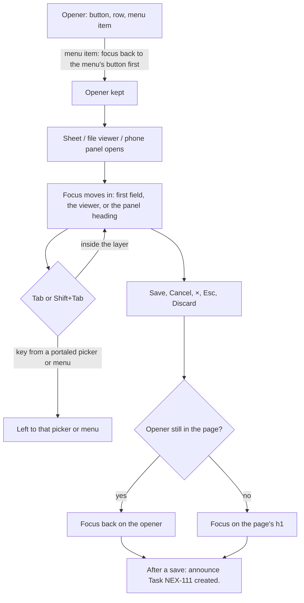
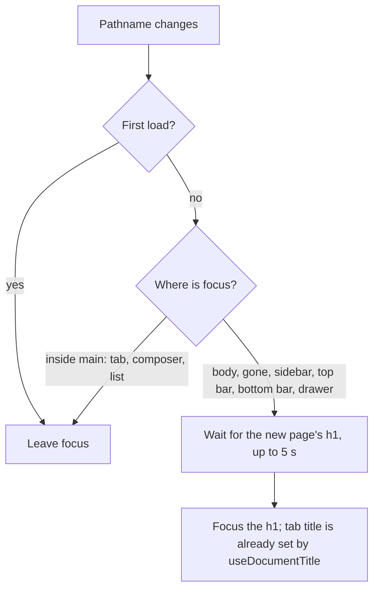

# UX Phase 5A: Keyboard and screen readers — Implementation Plan

> **For agentic workers:** REQUIRED SUB-SKILL: Use superpowers:subagent-driven-development (recommended) or superpowers:executing-plans to implement this plan task-by-task. Steps use checkbox (`- [ ]`) syntax for tracking.

**Goal:** someone with only a keyboard or a screen reader can open every record, keeps their place in every dialog, menu and panel, knows which page they are on, and hears what changed. This covers audit items 5.5, 5.6, 5.7, 5.9, 5.11, 5.12 and 5.13.

**Architecture:**
- **Dialogs, menus and panels.** The kit's dialogs, menus and side panels get the focus rules the chat side already has, from `components/sf/layers.tsx`: `useRestoreFocus`, `trapTab` and `focusables`. When the thing that opened them is gone, one helper, `focusPageHeading`, is where focus lands.
- **Page titles and route focus.** One hook names the browser tab after the page's `h1`. A small shell component moves focus to the new page's heading when focus was lost or left behind in the navigation.
- **Forms.** `Field` links its control to its error and hint, and `useFormCheck` puts the caret on the first error.
- **Unchanged.** There is no visual change apart from a skip link that shows only while focused, and the phone task panel's dim backdrop (Q1). No Api change apart from one preference (Q2).

**Tech stack:** React 19, TypeScript, React Router 8, TanStack Query, dnd-kit 6, Lexical 0.52, Tailwind v4, Vitest (jsdom and browser projects), axe-core 4.14.

**Spec:** `spark-flow-web/docs/ux-audit/2026-11-09-ui-ux-audit.md` (in the main checkout, untracked), Phase 5 items 5.5, 5.6, 5.7, 5.9, 5.11, 5.12 and 5.13 (lines 632–725). Also the Phase 5 "Done when" row in section 6: "No axe serious/critical; keyboard can open every record; focus kept and returned". Contrast belongs to 5B, so this phase is done when axe finds nothing serious or critical *apart from contrast*. The kit's rules are `design/05-ux-rules.md` rule 11 ("Esc closes menus and returns focus; Tab is trapped in menus") and its accessibility list ("All animation behind `motion-safe:`"). Phase 5B (5.1–5.4, 5.8, 5.10: phones, contrast, colour-only status) is a separate plan.

## Global Constraints

- **Hard rules in `CLAUDE.md` still apply:**
  - semantic tokens only;
  - no toasts, spinners or overlays (the phone panel backdrop in Q1 is the kit's bottom-sheet scrim, the same one `MenuPanel` uses on phones);
  - sentence case and curly ’ (`src/copy.test.ts`);
  - `…` for pending;
  - logical direction classes only (`src/rtl.test.ts`);
  - light, dark and 390 px.
- **Kit-copied files keep their class strings.** This covers `ui/Sheet`, `ui/Field`, `ui/Menu`, `ui/FileViewer` and `ui/DataTable`. Behaviour and attributes may change. DOM structure may change only where a decision below says so (D7 `Field`).
- **Reuse, don't copy.** Focus helpers come from `components/sf/layers.tsx` (`useRestoreFocus`, `trapTab`, `focusables`) and `lib/useDialogFocus.ts` (`wrapFocus`). There is no second implementation. Kit files may import them; they hold no chat styling.
- **Screen-reader-only messages** use the one live region the app already has: `announce(text)` from `components/sf/Announcer.tsx`, mounted once in `AppLayout`. The exception is a message that must be heard while an `aria-modal` sheet is open; it goes in a `role="status"` inside that sheet.
- **New shared pieces get a line in `CLAUDE.md` "Hard rules"** in the task that adds them.
- **Tests come first in every task.** Tests read names and descriptions through Testing Library (`getByRole(role, { name, description })`); there is no jest-dom. axe checks use a new helper, `src/test/axe.ts`. Layout and real focus movement go in browser tests (`*.browser.test.tsx`).
- **Gates at the end of the phase:**
  - `npx tsc -b`, `npm run lint`, `npm test` and `npm run build:prototype`, run outside the sandbox. Nothing may fail except the two worktree-only `MessageList.browser` "Jump to latest" failures.
  - `npm test` runs vitest; in this worktree vitest must run outside the sandbox.
- **Branch:** `feat/ux-phase-5a` in `Spark_Flow/.worktrees/ux-phase-5a`, from `origin/dev` (a621b47, Phase 4 landed). One commit per task. No push or merge; the user decides.

## Decisions

**D1. Sheets keep focus and give it back** (5.5).
- **Tab stays in.** `Sheet` keeps Tab and Shift+Tab inside its panel with `trapTab(e, panel)`. Keys from something portaled out of the sheet (a `DateTimePicker`, a phone `MenuPanel`, a `FileViewer`) are not inside the panel's DOM, and the sheet leaves them to that thing (as `useDialogFocus` does).
- **Focus goes back on close.** `useRestoreFocus(open, focusPageHeading)` returns focus to what opened the sheet. If that is gone, for example a deleted row, focus goes to the page's `h1`.
- **What stays.** How focus moves in, Esc only when `dismissible`, and the discard question in the footer all stay as they are.
- `src/lib/pageFocus.ts` gets `focusPageHeading(): HTMLElement | null`. It finds `main h1`, adds `tabIndex=-1` if the heading has none, focuses it with `preventScroll`, and returns it, or null when there is no heading. D4, D6 and later tasks use it.

**D2. The file viewer is a real dialog** (5.5). When it opens, focus moves to the viewer itself (`tabIndex=-1`, so its label "a.pdf" is read and the arrow keys work). Tab stays inside, as in D1. On close, focus goes back to what opened it, with `focusPageHeading` as the fallback. Esc and the arrow keys stay as they are.

**D3. Menus: arrow keys, and focus back on a pick** (5.5).
- **Arrow keys.** In `MenuPanel` (`components/ui/Menu.tsx`), ↓ and ↑ move between enabled `menuitem`, `menuitemradio` and `menuitemcheckbox` items, wrapping at the ends. Home and End jump to the first and last item.
- **The step is a pure function.** It is `menuStep<T>(items: T[], active: T | null, key: string): T | null`, exported from `Menu.tsx`. It returns null for any other key.
- **Focus goes back on a pick.** When an item is clicked, the panel first puts focus back on `triggerRef` (in the capture phase, before the item's own `onClick`), so a sheet the item opens remembers the trigger as its opener (D1).
- **What stays.** A click outside closes the menu and leaves focus where the click put it. Esc and Tab behave as they do now.

**D4. Side panels: focus in, focus back, modal on phones** (5.5).
- **Which panels.** The task, thread and file panels (`layout/InspectorFrame.tsx`) and the page help panel (`layout/PageHelpPanel.tsx`).
- **Focus in.** Each panel moves focus to its heading when it opens or switches to another record, but not on page load, and not when something inside it has already taken focus (a reply box).
- **Focus back.** When the panel closes, focus goes back to what opened it (`useRestoreFocus`, with the `focusPageHeading` fallback). Help already returns focus to its button.
- **Phones (Q1).** Below `lg` the panel is a modal bottom sheet: `role="dialog"`, `aria-modal="true"`, Tab kept inside, and the kit scrim above it (a tap closes, as with a `MenuPanel` on phones). From `lg` it stays a side panel with no trap.
- **The panel's own Esc.** `useInspectorEscape` yields to `[aria-modal]`. It must not yield to its own panel now that the panel is modal on phones.

**D5. Every record opens from the keyboard** (5.6).
- **Clicks on controls inside a row.** `DataTable` ignores a row click that starts on a control inside the row (`a, button, input, select, textarea, label, [role=menuitem]`). A link or button in a cell then does its own job, and pages drop their `stopPropagation`.
- **Projects.** The name cell is a `Link` to the project.
- **Files tab.** The title cell is a `<button>` that opens the viewer, as the phone list already does.
- **Board cards (Space picks up, Enter opens; the sidebar's rule).**
  - The card's `TicketRow` link is the tab stop, so Enter opens the task.
  - The `<li>` carries dnd-kit's `listeners` only, so Space picks the card up.
  - The link gets the instructions' `aria-describedby`.
- **Shared keys.** `lib/dragSensors.ts` exports `SPACE_DRAG_KEYS = { start: ['Space'], cancel: ['Escape'], end: ['Space'] }`, used by the sidebar and the board.
- **Board column headers (5.11, `nested-interactive`).**
  - The header keeps `listeners`, so it can still be dragged from anywhere by mouse.
  - Its `<h2>` holds a text-styled `<button>`, which is the activator (`setActivatorNodeRef`, `attributes`, `aria-roledescription="movable column"`). The button's name is the column's label, so the label and the name match. There is no visual change.
  - The menu button sits outside that button.

**D6. Skip link, page titles, and focus after a page change** (5.7).
- **Skip link.** "Skip to content" is the first thing in `AppLayout`. It is `sr-only` until focused, then shows at the top start in kit tokens with the brand ring. It focuses `<main id="main" tabIndex={-1}>` without changing the address.
- **Tab titles.** `useDocumentTitle(parts: readonly (string | null | undefined)[]): void` in `src/lib/useDocumentTitle.ts` sets `document.title` to the parts that are set, joined with " · ", then "Spark Flow". These call it:
  - `PageHeader`, with `[title]`;
  - `ProjectPage`, with `[project.name, tab label]` ("Nexus Core · Tasks · Spark Flow");
  - every other page that draws its own `h1`: `ChannelHeader` ("#general" or the person's name), Threads, Search, Activity, Saved, Drafts, Help, Roles, Not found and Sign in.
  - A scan test fails when a `.tsx` file renders an `h1` without the hook. `RecordHeader` is excluded, because `ProjectPage` names it.
- **Focus after a page change.** `layout/RouteFocus.tsx`, mounted in `AppLayout`, does this:
  - It watches for a pathname change, but not on the first load and not for a change to the search or hash alone.
  - When the pathname changes, it acts only if focus is on `body`, or on something no longer in the page, or outside `<main>` (the sidebar, top bar, bottom bar or drawer).
  - In those cases it waits for the new page's `h1` (at most 5 s) and focuses it with `focusPageHeading`.
  - If focus is already inside `<main>` (a project tab, or a composer that focused itself), it leaves it there.
  - Nothing extra is announced, because the heading is read when it takes focus.

**D7. Forms for screen readers** (5.9).
- **`Field`'s DOM changes, its class strings don't.**
  - It becomes a `
` around the `<label class="block">`, which holds the label text and the control. The error or hint `` (same classes) follows the label inside the div.
  - So the error is no longer part of the field's name. It becomes the control's description: the span gets an id from `useId`, and the control gets `aria-describedby`, added with `cloneElement` to Field's single native-control child and merged with any it already has.
  - With `required`, the control gets `aria-required="true"` and the " *" is `aria-hidden`. A field is then named "Title", not "Title *".
- **The caret goes to the first error.** `useFormCheck` also returns `formRef: RefObject<HTMLFormElement | null>`. After a failed `attempt()`, once the errors have rendered, it focuses the first `[aria-invalid="true"]` in the form, or else the first control inside the first `[data-invalid]` group.
  - Every form that uses the hook puts `ref={formRef}` on its `<form>`.
  - Group errors mark their fieldset with `data-invalid` and `aria-describedby`: ColumnSheet's Type, ProjectSheet's Links, and Users' Roles and Teams.
- **Project link rows** are named "Link 1 label" and "Link 1 web address".
- **Hidden file inputs.** In TaskAttachments and ProjectFiles they use `hidden` (as RichComposer does), so they leave the accessibility tree. Their visible "Add files" button stays the way in.

**D8. Structure fixes from axe** (5.11).
- **Sidebar.** `SortableSideList` renders its own `<ul id>`, so dnd-kit's hidden instructions and live region sit next to the list, not inside it. Sidebar sections render a `<ul>` only for their static lists.
- **Progress bars.** `ProgressBar` gets a required `label: string`, used as its `aria-label` ("Progress"). TypeScript then makes every use name it.
- **Typeahead.** The composer's typeahead list renders inside the composer, using `LexicalTypeaheadMenuPlugin`'s `parent` set to the composer's root, so it sits inside the page's landmark. The existing browser test pins its place at the caret.
- **Not found.** It already has its `h1` (UX Phase 2); nothing to do.
- **Test helper.** `src/test/axe.ts` exports `axeProblems(context?: Element | Document, opts?: { skip?: string[] }): Promise<string[]>`. It runs axe and returns `"rule: target"` for each serious or critical violation. Contrast (`color-contrast`) is skipped until 5B.

**D9. Announce what changed, and only that** (5.12).
- **Composer count.** The visible count loses `aria-live`. A screen-reader-only status carries `countNotice(remaining: number): string` from `pages/chat/composer/countNotice.ts`. That text changes only at a few steps, so it is read once per step:

  | `remaining` | Text |
  |---|---|
  | 1000 or more | "" (nothing) |
  | 500 to 999 | "Fewer than 1,000 characters left." |
  | 100 to 499 | "Fewer than 500 characters left." |
  | 1 to 99 | "Fewer than 100 characters left." |
  | 0 | "No characters left." |
  | below 0 | "Too long to send. Remove some text." |

- **Upload rows.**
  - Rows lose `aria-live`, and each in-flight row gets `role="progressbar"`, `aria-label="Uploading {name}"` and `aria-valuenow`, as chat's `UploadTray` has. The visible "Uploading… 50%" stays.
  - `useUploadQueue` returns `notice: string`, the latest finish ("a.pdf uploaded.") or failure ("a.pdf: {sentence}").
  - TaskAttachments and ProjectFiles show it in a `role="status"` `sr-only` paragraph. It stays inside the sheet, which is `aria-modal`.
- **Saves are announced through `announce()` after the sheet closes:**

  | Sheet | Create | Save |
  |---|---|---|
  | Task | "Task NEX-111 created." | "Task NEX-111 saved." |
  | Project | "Project Nexus Core created." | "Project saved." |
  | Add time | "Time added." | "Time entry saved." |
  | Deliverable | "Deliverable added." | "Deliverable saved." |
  | Column | "Column QA added." | "Column saved." |
  | Phases | "Phase added." | "Phases saved." |
  | Team | "Team Data created." | "Team saved." |
  | Person | "Nour El-Sayed added." | "Changes saved." |

  On Users, deactivate says "{name} deactivated." and reactivate says "{name} reactivated."
- **Labels on elements that can't hold one.** No `aria-label` on a `span` or `div` without a role. The two "Unread" dots get an `sr-only` "Unread" and the dot is hidden. StageProgress's phone line gets `role="group"`. The reaction count that isn't a button gets `role="img"`. A scan test keeps it that way.

**D10. Motion and shortcuts** (5.13).
- **Reduced motion.**
  - `src/index.css`'s reduced-motion block also stops `.animate-pulse` everywhere: one rule, rather than editing about 44 class strings that the kit itself mixes.
  - Help's scroll uses `behavior: prefersReducedMotion() ? 'auto' : 'smooth'`, with `prefersReducedMotion` from `components/charts/chartUtils.ts`.
- **A switch for single-key shortcuts (Q2).**
  - **Where.** Preferences gets a "Keyboard" section with one `Switch`: "Single-key shortcuts", help "Press / to search, G then P for Projects, G then C for Chat." It is on by default.
  - **What it turns off.** When off, `/` (`GlobalSearch`) and G then P / G then C (`useModeShortcuts`) do nothing. ⌘/Ctrl shortcuts keep working. Chat's letter keys on a focused message stay, because they work only while that message has focus, which WCAG 2.1.4 allows.
  - **Storage (recommended).**
    - It is per person: `Preferences.singleKeyShortcuts: boolean`, in `DEFAULT_PREFERENCES` as `true`.
    - The mock gains DB v32: migration 31 → 32 fills it on stored records, and `mocks/preferences.ts` checks it is a boolean.
    - While preferences load, the shortcuts are on.
  - The help chapter `preferences.md` gets a "Keyboard" part.

**Not in this phase:**
- contrast, phone layout, tap targets and colour-only status (5B);
- the all-pages axe sweep in `npm test` (6.1);
- refactoring the 8 existing inline axe calls onto the new helper;
- arrow keys to open a menu from its trigger;
- a shortcuts list or remapping.

## Review Focus

1. **Layers inside a sheet.**
   - Cases: a `DateTimePicker`; a `MenuPanel` on a phone (portaled); the file viewer opened from TaskSheet's files; a discard question; Enter on the hidden submit button.
   - Tab, Esc and close each return focus one level at a time: to the control in the sheet, then to the sheet's opener.
   - Pinned in Tasks 1–3.
2. **The opener is gone.**
   - Cases: a sheet opened from a row menu whose row the sheet deletes; a task panel closed after its card moved to another column; a panel closed by a page change.
   - Focus lands on the page's `h1` or the moved card, never on `body`.
   - Pinned in Tasks 1, 4 and 5.
3. **Page-change focus doesn't steal.**
   - These leave focus where it is: a filter or search in the address, a project tab, opening a task panel (`?ticket=`), a channel switch where the composer focuses itself, Back and Forward from a link inside the page, and the first load.
   - Only from the sidebar, top bar, bottom bar, drawer, or lost focus does it go to the `h1`.
   - Pinned in Task 6.
4. **`Field`'s new DOM keeps every form working.**
   - A click on a label focuses its control.
   - Names don't change ("Title", and the `*` is not read).
   - Errors and hints are descriptions; a field with both shows only the error.
   - Tests that used `closest('label')` move to `getByRole(…, { description })`.
   - The layout looks the same in RTL and dark.
   - Pinned in Task 7.
5. **Shortcuts.**
   - `/` typed in a field always types a `/`.
   - With the switch off, `/` and G then P do nothing anywhere, ⌘K still opens search, and the setting survives a reload.
   - An old stored preferences record (DB v31) reads as on.
   - Pinned in Task 10.

---

### Task 1: Sheets keep focus and give it back (D1, 5.5)

**Files:**
- Create `src/lib/pageFocus.ts` and `src/lib/pageFocus.test.ts`.
- Modify `src/components/ui/Sheet.tsx`.
- Test `src/components/ui/Sheet.test.tsx`.

**Interfaces:**
- Consumes `useRestoreFocus` and `trapTab` from `@/components/sf/layers`.
- Produces `focusPageHeading(): HTMLElement | null`.

- [ ] **Step 1: Failing tests.**
  - `focusPageHeading` focuses `main h1`, gives it `tabIndex=-1`, and returns it; with no `h1` it returns null.
  - In a sheet with a field and the footer's two buttons, Tab on the last button goes to the first field, and Shift+Tab on the first field goes to the last button.
  - Closing the sheet with Cancel returns focus to the button that opened it.
  - When the opener was removed while the sheet was open, focus goes to `main h1`.
  - A keydown from an element portaled to `document.body` as a React child of the sheet isn't trapped (its default isn't prevented).
- [ ] **Step 2–4:** fail, implement, pass: `npx vitest run src/lib/pageFocus.test.ts src/components/ui/Sheet.test.tsx`.
- [ ] **Step 5: Commit:** `fix(a11y): sheets keep Tab inside and give focus back`.

### Task 2: The file viewer is a real dialog (D2, 5.5)

**Files:**
- Modify `src/components/ui/FileViewer.tsx`.
- Test `src/components/ui/FileViewer.test.tsx`.

- [ ] **Step 1: Failing tests.**
  - On open, `document.activeElement` is the dialog named after the file.
  - Tab from its last button goes to its first.
  - Esc closes it and focus returns to the "Open a.pdf" button that opened it.
  - → still moves to the next file.
- [ ] **Step 2–4:** fail, implement, pass: `npx vitest run src/components/ui/FileViewer.test.tsx`.
- [ ] **Step 5: Commit:** `fix(a11y): the file viewer takes focus and gives it back`.

### Task 3: Menus: arrow keys and focus back on a pick (D3, 5.5)

**Files:**
- Modify `src/components/ui/Menu.tsx`.
- Create `src/components/ui/Menu.test.tsx`.

**Interfaces:**
- Produces `menuStep<T>(items: T[], active: T | null, key: string): T | null`.

- [ ] **Step 1: Failing tests.**
  - `menuStep([a,b,c], a, 'ArrowDown')` → b; `(…, c, 'ArrowDown')` → a; `(…, a, 'ArrowUp')` → c; `(…, b, 'Home')` → a; `(…, b, 'End')` → c; `(…, null, 'ArrowDown')` → a; `(…, a, 'x')` → null.
  - In a `RowMenu` with Rename and Delete, ↓ moves focus from Rename to Delete and skips a disabled item.
  - Picking Rename puts focus on the "More" button before Rename's handler runs: the handler sees `document.activeElement` as the trigger.
  - A sheet opened by Rename returns focus to "More" when it closes (with Task 1).
- [ ] **Step 2–4:** fail, implement, pass: `npx vitest run src/components/ui/Menu.test.tsx src/components/ui/Menu.browser.test.tsx`.
- [ ] **Step 5: Commit:** `fix(a11y): menus move with arrow keys and give focus back on a pick`.

### Task 4: Side panels: focus in, focus back, modal on phones (D4, 5.5)

**Files:**
- Modify `src/layout/InspectorFrame.tsx`, `src/layout/Inspector.tsx` (`useInspectorEscape`), `src/layout/PageHelpPanel.tsx`, and the callers that need `focusTitle`: `TicketInspector`, `ThreadInspector`.
- Test `src/layout/Inspector.browser.test.tsx` and `src/layout/PageHelpPanel.test.tsx` (or its existing test).

- [ ] **Step 1: Failing tests (browser).**
  - Clicking a task row at 1280 opens the panel with focus on its heading "NEX-111 …". × returns focus to the row's link.
  - A link to another task inside the panel moves focus to the new heading. × still returns focus to the first row.
  - Loading the page with `?ticket=` in the address leaves focus alone.
  - At 390 px the panel has `role="dialog"` and `aria-modal="true"`, Tab stays inside, a tap on the scrim closes it, and Esc closes it (it does not yield to itself).
  - At 1280 it has no `aria-modal` and no trap.
  - The help panel focuses its heading on open.
- [ ] **Step 2–4:** fail, implement, pass: `npx vitest run --project browser src/layout/Inspector.browser.test.tsx` and `npx vitest run src/layout`.
- [ ] **Step 5: Commit:** `fix(a11y): side panels take focus, give it back, and are modal on phones`.

### Task 5: Every record opens from the keyboard (D5, 5.6, 5.11 board)

**Files:**
- Modify `src/components/ui/DataTable.tsx`, `src/pages/projects/ProjectsPage.tsx`, `src/pages/projects/FilesTab.tsx`, `src/pages/settings/UsersPage.tsx` and `src/pages/settings/AuditLogPage.tsx` (drop the `stopPropagation`), `src/lib/dragSensors.ts`, `src/layout/SortableSideList.tsx`, `src/pages/projects/ProjectBoard.tsx`, and `src/pages/projects/TicketRow.tsx` if needed.
- Create `src/pages/projects/ProjectBoard.browser.test.tsx`.
- Test the DataTable, ProjectsPage, FilesTab and SortableSideList tests.

**Interfaces:**
- Produces `SPACE_DRAG_KEYS`.

- [ ] **Step 1: Failing tests.**
  - **DataTable:** a click on a button inside a row doesn't call `onRowClick`; a click on plain cell text does.
  - **Projects:** "Nexus Core" in the table is a link to `/w/:ws/p/NEX`.
  - **Files tab:** the file's title cell is a button that opens the viewer.
  - **Board (browser):**
    - Tab reaches a card's link, and Enter opens `?ticket=NEX-111`.
    - Space picks the card up, → moves it to the next column, and Space drops it; the move mutation is called and focus is on that card's link afterwards.
    - Esc during a move puts it back.
    - A column's header has a button named "QA" with `aria-roledescription="movable column"`; the menu button is not inside it.
    - axe: no `nested-interactive`, `aria-allowed-role` or `label-content-name-mismatch` on the board.
  - **Sidebar:** its test still passes with `SPACE_DRAG_KEYS`.
- [ ] **Step 2–4:** fail, implement, pass: `npx vitest run src/components/ui src/pages/projects src/layout/SortableSideList` and `npx vitest run --project browser src/pages/projects/ProjectBoard.browser.test.tsx src/layout/SortableSideList.browser.test.tsx`.
- [ ] **Step 5: Commit:** `fix(a11y): rows, files and board cards open from the keyboard`.

### Task 6: Skip link, tab titles, focus after a page change (D6, 5.7)

**Files:**
- Create `src/lib/useDocumentTitle.ts` and its test, `src/layout/RouteFocus.tsx` and `src/layout/RouteFocus.browser.test.tsx`, and `src/a11y.test.ts` (scan tests; Task 9 adds to it).
- Modify `src/layout/AppLayout.tsx` (skip link, `main` id, `RouteFocus`), `src/components/ui/PageHeader.tsx`, `src/pages/projects/ProjectPage.tsx` (export `tabLabels` from `ProjectTabs.tsx`), `ChannelHeader.tsx`, `ThreadsPage.tsx`, `SearchPage.tsx`, `ActivityView.tsx`, `SavedView.tsx`, `DraftsView.tsx`, `HelpPage.tsx`, `RolesPage.tsx`, `NotFound.tsx` and `SignInPage.tsx`.

**Interfaces:**
- Consumes `focusPageHeading`.
- Produces `useDocumentTitle(parts)`.

- [ ] **Step 1: Failing tests.**
  - **Hook:** `useDocumentTitle(['Nexus Core', 'Tasks'])` → "Nexus Core · Tasks · Spark Flow"; `([undefined])` → "Spark Flow".
  - **Pages:** a page with `PageHeader title="Projects"` sets "Projects · Spark Flow".
  - **Scan:** every `src/**/*.tsx` that renders `<h1` calls `useDocumentTitle`, except `RecordHeader.tsx` (its page, `ProjectPage`, names it).
  - **Skip link:** the first Tab stop in `AppLayout` is "Skip to content"; Enter moves focus to `main` and the address doesn't change.
  - **Route focus (browser, memory router):**
    - A sidebar link to Projects puts focus on the "Projects" `h1`.
    - Changing `?q=` leaves focus in the search box.
    - Switching a project tab leaves focus on the tab.
    - Opening `?ticket=` doesn't move focus to the page `h1`.
    - A page whose `h1` appears after a 300 ms load still gets focus.
    - The first render doesn't move focus.
- [ ] **Step 2–4:** fail, implement, pass: `npx vitest run src/lib/useDocumentTitle.test.ts src/a11y.test.ts src/layout` and `npx vitest run --project browser src/layout/RouteFocus.browser.test.tsx`.
- [ ] **Step 5: Commit:** `feat(a11y): skip link, a title per page, focus after a page change`.

### Task 7: Forms for screen readers (D7, 5.9)

**Files:**
- Modify `src/components/ui/Field.tsx` and `src/lib/useFormCheck.ts`.
- Modify the forms using the hook: TaskSheet, ProjectSheet, DeliverableSheet, ColumnSheet, AddTimeSheet, AttendancePage `WorkHoursForm`, UsersPage `PersonSheet` and NewChannelDialog.
- Modify `TaskAttachments.tsx` and `ProjectFiles.tsx`.
- Test `src/components/ui/Field.test.tsx` (create), `src/lib/useFormCheck.test.tsx`, and the forms' tests: `projectSheets.test.tsx`, `TaskSheet.test.tsx`, `AddTimeSheet.test.tsx`, `UsersPage.test.tsx` and `chatDialogs.test.tsx`. Update the 11 `closest('label')` uses.

**Interfaces:**
- Produces `useFormCheck(errorsNow)` → `{ errors, attempt, reset, formRef }`.

- [ ] **Step 1: Failing tests.**
  - **Field:** `<Field label="Title" required error="Give the task a title."><input/></Field>` gives a textbox named "Title" (not "Title *"), with `aria-required="true"` and the description "Give the task a title.". With only `hint="Optional"` the description is "Optional". A click on the label text focuses the input.
  - **TaskSheet:** Save with an empty title puts focus on the Title field.
  - **ProjectSheet:**
    - With only a bad link, Save puts focus on "Link 1 web address".
    - The link inputs are named "Link 1 label" and "Link 1 web address".
  - **Users:** with no role picked, Save focuses the first role checkbox, and the Roles group is described by its error.
  - **TaskAttachments:** no file input is in the accessibility tree.
- [ ] **Step 2–4:** fail, implement, pass: `npx vitest run src/components/ui src/lib/useFormCheck.test.tsx src/pages`.
- [ ] **Step 5: Commit:** `fix(a11y): fields name, describe and require; the caret goes to the first error`.

### Task 8: Structure fixes from axe (D8, 5.11)

**Files:**
- Create `src/test/axe.ts`.
- Modify `src/layout/SortableSideList.tsx`, `src/layout/Sidebar.tsx`, `src/components/ui/ProgressBar.tsx` and its 2 uses (`ProjectsPage`, `OverviewTab`), and `src/pages/chat/composer/AutocompletePlugin.tsx` (plus `RichComposer.tsx` for the root ref).
- Test `SortableSideList.test`/`.browser.test`, `ProgressBar.test.tsx` and `RichComposer.browser.test.tsx`.

**Interfaces:**
- Produces `axeProblems(context?, opts?) → Promise<string[]>`.

- [ ] **Step 1: Failing tests.**
  - **Sidebar:** a rendered `SortableSideList` has no non-`li` child under its `ul`, and `axeProblems` on it is `[]`.
  - **ProgressBar:** `<ProgressBar value={20} label="Progress" />` is a progressbar named "Progress" with value 20.
  - **Typeahead (browser):** typing "@no" opens the typeahead; its listbox's closest `main` (or landmark) exists; it is still within 40 px below the caret; `axeProblems` with the list open has no `region`.
- [ ] **Step 2–4:** fail, implement, pass: `npx vitest run src/components/ui/ProgressBar.test.tsx src/layout` and `npx vitest run --project browser src/layout/SortableSideList.browser.test.tsx src/pages/chat/composer/RichComposer.browser.test.tsx`.
- [ ] **Step 5: Commit:** `fix(a11y): sidebar lists, named progress bars, typeahead inside the page`.

### Task 9: Announce what changed, and only that (D9, 5.12)

**Files:**
- Create `src/pages/chat/composer/countNotice.ts` and its test.
- Modify `RichComposer.tsx`, `lib/uploadQueue.ts`, `useUploadQueue`, `TaskAttachments.tsx`, `ProjectFiles.tsx`, the sheets in the D9 table (and Users' deactivate and reactivate), `NotificationsMenu.tsx`, `MyWorkPage.tsx`, `StageProgress.tsx` and `MessageParts.tsx`.
- Test `src/a11y.test.ts` (adds the `aria-label` scan), `useUploadQueue.test.tsx`, `TaskAttachments.test.tsx` and the sheets' tests.

**Interfaces:**
- Consumes `announce` from `@/components/sf/Announcer`.
- Produces `countNotice(remaining)` and `useUploadQueue(...).notice`.

- [ ] **Step 1: Failing tests.**
  - **`countNotice`:** 1000 → ""; 999 and 500 → "Fewer than 1,000 characters left."; 499 → "Fewer than 500 characters left."; 99 → "Fewer than 100 characters left."; 0 → "No characters left."; -10 → "Too long to send. Remove some text.".
  - **Composer:** the visible count has no `aria-live`.
  - **Uploads:**
    - An uploading row is a progressbar named "Uploading a.pdf" with value 50.
    - After it finishes, the status reads "a.pdf uploaded.".
    - The row has no `aria-live`.
  - **Saves:** creating a task calls `announce('Task NEX-111 created.')` after `onClose`; saving a project calls `announce('Project saved.')`; and likewise for each row of the table.
  - **Scan:** no `.tsx` in `src` puts `aria-label=` on a `<span` or `<div` without a `role=`.
- [ ] **Step 2–4:** fail, implement, pass: `npx vitest run src/a11y.test.ts src/pages src/lib src/layout` and `npx vitest run --project browser src/pages/chat/composer/RichComposer.browser.test.tsx`.
- [ ] **Step 5: Commit:** `fix(a11y): announce saves and uploads once, not every key or percent`.

### Task 10: Motion and shortcuts (D10, 5.13)

**Files:**
- Modify `src/index.css`, `src/pages/help/HelpPage.tsx`, `src/api/types.ts` (`Preferences`), `src/mocks/membership.ts` (`DEFAULT_PREFERENCES`), `src/mocks/db.ts` (`DB_VERSION` 32 and its note), `src/mocks/migrations.ts` (31 → 32), `src/mocks/preferences.ts`, `src/pages/preferences/PreferencesPage.tsx`, `src/layout/GlobalSearch.tsx`, `src/layout/useModeShortcuts.ts`, `src/help/preferences.md` and `CLAUDE.md` (the Preferences line).
- Test `flowTokens.test.ts` (or a CSS scan in `a11y.test.ts`), `HelpPage.test.tsx`, `mocks/migrations.test.ts`, `mocks/preferences.test.ts`, `PreferencesPage.test.tsx`, `useModeShortcuts.test.tsx` and `searchShortcuts.test.ts`.

- [ ] **Step 1: Failing tests.**
  - **CSS:** `index.css` has `.animate-pulse` inside `@media (prefers-reduced-motion: reduce)` with `animation: none`.
  - **Help:** with reduced motion, Help scrolls with `behavior: 'auto'`.
  - **Mock:** migrating a v31 doc gives each stored preferences record `singleKeyShortcuts: true`; `preferences.update({ singleKeyShortcuts: 'no' })` is refused with a sentence; `false` is kept.
  - **Preferences page:** has a "Single-key shortcuts" switch, on, that saves `false`.
  - **Shortcuts off:** with the preference false, G then P and `/` do nothing, and ⌘K still opens search.
- [ ] **Step 2–4:** fail, implement, pass: `npx vitest run src/mocks src/pages/preferences src/pages/help src/layout src/a11y.test.ts`.
- [ ] **Step 5: Commit:** `feat(a11y): reduced motion for skeletons, a switch for single-key shortcuts`.

### Task 11: Phase check and records

- [ ] Run `npx tsc -b`, `npm run lint`, `npm test` and `npm run build:prototype`. All pass but the two known worktree-only failures.
- [ ] Keyboard walkthrough in the app at 1280 and 390, light and dark:
  - Tab to "Skip to content" and use it.
  - Open a project from the Projects table.
  - Open a task from the board with Enter, and move it with Space.
  - Open, cancel and save a task sheet, and check focus comes back each time.
  - Use a row menu with the arrow keys.
  - Open the file viewer and close it.
  - Open a task panel on a phone.
  - Change pages from the sidebar.
  - Check the tab titles.
  - Turn single-key shortcuts off.
- [ ] axe (`axeProblems`) on Dashboard, Projects, a project's Overview, Board and Files, a channel with the typeahead open, Users, and Preferences. Nothing serious or critical apart from contrast.
- [ ] `npm run help:shots` if the Preferences picture changed; `help/preferences.md` reads right.
- [ ] `CLAUDE.md` lines are in: Focus (D1–D4, `focusPageHeading`), Page titles and route focus (D6), Fields (D7), Announce (D9). `tasks/todo.md` gets "Review — UX Phase 5A". The audit report gets an "Update (Phase 5A)" line (main checkout, uncommitted).
- [ ] Commit: `docs(ux): Phase 5A review`.

## Execution order

1 → 2 → 3 (layers; 3's sheet check needs 1) → 4 → 5 → 6 (6 needs `focusPageHeading` from 1) → 7 → 8 → 9 (9 adds to the `a11y.test.ts` from 6) → 10 → 11.

## Questions before Task 1

1. **Task panel on phones (5.5):** below `lg` the task, thread and file panel becomes a real bottom-sheet dialog: a dim scrim over the strip of page above it (a tap closes the panel), Tab kept inside, and screen readers read only the panel. Or keep it as it is, a panel with the page still usable above it?
   *Recommended: the bottom-sheet dialog, as D4. It matches `MenuPanel` on phones.*
2. **Single-key shortcuts switch (5.13):** stored per person in Preferences (follows you to every browser; adds `singleKeyShortcuts` to the API contract for the .NET team, and mock DB v32), or per browser like the theme (no API change, but the one Preferences setting that doesn't follow you)?
   *Recommended: per person, as D10, because everything else on Preferences is per person.*
3. **Focus after a page change (5.7):** focus moves to the new page's heading only when it was in the sidebar, top bar, bottom bar or drawer, or was lost. It stays put for tabs, filters, panels and a composer that focuses itself, and nothing extra is announced.
   *Recommended: yes, as D6.*
4. **How to run it:** Native, with one Opus review of the whole branch at the end, as in Phases 1–4?
   *Recommended: yes.*
