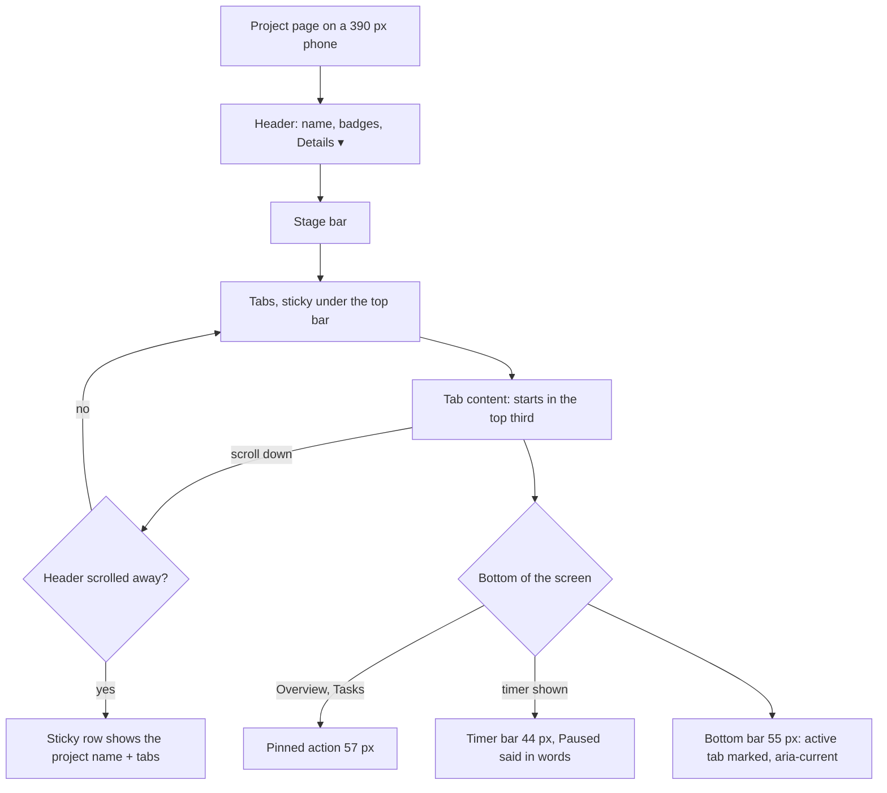

# UX Phase 5B: Phones, tap targets and contrast — Implementation Plan

> **For agentic workers:** REQUIRED SUB-SKILL: Use superpowers:subagent-driven-development (recommended) or superpowers:executing-plans to implement this plan task-by-task. Steps use checkbox (`- [ ]`) syntax for tracking.

**Goal:** on a 390 px phone a project's content starts in the top third and every control answers a 44 px touch. Text and controls pass contrast in light and dark, no status is shown by colour alone, and the laptop top bar stays usable while a timer runs. This covers audit items 5.1, 5.2, 5.3, 5.4, 5.8 and 5.10, plus the tablet panel question left open in 5A.

**Architecture:**
- **Contrast.** It is fixed where text and controls use the colours, not by changing the kit's colour tokens. Flow keeps the same token values as Spark CRM, so CRM can take the same class fixes. The exception is one new token, `line-input`, for the borders of fields.
- **Touch.** A single `touch-target` utility gives anything an invisible 44 × 44 touch area without moving the layout.
- **Phone project page.** Project facts fold behind "Details" on phones, and a sticky tab row keeps the project's name once the header scrolls away.
- **Checks.** Shared test helpers check contrast ratios and touch areas, and axe's contrast rule is switched back on.

**Tech Stack:** React 19, TypeScript, React Router 8, Tailwind v4 (`@utility`, `@theme`), Vitest (jsdom and browser), axe-core.

**Spec:** `spark-flow-web/docs/ux-audit/2026-11-09-ui-ux-audit.md` (main checkout, untracked), Phase 5 items 5.1–5.4, 5.8 and 5.10 (lines 592–630, 664–678, 690–697). The Phase 5 "Done when" row of section 6 reads: "No axe serious/critical; … contrast passes; content starts in the top third on phones". The kit's phone rules are in `design/05-ux-rules.md` and its tokens in `design/01-foundations.md`. Phase 5A (on `dev`, 351eaa4) left one question open: whether the task panel is a modal sheet between 640 and 1279 px.

## Global Constraints

- **Hard rules in `CLAUDE.md`:**
  - semantic tokens only (`line-input` joins them);
  - status colours `bg-{c}-50 text-{c}-700 dark:bg-{c}-500/15 dark:text-{c}-300`;
  - no toasts, spinners or overlays;
  - sentence case and curly ’ (`src/copy.test.ts`);
  - logical direction classes (`src/rtl.test.ts`);
  - light, dark and 390 px;
  - one primary red button per view.
- **Token values in `src/index.css` stay identical to `design/reference-code/src/index.css`.** The only additions are new tokens (`--line-input`) and utilities (`touch-target`), plus the existing app-only additions.
- **Kit-copied files** (`ui/Sheet`, `ui/Field`, `ui/IconButton`, `ui/Menu`, `ui/DataTable`) keep their class strings except where a decision below changes them (D1 `Field` border and placeholder, D4 `Sheet`'s ×).
- **Phone breakpoints:** kit pieces use `max-sm` (640), and chat and shell pieces use `max-md` (768), as today. `touch-target` is used with `max-md:`.
- **Tests come first in every task.** Contrast is checked on token values (`src/test/contrast.ts`) and with axe in the browser (`axeProblems` no longer skips `color-contrast`). Touch areas are checked in the browser at 390 px (`src/test/touch.ts`).
- **Gates:** `npx tsc -b`, `npm run lint`, `npm test` (all of it; dev's browser fix means no known failures now), and `npm run build:prototype`. vitest runs outside the sandbox here.
- **Branch:** `feat/ux-phase-5b` in `Spark_Flow/.worktrees/ux-phase-5b`, from `origin/dev` (351eaa4, Phase 5A landed). One commit per task. No push or merge; the user decides.

## What the app shows today (measured at 390 px, 10 Nov)

- **Header height:** the project header and stage bar end at 289 px, and content starts at about 305 px. The audit's 45% is now about 36%, because the earlier phases trimmed it.
- **Fixed bars:** on Overview with a timer running, the bottom of the screen holds the pinned action bar (57 px), the timer bar (44 px) and the bottom bar (55 px), which is 156 px. The 56 px top bar is sticky above.
- **Tap sizes:** the top bar's round buttons are 32 px. Sheet and panel × are 28 px. The timer bar's Pause and Stop are 24 px. The column ⋯ and row ⋯ are 32 px. The chat star, "Add a bookmark" and the date pill are 28 px. History and Files "From" links are text-high (16–17 px). Teams' Message and Entry ⋯ already reach 44.
- **Unused code:** `DateTimePicker` has no callers, so its findings are left with it.

## Decisions

**D1. Contrast where colours are used** (5.8, Q1, Q2).
- **Text people must read moves off `fg-subtle`** (2.56:1) to `fg-muted` (4.76:1 light, 5.5:1 dark). That covers:
  - field placeholders (`inputClass`);
  - BarList's note;
  - the board's "No tasks here";
  - Pagination's "…".
  `fg-subtle` stays for decoration only: dots, bars, icons beside a word.
- **Muted text on `surface-muted` uses `fg-tertiary`** (6.92 light, 6.99 dark). That covers:
  - the SegmentedControl `switch` kind's off items;
  - StageProgress's upcoming stages, whose meta also loses its `opacity-75`;
  - the Files tab's source chip.
- **Chat:**
  - Unread rows in the bell show their time and excerpt in `text-sf-text-secondary`.
  - The sidebar's active row shows its count and icons in `text-sf-sidebar-text` (6.93:1).
- **Field borders (Q2):**
  - A new token `--line-input`: light `#7f8ea3` (3.33:1 on surface, 3.04 on surface-muted), dark `#76767c` (3.77 on surface, 3.35 on surface-muted). It is exposed as `border-line-input`.
  - Used by `inputClass` (so `selectClass` too), OverviewTab's deliverable checkbox ring, `Switch`'s off track, and the `select-chevron` stroke (`#64748b`).
- **Focus in dark:** every `ring-brand-500` or `outline-brand-500` focus style gets `dark:…-brand-400` (4.05:1 on dark surface).
- **Checks:**
  - The token values pass `src/test/contrast.ts` in a new `src/styles/kitTokens.test.ts`.
  - A scan in `src/a11y.test.ts` fails on `text-fg-subtle` outside the decoration allow-list, and on a brand focus ring without its dark variant.
  - `axeProblems` stops skipping `color-contrast`.

**D2. No state shown by colour alone** (5.10).
- **Late due dates** read "3 Oct · late" on Projects (table and phone list) and Overview. This is the same wording as `finishHint`'s "Due … · late", from one helper: `dueText(date, late)` in `projectStats.ts`.
- **The timer** says "Paused" beside its clock in the pill and the phone bar while paused, so the dot is no longer the only cue.
- **Presence:** the sidebar's DM rows and Channel details' member rows read the person's state to screen readers (", active" / ", away"; offline says nothing), as the avatar would without `decorative`.
- **The bottom bar's active tab:** see D5.

**D3. One touch area for every small control** (5.4).
- **The utility:** `@utility touch-target` in `src/index.css` sets `position: relative`. Its `::after` is centred, at least 44 × 44 (`max(100%, 44px)`), transparent and clickable. Elements use it as `max-md:touch-target`, so the layout never moves.
- **Applied to:**
  - the top bar's round buttons (`roundButton`), the menu and collapse buttons, and the phone Start timer;
  - the timer bar's Pause, Resume, Stop and Switch task;
  - Sheet's ×, and InspectorFrame's two ×;
  - the chat header's star, and "Add a bookmark";
  - the date pill's menu trigger;
  - History's links and the Files "From" link.
- **Kit IconButtons** use their existing `touch` prop instead (it grows the box below 640): the board's column ⋯ and ColumnStrip ‹ ›, and RowMenu's ⋯.
- **The play button:** the phone Start timer becomes a `roundButton`, ringed like Search and Help (5.2).
- **Neighbours overlap:** where two targets' areas meet (top bar gap 8 px), each control's own box still takes its own taps, because its `::after` sits under its siblings' boxes (`z-index` order is the DOM's).
- **Test helper:** `answersTouch(el): boolean[]` in `src/test/touch.ts` checks 21 px above, below, left and right of the centre. It is shared with `src/pages/chat/a11y.browser.test.tsx`, whose own copies are replaced.

**D4. A phone project page that starts in the top third** (5.1, 5.2, Q3).
- **Details:** on phones (below `sm`), RecordHeader's facts row (client, manager, dates, links) folds behind a "Details" button, with `aria-expanded` and a chevron. Tapping it shows the row. From `sm` up the row is always shown, with no button. The open state is per page view, not stored.
- **Sticky tabs:** on phones, ProjectTabs sticks under the top bar (`sticky top-14 z-10 bg-canvas`). Once the header has scrolled out, a short project name shows at the row's start (`h-10`, the name truncates).
  - This uses `useScrolledPast(ref): boolean` in `src/lib/useScrolledPast.ts`, an IntersectionObserver on the header's bottom edge, with `rootMargin` set to the top bar's height.
  - On the Chat tab (fill layout, where `main` scrolls) the row is already at the top: nothing changes there.
- **Pinned action bar:** it shows only on Overview and Tasks (`compact` on Chat, Time, History and Files). There, the actions sit under the header's ⋯.
- **Tab row cue:** the tab row shows an end-edge fade while more tabs are out of view. This uses `useScrollEnd(ref): boolean` in `src/lib/useScrollEnd.ts`, the DataTable fade rule moved into a hook (`scrollWidth − clientWidth − |scrollLeft| > 1`, which works in RTL). DataTable and ProjectTabs both use it.
- **Timer bar:** it stays a full row (44 px). It is the timer's only control on phones, and with D4 the content top already lands in the top third.

**D5. The bottom bar lights the right tab** (5.2, 5.10, Q5).
- **The rule:** `bottomTab(pathname): 'dashboard' | 'projects' | 'chat' | 'more' | null` in `src/layout/bottomTab.ts`:
  - `/w/:ws/dashboard` → dashboard;
  - the Projects list and any project → projects;
  - the Chat side → chat (`modeOf`);
  - My work (`/w/:ws`), Time, Teams, Settings, Preferences and Help → more;
  - Search → null.
- **Marking the active tab:** it gets `aria-current="page"` (More gets it too, as a button), a 2 px top marker in `bg-sf-accent-fill`, and `font-semibold`. That gives three cues, not colour alone.
- **Test change:** `MobileNav.test.tsx`'s "Projects lights on /w/engineering" becomes "More lights on My work".

**D6. The laptop top bar while a timer runs** (5.3, Q6).
- **The rule:** below `xl` (1280) while a timer is shown, the search box becomes the round search button, the same one phones use, and it opens the search screen at any width. `⌘K`, `/` and an arrival with `state.focus` (⌘F, the channel's 🔍) open that screen, with the caret in its field.
- **Shared state:** `GlobalSearch` reads `useMyTimer().timer` and `useMedia('(min-width: 1280px)')` for one `compact` flag shared by DesktopSearch, PhoneSearch and SearchScreen.
- **The pill:** its task title is `max-w-32`, `2xl:max-w-48`.

**D7. The panel is a modal wherever it covers the page** (5A carry-over, Q4).
- Below `xl` (1279 px) the task, thread and file panel is a modal: scrim, `role="dialog"`, `aria-modal`, Tab kept inside. It is a bottom sheet below `sm` and a side sheet from `sm` to `xl`.
- From `xl` it sits beside the page as before.
- `SHEET_QUERY` becomes `OVERLAY_QUERY = '(max-width: 1279px)'`.
- The help panel stays non-modal: it's for reading while working.

**D8. Formatting row on phones** (5.2). Below `md`, the channel composer starts with its formatting row hidden (`showFormatting` defaults to `!phone`); Aa shows it. The thread composer is already hidden, and desktop is unchanged.

**Not in this phase:**
- changing token values in `src/index.css`, which is CRM's call;
- removing `DateTimePicker` (dead code; a follow-up);
- help panel layout;
- a collapsing timer pill;
- the audit's 6.1 all-pages sweep.

## Review Focus

1. **Sticky tabs on real pages.** Check:
   - a very long project name;
   - an archived project's notice;
   - RTL;
   - dark;
   - Back to a scrolled page;
   - the Chat tab, where `main` scrolls;
   - widths around 640.

   The name shows only once the header is out of view. The row never hides content under the top bar, and from `sm` nothing changes. Pinned in Task 6.
2. **Every changed colour pair in both themes.** Disabled controls still look disabled, hover states keep contrast, and the pairs left on `fg-subtle` are only decoration. Pinned in Tasks 1–2 (token test plus scan) and Task 10 (axe on pages).
3. **Overlapping touch areas.** In the top bar (8 px gaps), the timer bar (Pause beside Stop) and a sheet header (× beside an action), a tap on each control's centre and on its own edge reaches that control, never its neighbour. Pinned in Task 5 (centre plus 4 sides per control).
4. **The bottom bar on every page.** Dashboard, Projects, a project, a channel, My work, Settings, Help and Search: exactly one or zero tabs are marked, the marked tab has `aria-current`, and the More drawer still opens. Pinned in Task 4.
5. **Compact search.** Starting a timer while the search box has the caret, stopping it while the search screen is open, resizing across 1280, and ⌘K, `/`, ⌘F and Escape: the caret is never lost and the screen never sticks open. Pinned in Task 8.

---

### Task 1: Contrast test helpers, field borders, dark focus rings (D1, 5.8)

**Files:**
- Create `src/test/contrast.ts` and `src/styles/kitTokens.test.ts`.
- Modify `src/styles/flowTokens.test.ts` (use the shared helper), `src/index.css` (`--line-input` in `:root` and `.dark`, `--color-line-input`, and the `select-chevron` stroke), `src/components/ui/Field.tsx` (`border-line-input`), `src/components/ui/Switch.tsx`, `src/pages/projects/OverviewTab.tsx`, and every brand focus ring without a dark variant (`layout/roundButton.ts`/`styles.ts`, `BarList`, `ColumnChart`, `LineChart`, `ProjectBoard`, `TicketRow`, `SkipLink`, `ChartCard`, `Switch`).
- Test the same files plus `src/a11y.test.ts`.

**Interfaces:**
- Produces `contrast(a: string, b: string): number` and `tokens(css: string, selector: ':root' | '.dark'): Record<string, string>` (resolving `var(--x)`) from `src/test/contrast.ts`.

- [ ] **Step 1: Failing tests.**
  - **`kitTokens.test.ts`**, in both themes:
    - fg, fg-secondary, fg-tertiary and fg-muted on surface, sunken and canvas: ≥ 4.5;
    - fg-tertiary on surface-muted: ≥ 4.5;
    - line-input on surface and on surface-muted: ≥ 3;
    - brand-500 on light surface and brand-400 on dark surface: ≥ 3;
    - and every token name `index.css` shares with `design/reference-code/src/index.css` has the same value.
  - **`a11y.test.ts` scan:** a file using `focus-visible:ring-brand-500`, `focus:ring-brand-500` or `focus-visible:outline-brand-500` also has the `dark:` variant with `brand-400`.
  - **Field:** `inputClass` has `border-line-input` and no `border-line `.
- [ ] **Step 2–4:** fail, implement, pass: `npx vitest run src/styles src/a11y.test.ts src/components/ui`.
- [ ] **Step 5: Commit:** `fix(a11y): field borders at 3:1, focus rings that show in dark`.

### Task 2: Text that's readable in both themes (D1, 5.8)

**Files:**
- Modify `Field.tsx` (placeholder), `charts/BarList.tsx`, `ProjectBoard.tsx` (empty column), `ui/Pagination.tsx`, `ui/SegmentedControl.tsx`, `ui/StageProgress.tsx`, `projects/FilesTab.tsx`, `layout/NotificationsMenu.tsx`, `layout/Sidebar.tsx`, and `src/test/axe.ts` (stop skipping `color-contrast`).
- Test `src/a11y.test.ts`, `SegmentedControl.test.tsx`, `StageProgress` tests, `Sidebar.test.tsx`, and the browser tests that call `axeProblems`.

- [ ] **Step 1: Failing tests.**
  - **Scan:** no `text-fg-subtle` or `placeholder:text-fg-subtle` outside an allow-list of decorative uses, each with its reason.
  - **SegmentedControl:** a switch's unpicked option has `text-fg-tertiary`.
  - **StageProgress:** an upcoming stage's meta has no `opacity-75`.
  - **Sidebar:** the active row's count has `text-sf-sidebar-text`.
  - **Bell:** an unread item's time has `text-sf-text-secondary`.
  - **`axeProblems`:** reports `color-contrast` (a test renders `
Low
` on white and expects a `color-contrast` line).
- [ ] **Step 2–4:** fail, implement, pass: `npx vitest run src/a11y.test.ts src/components src/layout` and `npx vitest run --project browser src/pages/projects/ProjectBoard.browser.test.tsx src/pages/chat/composer/RichComposer.browser.test.tsx`.
- [ ] **Step 5: Commit:** `fix(a11y): readable muted text, segments and chips in both themes`.

### Task 3: Late dates and paused timers say so in words (D2, 5.10)

**Files:**
- Modify `projects/projectStats.ts` (`dueText`), `ProjectsPage.tsx`, `OverviewTab.tsx`, `layout/TimerBar.tsx`, `layout/Sidebar.tsx` (DM rows), and `chat/ChannelMembers.tsx`.
- Test `projectStats.test.ts`, `ProjectsPage.test.tsx`, `TimerBar.test.tsx`, `Sidebar.test.tsx`, and the members test.

**Interfaces:**
- Produces `dueText(dueDate: string, late: boolean): string`.

- [ ] **Step 1: Failing tests.**
  - **`dueText`:** `dueText('2026-10-03T00:00:00.000Z', true)` → "3 Oct 2026 · late"; with `false` → "3 Oct 2026".
  - **Projects:** a late project's due cell reads "… · late".
  - **Timer:** a paused timer's pill and phone bar show "Paused" beside the clock; a running one doesn't.
  - **Presence:** a DM row for an away person is a link named "Nour El-Sayed, away"; an offline one has no state.
- [ ] **Step 2–4:** fail, implement, pass: `npx vitest run src/pages/projects src/layout src/pages/chat`.
- [ ] **Step 5: Commit:** `fix(a11y): late, paused and presence said in words`.

### Task 4: The bottom bar lights the right tab (D5, 5.2, 5.10)

**Files:**
- Create `src/layout/bottomTab.ts` and `bottomTab.test.ts`.
- Modify `src/layout/MobileNav.tsx`.
- Test `MobileNav.test.tsx`; update the old "Projects on /w/engineering" test.

**Interfaces:**
- Produces `bottomTab(pathname: string): 'dashboard' | 'projects' | 'chat' | 'more' | null`.

- [ ] **Step 1: Failing tests.**
  - **The rule:**

    | Path | Tab |
    |---|---|
    | `/w/eng/dashboard` | dashboard |
    | `/w/eng/projects`, `/w/eng/p/NEX/tasks` | projects |
    | `/w/eng/c/c-1`, `/w/eng/activity` | chat |
    | `/w/eng`, `/w/eng/time`, `/w/eng/teams`, `/w/eng/settings/users`, `/w/eng/preferences`, `/w/eng/help` | more |
    | `/w/eng/search` | null |

  - **The bar:** on My work, More has `aria-current="page"` and the top marker, and no other tab has `aria-current`. On a project page only Projects does.
- [ ] **Step 2–4:** fail, implement, pass: `npx vitest run src/layout/bottomTab.test.ts src/layout/MobileNav.test.tsx src/lib/workspaceMode.test.ts`.
- [ ] **Step 5: Commit:** `fix(mobile): the bottom bar marks the tab you're in, not by colour alone`.

### Task 5: Every small control answers a 44 px touch (D3, 5.4, 5.2 top bar)

**Files:**
- Create `src/test/touch.ts` and `src/touchTargets.browser.test.tsx`.
- Modify `src/index.css` (`@utility touch-target`), `layout/roundButton.ts`, `layout/TopBar.tsx`, `layout/TimerBar.tsx` (controls; the phone Start timer becomes `roundButton`), `ui/Sheet.tsx` (×), `layout/InspectorFrame.tsx` (×), `chat/ChannelHeader.tsx` (star), `chat/ChannelTabs.tsx` (Add a bookmark), `chat/MessageList.tsx` (date pill trigger), `projects/HistoryList.tsx`, `projects/FilesTab.tsx`, `projects/ProjectBoard.tsx` and `ColumnStrip.tsx` (`touch`), and `components/RowMenu.tsx` (`touch`).
- Also modify `src/pages/chat/a11y.browser.test.tsx` to use the shared helper.

**Interfaces:**
- Produces `answersTouch(el: Element): boolean[]`: `[up, down, left, right]`, each true when a point 21 px from the centre lands on `el`.

- [ ] **Step 1: Failing tests (browser, 390 × 844).**
  - Each of these answers `[true, true, true, true]`:
    - the top bar's menu, Start timer, Search, Help and avatar;
    - the timer bar's Pause and Stop;
    - a Sheet's ×;
    - a panel's ×;
    - the chat star, "Add a bookmark" and the date pill;
    - a History link and a Files "From" link;
    - a board column ⋯ and a RowMenu ⋯.
  - **Neighbours:** a point 2 px inside each top bar button's own edge lands on that button, not its neighbour.
  - **Layout:** at 1280 each of these keeps its box size, so the layout doesn't move.
  - **Play button:** the phone Start timer has the round, ringed class like Search.
- [ ] **Step 2–4:** fail, implement, pass: `npx vitest run --project browser src/touchTargets.browser.test.tsx src/pages/chat/a11y.browser.test.tsx`.
- [ ] **Step 5: Commit:** `fix(mobile): 44 px touch areas on small controls; a round play button`.

### Task 6: The phone project page starts in the top third (D4, 5.1, 5.2)

**Files:**
- Create `src/lib/useScrolledPast.ts` and `src/lib/useScrollEnd.ts` (each with tests).
- Modify `ui/RecordHeader.tsx` (Details on phones), `projects/ProjectPage.tsx` (`compact` on Chat, Time, History and Files; sticky tabs and name), `projects/ProjectTabs.tsx` (sticky on phones, name slot, end fade), and `ui/DataTable.tsx` (use `useScrollEnd`).
- Create `src/pages/projects/ProjectPage.browser.test.tsx`; also test `RecordHeader.test.tsx`, `ProjectTabs.browser.test.tsx` and `DataTable.browser.test.tsx`.

**Interfaces:**
- Produces `useScrolledPast(ref: RefObject<Element | null>, offset: number): boolean` and `useScrollEnd(ref: RefObject<HTMLElement | null>): boolean`.

- [ ] **Step 1: Failing tests.**
  - **RecordHeader (jsdom):** with `meta` on a phone (matchMedia below 640), a "Details" button with `aria-expanded="false"`, and no facts; after a click, the facts and `aria-expanded="true"`. From 640, the facts and no button.
  - **ProjectPage (browser, 390 × 844):**
    - On Overview the tab content's top is ≤ 281 px (a third of 844).
    - On History there is no pinned bar.
    - After scrolling 600 px, the tab row is stuck at 56 px and shows "Nexus Core".
    - At 1280 the row isn't sticky and shows no name.
  - **ProjectTabs (browser, 200 px box):** an end fade while "Files" is out of view; none after scrolling to the end; RTL mirrored.
  - **DataTable:** its existing fade tests pass on the shared hook.
- [ ] **Step 2–4:** fail, implement, pass: `npx vitest run src/lib src/components/ui/RecordHeader.test.tsx` and `npx vitest run --project browser src/pages/projects src/components/ui/DataTable.browser.test.tsx`.
- [ ] **Step 5: Commit:** `fix(mobile): project details fold, tabs stick with the name, pinned action on Overview and Tasks`.

### Task 7: The composer's formatting row waits for Aa on phones (D8, 5.2)

**Files:**
- Modify `chat/composer/RichComposer.tsx` (default `showFormatting` = `!phone` unless the prop is given).
- Test `RichComposer.browser.test.tsx`.

- [ ] **Step 1: Failing test (browser, 390).** A channel composer shows no formatting toolbar until Aa is pressed. At 1280 the toolbar shows from the start, and Aa is pressed.
- [ ] **Step 2–4:** fail, implement, pass: `npx vitest run --project browser src/pages/chat/composer/RichComposer.browser.test.tsx`.
- [ ] **Step 5: Commit:** `fix(mobile): the composer's formatting row waits for Aa on phones`.

### Task 8: A laptop top bar that fits a running timer (D6, 5.3)

**Files:**
- Modify `layout/GlobalSearch.tsx` (the `compact` flag; DesktopSearch hides, and PhoneSearch and SearchScreen show while compact; ⌘K, `/` and arrival open the screen) and `layout/TimerBar.tsx` (pill title widths).
- Test `GlobalSearch.browser.test.tsx` and `TimerBar.browser.test.tsx`.

- [ ] **Step 1: Failing tests (browser).**
  - **At 1100 with a timer:** no search box, a round Search button; ⌘K opens the search dialog with the caret in its field; Escape closes it and focus returns to the Search button.
  - **At 1100 with no timer:** the box shows, at least 200 px wide.
  - **At 1440 with a timer:** the box shows.
  - **Header fit:** at 1100 and 1280 with a timer and a 60-character task title, the header's `scrollWidth ≤ clientWidth`, and the pill's title is ≤ 128 px wide.
  - **Arrival:** with `state.focus` at 1100 and a timer, the dialog opens with the caret.
- [ ] **Step 2–4:** fail, implement, pass: `npx vitest run --project browser src/layout/GlobalSearch.browser.test.tsx src/layout/TimerBar.browser.test.tsx`.
- [ ] **Step 5: Commit:** `fix(shell): search folds to a button below 1280 while a timer runs`.

### Task 9: The panel is a modal wherever it covers the page (D7)

**Files:**
- Modify `layout/InspectorFrame.tsx` (`OVERLAY_QUERY`) and `CLAUDE.md` (the Focus line: "modal below `xl`").
- Test `panelFocus.browser.test.tsx`.

- [ ] **Step 1: Failing test (browser).** At 1024 the panel is `role="dialog"` with `aria-modal`, a scrim, and Tab kept inside. At 1280 it is complementary with no scrim.
- [ ] **Step 2–4:** fail, implement, pass: `npx vitest run --project browser src/layout/panelFocus.browser.test.tsx src/layout/Inspector.browser.test.tsx`.
- [ ] **Step 5: Commit:** `fix(a11y): the task panel is a modal wherever it covers the page`.

### Task 10: Phase check and records

- [ ] Run `npx tsc -b`, `npm run lint`, `npm test` and `npm run build:prototype`. Everything passes.
- [ ] Look in the app at 390, 768, 1100, 1280 and 1440, light and dark:
  - a project's Overview, History and Chat on the phone;
  - the bottom bar on My work;
  - a timer running at 1100;
  - a sheet's × and the timer bar's buttons;
  - Projects with a late project;
  - the panel at 1024.
- [ ] Run axe (`axeProblems`, contrast on) on Dashboard, Projects, a project's Overview and Board, My work, a channel, Users and Preferences, in light and dark. Nothing serious or critical.
- [ ] Run `npm run help:shots` (project, board and home pictures change).
- [ ] Add `CLAUDE.md` lines: Contrast (D1: `line-input`, `fg-subtle` decoration only, dark focus rings), Touch (`touch-target`), the phone project page (D4), and the bottom bar (D5). `tasks/todo.md` gets "Review — UX Phase 5B". The audit report gets an "Update (Phase 5B)" line (main checkout, uncommitted).
- [ ] Commit: `docs(ux): Phase 5B review and pictures`.

## Execution order

1 → 2 (contrast; 2 needs 1's helpers) → 3 → 4 → 5 → 6 (5's `touch-target` before 6's pinned bar) → 7 → 8 → 9 → 10.

## Questions before Task 1

1. **How to fix contrast (5.8):** change where the colours are used (placeholders and small text move from the faintest grey to the muted grey; inactive segments and chips use a darker grey), keeping Flow's colour values identical to Spark CRM's, so CRM can take the same class fixes. Or darken the faint grey everywhere, which changes the shared token values?
   *Recommended: change the uses, as D1.*
2. **Field borders (5.8):** to reach 3:1, text fields, selects, switches and the deliverable checkbox get a visibly darker grey border (`#7f8ea3` light, `#76767c` dark). Cards, tables and dividers keep their light lines. Or keep today's light borders and accept the gap?
   *Recommended: the darker field borders.*
3. **Phone project page (5.1):**
   - client, manager, dates and links fold behind "Details";
   - the tab row sticks under the top bar and shows the project's name once the header scrolls away;
   - the pinned "New task" bar shows only on Overview and Tasks;
   - the timer bar stays a full row.

   Or also shrink the timer bar into a small pill above the bottom bar?
   *Recommended: as D4, the timer bar stays.*
4. **Task panel on tablets (left from 5A):** the task, thread and file panel is a modal (dimmed page, Tab kept inside) wherever it covers the page, below 1280 px, not only on phones.
   *Recommended: yes, as D7.*
5. **Bottom bar (5.2, 5.10):** My work, Time, Teams, Settings, Preferences and Help light **More** (where they live), not Projects. The tab you're in also gets a top line and a bolder label, not only colour.
   *Recommended: yes, as D5.*
6. **Laptop top bar (5.3):** below 1280 px while a timer runs, the search box becomes the round search button, and ⌘K and / open the search screen. The pill's task title gets shorter.
   *Recommended: yes, as D6.*
7. **How to run it:** Native, with one Opus review of the whole branch at the end, as in Phases 1–5A?
   *Recommended: yes.*
