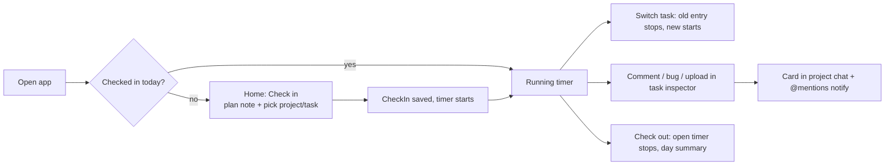
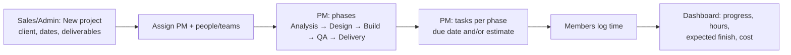

# Spark Flow — company system (projects, time, cost, collaboration)

Date: 2026-10-26 · Status: approved in conversation, written for review · Demo: Thursday 29 Oct 2026
Builds on: `2026-10-26-spark-flow-shell-data-layer-design.md` (Phases 1+2, merged as `23a42d4`).
Replaces the earlier Phase 3–5 roadmap (Slack engine / Jira engine / bridge) with milestones M0–M4 below.

## 1. Goal

Spark Flow becomes Spark Systems' own system for running a software-development company, replacing Jira and the
paid tools around it (about 30 staff, 20+ technical). It must let a manager see, for any project: where it is, who
works on it, how long they've spent, when it will finish and what it has cost — and let everyone check in, log time,
comment, report bugs and chat around the project.

Source: two voice notes (Arabic) with the manager, 26 Oct 2026, and their written summary.

**Done when (Thursday demo):** on mock data in the browser, each of the 4 roles can run the flows in §6 end to end;
data survives refresh and stays consistent across tabs; Database page exports, reloads seed and resets; light, dark,
390px and RTL all hold; `npm test`, `npm run build:prototype`, `npm run lint` pass; every milestone has a recorded
browser run.

**Assumptions (open questions from the summary, decided here):**
- Thursday is a working **demo on mock data** (IndexedDB in the browser), not a production release. The .NET + SignalR
  backend comes later behind the existing `lib/api.ts` switch.
- "Teams" are named groups of users. Hourly cost is per person, entered by an Admin, visible to Admins only.
- Check-in is for tracking work, not surveillance; it is shown to the person and to managers of their projects.
- Waterfall is the default way of working; sprints are optional per project.

## 2. Decisions

| Decision | Chosen | Rejected and why |
|---|---|---|
| Scope for Thursday | All four modules: projects + phases + tasks; check-in + time + cost; manager dashboard; chat + mentions + comments | Smaller slice — user chose all four; a cut line (§8) protects the date |
| Mock storage | **IndexedDB**: one readwrite transaction per write (browser-serialised across tabs), files as Blobs, memory fallback | localStorage key-per-record (same-record edits still clash); single writer tab (leader election, more parts) |
| Roles | **Admin, Sales, PM, Member** + a demo-only "View as" switcher | Spark CRM sales roles (don't fit); no roles (salaries exposed) |
| Time logging | **Timer + manual entry**; one running timer per user; switching task stops the last | Timer only; manual only |
| Way of working | Projects have **phases** (waterfall); `methodology: 'agile'` adds optional sprints | Sprints for everyone (manager: "I want it flexible… waterfall") |
| Tasks vs tickets | Keep the `Ticket` contract renamed to **Task**, same `NEX-101` keys, plus `phaseId`, `type`, `dueAt`, `estimateHours` | New entity (would break Phases 1+2 code and routes) |
| Where comments/bugs live | Task inspector **Activity** tab; each also appears as a card in the project's chat | Board-only cards (manager asked "where will it show?") |
| Visual system | Spark kit (unchanged) — copy CRM screens per §5 | — |

## 3. Data model (`src/api/types.ts`)

Rules from Phases 1+2 stay: string ids, ISO dates, camelCase string unions, ProblemDetails errors.

```ts
export type Role = 'admin' | 'sales' | 'pm' | 'member'
export type User = { id: string; name: string; email: string; title: string; role: Role; presence: Presence; teamIds: string[] }
export type Team = { id: string; workspaceId: string; name: string; memberIds: string[] }

export type Methodology = 'waterfall' | 'agile'
export type ProjectStatus = 'planned' | 'active' | 'onHold' | 'delivered'
export type ProjectLink = { label: string; url: string }
export type Project = {
  id: string; workspaceId: string; key: string; name: string; description: string // description = "about"
  clientName: string; logoFileId: string | null; links: ProjectLink[]
  managerId: string; memberIds: string[]; teamIds: string[]
  methodology: Methodology; status: ProjectStatus; startDate: string; dueDate: string
  channelId: string // the project's chat
}

export type PhaseStatus = 'notStarted' | 'inProgress' | 'done'
export type Phase = { id: string; projectId: string; name: string; order: number; startDate: string; dueDate: string; status: PhaseStatus }
export type Deliverable = { id: string; projectId: string; phaseId: string | null; title: string; dueDate: string; doneAt: string | null }

export type TaskType = 'task' | 'bug'
export type Task = Ticket & { phaseId: string | null; type: TaskType; dueAt: string | null; estimateHours: number | null }
// Ticket (Phases 1+2) keeps: id, key, projectId, title, description, status, priority, storyPoints, assigneeId,
// reporterId, sprintId (agile only), rank, linkedChannelId, linkedMessageId, createdAt, updatedAt.

export type TimeEntry = {
  id: string; userId: string; projectId: string; taskId: string | null
  startedAt: string; endedAt: string | null // null = running
  source: 'timer' | 'manual'; note: string
}
export type CheckIn = { id: string; userId: string; day: string /* YYYY-MM-DD local */; checkedInAt: string; checkedOutAt: string | null; plan: string }
export type Rate = { userId: string; hourlyCost: number; currency: 'EGP' } // admin only

export type Attachment = { id: string; name: string; mimeType: string; size: number; createdAt: string } // bytes in the file store
export type CommentKind = 'comment' | 'bug'
export type Comment = { id: string; taskId: string; projectId: string; authorId: string; kind: CommentKind; body: string; attachmentIds: string[]; createdAt: string }
export type ProjectFile = { id: string; projectId: string; attachmentId: string; uploadedBy: string; createdAt: string }

export type Mention = { kind: 'user' | 'project' | 'task' | 'all'; id: string } // id = userId | projectKey | taskKey | 'all'
// ChatMessage gains `mentions: Mention[]`; ThreadReply gains `mentions: Mention[]`.
```

**Derived values (computed by the API, never stored):**
- `task.loggedHours` = Σ closed entries + running entry so far.
- `task.overdue` = (`dueAt` < now and status ≠ done) or (`estimateHours` and `loggedHours` > `estimateHours`).
- `project.progress` = done tasks / all tasks; `project.loggedHours`; `project.cost` = Σ(entry hours × user's rate)
  (cost returned only to Admins); `project.expectedFinish` = latest of open phases' `dueDate`, shifted by overdue
  estimates (simple rule: if any open task is overdue, expectedFinish = max(dueDate, today + remaining estimate hours ÷ 8h/day)).
- Mentions are parsed server-side from message text: `@all`, `@<KEY>` (project), `@<KEY>-<n>` (task), `@[Name](userId)`
  inserted by the composer's autocomplete.

## 4. Storage and API

### 4.1 IndexedDB mock store (`src/mocks/store/`)
- Database `spark-flow.mock`, version 1. Object stores: `doc` (one record `main`: the JSON document) and `files`
  (Blob per `attachmentId`). One document keeps the mock simple; the transaction makes it safe.
- `MockDb` becomes async: `read(): Promise<DbData>`, `update<T>(fn): Promise<T>` (= one `readwrite` transaction on
  `doc`: get → fn → put), `putFile(id, blob)`, `getFile(id)`, `reset()`, `exportAll(): Promise<ExportBundle>`,
  `importAll(bundle)`. `fn` must be synchronous (no awaits inside a transaction).
- Fallback: if IndexedDB is unavailable or throws on open, an in-memory store with the same interface, with one
  `console.warn` (Review Focus #1 keeps holding).
- The old `localStorage` keys (`spark-flow.mockdb.v1*`) are removed on first start; the app starts from the seed.
- Read markers move back into the document (the per-key workaround from Ruling T is no longer needed).

### 4.2 API additions (`Api` in `src/api/types.ts`, mock + HTTP mapping)
`projects.create/update`, `phases.list/create/update/reorder`, `deliverables.list/create/update`,
`tasks.create/update` (plus existing reads), `comments.list(taskId)/create`, `files.upload(projectId|commentDraft, file)/url(id)`,
`time.checkIn(plan)/checkOut()/today()`, `time.start(taskId|projectId)/stop()/addManual(entry)/list(filter)`,
`rates.list/update` (admin), `dashboard.projects()`, `teams.list/update`, `chat.send(channelId, content)`,
`chat.reply(messageId, content)`, `mentions.mine()`, `db.export()/reloadSeed()/reset()` (admin, mock only).
HTTP paths follow the Phases 1+2 style (`POST /api/projects`, `POST /api/time/start`, …) and are listed in the plan.

### 4.3 Permissions (enforced in the mock API — 403 `ApiError` — and mirrored in the UI)

| | Admin | Sales | PM (projects they manage) | Member |
|---|---|---|---|---|
| See rates and cost | ✓ | — | — (hours only) | — |
| Create project; edit dates, client, deliverables | ✓ | ✓ | edit own | — |
| Phases, tasks, assign people/teams | ✓ | — | ✓ | change status of own tasks |
| Check-in, timer, add time (own) | ✓ | ✓ | ✓ | ✓ |
| Comment, bug, upload, chat | ✓ | ✓ | ✓ | ✓ (projects they're on) |
| Dashboard | ✓ | ✓ | own projects | — |
| Time & cost page, rates, Database page | ✓ | — | — | — |
| Archive or restore a project | ✓ | — | — | — |
| Edit or archive a channel | public ones; private only as a member | its members | its members | its members |

"View as" (user menu, demo only, hidden when `backendOn`) switches the current user among seeded people of each role.

### 4.4 Write rules (enforced in the mock — 400 `ApiError` with the sentence the form shows — for the backend to copy)

- **Patches take listed fields only.** Any other field → `Some of these fields can't be changed.`
  - Task: `title, description, status, priority, storyPoints, assigneeId, sprintId, rank, phaseId, type, dueAt, estimateHours`.
  - Project: `name, clientName, description, links, managerId, memberIds, teamIds, status, startDate, dueDate, logoFileId`.
  - Phase: `name, startDate, dueDate, status`. Deliverable: `phaseId, title, dueDate, doneAt`.
- **Task values** (create and update):
  - `priority` is urgent / high / medium / low (`That isn't a priority.`); `type` is task / bug (`That isn't a task type.`).
  - `status` is a column of the project's board (`That column no longer exists.`).
  - `assigneeId` is one of the project's people — manager, members, people on its teams — or the one the task already has (`Pick someone on the project.`).
  - `sprintId` and `phaseId` belong to the task's project (`That sprint belongs to another project.`, `That phase belongs to another project.`).
  - `storyPoints` ≥ 0 (`Story points are a number, 0 or more.`); `estimateHours` ≥ 0; `dueAt` a date (`Pick a due date.`); `rank` a number.
  - An archived task takes no change (`This task is archived. Restore it first.`).
- **Project, phase, deliverable values:**
  - Project `status` planned / active / onHold / delivered; `managerId` an existing person (`Pick a project manager.`); every `memberIds` entry a person (`Someone on this list doesn't exist.`); every `teamIds` entry a team (`That team doesn't exist.`).
  - Phase `status` notStarted / inProgress / done (`That isn't a phase status.`).
  - Deliverable `phaseId` of its own project; `dueDate` a date; `doneAt` null or a date (`Pick a done date.`).
- **A task save sends only the fields that changed** since the form opened (a due date is compared by day), for the assignee's status-only save too. Rights and values are checked in the same transaction as the write, never on an earlier read.
  - The backend may also take `If-Match: <updatedAt>` and answer 409 "This task changed since you opened it." The prototype doesn't send it.
- **A project's chat follows the project.** Its members are the project's people, on every project write (the seed starts that way). When the project is created or renamed, its channel's name becomes the project name's slug (`nexus-core`), with `-2`, `-3`… when another channel in the workspace has it, always a valid channel name; other edits keep the name. A change publishes `channelChanged`.
- **Removing people from a project leaves their tasks assigned.** The task form shows the assignee as "Name (not on this project)"; the project form says who keeps how many open tasks.
- **Live events** (one per change, after the write) and what each makes stale:
  - `ticketUpdated` → the task, its lists and history, project summaries, the dashboard; `projectChanged` → project, phases, deliverables, board, summaries, dashboard; `channelChanged` → channel lists.
  - `ratesChanged` → rates, the time report, the dashboard, project time; `filesChanged{projectId}` → its files.
  - `readChanged{userId}` → channel lists and mentions; `dataReset` (a reset or reload) → everything.

- **Archived projects** (Admin, `project.archive`): out of the project lists, the sidebar, search and the dashboard; still open by address; their hours stay in Time & cost. Every write on one — the project, its board, phases, deliverables, tasks, comments, files and time — is `This project is archived. Restore it first.`, for Admins too; its channel is archived with it and running timers on its tasks stop.
- **Archived channels** (a member or an Admin; not a project's channel — `This channel follows its project.` — nor a DM — `Conversations can't be archived.`): read-only (`This channel is archived.`) until restored.
- **The sidebar lists my channels**: those I'm a member of and my projects' chats. Other public channels are found through search; **join** works on public, non-project, open channels (`You can only join public channels.`); **leave** on any but a project's (`This channel follows its project.`) or a DM (`You can't leave a conversation.`).
- **Project files** are removed by whoever added them, the manager or an Admin (`You can only remove files you added.`); the bytes go when nothing else uses them. A refused or cancelled upload leaves no bytes behind; `upload` takes an abort signal.
- **Rates keep their history**: each change adds a row `{ id, userId, hourlyCost, currency, effectiveFrom }` (a second change the same day corrects that day's row). Every cost is entry by entry at `rateAt(rates, userId, entry.startedAt)`; time before every row uses the earliest. DB_VERSION 6 migrates old rates to rows in effect since the start of time.
- **Check-out can be undone** the same local day (`You haven't checked out today.`); the stopped timer stays stopped.
- **Timers stop** when their task moves into a Done-type column, when the person checks in on a new day (at the 12-hour limit), and at 12 hours on screen.
- **Time zone**: every request sends `X-Time-Zone: <IANA zone>`; "today", check-ins and report weeks are that zone's.
- **Typing**: the client sends `userTyping { channelId, userId }` at most every 2 s while typing; readers show it for 3 s.
- **Text fields** must be text (`Title must be text.`, `Name must be text.`…); links are `{ label, url }` (`Each link needs a label and an address.`); an unknown phase is `That phase no longer exists.` A task's create is checked in its own write, like an update.
- **Events added**: `filesChanged` also on remove; `channelChanged` on archive, restore, join and leave; `projectChanged` + `channelChanged` + `timeLogged` on a project's archive.

- **M12:** a channel name clash reads `That name is taken.` (hidden channels included, so it reveals nothing). `files.url` serves a file only to people who can post in its project (read isn't frozen for archived projects). **Import data** (`db.import`, Admin) replaces everything with an export; a bad file is `Import failed` and writes nothing. Phases lie inside their project's dates (`A phase can't start before the project.`, `A phase can't end after the project's due date.`); a new deliverable needs a due date. Tasks are read at `GET /api/projects/:id/tasks` and `GET /api/tasks/:key`. The dashboard's "checked in now" shows what someone runs only on projects it covers, and "manages a project" is per workspace.

- **M13:** `tasks.moveTo(key, status, index, visibleKeys?)` places a task and renumbers its column (1000, 2000, …) in one write, with a status change's rights, so a member's drop never needs to patch other cards. Retyping a column to Done, or deleting one into a Done column, stops the timers on its tasks. Archiving or restoring something already so changes nothing and sends nothing. Import also clears stored file bytes; an export carries none. Time logged before a person's first rate is priced at that first rate; a changed rate never rewrites past cost. Mentions carry `authorName`.

## 5. Screens (copy the named Spark CRM screen in `design/screenshots/`)

Sidebar groups: **WORK** Home, Projects, My tasks · **TEAM** Chat, Teams · **MANAGE** Dashboard, Time & cost ·
Settings (with Database) pinned at the bottom. Group/items hidden per §4.3. The Phases 1+2 channel/DM/project lists move
inside Chat and Projects.

| Screen | Route | Copy | Content |
|---|---|---|---|
| Home / My day | `/w/:ws` | `01-home-light` | Check-in card (or day summary), running timer, my tasks due today/overdue, mentions of me |
| Projects | `/w/:ws/projects` | `03-leads-list` | Stat cards (active, overdue, due this month, on hold); DataTable: logo+name, client, PM, current phase, due, progress, hours (+ cost for Admin), overdue count; "New project" Sheet |
| Project | `/w/:ws/p/:key/:tab` (`overview` \| `tasks` \| `chat` \| `time`) | `05-lead-detail` + `07-opportunities-board` | RecordHeader (logo, client, links, PM); **StageProgress = phases**; Overview: about, deliverables, team, files; Tasks: Board \| List grouped by phase (sprint filter when agile); Chat: project channel; Time: entries (+ cost for Admin) |
| My tasks | `/w/:ws/tasks` | `03-leads-list` | My open tasks across projects, overdue first |
| Task inspector | `?ticket=KEY` (unchanged) | `27-page-help-panel` | Fields (editable per role), Start timer / Add time, logged vs estimate, **Activity**: comments, bugs, attachments (image preview, video `<video controls>`, files) with a drop zone |
| Chat | `/w/:ws/c/:channelId` (unchanged) | existing | Composer with `@` autocomplete (people, projects, tasks, @all); mention chips open the project/task |
| Teams | `/w/:ws/teams` | `09-clients-list` | Teams and members (Admin edits) |
| Dashboard | `/w/:ws/dashboard` | `14-reports` | Per project: phase, progress ring, hours vs estimate, expected finish, cost (Admin), who worked this week; "Checked in now" list |
| Time & cost | `/w/:ws/time` | `12-payments` | Hours and cost by project / person / week; rates editor |
| Database | `/w/:ws/settings/database` | `16-settings` | Export (downloads `spark-flow-export-<date>.json`), Reload seed, Reset (DeleteDialog confirm) |

Phone (390px): bottom bar **Home · Projects · Chat · More**; the running timer is a slim bar above it.

Route changes from Phases 1+2:
- `/w/:ws` becomes Home (it used to redirect to the last place). `/` still goes to the last workspace, landing on its Home.
- `/w/:ws/p/:key/board` and `/backlog` redirect to `/w/:ws/p/:key/tasks?view=board` and `?view=list`.
- `lastVisited` / `validSavedPlace` keep working for channel and project paths.

## 6. Flows (the demo script)





Demo personas in the seed: Admin (the manager), Sales, two PMs, five Members; 4 projects in different phases
(one delivered, one overdue, one agile with sprints, one just sold); a week of check-ins and time entries; comments,
bugs with images, and project chats that mention tasks and people.

## 7. Security

- `FileViewer`: PDFs are fetched, checked for the `%PDF-` signature and shown from a `blob:` URL typed
  `application/pdf`; anything else shows "This file can't be previewed. Download it instead." Images and video use
  `blob:` URLs from the file store.
- `safeFileUrl(url)` allows only same-origin, `https:` and `blob:` URLs; used by every `src`/`href` for files and project links.
  Project links open with `rel="noopener noreferrer"` and only `https:`/`http:` schemes.
- Message, comment and project text is rendered as text (no HTML); mention chips are built from parsed ids.
- Note for the .NET team: file responses must send `X-Content-Type-Options: nosniff`, the validated `Content-Type`,
  and `Content-Security-Policy: sandbox`; enforce §4.3 server-side.

## 8. Milestones and cut line

| Milestone | Target | Contents |
|---|---|---|
| M0 Foundation | Tue 27 Oct midday | IndexedDB store + async `MockDb`, files, fallback, export/import; new contracts; seed rewrite (also fixes the Phase 1+2 narrative issues); roles + View as + permission helper; Database page; FileViewer + `safeFileUrl` |
| M1 Projects & tasks | Tue night | Projects list + create/edit; project page (header, phases, overview, deliverables, team, files); task create/edit with phase, due, estimate, overdue; board/list by phase; sprint filter (agile) |
| M2 Time | Wed 28 Oct midday | Check-in/out, one running timer, add time, Home/My day, rates, hours and cost |
| M3 Collaboration | Wed night | Chat composer (general + project tab), mention autocomplete and chips, task Activity with comments/bugs/uploads, comment cards in project chat, mention notifications in the bell |
| M4 Manager + polish | Thu 29 Oct midday | Dashboard, Time & cost page, demo seed story, full E2E pass, fixes, final review |

Cut line (last in, first out): Time & cost page → video playback (falls back to download) → sprint filter → Teams
editing UI (teams stay seed-only).

## 9. Testing

- **Vitest (mock API rules):** permissions per role (403s), overdue, cost = hours × rate, timer switch stops the
  previous entry, check-out closes the open timer, one check-in per day, mention parsing, `safeFileUrl`, PDF signature
  check, export → reset → import round trip, cross-tab no-lost-write (two `fake-indexeddb` connections writing
  concurrently).
- **End to end (controller, browser):** after each milestone, the §6 flows for each role via View as; light, dark,
  390px, RTL; a second tab; no console errors. Results recorded in `tasks/todo.md`.
- **Reviews:** per task (spec + quality) and one whole-branch review per milestone; final review before Thursday.

## 10. Out of scope (later)

Real .NET/SignalR backend and sign-in; email/push notifications; payroll beyond hourly cost; client portal;
invoices; Gantt charts; recurring tasks; Arabic UI strings (layout stays RTL-ready); ZIP export of files (JSON export
includes file metadata only on Thursday).
