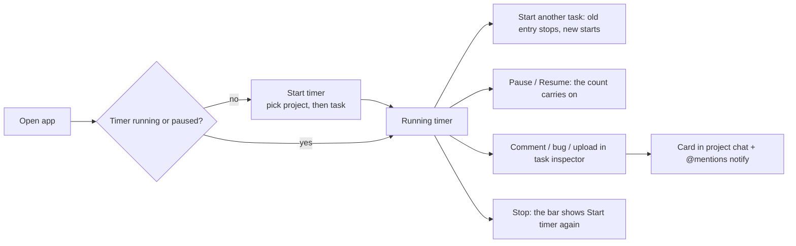
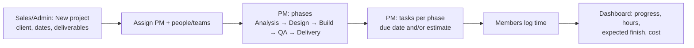

# Spark Flow — company system (projects, time, cost, collaboration)

Date: 2026-10-26 · Status: approved in conversation, written for review · Demo: Thursday 29 Oct 2026
Builds on: `2026-10-26-spark-flow-shell-data-layer-design.md` (Phases 1+2, merged as `23a42d4`).
Replaces the earlier Phase 3–5 roadmap (Slack engine / Jira engine / bridge) with milestones M0–M4 below.

## 1. Goal

Spark Flow becomes Spark Systems' own system for running a software-development company, replacing Jira and the
paid tools around it (about 30 staff, 20+ technical). It must let a manager see, for any project: where it is, who
works on it, how long they've spent, when it will finish and what it has cost — and let everyone check in, log time,
comment, report bugs and chat around the project.

Source: two voice notes (Arabic) with the manager, 26 Oct 2026, and their written summary.

**Done when (Thursday demo):** on mock data in the browser, each of the 4 roles can run the flows in §6 end to end;
data survives refresh and stays consistent across tabs; Database page exports, reloads seed and resets; light, dark,
390px and RTL all hold; `npm test`, `npm run build:prototype`, `npm run lint` pass; every milestone has a recorded
browser run.

**Assumptions (open questions from the summary, decided here):**
- Thursday is a working **demo on mock data** (IndexedDB in the browser), not a production release. The .NET + SignalR
  backend comes later behind the existing `lib/api.ts` switch.
- "Teams" are named groups of users. Hourly cost is per person, entered by an Admin, visible to Admins only.
- Check-in is for tracking work; it is shown to the person and to managers of their projects. (Amended 1 Nov 2026,
  Admin and help slice 5: check-in and check-out also record IP, device and, if the person allows it, location, and
  Flow records time using it. The card says so before the first check-in; see §4.8.) (Amended 5 Nov 2026, timer
  slice 3: check-in is replaced by the task timer; attendance days come from timer entries. See
  `2026-11-05-task-timer-and-dashboard-design.md` §4.3.)
- Waterfall is the default way of working; sprints are optional per project.

## 2. Decisions

| Decision | Chosen | Rejected and why |
|---|---|---|
| Scope for Thursday | All four modules: projects + phases + tasks; check-in + time + cost; manager dashboard; chat + mentions + comments | Smaller slice — user chose all four; a cut line (§8) protects the date |
| Mock storage | **IndexedDB**: one readwrite transaction per write (browser-serialised across tabs), files as Blobs, memory fallback | localStorage key-per-record (same-record edits still clash); single writer tab (leader election, more parts) |
| Roles | **Admin, Sales, PM, Member** + a demo-only "View as" switcher | Spark CRM sales roles (don't fit); no roles (salaries exposed) |
| Roles (amended 31 Oct 2026, Admin and help slice 1) | **Roles are records an Admin edits** (name and permissions), and a person holds one or more, getting every permission of each. Admin, Sales, Project manager and Member are seeded with exactly the rights above and can't be deleted | Fixed roles in code (asked for editable ones, as in the CRM) |
| Time logging | **Timer + manual entry**; one running timer per user; switching task stops the last | Timer only; manual only |
| Way of working | Projects have **phases** (waterfall); `methodology: 'agile'` adds optional sprints | Sprints for everyone (manager: "I want it flexible… waterfall") |
| Tasks vs tickets | Keep the `Ticket` contract renamed to **Task**, same `NEX-101` keys, plus `phaseId`, `type`, `dueAt`, `estimateHours` | New entity (would break Phases 1+2 code and routes) |
| Where comments/bugs live | Task inspector **Activity** tab; each also appears as a card in the project's chat | Board-only cards (manager asked "where will it show?") |
| Visual system | Spark kit (unchanged) — copy CRM screens per §5 | — |

## 3. Data model (`src/api/types.ts`)

Rules from Phases 1+2 stay: string ids, ISO dates, camelCase string unions, ProblemDetails errors.

```ts
export type Role = 'admin' | 'sales' | 'pm' | 'member'
export type User = { id: string; name: string; email: string; title: string; role: Role; presence: Presence; teamIds: string[] }
export type Team = { id: string; workspaceId: string; name: string; memberIds: string[] }

export type Methodology = 'waterfall' | 'agile'
export type ProjectStatus = 'planned' | 'active' | 'onHold' | 'delivered'
export type ProjectLink = { label: string; url: string }
export type Project = {
  id: string; workspaceId: string; key: string; name: string; description: string // description = "about"
  clientName: string; logoFileId: string | null; links: ProjectLink[]
  managerId: string; memberIds: string[]; teamIds: string[]
  methodology: Methodology; status: ProjectStatus; startDate: string; dueDate: string
  channelId: string // the project's chat
}

export type PhaseStatus = 'notStarted' | 'inProgress' | 'done'
export type Phase = { id: string; projectId: string; name: string; order: number; startDate: string; dueDate: string; status: PhaseStatus }
export type Deliverable = { id: string; projectId: string; phaseId: string | null; title: string; dueDate: string; doneAt: string | null }

export type TaskType = 'task' | 'bug'
export type Task = Ticket & { phaseId: string | null; type: TaskType; dueAt: string | null; estimateHours: number | null }
// Ticket (Phases 1+2) keeps: id, key, projectId, title, description, status, priority, storyPoints, assigneeId,
// reporterId, sprintId (agile only), rank, linkedChannelId, linkedMessageId, createdAt, updatedAt.

export type TimeEntry = {
  id: string; userId: string; projectId: string; taskId: string | null
  startedAt: string; endedAt: string | null // null = running
  source: 'timer' | 'manual'; note: string
}
export type CheckIn = { id: string; userId: string; day: string /* YYYY-MM-DD local */; checkedInAt: string; checkedOutAt: string | null; plan: string }
export type Rate = { userId: string; hourlyCost: number; currency: 'EGP' } // admin only

export type Attachment = { id: string; name: string; mimeType: string; size: number; createdAt: string } // bytes in the file store
export type CommentKind = 'comment' | 'bug'
export type Comment = { id: string; taskId: string; projectId: string; authorId: string; kind: CommentKind; body: string; attachmentIds: string[]; createdAt: string }
export type ProjectFile = { id: string; projectId: string; attachmentId: string; uploadedBy: string; createdAt: string }

export type Mention = { kind: 'user' | 'project' | 'task' | 'all'; id: string } // id = userId | projectKey | taskKey | 'all'
// ChatMessage gains `mentions: Mention[]`; ThreadReply gains `mentions: Mention[]`.
```

**Derived values (computed by the API, never stored):**
- `task.loggedHours` = Σ closed entries + running entry so far.
- `task.overdue` = (`dueAt` < now and status ≠ done) or (`estimateHours` and `loggedHours` > `estimateHours`).
  *Amended 9 Nov 2026 (UX Phase 1, 1.1):* `task.overdue` = `dueAt` < now and not done (the date only); `task.overEstimate`
  = `estimateHours` > 0 and `loggedHours` > `estimateHours` and not done. A task can be both; `project.overdueCount` and
  `overEstimateCount` count each, the dashboard's `attention` list holds both, and expectedFinish shifts on either.
- `project.progress` = done tasks / all tasks; `project.loggedHours`; `project.cost` = Σ(entry hours × user's rate)
  (cost returned only to Admins); `project.expectedFinish` = latest of open phases' `dueDate`, shifted by overdue
  estimates (simple rule: if any open task is overdue, expectedFinish = max(dueDate, today + remaining estimate hours ÷ 8h/day)).
- Mentions are parsed server-side from message text: `@all`, `@<KEY>` (project), `@<KEY>-<n>` (task), `@[Name](userId)`
  inserted by the composer's autocomplete.

## 4. Storage and API

### 4.1 IndexedDB mock store (`src/mocks/store/`)
- Database `spark-flow.mock`, version 1. Object stores: `doc` (one record `main`: the JSON document) and `files`
  (Blob per `attachmentId`). One document keeps the mock simple; the transaction makes it safe.
- `MockDb` becomes async: `read(): Promise<DbData>`, `update<T>(fn): Promise<T>` (= one `readwrite` transaction on
  `doc`: get → fn → put), `putFile(id, blob)`, `getFile(id)`, `reset()`, `exportAll(): Promise<ExportBundle>`,
  `importAll(bundle)`. `fn` must be synchronous (no awaits inside a transaction).
- Fallback: if IndexedDB is unavailable or throws on open, an in-memory store with the same interface, with one
  `console.warn` (Review Focus #1 keeps holding).
- The old `localStorage` keys (`spark-flow.mockdb.v1*`) are removed on first start; the app starts from the seed.
- Read markers move back into the document (the per-key workaround from Ruling T is no longer needed).

### 4.2 API additions (`Api` in `src/api/types.ts`, mock + HTTP mapping)
`projects.create/update`, `phases.list/create/update/reorder`, `deliverables.list/create/update`,
`tasks.create/update` (plus existing reads), `comments.list(taskId)/create`, `files.upload(projectId|commentDraft, file)/url(id)`,
`time.checkIn(plan)/checkOut()/today()`, `time.start(taskId|projectId)/stop()/addManual(entry)/list(filter)`,
`rates.list/update` (admin), `dashboard.projects()` (and `workingNow`, `stats`, 5 Nov 2026), `teams.list/update`, `chat.send(channelId, content)`,
`chat.reply(messageId, content)`, `mentions.mine()`, `db.export()/reloadSeed()/reset()` (admin, mock only).
HTTP paths follow the Phases 1+2 style (`POST /api/projects`, `POST /api/time/start`, …) and are listed in the plan.

Timer (amended 5 Nov 2026, timer slice 1, `2026-11-05-task-timer-and-dashboard-design.md` §4.1):
- `POST /api/time/start` `{ ...TimeTarget, location }`
- `POST /api/time/pause`
- `POST /api/time/resume` `{ location }`
- `POST /api/time/stop`

A time entry carries `endReason` (`'paused' | 'stopped' | 'timeout' | 'flow' | null`). It also stores `startedFrom`
(IP, device, place), which only Attendance returns. `MyDay.timer` is the running or paused run, with `runMs`.

Check-in removed (amended 5 Nov 2026, timer slice 3, `2026-11-05-task-timer-and-dashboard-design.md` §4.3):
- Gone: `POST /api/time/check-in`, `/check-out` and `/check-out/undo`, and the `CheckIn` record. `MyDay` is
  `{ day, entries, timer, firstStart }`.
- `GET /api/workspaces/:id/dashboard/checked-in` becomes `GET /api/workspaces/:id/dashboard/working-now`, returning
  `WorkingNow[]` (`{ userId, taskId, projectId, startedAt }`): running timers only.
- `GET /api/attendance/check-ins` becomes `GET /api/attendance/days` (§4.8).

Add time for someone else (amended 7 Nov 2026):
- `POST /api/time/entries` takes an optional `userId`: whose time it is, left out for your own. Someone else's needs
  `time.logFor` on the project, worked out by `can()`: "See and change everyone's time" (`time.othersAll`, Admin), or
  being the project's manager. Otherwise `403` `You can only add time for others on projects you manage.`
- That person must be active (`400` `{Name} is deactivated.`) and on the project, or allowed on every project (`400`
  `You can only add time for the people on this project.`). Their own rules apply: an overlap with their entries is
  `400` `That overlaps time {Name} already logged.`
- The entry is the person's and carries `addedBy` (the one who added it), absent when it's their own. Whoever added it
  may also change or delete it (`PATCH` / `DELETE /api/time/entries/:id`), besides the person and `time.othersAll`.
- It's audited as a created time entry, by whoever added it.

Timer timeout (amended 5 Nov 2026, timer slice 2, `2026-11-05-task-timer-and-dashboard-design.md` §4.2):
- `GET /api/settings/timer` → `{ timeoutHours }`, for everyone signed in (the Still working? dialog reads it).
- `PUT /api/settings/timer` `{ timeoutHours }`: `settings.manage` only; a whole number from 1 to 12, else `400`
  `Pick a whole number of hours from 1 to 12.`; audited as `Timer timeout`.
- The server ends a running timer entry itself at exactly `startedAt + timeoutHours`, with `endReason: 'timeout'`.

Dashboard for everyone (amended 5 Nov 2026, dashboard slice, `2026-11-05-task-timer-and-dashboard-design.md` §4.4):
- `dashboard.view` is true for everyone in the workspace. Scope: every active project with `dashboard.all`, else the
  projects the person manages or is on (as a member or through a team).
- `GET /api/workspaces/:id/dashboard` (`DashboardProject[]`) adds `weekHours`, everyone's hours in the last 7 days.
  Its `week` rows name each person only for whoever may see the team's time on that project (`time.seeTeam`) or has
  `dashboard.all`; anyone else gets their own row.
- `GET /api/workspaces/:id/dashboard/stats` → `DashboardStats`, over the projects in scope, hours unrounded:
  - `days: { day, hours, mine }[]`: the last 14 local days, oldest first; an entry counts on each day it ran, up to now.
  - `byProject: { projectId, hours }[]`: the same 14 days, most first; projects with no time are left out.
  - `byStatus: { category, count }[]`: always `todo`, `inProgress`, `done`; `done` counts tasks whose last move into
    their current column (from the project's history, or their creation) is within the 14 days.
  - `overdue: { taskId, key, title, projectId, assigneeId, dueAt }[]`: overdue tasks (past due, or more hours than
    estimated), due soonest first, those with no due date last.

### 4.3 Permissions (enforced in the mock API — 403 `ApiError` — and mirrored in the UI)

**Amended 31 Oct 2026 (Admin and help slice 1):** the table below is now the four built-in roles' starting grants,
not code. Roles are records (`Role { id, name, builtIn, grants, holders }`), people hold `roleIds`, and `can()` in
`src/lib/permissions.ts` answers from the permissions their roles grant (`PERMISSION_GROUPS`, 21 of them since slices 2 and 4 added "See the audit log" and "Manage archived records") plus the
rules that depend on the record: whoever a project names as manager has PM rights on it, authors edit their own
messages, a private channel's members manage it, and an archived project is frozen for everyone. A test checks the
built-in roles give the old table's answers in every case. Routes:

| Call | Route | Notes |
|---|---|---|
| Roles | `GET /api/roles` | Everyone signed in. `holders` is worked out on read. |
| Add | `POST /api/roles` `{ name, copyFrom? }` | Name 1–40 characters, unique ignoring case; `copyFrom` copies another role's permissions. |
| Rename | `PATCH /api/roles/:id` `{ name }` | Any role, built-in ones too. |
| Delete | `DELETE /api/roles/:id` | Only a role nobody holds, never a built-in one (`400` with the reason). |
| Save permissions | `PUT /api/roles/grants` `{ changes: [{ roleId, add, remove }] }` | Every changed role in one write. Each change is applied to the role as the server has it, so another Admin's change to other permissions of that role in the meantime is kept. Unknown roles are `404`, unknown permissions `400`, and nothing is kept. An empty list changes nothing and sends no event. |
| Me | `GET /api/users/me` | Now with `grants`: every permission of every role I hold, worked out by the server. |

- Changing roles needs "Change settings, users and roles" (`settings.manage`); anyone else gets `403`.
- No change may leave nobody holding `settings.manage`: `400` "At least one person must be able to change settings,
  users and roles."
- Every change sends `rolesChanged` to everyone: anyone's rights may have changed, so clients read everything again.
- The one behaviour change: while it isn't known yet whether someone manages a project, the Project manager role no
  longer stands in for it (the Dashboard link waits for the projects to load). Amended 5 Nov 2026 (dashboard slice,
  `2026-11-05-task-timer-and-dashboard-design.md` §4.4): the Dashboard is everyone's, so nothing waits for that any
  more.

| | Admin | Sales | PM (projects they manage) | Member |
|---|---|---|---|---|
| See rates and cost | ✓ | — | — (hours only) | — |
| Create project; edit dates, client, deliverables | ✓ | ✓ | edit own | — |
| Phases, tasks, assign people/teams | ✓ | — | ✓ | change status of own tasks |
| Timer, add time (own) (check-in removed 5 Nov 2026) | ✓ | ✓ | ✓ | ✓ |
| Add time for someone else on a project (7 Nov 2026) | ✓ any project | — | ✓ | — |
| Comment, bug, upload, chat | ✓ | ✓ | ✓ | ✓ (projects they're on) |
| Dashboard (everyone's, 5 Nov 2026) | ✓ every project | ✓ every project | projects they manage or are on | projects they're on |
| Time & cost page, rates, Database page | ✓ | — | — | — |
| Archive or restore a project | ✓ | — | — | — |
| Edit or archive a channel | public ones; private only as a member | its members | its members | its members |

"View as" (user menu, demo only, hidden when `backendOn`) switches the current user among seeded people of each role.

### 4.4 Write rules (enforced in the mock — 400 `ApiError` with the sentence the form shows — for the backend to copy)

- **Patches take listed fields only.** Any other field → `Some of these fields can't be changed.`
  - Task: `title, description, status, priority, storyPoints, assigneeId, sprintId, rank, phaseId, type, dueAt, estimateHours`.
  - Project: `name, clientName, description, links, managerId, memberIds, teamIds, status, startDate, dueDate, logoFileId`.
  - Phase: `name, startDate, dueDate, status`. Deliverable: `phaseId, title, dueDate, doneAt`.
- **Task values** (create and update):
  - `priority` is urgent / high / medium / low (`That isn't a priority.`); `type` is task / bug (`That isn't a task type.`).
  - `status` is a column of the project's board (`That column no longer exists.`).
  - `assigneeId` is one of the project's people — manager, members, people on its teams — or the one the task already has (`Pick someone on the project.`).
  - `sprintId` and `phaseId` belong to the task's project (`That sprint belongs to another project.`, `That phase belongs to another project.`).
  - `storyPoints` ≥ 0 (`Story points are a number, 0 or more.`); `estimateHours` ≥ 0; `dueAt` a date (`Pick a due date.`); `rank` a number.
  - An archived task takes no change (`This task is archived. Restore it first.`).
- **Project, phase, deliverable values:**
  - Project `status` planned / active / onHold / delivered; `managerId` an existing person (`Pick a project manager.`); every `memberIds` entry a person (`Someone on this list doesn't exist.`); every `teamIds` entry a team (`That team doesn't exist.`).
  - Phase `status` notStarted / inProgress / done (`That isn't a phase status.`).
  - Deliverable `phaseId` of its own project; `dueDate` a date; `doneAt` null or a date (`Pick a done date.`).
- **A task save sends only the fields that changed** since the form opened (a due date is compared by day), for the assignee's status-only save too. Rights and values are checked in the same transaction as the write, never on an earlier read.
  - The backend may also take `If-Match: <updatedAt>` and answer 409 "This task changed since you opened it." The prototype doesn't send it.
- **A project's chat follows the project.** Its members are the project's people, on every project write (the seed starts that way). When the project is created or renamed, its channel's name becomes the project name's slug (`nexus-core`), with `-2`, `-3`… when another channel in the workspace has it, always a valid channel name; other edits keep the name. A change publishes `channelChanged`.
- **Removing people from a project leaves their tasks assigned.** The task form shows the assignee as "Name (not on this project)"; the project form says who keeps how many open tasks.
- **Live events** (one per change, after the write) and what each makes stale:
  - `ticketUpdated` → the task, its lists and history, project summaries, the dashboard; `projectChanged` → project, phases, deliverables, board, summaries, dashboard; `channelChanged` → channel lists.
  - `ratesChanged` → rates, the time report, the dashboard, project time; `filesChanged{projectId}` → its files.
  - `readChanged{userId}` → channel lists and mentions; `dataReset` (a reset or reload) → everything.

- **Archived projects** (Admin, `project.archive`): out of the project lists, the sidebar, search and the dashboard; still open by address; their hours stay in Time & cost. Every write on one — the project, its board, phases, deliverables, tasks, comments, files and time — is `This project is archived. Restore it first.`, for Admins too; its channel is archived with it and running timers on its tasks stop.
- **Archived channels** (a member or an Admin; not a project's channel — `This channel follows its project.` — nor a DM — `Conversations can't be archived.`): read-only (`This channel is archived.`) until restored.
- **The sidebar lists my channels**: those I'm a member of and my projects' chats. Other public channels are found through search; **join** works on public, non-project, open channels (`You can only join public channels.`); **leave** on any but a project's (`This channel follows its project.`) or a DM (`You can't leave a conversation.`).
- **Project files** are removed by whoever added them, the manager or an Admin (`You can only remove files you added.`); the bytes go when nothing else uses them. A refused or cancelled upload leaves no bytes behind; `upload` takes an abort signal.
- **Rates keep their history**: each change adds a row `{ id, userId, hourlyCost, currency, effectiveFrom }` (a second change the same day corrects that day's row). Every cost is entry by entry at `rateAt(rates, userId, entry.startedAt)`; time before every row uses the earliest. DB_VERSION 6 migrates old rates to rows in effect since the start of time.
- ~~**Check-out can be undone**~~ (removed 5 Nov 2026, timer slice 3: there is no check-out).
- **Timers stop** when their task moves into a Done-type column, when the person starts a timer on a new day (at the 12-hour limit), at the timer timeout (`'timeout'`, amended 5 Nov 2026), and at 12 hours on screen.
- **Time zone**: every request sends `X-Time-Zone: <IANA zone>`; "today", attendance days and report weeks are that zone's.
- **Typing**: the client sends `userTyping { channelId, userId }` at most every 2 s while typing; readers show it for 3 s.
- **Text fields** must be text (`Title must be text.`, `Name must be text.`…); links are `{ label, url }` (`Each link needs a label and an address.`); an unknown phase is `That phase no longer exists.` A task's create is checked in its own write, like an update.
- **Events added**: `filesChanged` also on remove; `channelChanged` on archive, restore, join and leave; `projectChanged` + `channelChanged` + `timeLogged` on a project's archive.

- **M12:** a channel name clash reads `That name is taken.` (hidden channels included, so it reveals nothing). `files.url` serves a file only to people who can post in its project (read isn't frozen for archived projects). **Import data** (`db.import`, Admin) replaces everything with an export; a bad file is `Import failed` and writes nothing. Phases lie inside their project's dates (`A phase can't start before the project.`, `A phase can't end after the project's due date.`); a new deliverable needs a due date. Tasks are read at `GET /api/projects/:id/tasks` and `GET /api/tasks/:key`. The dashboard's "checked in now" shows what someone runs only on projects it covers, and "manages a project" is per workspace.

- **M13:** `tasks.moveTo(key, status, index, visibleKeys?)` places a task and renumbers its column (1000, 2000, …) in one write, with a status change's rights, so a member's drop never needs to patch other cards. Retyping a column to Done, or deleting one into a Done column, stops the timers on its tasks. Archiving or restoring something already so changes nothing and sends nothing. Import also clears stored file bytes; an export carries none. Time logged before a person's first rate is priced at that first rate; a changed rate never rewrites past cost. Mentions carry `authorName`.


#### Amendment: task files and the Files tab (7 Nov 2026)

Spec `2026-11-07-project-files-and-task-attachments-design.md`. Tasks gain `descriptionBody` (structured text and file blocks) and `attachmentIds`; `description` is read-only, worked out from the body. The task patch's fields become `title, descriptionBody, attachmentIds, status, priority, storyPoints, assigneeId, sprintId, rank, phaseId, type, dueAt, estimateHours`.

- `POST /api/files/upload-url` also takes `{ projectId, name, size, mimeType }` for a task's file: whoever has `task.manage` on the project, not while it's archived. The file is the uploader's alone until a task names it.
- `POST/PATCH` tasks take `descriptionBody` and `attachmentIds`, checked in this order:
  - at most 20 files, a repeated id counted once: `400` "Attach up to 20 files to a task.";
  - each exists and isn't deleted: `404`;
  - a file new to the task is mine (`403` "You can only attach files you uploaded.") and used nowhere yet (`400` "Upload that file again to attach it here.");
  - each is clean: `400` "{title} is still being checked." · "{title} was blocked.";
  - the body names only the task's files and holds text and links only (a link may keep its `marks`): `400` "The description couldn't be read. Try again.";
  - its text is at most 20,000 characters: `400` "Keep the description under 20,000 characters."
- A file taken off a task leaves its description; one nothing else holds is deleted with its bytes. History logs `attachments` ("changed the files"); the audit log records `Files` (names before and after); `filesChanged { projectId }` goes out.
- `GET /api/projects/:id/all-files?from=&type=&cursor=` → `{ items: { file, source }[], nextCursor }`: every file of the project once, from the first place the caller can open (Overview, task, comment or bug, chat; comment cards left out), newest first, 50 a page.
- A task's files count wherever access and "still used" are decided (open, details, delete for good).
### 4.5 Audit log (amended 31 Oct 2026, Admin and help slice 2)

One entry per recorded write, appended **in the same transaction as the change** (a refused or failed write records
nothing of itself), and one per refusal. Nobody can change or remove an entry. Reading needs "See the audit log"
(`audit.view`, the built-in Admin); anyone else gets `403`, and that refusal is itself an entry.

**An entry** (`AuditEvent`): `seq` (#341, one more than the last), `at` (the server's time, never before the last),
`actorId` (null for a failed sign-in), `actorName` (or the email that was tried) and `actorRoles` as they were then,
`action` (`created, changed, deleted, archived, restored, signedIn, signInFailed, denied, exported, downloaded,
imported, reset`), `group`, `record { type, id, name }` or null, `changes [{ field, from, to }]` as people read them
(names for ids, dates without times, "On"/"Off", choices in words, text cut at 80 characters, null for empty),
`result` (`done, refused, failed`), `detail`, `ip`, `device` ("Chrome 130 · macOS"), `requestId`, `prevHash`, `hash`.

**What is recorded**, by group (`src/mocks/audit.test.ts` lists every `Api` method as recorded or not, with why):

| Group | Entries |
|---|---|
| `data` Data changes | Projects (fields, board columns, phase order), phases, tasks (fields; not a move within a column), deliverables, project files (added, removed, edited, deleted), channels (created, details, people added or removed, invitations sent or revoked), time entries added, edited or deleted by hand, hourly cost, and someone else's message deleted or restored (where and whose, never what it said) |
| `status` Status and archive | A project's status, a task's column, archiving and restoring projects, tasks and channels |
| `access` Sign-in and access | Sign-ins and failed sign-ins (in the prototype, View as: "Demo user switcher (prototype only)"), and every `403` as "Access denied" with the request (`projects.create`) and the reason |
| `settings` Settings and users | Roles added, renamed or deleted, and each permission turned on or off ("Create projects: Off → On"); importing or resetting the demo data |
| `exports` Exports and downloads | The Database export, the Time and cost CSV (with its period, grouping and project), a file downloaded, and the audit log's own export |

Not recorded: messages, replies, comments, reactions, pins, bookmarks, folders, scheduled messages, reads, drafts,
saved items and personal preferences; joining or leaving a channel; timers and check-ins (attendance is slice 5's).
Every refusal is an entry, including a refused read a page asks for again (on focus, or after a change elsewhere);
the client hides what someone may not do, so in normal use that's rare.

**Reset and import (prototype only)** replace the demo data, not the log: the log as it was goes back in, with the
reset's or import's own entry, and the file's or the seed's log is left out.

**The chain:** `hash = SHA-256(canonical)`, where `canonical` is the JSON array of `seq, at, actorId, actorName,
actorRoles, action, group, [record.type, record.id, record.name] | null, [[field, from, to]…], result, detail, ip,
device, requestId, prevHash`; the first entry's `prevHash` is 64 zeros (`src/lib/auditChain.ts`, tested against
Node's SHA-256). The text must be byte for byte what `JSON.stringify` writes, so a .NET backend can't use
System.Text.Json's default encoder: no spaces, strings escape only `"`, `\` and control characters (Arabic and emoji
stay as UTF-8, as RFC 8785 says), `null` for empty, `seq` as an integer, and `at` exactly as `toISOString()` writes it
(`2026-10-31T12:00:00.000Z`, milliseconds and `Z`). The hash is lowercase hex of SHA-256 over that text's UTF-8. The tamper check walks the log oldest first and names the first entry that doesn't fit: `edited`
(its hash doesn't match), `removed` (a number is missing) or `reordered`. **Honest limit:** whoever can rewrite the
whole table can rebuild the chain. The backend must keep the log append-only (no UPDATE or DELETE grant for the app's
database user) and anchor the latest hash where the app server can't change it (a separate key or store). In the
prototype the log lives in the browser's demo data, so the check shows how it works rather than protecting anything,
and the IP is a made-up one per browser.

| Call | Route | Notes |
|---|---|---|
| List | `GET /api/audit?q=&since=&actor=&recordType=&result=&group=&cursor=` | Newest first, 50 a page; `cursor` is the last `seq` shown. `q` matches names, records, ids, IPs, devices, request ids, details, changes and `#341`. `counts` per group apply every filter but the group. |
| One | `GET /api/audit/:seq` | `404` when there's none. |
| Summary | `GET /api/audit/summary?todayFrom=` | Today's counts from the start of my day; **Needs a look** (last 7 days, newest first, at most 10): 3 or more failed sign-ins from one IP within 10 minutes, 3 or more refusals for one person within 10 minutes, role and permission changes, someone's roles changed, and full data exports; the tamper check; who and what the log names, for the filters. |
| Export | `GET /api/audit/export?…` (`Accept: text/csv`) | The filtered log as CSV, newest first, formulas kept as text; the client saves it with a BOM. Taking it is itself an entry. |
| Note an export | `POST /api/audit/exports` `{ what: 'timeCost', detail }` | The Time and cost CSV is made in the page, so the page reports it; needs `timeCost.view`. A download is recorded by the backend when it serves the file (the prototype's page reports it). |

Events: no event of its own; any event whose write the server logged also refreshes the log's queries (`keysForEvent`).

### 4.6 People (amended 31 Oct 2026, Admin and help slice 3)

People are company-wide records, edited on Settings → Users by whoever holds "Change settings, users and roles"
(`settings.manage`); anyone else gets `403` (recorded as a refusal). Everyone signed in still reads the people list.

| Call | Route | Notes |
|---|---|---|
| Directory | `GET /api/users` | Everyone, active or not, each with `lastActiveAt`: the latest thing the server saw them do (a message, reply, comment, time entry, check-in or out, or any audit entry), null if nothing. |
| Add | `POST /api/users` `{ name, email, title, roleIds, teamIds }` | Name 1–80 characters (`Give their name.`), email valid (`That isn’t an email address.`) and unique ignoring case (`Mariam Fathy has that email already.`), title up to 80, at least one role (`Give them at least one role.`), roles and teams that exist. Stored tidied: trimmed, email lowercased, roles and teams in their own order. A new person is `offline` and can be tried at once through View as. |
| Edit | `PATCH /api/users/:id` with any of the same fields | Same rules; their own email is no clash. No edit may leave nobody active who holds `settings.manage` (`At least one person must be able to change settings, users and roles.`). An edit that changes nothing records nothing and sends nothing. |
| Deactivate | `POST /api/users/:id/deactivate` `{ reason }` | Not yourself (`You can't deactivate yourself.`), which also means someone who can change settings always stays. Reason optional, up to 200 characters. Sets `deactivated { at, by, reason }`, stops their running timer and closes an open check-in, in the same write. Someone already deactivated: nothing changes or is sent. |
| Reactivate | `POST /api/users/:id/reactivate` | Clears `deactivated`. |

- **Teams agree both ways:** a person's `teamIds` and each team's `memberIds` are written together.
- **A deactivated person** stays in the people list (their name still shows on what they did) but leaves every
  picker: View as, an assignee, a project's manager or members, a new channel's or conversation's people, Add people,
  `@` mentions and search's people. The server refuses to add them (`Mariam Fathy is deactivated.`); people who
  were already there stay, and a task stays with them until it's reassigned. A session acting as them gets `401`
  (`This account was deactivated.`) on every request that asks who is acting.
- **Events:** each change sends `peopleChanged` (clients read everything again: names, roles and pickers show
  everywhere); deactivating also sends `timeLogged` for a stopped timer.
- **Audit log** (group "Settings and users"): `created`, `changed` (each field, roles and teams by name),
  `deactivated` (with the reason as its detail) and `reactivated`.
- **Not here yet:** sign-in, invitations and passwords wait for the backend (§10). The backend must also end a
  deactivated person's sessions.

### 4.7 Archived records (amended 1 Nov 2026, Admin and help slice 4)

Archiving a project, task or channel asks **"Why?"** (optional, at most 200 characters: `Keep the reason under
200 characters.`). Each record keeps `archivedBy` and `archiveReason` beside `archivedAt`; a project's channel takes its
project's. Restoring clears all three. Archives made before this show "—".

Settings → Archived records needs "Manage archived records" (`archive.manage`, the built-in Admin from DB v26).

| Call | Route | Notes |
|---|---|---|
| Archive | `POST /api/projects/:id/archive`, `/api/tasks/:key/archive`, `/api/channels/:id/archive` `{ reason }` | As before, plus the reason. |
| List | `GET /api/workspaces/:id/archive` | `{ items, retentionDays }`: archived projects, tasks (of the workspace's projects) and channels, newest first. A project's channel is listed with its project, not alone. Each item has `deletableFrom` (archived + retention days) or null with `keptBecause`: `time` (time logged on it) or `channel`; and `includes`, the counts deleting it takes (tasks, files, comments, phases, deliverables; a task takes no files, since a comment's files stay on its project-chat card). `restoreBlocked` says why this viewer can't restore it (`Restore its project first.`, `You can’t restore projects.`, `You can’t restore tasks in this project.`, `Only admins can restore channels.`) or is null. |
| Keep for | `PUT /api/settings/archive-retention` `{ days }` | 30 to 3650 days (`Keep them between 30 and 3650 days.`); default 365. Logged as a settings change. |
| Delete for good | `DELETE /api/archive/:type/:id` | Only an archived record (`Only archived records can be deleted for good.`), past its date (`It can be deleted for good from 31 Oct 2027.`), with no time logged (`It has time logged on it, so it’s kept: its hours and cost stay in reports.`), never a channel (`Channels are restored, not deleted for good.`, until message retention is decided, chat spec §13 item 8). A project goes with its tasks, comments, phases, deliverables, sprints, project files (and their bytes when nothing else uses them) and history; its channel stays, archived, as a channel of its own. A task goes with its comments and history. A deleted project's key is retired (`settings.retiredKeys`): a new project can't take it (`Key PIL belonged to a project deleted for good, so it can’t be used again.`), since the log and old links still name its tasks. Logged as `deleted` in "Status and archive", with what went. Sends `projectChanged`. |

Restoring uses each type's own call and rights; the list shows `restoreBlocked` in place of Restore. Archiving or restoring what is already so changes nothing and sends nothing; the reason is checked after access. Changing the retention sends no event (another open tab sees the new dates on its next load), and "Can be deleted" compares with the browser's clock (the server checks again on delete).

### 4.8 Attendance (amended 1 Nov 2026, Admin and help slice 5; amended 5 Nov 2026, timer slice 3)

Amended 5 Nov 2026 (timer slice 3, `2026-11-05-task-timer-and-dashboard-design.md` §4.3): there is no check-in. A person's **day** is
made of their timer entries that started on that local day: in is the first start (with its `startedFrom`), out the
last end (none while a timer runs), hours their sum. Manual entries don't make or change a day. Left early is never
when the last entry ended `'flow'` or `'timeout'`, nor today while a timer runs or is paused. DB v30 drops `checkIns`;
an import that still carries them is accepted and they are dropped.

A timer start or resume records the server's time, IP and device (the browser's user agent), and the browser's place:
`location` is `{ lat, lng, accuracy }` (5 decimals, metres), `'blocked'` when refused, `'none'` when the device has none
or doesn't answer in 8 seconds (`That location can't be right.` for anything else). Stored on the entry as
`startedFrom` (`{ ip, device, location }`), returned only by Attendance. The server keeps a place to 5 decimals. Until
someone's first timer start that recorded where it came from (`MyDay.firstStart`) the Start timer dialog says what is
recorded and who sees it. In the prototype the IP is made up per browser.

App use: `layout/ActivityTracker.tsx` (the CRM's) pings about once a minute while Flow is on screen and was used in the
last 5 minutes. A ping within 5 minutes of my last visit's end, from the same IP and device on the same local day, adds a
minute to it, unless it comes under 50 seconds after that visit's last counted minute (another tab), which adds nothing;
anything else starts a visit `{ day, startedAt, endedAt, minutes, ip, device }`. Each IP and device keeps its own
visit. Pings aren't audited and send no event.

Working hours (`settings.workHours`, DB v27): days (0 = Sunday), `HH:MM` start and end, time zone; default Sunday to
Thursday, 09:00–17:00, Africa/Cairo. Late = in after the start on a working day; left early = out before the end of the
day's own working hours (an out after midnight never is), never when Flow or the timeout ended it. An import whose working
hours break these rules, or name an unknown time zone, is refused. Changing them needs `settings.manage` and is logged (`Working days`, `Starts`,
`Ends`). Refusals: `Pick at least one working day.`, `Pick days from Sunday to Saturday.`, `Times are HH:MM, such as
09:00.`, `The day ends after it starts.`

Who sees whom: yourself always; `checkins.all` ("See everyone’s timers and app use", relabelled 5 Nov 2026) everyone; `checkins.managed`
("…of the people on projects they manage") the people on projects you manage that aren't archived. Anyone else: 403
`You don't have access to their attendance.` `settings.open` now includes `checkins.view`, so Project managers and
Members find Settings → Attendance; the user menu has **My attendance** for everyone.

| Call | Route | Notes |
|---|---|---|
| Scope | `GET /api/attendance/scope` | `{ userIds }`, me first. |
| Days | `GET /api/attendance/days?days=&userId=` | Newest first; `AttendanceDay` `{ id, userId, day, inAt, outAt, hours, from, endReason, newIp, newDevice, late, early }`. `newIp` / `newDevice`: the first start differs from that person's day before that had one. Replaces `check-ins` (5 Nov 2026). |
| Day | `GET /api/attendance/day?day=YYYY-MM-DD&userId=` | A row per person shown (active ones, plus deactivated ones with a day): `{ userId, inAt, outAt, hours, appMinutes, late, early }` (timer hours, until now while one runs). `Pick a day.` |
| Visits | `GET /api/attendance/visits?days=&userId=` | Newest first. |
| Report | `GET /api/attendance/report?days=&userId=` | Per person: days in, average in and out (minutes after midnight in the hours' zone), late, early, hours, app minutes. |
| Working hours | `GET` / `PUT /api/settings/work-hours` `{ days, start, end }` | |
| Ping | `POST /api/attendance/ping` | |

`days` is 1, 7, 30 or 90 (`Pick 1, 7, 30 or 90 days.`), ending today. A timer start, pause, resume or stop sends `timeLogged`, which
also refreshes Attendance; app time refreshes once a minute on the page. Changing working hours sends no event.

Open: a "day" (an attendance day, `Visit.day`, periods, the Day view) is the local day of the browser in the prototype,
which for Spark Systems is Cairo. The backend should cut days in `workHours.timeZone`, and times on the page then read in
that zone too; until then a viewer outside Cairo sees in and out times in their own zone, while averages and late and
early use Cairo's.

### 4.9 Help (amended 1 Nov 2026, Admin and help slice 6)

Help is content in the app's bundle, not an API: one Markdown file per chapter in `src/help/`, loaded as one chunk the
first time help opens. Front matter: `title`, `group` (Getting started, Work, Chat, Manage, Settings), `order`,
`summary` and optionally `needs` (a `can()` action; the chapter shows only to whoever may, and says "For people who can
…"). The body allows `##` sections, paragraphs, `-` and `1.` lists, `**bold**`, `` `keys` ``, `> ` tips, links to a
chapter (`help:id#section`) or to https, and `` from `public/help/`. It's parsed into blocks
(`lib/helpMarkdown.ts`) and rendered as elements, never HTML.

- **The "?"** beside the bell shows on pages with help this person may read (`lib/pageHelp.ts`: route → chapter and
  maybe `##` sections; `NO_HELP` lists the rest with why, and a test fails on a route in neither). Its panel sits beside
  the card from 1536px, over the page from 640px, and rises from the bottom on phones; it doesn't dim the page, stays
  open across pages (not reloads), follows links inside with "Back to this page", and Escape closes it unless a sheet or
  menu is open.
- **The help centre** is `/w/:ws/help/:chapter?` (the user menu's **Help**, or the panel's "Open the help centre").
- **Screenshots:** `npm run help:shots` builds the prototype and takes each chapter's pictures with Playwright at
  1280×800, light, on the seed (`HELP_SHOTS_CHROME` points at a Chromium of your own). A test fails on a picture that
  isn't there.

## 5. Screens (copy the named Spark CRM screen in `design/screenshots/`)

Sidebar groups: **WORK** Home, Projects, My tasks, Dashboard (moved from Manage, 5 Nov 2026) · **TEAM** Chat, Teams ·
**MANAGE** Time & cost ·
Settings (with Database) pinned at the bottom. Group/items hidden per §4.3. The Phases 1+2 channel/DM/project lists move
inside Chat and Projects.

| Screen | Route | Copy | Content |
|---|---|---|---|
| Home / My day | `/w/:ws` | `01-home-light` | Today card: the timer with Pause / Resume / Stop, or Start timer, and today's hours (replaced the check-in card, 5 Nov 2026); my tasks due today/overdue, mentions of me |
| Projects | `/w/:ws/projects` | `03-leads-list` | Stat cards (active, overdue, due this month, on hold); DataTable: logo+name, client, PM, current phase, due, progress, hours (+ cost for Admin), overdue count; "New project" Sheet |
| Project | `/w/:ws/p/:key/:tab` (`overview` \| `tasks` \| `chat` \| `time`) | `05-lead-detail` + `07-opportunities-board` | RecordHeader (logo, client, links, PM); **StageProgress = phases**; Overview: about, deliverables, team, files; Tasks: Board \| List grouped by phase (sprint filter when agile); Chat: project channel; Time: entries (+ cost for Admin) |
| My tasks | `/w/:ws/tasks` | `03-leads-list` | My open tasks across projects, overdue first |
| Task inspector | `?ticket=KEY` (unchanged) | `27-page-help-panel` | Fields (editable per role), Start timer / Add time, logged vs estimate, **Activity**: comments, bugs, attachments (image preview, video `<video controls>`, files) with a drop zone |
| Chat | `/w/:ws/c/:channelId` (unchanged) | existing | Composer with `@` autocomplete (people, projects, tasks, @all); mention chips open the project/task |
| Teams | `/w/:ws/teams` | `09-clients-list` | Teams and members (Admin edits) |
| Dashboard | `/w/:ws/dashboard` | `14-reports` | For everyone, over the projects in their scope (5 Nov 2026): tiles; charts for hours per day (14 days, mine in grey), tasks by status and hours by project; overdue tasks (opens the task inspector); per project: phase, progress ring, hours vs estimate, expected finish, cost (Admin), who worked this week; "Working now" list (was "Checked in now", 5 Nov 2026) |
| Time & cost | `/w/:ws/time` | `12-payments` | Hours and cost by project / person / week; rates editor |
| Database | `/w/:ws/settings/database` | `16-settings` | Export (downloads `spark-flow-export-<date>.json`), Reload seed, Reset (DeleteDialog confirm) |

Phone (390px): bottom bar **Home · Projects · Chat · More**; the running timer is a slim bar above it.

Route changes from Phases 1+2:
- `/w/:ws` becomes Home (it used to redirect to the last place). `/` still goes to the last workspace, landing on its Home.
- `/w/:ws/p/:key/board` and `/backlog` redirect to `/w/:ws/p/:key/tasks?view=board` and `?view=list`.
- `lastVisited` / `validSavedPlace` keep working for channel and project paths.

## 6. Flows (the demo script)

Amended 5 Nov 2026 (timer slice 3): the day starts with **Start timer**, not a check-in. See
`2026-11-05-task-timer-and-dashboard-design.md` §5 for the timer's states.





Demo personas in the seed: Admin (the manager), Sales, two PMs, five Members; 4 projects in different phases
(one delivered, one overdue, one agile with sprints, one just sold); a week of check-ins and time entries; comments,
bugs with images, and project chats that mention tasks and people.

## 7. Security

- `FileViewer`: PDFs are fetched, checked for the `%PDF-` signature and shown from a `blob:` URL typed
  `application/pdf`; anything else shows "This file can't be previewed. Download it instead." Images and video use
  `blob:` URLs from the file store.
- `safeFileUrl(url)` allows only same-origin, `https:` and `blob:` URLs; used by every `src`/`href` for files and project links.
  Project links open with `rel="noopener noreferrer"` and only `https:`/`http:` schemes.
- Message, comment and project text is rendered as text (no HTML); mention chips are built from parsed ids.
- Note for the .NET team: file responses must send `X-Content-Type-Options: nosniff`, the validated `Content-Type`,
  and `Content-Security-Policy: sandbox`; enforce §4.3 server-side.

## 8. Milestones and cut line

| Milestone | Target | Contents |
|---|---|---|
| M0 Foundation | Tue 27 Oct midday | IndexedDB store + async `MockDb`, files, fallback, export/import; new contracts; seed rewrite (also fixes the Phase 1+2 narrative issues); roles + View as + permission helper; Database page; FileViewer + `safeFileUrl` |
| M1 Projects & tasks | Tue night | Projects list + create/edit; project page (header, phases, overview, deliverables, team, files); task create/edit with phase, due, estimate, overdue; board/list by phase; sprint filter (agile) |
| M2 Time | Wed 28 Oct midday | Check-in/out, one running timer, add time, Home/My day, rates, hours and cost |
| M3 Collaboration | Wed night | Chat composer (general + project tab), mention autocomplete and chips, task Activity with comments/bugs/uploads, comment cards in project chat, mention notifications in the bell |
| M4 Manager + polish | Thu 29 Oct midday | Dashboard, Time & cost page, demo seed story, full E2E pass, fixes, final review |

Cut line (last in, first out): Time & cost page → video playback (falls back to download) → sprint filter → Teams
editing UI (teams stay seed-only).

## 9. Testing

- **Vitest (mock API rules):** permissions per role (403s), overdue, cost = hours × rate, timer switch stops the
  previous entry, check-out closes the open timer, one check-in per day, mention parsing, `safeFileUrl`, PDF signature
  check, export → reset → import round trip, cross-tab no-lost-write (two `fake-indexeddb` connections writing
  concurrently).
- **End to end (controller, browser):** after each milestone, the §6 flows for each role via View as; light, dark,
  390px, RTL; a second tab; no console errors. Results recorded in `tasks/todo.md`.
- **Reviews:** per task (spec + quality) and one whole-branch review per milestone; final review before Thursday.

### 4.10 Signing in (amended 1 Nov 2026, Admin and help slice AB)

`/signin` sits outside the shell, as the CRM's: a Spark Flow panel on wide screens, and email, password and **Sign in**.
`returnTo` (a path inside the app only) is where it goes after; `why=deactivated` explains a deactivated account.
Signed out, the shell sends any page there; **Log out** (account menu) ends the session. **Change password** waits for
the backend.

| Call | Route | Notes |
|---|---|---|
| Sign in | `POST /api/auth/sign-in` `{ email, password }` | Sets the session cookie and returns `me`. Refusals: `That email and password don't match.`, `This account is deactivated. Ask an Admin to reactivate it.` (400 both). Logged as `signedIn` or `signInFailed`. |
| Sign out | `POST /api/auth/sign-out` | Logged as `signedOut`. |
| Demo people | `GET /api/auth/demo-people` | Prototype only: active people with their role names (Admin, Project manager, Sales, Member order, then A–Z), to sign in as with the one demo password `flow2026`. The backend has none. |

Every other call is a 401 while signed out. In the prototype the session is the browser's (localStorage), so a first
visit opens on Sign in; View as still switches person in one tab.

## 10. Out of scope (later)

Real .NET/SignalR backend; email/push notifications; payroll beyond hourly cost; client portal;
invoices; Gantt charts; recurring tasks; Arabic UI strings (layout stays RTL-ready); ZIP export of files (JSON export
includes file metadata only on Thursday).
