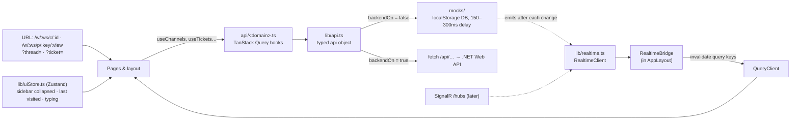
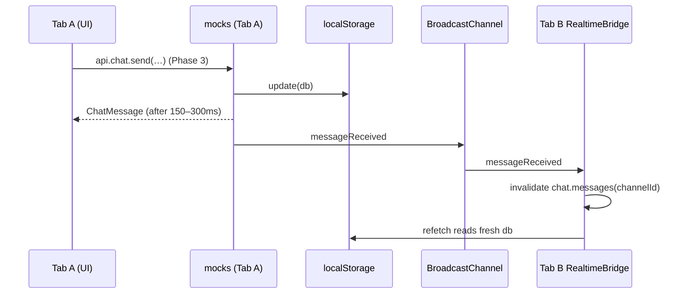

# Spark Flow — Phase 1 + 2: app shell and backend-ready data layer

Date: 2026-10-26 · Status: draft for review · App: `spark-flow-web/`

## 1. Goal

Spark Flow is a hybrid of real-time team chat (Slack-like) and agile project management (Jira-like), built as a sister
product of Spark CRM: it must look and behave like the same product (see `CLAUDE.md` and `design/`).

This spec covers the first two of five phases:

| Phase | Scope | Spec |
|---|---|---|
| **1** | App shell: sidebar groups, workspace switcher, routes, inspector panel, `@/` alias, dev proxy | **this spec** |
| **2** | DTO contracts, `localStorage` mock backend, mock real-time client, TanStack Query hooks, seed data | **this spec** |
| 3 | Chat engine: feed, composer, reactions, attachments, thread replies, simulated colleague messages | later |
| 4 | Project engine: drag-and-drop board, backlog table, filters, create ticket, ticket editing | later |
| 5 | Bridge: ticket-key unfurling in chat, message → ticket, ticket discussion tab, command palette, split view | later |

**Done when** (demo check): you can switch workspaces, move between channels, DMs and both project views, open and
close a thread or ticket in the inspector, refresh without losing data, reset the demo data, and see a change made in
one tab appear in a second tab — in light and dark, at 1440px and 390px, and mirrored correctly under `dir="rtl"` —
with `npm run build`, `npm run lint` and `npm test` passing.

## 2. Decisions

| Decision | Chosen | Rejected and why |
|---|---|---|
| UI foundation | Spark kit components already in `src/components/ui` + `src/layout` | shadcn/Radix and a Linear look: Spark Flow must look like Spark CRM; two component systems in one repo |
| Desktop layout | Spark shell: ink sidebar with group labels, floating rounded panel, top bar, inspector beside the panel | 64px workspace rail: a pattern Spark CRM doesn't have |
| Navigation state | URL first (React Router); Zustand only for UI preferences | Zustand for active channel/project: no links, back button or refresh |
| Data layer | Spark CRM pattern: `lib/api.ts` switch between `mocks/` and `fetch` | MSW (extra tooling, clashes with PWA worker); per-service classes writing `localStorage` (rewrite for .NET) |
| Inspector | Spark `PageHelpPanel` pattern, fixed `24rem` | `react-resizable-panels` / drag handle: not a Spark pattern |
| Sidebar modes | Group labels CHANNELS · DIRECT MESSAGES · PROJECTS, mode from URL | Chat \| Projects toggle in the sidebar: not a Spark pattern |
| React plugin | Keep `@vitejs/plugin-react` v6 (Vite 8) | `plugin-react-swc`: no gain on Vite 8 |
| Later-phase libraries | Installed in the phase that uses them | Installing `dnd-kit`, `tanstack-table`, `cmdk`, `react-hook-form`, `zod` now |
| Visual tokens (font, colors, icons, radius) | Design kit: Inter, `brand-*`/`ink-*` from `index.css`, lucide, `rounded-lg` | `spark-design-system.md` values (Readex Pro, `#B72427` scale, Tabler, 6px radius): that file is scoped to marketing surfaces, and Spark Flow must match Spark CRM |
| Taken from `spark-design-system.md` | Voice (specific, numbers over adjectives, no buzzwords, short active sentences); charts (red highlight + greys, max 4 series, takeaway in the title, no other hues); Western digits | — |
| Direction | **RTL-ready, English UI**: logical Tailwind classes only, `dir` on `<html>`, directional icons flip; no translations yet | English-only physical classes (Arabic later = pass over every screen); Arabic strings in the MVP (adds an i18n layer to every phase) |

## 3. Architecture



**Rule:** pages and layout import only hooks from `api/<domain>.ts` and types from `api/types.ts`. Nothing outside
`lib/api.ts` and `mocks/` imports from `mocks/`.

### 3.1 Files

New:

| Path | Purpose |
|---|---|
| `src/api/types.ts` | DTO contracts (section 4) |
| `src/api/workspaces.ts` | `useWorkspaces`, `useWorkspace(slug)` |
| `src/api/users.ts` | `useMe`, `useUsers(workspaceId)` |
| `src/api/chat.ts` | `useChannels(workspaceId)`, `useChannel(id)`, `useMessages(channelId)` (infinite, cursor), `useThread(messageId)` |
| `src/api/tickets.ts` | `useProjects(workspaceId)`, `useProject(workspaceId, key)`, `useSprints(projectId)`, `useTickets(projectId)`, `useTicket(key)` |
| `src/api/queryKeys.ts` | One place for query keys, shared by hooks and `RealtimeBridge` |
| `src/lib/api.ts` | `backendOn`, `apiUrl`, `ApiError`, `request()` (fetch + ProblemDetails), the typed `api` object |
| `src/lib/realtime.ts` | `RealtimeClient` interface, `createRealtimeClient()` (mock now, SignalR later) |
| `src/lib/uiStore.ts` | Zustand store (section 6.4) |
| `src/mocks/db.ts` | Versioned `localStorage` DB with injectable storage; `load`, `update`, `reset` |
| `src/mocks/seed.ts` | Seed data (section 5.3) |
| `src/mocks/latency.ts` | `delay()` 150–300ms random |
| `src/mocks/{workspaces,users,chat,tickets,dev}.ts` | Mock implementations of each `api` method |
| `src/mocks/realtime.ts` | Mock `RealtimeClient`: in-tab event bus + `BroadcastChannel('spark-flow.realtime')` |
| `src/layout/WorkspaceSwitcher.tsx` | Round top-bar button + `MenuPanel` (after `design/reference-code/src/layout/MarketSwitcher.tsx`) |
| `src/layout/Inspector.tsx` | Right panel (after `design/reference-code/src/layout/PageHelpPanel.tsx`) |
| `src/layout/RealtimeBridge.tsx` | Subscribes once; invalidates query keys on events |
| `src/layout/LastVisitRedirect.tsx` | `/` and `/w/:ws` → last visited place |
| `src/pages/chat/ChannelPage.tsx` | Channel header + read-only message list (full chat UI in Phase 3) |
| `src/pages/chat/ThreadInspector.tsx` | Parent message + replies, read-only |
| `src/pages/projects/ProjectPage.tsx` | Header with Board \| Backlog control; read-only views (full engine in Phase 4) |
| `src/pages/projects/TicketInspector.tsx` | Ticket fields, read-only |
| `src/pages/settings/SettingsPage.tsx` | Replaces the placeholder; "Reset demo data" |
| `src/pages/NotFound.tsx` | Shared "doesn't exist or was removed" state with a back link |
| `test` block in `vite.config.ts` | Vitest, Node environment (`/// <reference types="vitest/config" />`) |

Changed:

| Path | Change |
|---|---|
| `vite.config.ts` | `@/` alias; dev proxy `/api` → `http://localhost:5080`, `/hubs` → same with `ws: true`; production guard (`VITE_BACKEND=on` + `VITE_API_URL`, else error; `--mode prototype` builds the demo) |
| `tsconfig.app.json` | `"paths": { "@/*": ["./src/*"] }` |
| All `src/**` | Relative imports → `@/` (mechanical) |
| All `src/**` | Physical direction classes → logical (section 6.5); the only class-string edits to copied kit files |
| `index.html` | `<html lang="en" dir="ltr">` |
| `src/index.css` | `slide-in-end` keyframe (from `translateX(24px)` in LTR, `-24px` in RTL) for the inspector and drawers |
| `CLAUDE.md` | Add the RTL rule (section 6.5) and the voice and chart rules from `spark-design-system.md` |
| `package.json` | + `zustand`; dev + `vitest`; script `"test": "vitest run"` |
| `src/navigation.ts` | Static items become Settings only; channel/DM/project groups are built from query data in the sidebar |
| `src/router.tsx` | Routes in section 6.1; `HomePage` removed |
| `src/layout/Sidebar.tsx` | Groups CHANNELS · DIRECT MESSAGES · PROJECTS from hooks; Settings pinned at the bottom |
| `src/layout/TopBar.tsx` | Adds `WorkspaceSwitcher` between the bell and the avatar |
| `src/layout/MobileNav.tsx` | Bottom bar Chat · Projects · Search · More; More drawer = sidebar groups + Settings |
| `src/layout/AppLayout.tsx` | Mounts `Inspector` and `RealtimeBridge` |
| `src/layout/GlobalSearch.tsx`, `searchShortcuts.ts` | Also finds channels, DMs and projects of the current workspace |
| `src/lib/useRole.ts` | Persona comes from `useMe()` (seeded user, role `Management`); same return shape |
| `src/pages/HomePage.tsx`, `src/pages/PlaceholderPage.tsx` | Removed |

## 4. Contracts (`src/api/types.ts`)

Rules: ids are `string` (Postgres uuid / Mongo ObjectId); dates are ISO 8601 strings; enums are camelCase string
unions (ASP.NET `JsonStringEnumConverter` with camelCase policy); errors are ProblemDetails.

```ts
// ── Relational (PostgreSQL) ───────────────────────────────────────────────
export type Presence = 'active' | 'away' | 'offline'
export type User = { id: string; name: string; email: string; title: string; role: Role; presence: Presence }

export type Workspace = { id: string; slug: string; name: string }

export type Project = { id: string; workspaceId: string; key: string; name: string; description: string; leadId: string }

export type SprintState = 'planned' | 'active' | 'closed'
export type Sprint = {
  id: string; projectId: string; name: string; goal: string
  startDate: string; endDate: string; state: SprintState
}

export type TicketStatus = 'backlog' | 'todo' | 'inProgress' | 'inReview' | 'done'
export type Priority = 'urgent' | 'high' | 'medium' | 'low'
export type Ticket = {
  id: string; key: string; projectId: string            // key: 'NEX-101'
  title: string; description: string
  status: TicketStatus; priority: Priority; storyPoints: number | null
  assigneeId: string | null; reporterId: string; sprintId: string | null
  rank: number                                           // order within a status column
  linkedChannelId: string | null; linkedMessageId: string | null
  createdAt: string; updatedAt: string
}

// ── Documents (MongoDB) ───────────────────────────────────────────────────
export type Attachment = { id: string; name: string; size: number; mimeType: string; url: string }
export type Reaction = { emoji: string; userIds: string[] }

export type ChannelKind = 'channel' | 'dm'
export type Channel = {
  id: string; workspaceId: string; kind: ChannelKind
  name: string | null                                    // null for DMs; the UI names a DM after the other member
  topic: string; memberIds: string[]; isPrivate: boolean
  lastMessageAt: string | null; unreadCount: number      // unreadCount is per the current user
}

export type ChatMessage = {
  id: string; channelId: string; senderId: string; content: string
  attachments: Attachment[]; reactions: Reaction[]
  threadCount: number; lastReplyAt: string | null
  linkedTicketKeys: string[]; editedAt: string | null; createdAt: string
}

export type ThreadReply = {
  id: string; messageId: string; channelId: string; senderId: string; content: string
  attachments: Attachment[]; reactions: Reaction[]; createdAt: string
}

// ── Transport ─────────────────────────────────────────────────────────────
export type Page<T> = { items: T[]; nextCursor: string | null } // messages: newest first, cursor = createdAt
export type ProblemDetails = { title: string; status: number; detail?: string }
```

`Role` is the existing `lib/roles.ts` type (same vocabulary as Spark CRM). Spark Flow's own roles aren't defined
yet, so every seeded user is `Management` until they are.

### 4.1 `api` object (`src/lib/api.ts`)

```ts
export const api = {
  workspaces: { list(): Promise<Workspace[]> },
  users:      { me(): Promise<User>; list(workspaceId: string): Promise<User[]> },
  chat: {
    channels(workspaceId: string): Promise<Channel[]>
    channel(id: string): Promise<Channel>
    messages(channelId: string, cursor?: string): Promise<Page<ChatMessage>>
    message(id: string): Promise<ChatMessage>
    replies(messageId: string): Promise<ThreadReply[]>
  },
  tickets: {
    projects(workspaceId: string): Promise<Project[]>
    sprints(projectId: string): Promise<Sprint[]>
    list(projectId: string): Promise<Ticket[]>
    get(key: string): Promise<Ticket>
  },
  dev: { resetDemoData(): Promise<void> },               // mock only; hidden when backendOn
}
```

Phase 2 is read-only plus `resetDemoData`. The mock DB already supports writes (`update`), and its mutation helpers
(`sendMessage`, `addReply`, `createTicket`, `updateTicket`) are written and tested now so Phases 3–4 only add `api`
methods and hooks. Every mock write emits the matching real-time event.

HTTP mapping when `backendOn` (for the .NET team; not exercised until the backend exists):
`GET /api/workspaces`, `GET /api/users/me`, `GET /api/workspaces/{id}/users`, `GET /api/workspaces/{id}/channels`,
`GET /api/channels/{id}`, `GET /api/channels/{id}/messages?cursor=`, `GET /api/messages/{id}`,
`GET /api/messages/{id}/replies`, `GET /api/workspaces/{id}/projects`, `GET /api/projects/{id}/sprints`,
`GET /api/projects/{id}/tickets`, `GET /api/tickets/{key}`.

## 5. Mock backend (`src/mocks/`)

### 5.1 Database

- One JSON document in `localStorage['spark-flow.mockdb.v1']`:
  `{ version, users, workspaces, projects, sprints, tickets, channels, messages, replies, reads, counters }`.
  `reads` holds the current user's last-read time per channel (drives `unreadCount`); `counters` holds the next
  ticket number per project.
- `createDb(storage: Storage-like)` so tests pass an in-memory map. The app passes `window.localStorage`.
- First load or version mismatch → seed. Unparseable JSON → `console.warn`, reseed. Never throws to the UI.
- `update(fn)` reads, applies `fn`, writes back. Demo size makes whole-document writes fine.
- Every mock method awaits `delay()` (150–300ms) and throws `ApiError(404, …)` for unknown ids or keys.

### 5.2 Server-side behaviour reproduced by the mock

- `linkedTicketKeys` = unique matches of `/\b[A-Z]{2,5}-\d+\b/` in `content`, computed on send.
- A reply increments the parent's `threadCount`, sets `lastReplyAt`, and the channel's `lastMessageAt`.
- `createTicket` takes the key from `counters[projectId]` (highest existing number + 1) and `rank` = last in its column.
- `unreadCount` = messages in the channel after the current user's `reads` entry, not sent by them.

### 5.3 Seed (`src/mocks/seed.ts`)

Fixed ids and dates relative to "now" at seeding time, so the feed always looks recent.

- **Users:** 8 people with realistic Egyptian names and engineering titles; one is the current user (`users.me`).
- **Workspaces:** *Spark Engineering* (`engineering`), *Spark Design* (`design`).
- **Projects:** *Nexus Core* (`NEX`) and *Mobile App* (`MOB`) in Engineering; *Brand Refresh* (`BRD`, 4 tickets,
  `#design` channel) in Design so the switcher shows different content. Each project has one `active` and one
  `planned` sprint. Ticket numbers start at 101 per project.
- **Tickets:** at least 14 in Engineering, covering all five statuses and four priorities, some unassigned, some
  without points, some in the backlog without a sprint.
- **Channels:** `#general`, `#frontend-dev`, `#backend`, `#release-v2`, `#design` and 3 DMs; one private channel.
- **Messages:** about 60 over the last 7 days of real engineering talk; several mention ticket keys (`NEX-101`), a few
  have threads (2–5 replies) and reactions; one ticket links back to the message it came from.

`api.dev.resetDemoData()` reseeds, then the Settings page calls `queryClient.clear()` and returns to `/`.

## 6. Shell (Phase 1)

### 6.1 Routes

| Route | Shows |
|---|---|
| `/` | `LastVisitRedirect` → last place visited, else first workspace's `#general` |
| `/w/:ws` | Same, inside that workspace |
| `/w/:ws/c/:channelId` | `ChannelPage` (channel or DM); `?thread=<messageId>` opens the thread inspector |
| `/w/:ws/p/:projectKey` | → `/board` |
| `/w/:ws/p/:projectKey/:view` | `ProjectPage`, `view` = `board` \| `backlog`; `?ticket=<KEY>` opens the ticket inspector |
| `/w/:ws/settings` | `SettingsPage` |
| `*` | → `/` |

Unknown `:ws` → redirect to the first workspace. Unknown channel/project/ticket → `NotFound` (in the page or inside
the inspector). The ticket inspector works on any page of the workspace (Phase 5 opens tickets from chat).

### 6.2 Layout (matches `design/screenshots/01`, `22`, `24`, `27`, `43`)

```
┌──────────────┬───────────────────────────────────────────────┬──────────────┐
│ SPARK │ FLOW │ [⇤] [ Search pages, channels, projects… ] (?) 🔔 (SE) ◉ Name ▾ │
│              │──────────────────────────────────────────────│ THREAD ·      │
│ CHANNELS     │ # frontend-dev                                │ #FRONTEND-DEV │
│ # general    │ Topic of the channel                          │ Title      ✕  │
│ # frontend 3 │                                               │               │
│ DIRECT MSGS  │ main area (page content)                      │ inspector     │
│ ● Nour Adel  │                                               │ 24rem         │
│ PROJECTS     │                                               │               │
│ ▸ Nexus Core │                                               │               │
│ ▸ Mobile App │                                               │ footer action │
│ ⚙ Settings   └───────────────────────────────────────────────┴──────────────┘
```

- **Sidebar:** existing ink sidebar and collapse behaviour. Group labels in the Spark style; channel rows show
  `#` + name and an unread count pill (`brand` counter style); DM rows show presence dot + the other member's name;
  project rows link to the last view used (`board` by default). Settings pinned at the bottom. Active row = Spark
  active style.
- **Top bar:** unchanged order, plus `WorkspaceSwitcher` (round 36px button with workspace initials) between the bell
  and the avatar; `MenuPanel` with eyebrow `WORKSPACE`, a check on the current one, like the market menu.
- **Page header:** channel pages show `# name` (or the DM name) with the topic as subtitle; project pages show the
  project name, description, and a Board \| Backlog segmented control at the top right (as `07-opportunities-board`).
- **Phone (390px):** bottom bar Chat · Projects · Search · More. Chat → last channel, Projects → last project. More
  opens the drawer with the sidebar groups and Settings. Workspace switcher stays in the top bar.

### 6.3 Inspector (`layout/Inspector.tsx`)

Copies the `PageHelpPanel` pattern; opened and closed only through the URL (`?thread=` / `?ticket=`).

| Width | Behaviour |
|---|---|
| `xl` (≥1280px) | Beside the content as a second rounded panel: `xl:relative xl:m-2 xl:ms-0 xl:rounded-2xl xl:border xl:shadow-lg`, `w-[24rem]` |
| `sm`–`lg` | Slides over from the end side: `fixed end-0 top-0 h-full w-[24rem] border-s animate-slide-in-end`; no dimming |
| phone | Bottom sheet `h-[85vh] rounded-t-2xl animate-fade-up` |

Header: eyebrow `text-xs font-semibold uppercase tracking-wider text-accent` (`THREAD · #FRONTEND-DEV`,
`TICKET · NEX-101`), title, ✕ (removes the param, keeps the rest of the URL). `Escape` closes it. Body scrolls on its
own. Phase 1 bodies are read-only: thread = parent message + replies; ticket = status, priority, assignee, reporter,
sprint, points, description.

### 6.4 UI store (`lib/uiStore.ts`, Zustand + `persist` under `spark-flow.ui`)

- `sidebarCollapsed: boolean`
- `lastVisited: Record<workspaceSlug, string>` (path) and `lastWorkspace: string`
- `lastProjectView: Record<projectKey, 'board' | 'backlog'>`
- `typing: Record<channelId, { userId: string; until: number }[]>` (not persisted; entries expire after 3s)

Nothing that comes from the server is stored here.

### 6.5 Right-to-left readiness

The UI stays English, but every layout must mirror correctly when `<html dir="rtl">` (from `spark-design-system.md`
§5: mirror navigation, alignment, order, arrows and step indicators; never mirror the logo, numbers, code or media icons).

- Tailwind logical classes only: `ms-/me-`, `ps-/pe-`, `start-/end-`, `text-start/end`, `border-s/e`,
  `rounded-s/e-…`, `scroll-ms/me`. Banned: `ml-/mr-`, `pl-/pr-`, `left-/right-`, `text-left/right`, `border-l/r`,
  `rounded-l/r-…` (about 50 uses in the scaffold today).
- Directional lucide icons (`ChevronLeft/Right`, `ArrowLeft/Right`, `ArrowUpRight`) get `rtl:-scale-x-100`.
- Numbers, ticket keys (`NEX-101`), code and the logo lockup are wrapped or styled so they don't reorder
  (`dir="ltr"` / `unicode-bidi: isolate` where a key sits inside running text).
- Seed text and microcopy follow the voice rules: specific, numbers over adjectives, no buzzwords, Western digits.

## 7. Real-time (`lib/realtime.ts`)

```ts
export interface RealtimeClient {
  start(): Promise<void>
  stop(): Promise<void>
  joinChannel(channelId: string): void                  // SignalR group later
  leaveChannel(channelId: string): void
  onMessageReceived(cb: (message: ChatMessage) => void): () => void
  onReplyReceived(cb: (reply: ThreadReply) => void): () => void
  onTicketUpdated(cb: (ticket: Ticket) => void): () => void
  onUserTyping(cb: (event: { channelId: string; userId: string }) => void): () => void
}
```

- `createRealtimeClient()` returns the mock while `!backendOn`; the SignalR implementation (`/hubs/flow`) replaces it
  later with the same interface.
- Mock: mock writes publish to an in-tab emitter **and** `BroadcastChannel('spark-flow.realtime')`; other tabs
  receive and re-emit locally. Each tab's mock DB re-reads `localStorage` on the next call, so data agrees.
- `RealtimeBridge` (mounted once in `AppLayout`) maps events to query keys:
  message → `chat.messages(channelId)`, `chat.channels(workspaceId)`; reply → `chat.replies(messageId)`,
  `chat.messages(channelId)`; ticket → `tickets.list(projectId)`, `tickets.get(key)`; typing → `uiStore.typing`.



## 8. Loading and errors

- **Loading:** the existing `LoadingBar` (driven by TanStack fetching) shows mock latency; first loads use pulse
  skeletons (message rows, ticket rows, inspector field rows). No spinners, no overlays.
- **Query error:** a sentence in that pane + "Try again" (`refetch`), e.g. "Messages didn't load. Try again."
- **404:** `NotFound` — "This channel doesn't exist or was removed." / "…project…" / "…ticket…" with a back link.
- **Unknown workspace:** redirect. **Bad saved mock data:** reseed + `console.warn`.
- **Mutations** (Phase 3+): no toasts; error sentence beside the cause; the existing global "invalidate everything
  after a change" in `main.tsx` stays.

## 9. Testing

Vitest, Node environment. `npm test`; one file: `npx vitest run src/mocks/db.test.ts`.

| File | Covers |
|---|---|
| `mocks/db.test.ts` | seeds on empty storage; reseeds on version bump; `reset`; recovers from corrupt JSON |
| `mocks/seed.test.ts` | every foreign key resolves; ids and ticket keys unique; every status and priority present; ≥2 projects, ≥14 tickets, ≥5 channels |
| `mocks/chat.test.ts` | messages page by cursor newest-first; reply updates `threadCount`/`lastReplyAt`/`lastMessageAt`; `linkedTicketKeys` parsing; `unreadCount`; 404 as `ApiError` |
| `mocks/tickets.test.ts` | new key = project prefix + (highest existing number + 1); `rank` placement; `get` by key; 404 as `ApiError` |
| `mocks/realtime.test.ts` | writes emit the right event; unsubscribe stops delivery |
| `rtl.test.ts` | scans `src/**/*.{ts,tsx}` and fails on any banned physical direction class (section 6.5) |

UI is verified with Playwright on `npm run dev` (as in `tasks/todo.md`): 1440px and 390px, light and dark; workspace
switch; channels, DMs, board and backlog; inspector by URL (open, close, Escape, back button); refresh keeps data;
"Reset demo data"; second tab receives a change; with `document.documentElement.dir = 'rtl'` the sidebar moves to the
right, the inspector to the left, arrows flip and nothing overlaps; no console errors or warnings.

## 10. Out of scope (later phases)

Sending messages, reactions, attachments upload, typing indicators in the UI, simulated colleague messages (Phase 3);
drag-and-drop, backlog table, filters, create/edit ticket (Phase 4); ticket unfurling, message → ticket, discussion tab,
command palette, split view (Phase 5); sign-in and the real .NET/SignalR connection; Arabic strings, an i18n layer
and an Arabic font (the layout is RTL-ready from this phase).
