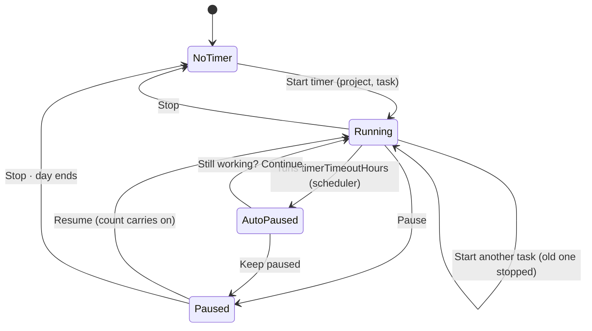

# Task timer for everyone, timer timeout, and a dashboard for everyone — design

Date: 5 Nov 2026 · Status: design approved in chat ("yes proceed"), spec for review
Amends: `2026-10-26-spark-flow-company-system-design.md` §2 (Time logging), §4.3 (Dashboard row), §4.4 (when timers
stop, undo check-out), §4.8 (Attendance), §5 (Home, Dashboard, phone timer bar), §6 (the check-in flow).

## 1. What was asked, and what it's for

| # | Asked | What it's for |
|---|---|---|
| 1 | A dashboard page for everyone, with analysis charts, tables and projects | Every person sees how their projects are going, not only Admin, Sales and project managers |
| 2 | A **Start timer** button in the top bar: pick a project, then a task, then start. The timer shows in the top bar with **Pause**; resuming carries on the count | Starting work is one click away from any page |
| 3 | Settings → **Timer timeout** in hours: a timer that runs that long pauses itself and asks to continue | Fewer timers left running by people who forgot them |
| 4 | Replace check-in and check-out with the task timer | People do one thing to start the day, not two |

Answers given in chat:
- A Member's dashboard shows the projects they work on, with the team's figures and their own hours (not only their
  own numbers, not everything).
- Check-in's required plan ("What will you work on today?") is dropped, not moved.
- A paused timer clears at the end of the local day.
- There is a **Stop** button as well as Pause (asked after the first design: "if I start a task timer and want to close
  it, will a button exist?").

## 2. Decisions

| Decision | Chosen | Rejected and why |
|---|---|---|
| How a pause is stored | **Pause closes the running entry; Resume starts a new entry on the same target.** The count shown is the sum of that run's entries | A separate timer record with its own state (two sources of truth); one open entry with gaps inside (breaks every hours rule, report and overlap check) |
| Pause and Stop | **Both.** Pause keeps the task in the bar to resume; Stop ends the run and clears the bar | Pause only (no way to close the timer); Stop only (today's behaviour, no resume) |
| A paused timer overnight | **Clears at the end of the local day** | Staying paused across days (yesterday's task sits in the bar) |
| Timeout | **One workspace-wide setting, 1–12 hours, default 4**, set by whoever holds `settings.manage`; enforced by the server | Per person (more settings nobody asked for); client-only (a closed tab would never pause) |
| Presence for Attendance | **Derived from timer entries**: the day's first timer start is "in", its last timer end is "out" | Keeping check-in as a hidden record (the double step stays in the data) |
| The daily plan | **Dropped** | Asking on the first start (one more step) |
| Dashboard scope | `dashboard.all` (Admin, Sales): every project; **anyone else: the projects they manage or work on** | Own numbers only; everything for everyone |

## 3. Data model changes (`src/api/types.ts`)

- `TimeEntry` gains:
  - `endReason: 'paused' | 'stopped' | 'timeout' | 'flow' | null`: why a timer entry ended. `null` while running and
    on manual entries. `'flow'` is Flow ending it (the task went Done or was archived, the project archived, the
    person deactivated, the 12-hour limit).
  - `startedFrom?: CheckSource | null`: where a timer start or resume came from (IP, device, place), as check-in
    recorded. Absent on manual entries and on entries from before this change.
- `MyDay` becomes `{ day, timer, entries, firstStart }`:
  - `timer: MyTimer | null`, where `MyTimer = { state: 'running' | 'paused'; target: TimeTarget; entryId: string;
    runMs: number; startedAt: string | null; pausedBy: 'me' | 'timeout' | null }`.
    - `runMs` is the closed time of this run: the target's timer entries that started today, after the target's last
      entry today that ended `'stopped'` or `'flow'`. A running timer shows `runMs + (now − startedAt)` through
      `runningClock`, never a counter.
    - Running: my entry with `endedAt: null`. Paused: no running entry, and my latest timer entry today ended
      `'paused'` or `'timeout'` on a task that isn't Done or archived.
  - `firstStart: boolean`: I've never started a timer that recorded where it came from, so the Start timer dialog says
    what is recorded and who sees it (as `firstCheckIn` did).
  - `checkIn`, `openCheckIn` and `firstCheckIn` go.
- `CheckIn` goes. `CheckSource`, `CheckLocation` and `GeoFix` stay (used by `startedFrom`).
- `DbData.settings` gains `timerTimeoutHours: number` (default 4).
- One DB version per slice, so each ships on its own:
  - **v28** (slice 1) sets `endReason` on timer entries: `'stopped'` when ended, `null` when running. Manual entries
    get `null`.
  - **v29** (slice 2) sets `settings.timerTimeoutHours = 4`.
  - **v30** (slice 3) drops `checkIns`. The seed is rebuilt so its days come from timer entries with `startedFrom`.
  - An import with `checkIns` is accepted and ignores them; an import whose `timerTimeoutHours` isn't a whole number
    from 1 to 12 is refused.

## 4. Behaviour

### 4.1 The timer (`src/mocks/time.ts`)

| Call | Route | Rules |
|---|---|---|
| Start | `POST /api/time/start` `{ target, location }` | As today (`time.logOn`, not a Done task). It ends whatever runs or is paused as `'stopped'`, then starts a new entry with `startedFrom`. Starting the target that already runs is a no-op. |
| Pause | `POST /api/time/pause` | Ends my running entry with `'paused'`. Refusal: `Your timer isn't running.` |
| Resume | `POST /api/time/resume` `{ location }` | Starts a new entry on the paused target with `startedFrom`. Refusals: `Nothing is paused.`, plus Start's own refusals for that target (for example, the task went Done while paused). |
| Stop | `POST /api/time/stop` | Running: ends it as `'stopped'`. Paused: marks that last entry's `endReason` `'stopped'`, which clears the bar. Refusal: `There's no timer to stop.` |

- One running timer per person stays the rule, with at most one paused run.
- The 12-hour limit per entry stays.
- Where Flow ended a timer before, it still does, now writing `endReason: 'flow'`: the task goes Done or is archived,
  the project is archived, the person is deactivated.
- **Day end:** a paused run isn't offered to resume once its local day ends, and the bar shows Start timer again.
  Nothing is written. A running timer isn't cut at midnight, so late work keeps counting; the timeout and the 12-hour
  limit catch a forgotten one, and it belongs to the day it started.
- Every write publishes `timeLogged`, as today.

### 4.2 The timeout (`src/mocks/scheduler.ts`)

- Each scheduler pass (every 15 s, one transaction) ends any running timer entry with
  `now − startedAt ≥ timerTimeoutHours`. The entry's `endedAt` is `startedAt + timeout` exactly, not the moment of the
  pass, and its `endReason` is `'timeout'`. The pass then publishes `timeLogged`.
- The time between the auto-pause and **Continue** is never counted.
- The limit counts from each start or resume, so a run with breaks can pass it in total without pausing.
- In the app, while `timer.pausedBy === 'timeout'` and this browser hasn't answered for that entry, a dialog says:
  - Title: **Still working?**
  - Body: `Your timer paused after 4 h on NEX-101 Login page.`
  - Buttons: **Continue**, which resumes and is the primary button, and **Keep paused**. Answers are kept per entry id
    in `sessionStorage`. A failed Continue shows its error in the dialog.
- Setting it: `GET` / `PUT /api/settings/timer` `{ timeoutHours }`. Saving needs `settings.manage` and is audited
  (`Timer timeout`). Refusal: `Pick a whole number of hours from 1 to 12.`
- On the page: Settings → Attendance, in the working hours box, now titled **Working hours and timer**, with the line
  `Timers pause after 4 hours and ask if you're still working.` and an edit sheet field "Pause timers after (hours)".

### 4.3 Attendance without check-in (§4.8 replaced in part)

- A person's **day** is made of their timer entries that started on that local day:
  - **In:** the first entry's `startedAt`, with its `startedFrom`.
  - **Out:** the last entry's `endedAt`; none while a timer runs.
  - **Hours:** the sum of those entries.
  - Manual entries don't make or change a day.
- **Late:** in after the working-hours start on a working day.
- **Left early:** out before the end of that day's working hours.
  - Never when the last entry ended `'flow'` or `'timeout'`.
  - Never on today while a timer runs or is paused.
- **The Check-ins tab becomes Days:** a row per person per day with in, out, hours, where they started from (IP,
  device, place), and new IP or device and off hours as before. The route `GET /api/attendance/check-ins` becomes
  `GET /api/attendance/days`, with the same query and the same row fields minus `byFlow`, plus `endReason`.
- Day, Visits and Report keep their routes; their in and out now come from timer entries.
- Who sees whom is unchanged: `checkins.all` and `checkins.managed` keep their ids. Their labels become "See
  everyone's timers and app use" and "…of the people on projects they manage".
- Removed: `POST /api/time/check-in`, `/check-out` and `/check-out/undo`, along with `useCheckIn`, `useCheckOut` and
  `useUndoCheckOut`.
- The privacy notice moves to the Start timer dialog, shown while `firstStart`: `Starting a timer records the time,
  this device's IP address and browser, and your location if you allow it. You, the managers of your projects and
  Admins can see them in Attendance.`

### 4.4 Dashboard for everyone

- `dashboard.view` isn't a stored grant: `can()` works it out (`dashboard.all`, or managing a project). It becomes
  true for anyone in the workspace, so every role, custom ones too, opens the page. No data changes.
- The sidebar entry moves from **Manage** to **Work**, after My tasks. `navigation.ts` and the sidebar's own copy both
  change, and so does Search.
- **Scope:** `dashboard.all` gives every active project in the workspace. Anyone else sees the projects they manage
  or are on (as a member or through a team). With none, the page says `You're not on any projects yet.`
- **Content.** All figures come from `src/mocks/dashboard.ts` and the charts follow the chart rules (red key series
  plus greys, at most 4 series, the takeaway in the title):
  - Tiles, as today: active projects, overdue tasks, hours in the last 7 days, and cost (Admin) or **Working now**.
  - **Hours per day:** a `ColumnChart` of the last 14 days, the projects in scope in red and my own hours in grey.
    Title: `{n} h logged in 14 days`.
  - **Hours by project:** a `BarList` of the last 14 days.
  - **Tasks by status:** a `BarList` of the tasks in scope by status category: To do, In progress, and Done in the
    last 14 days.
  - **Overdue tasks:** a `DataTable` with key, title, project, assignee and due date; it opens the task inspector.
  - The project cards stay as they are.
  - **Working now** (was "Checked in now") lists people with a running timer, their task and the count. It is shown
    by `checkins.all` and `checkins.managed` as today.
- Cost and rates stay `cost.view` and `rates.manage` only.

### 4.5 Screens

- **Top bar:**
  - With no timer, it shows a **Start timer** button (desktop `md:` and up). On phones it is a round 36px play icon
    button.
  - A running timer shows the pill as today: the task, the count, **Pause** and **Stop**.
  - A paused timer shows the frozen count with **Resume**, **Stop** and **Switch task**.
  - The bell and the rest stay as they are.
- **Start timer dialog:**
  - It uses `sf/Modal`, which is full screen on phones.
  - Fields: **Project** (projects I may log on), then **Task** (open tasks of that project, mine first, plus "No task"
    as in Add time). The Task select waits for a project.
  - **Start timer** is the primary button.
  - The `firstStart` notice sits under the fields.
  - Switch task opens the same dialog.
- **Phone bottom timer bar:** running or paused, with the same buttons as the pill.
- **Home:**
  - The Check in card becomes **Today**: the timer's state and its buttons, or Start timer, plus today's hours.
  - The plan field and the check-out summary go.
  - My tasks and mentions stay.
- **Task inspector:** Start timer stays, and Stop becomes Pause and Stop when that task's timer runs.

Microcopy: "Start timer", "Pause", "Resume", "Stop", "Switch task", "Starting…", "Pausing…", "Stopping…", ` · `
between the task key and title.

## 5. Flow

## 6. Order of work

Each slice is planned in `tasks/todo.md`, written test first, reviewed, committed and checked in the app.

1. **Timer:** `endReason`, Pause, Resume and Stop, `MyDay.timer`, the top bar button and dialog, the pill and the phone
   bar.
2. **Timeout:** the setting, the scheduler step and the Still working dialog.
3. **Check-in removed:**
   - The API and the Home card go.
   - Attendance is derived from timers, and Working now replaces Checked in now.
   - DB v30, the seed, help chapters, `CLAUDE.md` and the API contract are updated.
   - It needs slices 1 and 2.
4. **Dashboard for everyone:** the grant, the scope, the charts and the table. It is independent of the timer slices.

## 7. Testing

- **Mock, unit:**
  - Pause, Resume and Stop, with each refusal.
  - `runMs` across pause and resume, and after Stop, when the next start begins from 0.
  - The timeout ending an entry exactly at the limit, and the time after it not counted.
  - Day end: yesterday's paused run isn't today's timer, and a run crossing midnight keeps counting.
  - Attendance in, out, late and early from entries, including manual entries ignored and `'timeout'` never counting
    as early.
  - The migrations 27 → 28, 28 → 29 and 29 → 30.
  - Dashboard scope for Admin, Sales, a PM and a Member.
  - Every new Api method listed in `audit.test.ts`.
- **Components (jsdom):** the Start timer dialog (project then task, the notice), the pill in each state, the Still
  working dialog (Continue, Keep paused, error), the Today card and the dashboard's charts and table. Axe in light and
  dark, and 390px.
- **App check on `npm run dev`:** start, pause, resume, stop, switch; a timeout set to 1 hour with the clock moved by
  the dev helper; Attendance's Days; the dashboard as Admin and as a Member.

## 8. What this changes for the .NET team

- Removed: the check-in, check-out and undo routes, and the `CheckIn` record.
- Added:
  - Pause, resume and stop on the timer.
  - `endReason` and `startedFrom` on time entries.
  - `GET` / `PUT /api/settings/timer`.
  - `GET /api/attendance/days` in place of `check-ins`.
  - `dashboard.view` true for everyone in the workspace, and `GET /api/workspaces/:id/dashboard/stats`.
- The server must end timers at the timeout itself, as the mock's scheduler does.
- `docs/` API contract sections for time and attendance are updated in slice 3.

## 9. Not in this change

- Per-person timeouts.
- A daily plan.
- Editing a paused run's entries from the pill.
- Notifications outside the app for a timeout.
- Anything marked OPEN in the chat spec §13.
