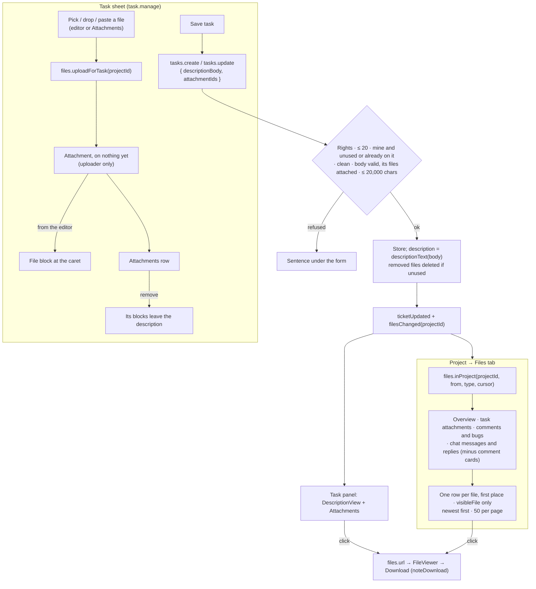

# Project Files tab, task attachments and a rich task description — design

Date: 7 Nov 2026 · Status: design approved in chat ("Approve design"), spec for review
Amends: `2026-10-26-spark-flow-company-system-design.md` §3 (Ticket), §4.2 (API), §4.4 (write rules), §5 (project page,
task sheet, task panel); `docs/flow-chat/api-contract.md` Phase 2 · Slice 6 (Files).

## 1. What was asked, and what it's for

| # | Asked | What it's for |
|---|---|---|
| 1 | A **Files** tab on the project page, after History: every file of the project in one list, with when and by whom it was uploaded, its size and type, and where it came from (a task comment or bug, Overview, the project's chat, a task's attachments). It opens and downloads files the way the app already does | One place to find a project's files, wherever they were added |
| 2 | **Attachments when creating a task**, like Jira: New task and Edit task take files, which stay on the task and show in its panel | Specs, screenshots and documents travel with the task from the start, not only in comments |
| 3 | A **rich editor for the task description** that formats text and takes files (dropped, pasted or picked) | Descriptions that read like a brief: lists, code, links, pictures where they belong |

Answers given in chat:
- A file dropped or pasted into the description also joins the task's **Attachments** (one list per task, like Jira).
  Removing an attachment also removes it from the description.
- Files are added to an existing task through **Edit task** only; the panel shows them (open, download).
- Whoever may edit the task (`task.manage`: the project's manager, Admins) adds and removes its files. No new
  permission.
- The Files tab shows **one row per file**: a file in two places is listed once, under where it was first added.

## 2. Decisions

| Decision | Chosen | Rejected and why |
|---|---|---|
| When a task's file uploads | **Upload first, link on save** (as chat): picking a file uploads it at once as a file only its uploader can see; Save sends the ids | Files sent with Save in one multipart request (as comments): no progress, no picture in the editor before saving, a slow Save |
| The description's format | **The chat body format** (`lib/messageBody.ts`) plus a **file block**: paragraphs, quote, lists, code block; bold, italic, underline, strikethrough, inline code, links | Markdown text (parsed on every read, ambiguous); HTML (never rendered as HTML in Flow) |
| Mentions in the description | **None for now**: text and links only | People and task mentions (they'd need notification rules for descriptions) |
| Old descriptions | **One paragraph per line**, as plain text: nothing changes meaning | Parsing them as markdown (`*`, `_`, `` ` `` in old text would turn into formatting) |
| The plain `description` | **Kept, worked out by the server** from the body on every save, for search, CSV, audit and old readers | Dropping it (every reader changes at once) |
| The editor | **A new description editor** in the project pages' look (lucide icons, `components/ui` tokens), reusing chat's Lexical nodes, conversions and markdown shortcuts | Reusing the chat composer (chat's `.sf` look and font, Enter sends, drafts, slash commands) |
| Files tab source of truth | **The server gathers** a project's files from every place (`files.inProject`) | The page joining five queries (no paging, no access rule in one place) |

## 3. Data model changes (`src/api/types.ts`, `src/lib/messageBody.ts`)

- `lib/messageBody.ts` gains the description format:
  - `FileBlock = { type: 'file'; id: string }`, `DescBlock = Block | FileBlock`, `DescBody = DescBlock[]`.
  - `validDescription(value, fileIds)`: chat's block and length rules (`MAX_BLOCKS`, `MAX_NODES`, `MAX_TEXT`, links
    http(s) only and ≤ 2,048), plus: inlines are `text` and `link` only; file blocks sit at the top level only and name
    one of `fileIds`. Chat's `validBody` keeps refusing file blocks.
  - `descriptionText(body)`: the plain text, one block per line; a file block adds nothing.
  - `textBody(text)`: one paragraph per line, plain text inlines only (`''` → `[]`).
- `Ticket` gains:
  - `descriptionBody: DescBody`: the description as written.
  - `attachmentIds: string[]`: the task's files, in the order they were added.
  - `description: string` stays, always `descriptionText(descriptionBody)`; clients never send it.
- `NewTicket`: `descriptionBody: DescBody` and `attachmentIds?: string[]` in place of `description`.
- `TicketPatch`: `descriptionBody?` and `attachmentIds?` (the whole new list) in place of `description`.
- `TaskView` gains `attachments: Attachment[]`: the task's files in `attachmentIds` order, deleted ones left out.
- `ProjectFileSource = { kind: 'overview' } | { kind: 'task'; taskKey: string } | { kind: 'comment'; taskKey: string;
  commentId: string; bug: boolean } | { kind: 'chat'; messageId: string; replyId: string | null }`.
- `ProjectFileRow = { file: Attachment; source: ProjectFileSource }`; `ProjectFileFilter = { from?: ProjectFileSource['kind'];
  type?: FileKind; cursor?: string }`.
- **DB v31** (`migrations.ts` step 30 → 31, with a test): every ticket gets `attachmentIds: []` and
  `descriptionBody = textBody(description)`. The seed builds its tickets the same way; one seed task gets an attachment
  and a formatted description so the feature shows in the demo. An import without these fields is migrated like the
  store.

## 4. Behaviour

### 4.1 Uploading a task's file

`files.uploadForTask(projectId, file, { onProgress, signal })` → `Attachment`:
- Whoever may edit tasks on the project (`task.manage`), on a project that isn't archived (`openProject`): else `403`
  / `400` "This project is archived. Restore it first.".
- The file rules everyone uses (`checkUpload`: empty, the size limit, the types in `fileTypes.ts`).
- Progress in steps and Cancel, as `uploadForChat`; a cancelled upload saves nothing and rejects with an `AbortError`.
- The new file is on nothing yet: only its uploader may open it (the existing "uploaded and not sent" rule). The
  backend removes it after 24 hours if no task names it (as chat files).
- Not audited: the file is recorded when the task that names it is saved (as `uploadForChat`).

### 4.2 Saving a task with files and a description

`tasks.create` and `tasks.update` (same routes as today) take `descriptionBody` and `attachmentIds`. In the same write:

| Check | Refusal |
|---|---|
| Rights: as today, `task.manage` (the assignee's status-only edit can't carry these fields) | `403` |
| At most 20 files; a repeated id counts once | `400` "Attach up to 20 files to a task." |
| Each id is a file that exists and isn't deleted | `404` |
| A file not already on this task: I uploaded it, and nothing else uses it yet | `403` "You can only attach files you uploaded." · `400` "Upload that file again to attach it here." |
| Each file is clean | `400` "{title} is still being checked." · "{title} was blocked." |
| The body passes `validDescription` with the task's resulting ids | `400` "The description couldn't be read. Try again." |
| Its text is at most 20,000 characters | `400` "Keep the description under 20,000 characters." |

Then:
- `description` is set to `descriptionText(descriptionBody)`.
- When `attachmentIds` leaves out a file that the stored description still shows (an update without `descriptionBody`), its
  file blocks leave the description too, so a description never points at a file the task doesn't have.
- A file that leaves the task and is used nowhere else (`fileInUse`, §4.3) is deleted with its bytes.
- History: a change of files is logged as `task.changed` with the field `attachments` ("Files changed" / "changed the
  files"), as the description is today.
- Audit: the task's change records `Files` with the file names before and after, beside the fields it records today.
- Events: `ticketUpdated` as today, plus `filesChanged { projectId }` when the task's files changed.

### 4.3 Who may open a file, and files nobody uses

- `placesOf` (and so `visibleFile`, `files.details`' `taskKeys`, `files.url`) counts **task attachments**: anyone on
  the project may open a task's files, archived project or task included (reading isn't frozen).
- `fileInUse(data, fileId)` in `mocks/files.ts` is the one rule for "something still uses this file": a message, a
  reply, a message waiting in Undo, a project file, a comment, or a task. It replaces the copies in
  `removeFromProject`, `archive.deleteForGood` and the new task unlink.
- `archive.deleteForGood` also removes the files of what it deletes when nothing else uses them: a project's task
  attachments and comment files, and a task's attachments and comment files (comment files were left behind before).
  Its "includes N files" count adds them.

### 4.4 The project's files

`files.inProject(projectId, filter)` → `Page<ProjectFileRow>`:
- For whoever can open the project (as `files.list`); archived projects too.
- Places, all in this project:
  - **Overview**: its project files.
  - **Task**: the attachments of its tasks, archived tasks included.
  - **Comment**: the files of its tasks' comments and bugs (not deleted).
  - **Chat**: the files of messages and replies in its channel, not deleted, **leaving out comment cards** (`commentId`):
    they repeat the comment's files.
- One row per file. Its source is the place it was added first (by that place's time; on a tie Overview, Task,
  Comment, Chat). Rows show the file's own `uploadedBy` and `createdAt`.
- Only files I may open (`visibleFile`), never deleted ones.
- Newest first (`createdAt`, then id); 50 per page with a cursor (as `inChannel`).
- `from` keeps rows whose source is that kind; `type` keeps rows whose `fileKind` is that type.

### 4.5 Live updates

The Files tab's query sits under `qk.files(projectId)`, so `filesChanged` refreshes it. `keysForEvent` also refreshes
`['projects', 'files']` on `fileChanged`, `commentAdded`, and a new message or reply that carries files.

## 5. Screens

### 5.1 Task sheet (New task, Edit task)

- **Description** becomes the description editor (lazy-loaded with the sheet's other heavy parts):
  - A bordered box like the other fields, focus ring on the box. Toolbar on top: Bold, Italic, Underline,
    Strikethrough · Link · Bulleted list, Numbered list · Quote, Code, Code block · Attach files. Icon buttons with
    labels for screen readers and `aria-pressed`; on a 390px phone the toolbar scrolls sideways.
  - Keys: ⌘/Ctrl B, I, U; ⌘/Ctrl K for a link; chat's markdown shortcuts (`*bold*`, `_italic_`, `~strike~`,
    `` `code` ``, ```` ``` ````, `> `, `- `, `1. `). Enter makes a new paragraph, Shift+Enter a line break,
    ⌘/Ctrl+Enter saves the task. Tab leaves the editor.
  - Link: an inline row under the toolbar, "Web address" field with Add link and Remove link; only http(s) (error
    under the field: "Use a web address that starts with http:// or https://").
  - Paste is plain text (as chat); pasted files upload.
  - Files dropped or pasted into the editor, or picked with Attach files, upload at once and appear where the caret was
    when they were added (at the end if that spot is gone): an image as a picture, any other file as a chip (icon,
    title, size). Selecting one and pressing Backspace takes it out of the description; it stays in Attachments.
- **Attachments**, under the description:
  - One row per file: type icon, title, "1.2 MB" or "Uploading… 50%", "Couldn't upload: {reason}" with Try again;
    × removes it (asks nothing: nothing is saved until Save). Removing it also takes it out of the description.
  - A dashed box: "Add files or drop them here", with the allowed files hint.
  - The upload rows reuse a `useUploadQueue` hook taken out of `ProjectFiles.tsx` (Overview's files keep working the
    same).
- **Save task** stays disabled while a file is uploading, with "Wait for the files to finish uploading." under
  Attachments. A save error shows under the footer as today.
- Someone who may only move the status sees the description read-only and the files without remove or add.

### 5.2 Task panel → Details

- **Description** shows the body as elements (`DescriptionView`, project pages' look): paragraphs, lists, quote, code,
  links (open in a new tab, http(s) only), pictures (click opens the viewer) and file chips (open the viewer). A file
  the task no longer has shows "This file was removed." Empty: "—".
- **Attachments · N** follows when there are files: `AttachmentView` (pictures, video, file rows) with the viewer and
  Download (`noteDownload`).

### 5.3 Project → Files tab (`/w/:ws/p/:key/files`)

- Sixth tab after History. Controls: chips **All · Tasks · Comments · Chat · Overview** (`?from=`) and a **Type**
  select: Any type, Images, PDFs, Documents, Snippets, Videos, Other (`?type=`).
- Desktop and tablet: `DataTable` with Name (type icon and title), Type (the extension, e.g. "PDF"), Size, Uploaded
  by (avatar and name), Uploaded (date), From. A row click opens the file in `FileViewer` (Download inside, reported
  with `noteDownload`).
- From is a link: "NEX-108 · Attachment" and "NEX-105 · Comment" / "NEX-105 · Bug" open the task panel; "Chat" opens
  the message in the Chat tab; "Overview" opens Overview.
- Phone: a list; each row has the icon, the title, "PDF · 1.2 MB · Nour El-Sayed · 3 Nov 2026" and "From NEX-108 ·
  Attachment".
- A file still being checked or blocked shows "Being checked" or "Blocked" and doesn't open.
- Load more (50 at a time); first load skeleton rows; refetch keeps the rows.
- Empty: "No files yet. Files added to tasks, comments, chat and Overview show here." Filtered to nothing: "No files
  match these filters." with Clear filters.
- Errors as sentences: "Files couldn't be loaded." with Try again; "{title} couldn't be opened. Try again."

Microcopy: "Attachments", "Add files", "Attach files", "Uploading…", "Try again", "Wait for the files to finish
uploading.", "Files changed", "Being checked", "Blocked", "From", "Load more", "Clear filters".

## 6. Flow



## 7. Order of work

One branch, `feat/task-files`, cut from `dev`; each slice planned in the plan file, written test first, committed.

1. **Data and mock:** the description format, DB v31, `uploadForTask`, task save rules, `fileInUse`, visibility,
   `inProject`, HTTP mapping, live keys, the audit lists.
2. **Task attachments:** `useUploadQueue`, the sheet's Attachments, the panel's Attachments.
3. **Rich description:** the editor with its file node, `DescriptionView`.
4. **Files tab.**
5. **Docs and checks:** help chapters (`project-page.md`, `tasks.md`), `CLAUDE.md`, the API notes, the demo script;
   the gates; the app in light and dark and at 390px.

## 8. Testing

- **Unit (mock and lib):**
  - `validDescription` (mentions refused, file blocks only top-level and attached, limits), `descriptionText`,
    `textBody`.
  - The migration 30 → 31.
  - `uploadForTask` rights and rules; task create and update with files: each refusal in §4.2, the file blocks of a
    removed file leaving the description, an unused removed file deleted, history and audit entries, `filesChanged`.
  - `fileInUse` and its callers, including delete for good.
  - `inProject`: each source, comment cards left out, one row per file under its first place, visibility, paging,
    `from` and `type`.
  - Every new `Api` method listed in `audit.test.ts`.
  - The editor ↔ body round trip with the file node, headless (`bodyEditor.test.ts` style).
- **Components (jsdom):** the sheet's Attachments (add, progress, remove, Save disabled while uploading),
  `DescriptionView` (every block, a removed file, links), the Files tab (chips and type in the address, table and
  phone list, empty and filtered states, From links, viewer).
- **Browser project:** typing and the format keys in the editor; dropping and pasting a file into it.
- **Gates:** `npx tsc -b`, `npm run lint`, `npx vitest run --project unit`, `--project browser`,
  `npm run build:prototype`; then `npm run dev` with the pages checked in light and dark and at 390px.

## 9. What this changes for the .NET team

- `POST /api/files/upload-url` takes `{ projectId, name, size, mimeType }` (in place of `channelId`) for a task's
  file: `task.manage` on the project, not archived. The bytes and `complete` steps are as for chat. The file is its
  uploader's until a task names it, and is removed after 24 hours if none does.
- Tasks: `POST /api/projects/:id/tasks` and `PATCH /api/tasks/:key` take `descriptionBody` (the `DescBody` JSON) and
  `attachmentIds`; `description` becomes read-only, worked out from the body. Task reads carry `descriptionBody`,
  `attachmentIds` and `attachments` (the file records). The rules and sentences are §4.2.
- Existing descriptions migrate to one paragraph per line.
- `GET /api/projects/:id/all-files?from=&type=&cursor=` → `{ items: ProjectFileRow[], nextCursor }` (§4.4).
- A task's files count in who may open a file (`GET /api/files/:id`, `/details`' `taskKeys`) and in "still used"
  before a file's bytes are thrown away; delete for good also removes the unused files of a project's or task's
  comments and attachments.
- `filesChanged { projectId }` is also sent when a task's files change.

## 10. Not in this change

- Mentions in the description.
- Adding or removing a task's files from the panel without Edit task.
- A rich editor for task comments (the comment composer stays plain text).
- Create task from a message or a file attaching that file or keeping the message's formatting.
- Searching descriptions.
- Deleting or renaming files from the Files tab (that stays where each file lives).
