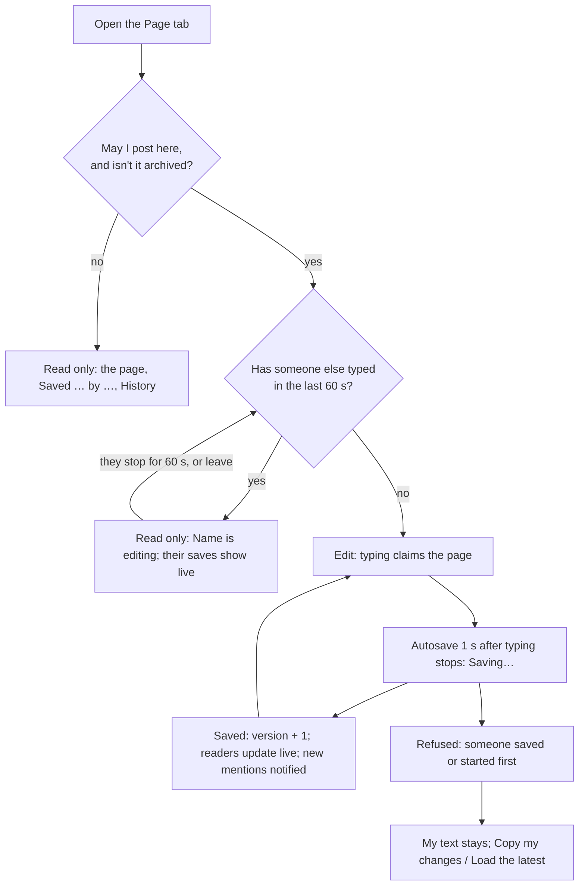

# Channel Page tab — design

Date: 10 Nov 2026. Status: approved in conversation (Q1–Q7 "Yes, recommended"); this document awaits review.
Source: `docs/flow-chat/FLOW_CHAT_REDESIGN.md` §6.14 ("Page tab: a collaborative Flow page attached to the channel").
Branch: `feat/channel-page`, from dev `b6b6804`.

## 1. What was asked, and what it's for

Every channel shows a **Page** tab that today says "This channel’s page will live here." The spec wants a page that belongs to the channel and that the channel's people write together: decisions, how-tos, links to tasks, checklists. It is the place for what shouldn't scroll away in the messages.

The spec asks for:
- **Toolbar:** text style, bold, italic, checklist, table and link a task.
- **Status and actions:** a save state ("Saved · Nour is editing"), collaborators, Share and history.
- **Content:** a 760 px column with headings, lists, tables, checklists, task chips and @mentions.
- **Reuse:** Flow's existing page editor, if one exists.

Flow has no page editor yet. It does have the task description editor (`pages/projects/description/`), built on Lexical with chat's conversions (`bodyEditor.ts`). The Page editor builds on the same pieces.

Success means:
- Anyone who may post in a channel can write its page.
- Everyone in the channel reads it, and it updates live.
- Nobody silently loses an edit.
- Any earlier version can be read and brought back.
- It works in light and dark and on a 390 px phone, and passes the UX checks (`npm run test:ux`).

## 2. Decisions

| # | Question | Answer |
|---|---|---|
| Q1 | How editing works | **One person edits at a time.**<br>- While someone has typed in the last 60 s, the page is theirs. Everyone else reads it with "Nour El-Sayed is editing" and sees each save as it lands.<br>- A save that would overwrite a newer version is refused, and its author keeps their text.<br>- No live co-editing, and no new libraries for it. |
| Q2 | What a page holds | Headings (three levels), bold, italic, links, bulleted and numbered lists, checklists, tables, task chips, and mentions of people and projects. Tables add `@lexical/table` (the same Lexical 0.52). |
| Q3 | Mentions | A person newly @mentioned by a save gets one Activity item ("mentioned you on #backend’s page"), which also reaches the bell. |
| Q4 | History | **Grouping:** saves by the same person within 10 minutes of the first save in a run form one version.<br>**Kept:** the last 100 versions.<br>**History window:** lists them, shows one, and restores it. A restore is saved as a new version. |
| Q5 | Share | **Copy link** only. Posting a page card into the channel comes later. |
| Q6 | Scope | The Page tab only. See §10 for what stays out. |
| Q7 | Who may edit | Whoever may post in the channel (the bookmarks rule: `useCanWrite`, and not archived). Everyone who can read the channel can read its page and its history. |

## 3. Flow



## 4. Data model (`src/api/types.ts`, new `src/lib/pageBody.ts`, mock DB v33)

### 4.1 The page's content: `PageBody`

The page's content uses chat's message-body model (`lib/messageBody.ts`: `Inline`, `Block`) plus three block types:

```ts
type PageBlock =
  | Block                                                    // p, quote, ul, ol, code (as in messages)
  | { type: 'h1' | 'h2' | 'h3'; children: Inline[] }
  | { type: 'check'; items: { checked: boolean; children: Inline[] }[] }
  | { type: 'table'; rows: Inline[][][] }                    // rows → cells → inlines; the first row is the header
type PageBody = PageBlock[]
```

`lib/pageBody.ts` holds three functions:
- `validPage(value: unknown): PageBody | null` is shared by the mock and the pages. It rejects:
  - unknown types;
  - `all` and `here` inlines (a page doesn't page the channel);
  - a table that isn't rectangular, or has fewer than 1 or more than 10 columns, or more than 100 rows;
  - more than 2,000 blocks;
  - more than 50,000 characters of text.
- `pageText(body)` returns plain text, used for the excerpt and for Copy my changes.
- `pageMentions(body)` returns the ids of people mentioned.

Inlines are validated exactly as in messages (`user`, `task` and `project` chips are built only from ids that exist when shown).

### 4.2 Records

```ts
type Page = {
  id: string; channelId: string; workspaceId: string
  body: PageBody; version: number                 // 0 until the first save
  createdAt: string; createdBy: string; updatedAt: string; updatedBy: string
  /** Who holds the page and until when; expired holds count as none. */
  editing: { userId: string; until: string } | null
}
type PageVersion = {
  id: string; pageId: string; version: number; body: PageBody
  /** Who saved it; firstSavedAt starts the 10-minute run, savedAt is the run's last save. */
  savedBy: string; firstSavedAt: string; savedAt: string
}
/** What the tab reads. */
type PageView = {
  channelId: string; body: PageBody; version: number
  updatedAt: string | null; updatedBy: string | null
  /** Distinct people who saved versions, newest first, at most 10. */
  editors: string[]
  editing: { userId: string; until: string } | null
}
type PageVersionSummary = { id: string; version: number; savedAt: string; savedBy: string }
```

- **Storage:** mock DB v33 adds `pages: Page[]` and `pageVersions: PageVersion[]`. The migration adds empty lists.
- **Creation:** a page record is created by the first claim (§5.2) or save.
- **The hold is stored:** `editing` lives on the record, not in memory, so every tab of the prototype sees the same hold. Expiry is worked out on read (`until < now` is none).

## 5. Behaviour (rules live in `src/mocks/pages.ts`; the .NET API keeps the same rules)

### 5.1 Reading

- Anyone who can read the channel can read its page, its history and any version. Anyone else gets 403, or 404 for a channel they can't see.
- A channel with no page reads as `version: 0`, an empty body and no editors.
- Group conversations and DMs have no Page tab (`channelTabs` already leaves it out).

### 5.2 Claiming the page while typing

`api.pages.editing(channelId)` claims or renews the hold until now + 60 s, and returns the holder.

- **Who may claim:** only someone who may edit.
- **If another person holds it:** the call changes nothing and returns that person, not an error.
- **How often:** the editor sends it on the first keystroke after a pause, then at most every 5 s while typing.
- **Letting go:** `api.pages.stopEditing(channelId)` releases my hold when I leave the tab, the channel or the page, or close the browser tab (best effort). Otherwise it ends by itself after 60 s.
- **Event:** each change of holder publishes `pageEditing { channelId, userId | null, until | null }`.

### 5.3 Saving

`api.pages.save(channelId, { body, baseVersion })`:

1. **Permission:** 403 unless the caller may edit (Q7).
2. **Content:** 400 with "This page is too long. Shorten it to save." or "Something on this page can’t be saved." unless `validPage(body)` passes.
3. **Hold:** 409 `{ code: 'page.editing', by }` while another person holds the page.
4. **Version:** 409 `{ code: 'page.changed', by }` unless `baseVersion === page.version`. Here `by` is who saved last.
5. **Otherwise:**
   - write the body and `version + 1`;
   - renew the caller's hold;
   - record the version under the 10-minute rule (Q4), keeping the newest 100;
   - publish `pageSaved { channelId, version, userId }`;
   - notify new mentions (§5.5).

   All of this happens in one `db.update`.

A save that changes nothing (the same body) is accepted without a new version.

### 5.4 History and restore

- `api.pages.history(channelId)` returns `PageVersionSummary[]`, newest first.
- `api.pages.version(channelId, versionId)` returns that version's body, version, `savedAt` and `savedBy`.
- `api.pages.restore(channelId, { versionId, baseVersion })` follows the same rules as save, in the same order. It saves the old body as a new version and never removes newer ones.

### 5.5 Mentions

On a save, the people mentioned in the new body but not in the old one each get one `ActivityItem`:
- `kind: 'mention'`, with `channelId` set and `page: true` (a new optional field);
- `messageId: null`;
- `excerpt`: the text of the block holding the mention, cut to 120 characters.

No item is made for the saver, for someone who can't read the channel, or for a deactivated person. Notification rules apply as for chat mentions (`notifies`, the channel's level, Do Not Disturb). Opening the item opens `/w/:ws/c/:channelId?tab=page`.

### 5.6 Live updates

`layout/RealtimeBridge.tsx` turns:
- `pageSaved` into invalidating `qk.page(channelId)` and `qk.pageHistory(channelId)`;
- `pageEditing` into invalidating `qk.page(channelId)`.

A reader's view re-renders with the new body. The holder's own editor ignores its own saves (no reload under the caret).

### 5.7 Audit

Page saves, restores, claims and releases are **not recorded** in the audit log: the page's history is their record, as messages have theirs. Each new `Api` method is listed in `src/mocks/audit.test.ts` as not recorded, with that reason.

## 6. Screens

All of this is on chat screens (Readex Pro, `sf` primitives, Tabler icons), inside the channel's tab panel. It looks the same in a project's Chat tab.

### 6.1 Layout

From the top:
1. **Page bar.** A 44 px row in the sf tokens:
   - At the start: the save state (§6.3).
   - At the end: the collaborators' faces (up to 3 `Avatar` 24, then "+N"; the group's accessible name is "Edited by Nour El-Sayed, Youssef Abdelrahman and 2 more"), then **Copy link** (shows "Link copied" next to it for 2 s, as the channel header does), then **History**.
2. **Toolbar.** Shown only while I may edit and nobody else holds the page. It sits under the page bar and sticks to the top of the page's scroll area.
3. **Content.** A column `max-w-[760px]` centred, with 24 px side padding from 768 px and 16 px on phones. It is the editor or the read-only view.

### 6.2 Toolbar (`role="toolbar"`, "Formatting", arrow keys move between controls)

- **Text style** is a `Menu` with Normal text, Heading 1, Heading 2, Heading 3, Bulleted list and Numbered list. The button shows the current style's name.
- **Toggles:** Bold (⌘/Ctrl B) and Italic (⌘/Ctrl I).
- **Checklist** toggles a checklist.
- **Table** inserts a 3 × 3 table, with its first row as the header. Inside a table, a table `Menu` offers Add row above, Add row below, Add column before, Add column after, Delete row, Delete column and Delete table.
- **Link a task** opens the composer's autocomplete (`AutocompletePlugin`) showing task choices only, and a pick inserts a task chip.
- **Mentions:** `@` opens the composer's people and projects autocomplete, without @channel or @here.

Markdown shortcuts work as in chat: `#`, `##`, `###`, `-`, `1.` and `[ ]`. On phones the toolbar scrolls sideways, and its buttons are 44 px.

### 6.3 States and their words

| State | Page bar | Content |
|---|---|---|
| Loading | Pulse line | Pulse skeleton lines (no spinner) |
| No page, I may edit | Empty | Empty editor with the placeholder "Start the channel’s page…" |
| No page, I can't edit | Empty | "No page yet." and, below it, "People who can post here can start it." |
| Saved, nobody editing | "Saved 3h ago by Nour El-Sayed" (`lib/format.ts`) | Editor or view |
| I'm typing | "Saving…" while a save is on its way, then "Saved" | Editor |
| Someone else holds it | "Nour El-Sayed is editing" | Read-only view, updated live |
| Refused: `page.changed` | "Nour El-Sayed saved changes before you. Your last changes aren’t saved." with **Copy my changes** and **Load the latest** | Editor, my text kept, read-only until I choose |
| Refused: `page.editing` | "Nour El-Sayed started editing first. Your last changes aren’t saved." with the same two buttons | Same |
| Couldn't save (network) | "Couldn’t save the page. Check your connection." with **Try again** | Editor, still editable; the next pause retries |
| Too long or invalid | The server's sentence | Editor |

Notes on these states:
- **Where messages go:** errors sit in the page bar, under the save state, as sentences.
- **What's read aloud:** only errors and "Nour El-Sayed is editing" are announced, each once, through `announce()`. "Saving…" and "Saved" are never announced.
- **Copy my changes** copies `pageText` of my editor to the clipboard and says "Copied".
- **Load the latest** replaces my editor with the newest page.
- **Buttons:** none of these is the view's red primary. The page has none.

### 6.4 Saving and leaving

- **When a save starts:** 1 s after the last change, at once when the editor loses focus, and before leaving the tab or the channel (flush).
- **Leaving with a failed or pending save:**
  - Leaving inside the app asks through the shared unsaved-changes guard (`useUnsavedChanges(dirty, 'page', ask)` in `lib/unsavedChanges.ts`, UX Phase 1): "Leave without saving the page?"
  - Closing the browser tab uses `beforeunload`.
- **Releasing the hold:** I let the page go (`stopEditing`) as I leave.

### 6.5 History (`PageHistory`, sf `Modal`, full screen on phones)

- **Title:** "Page history".
- **Layout:** a list of versions ("Today 2:00 PM · Nour El-Sayed", newest first, the current one marked "Current") beside the selected version's read-only view. On phones the list comes first, and picking a version shows it with Back.
- **Restore this version:**
  - It is the dialog's primary button, for people who may edit.
  - It isn't shown for the current version.
  - While someone else holds the page it refuses with "Nour El-Sayed is editing. Try again when they’re done.".
  - After a restore the dialog closes and `announce('Version restored.')`.
- **Focus and closing:** the dialog follows the layer rules (focus in, Tab kept, focus back to History). With nothing changed, Esc and × close it straight away.

### 6.6 Read-only view (`PageView`)

- **Rendering:** the body is rendered as elements, never as HTML, with the same inline chips as `MessageBody`.
- **Headings** render as `h2`, `h3` and `h4`: the screen's `h1` is the channel name.
- **Checklists** render as a list with `role="checkbox"` and `aria-checked`, not operable.
- **Tables** are `table` elements with `th` in the first row, and scroll sideways inside their own box.

### 6.7 Help

`src/help/chat.md` gets a section, "The channel’s page": who can edit, one person at a time, history and restore, Copy link. `lib/pageHelp.ts` needs nothing new, because the Page tab is part of the channel page.

## 7. Code layout

| Path | What |
|---|---|
| `src/lib/pageBody.ts` | `PageBody` types, `validPage`, `pageText`, `pageMentions`, limits |
| `src/mocks/pages.ts` (+ `pages.test.ts`) | §5 rules, DB v33 migration in `db.ts`/`migrations.ts` |
| `src/api/pages.ts` | `usePage`, `usePageHistory`, `usePageVersion`, `useSavePage`, `useRestorePage`, `useClaimPage`, `useReleasePage`; `qk.page`, `qk.pageHistory` |
| `src/lib/realtime.ts`, `layout/RealtimeBridge.tsx` | `pageSaved`, `pageEditing` |
| `src/pages/chat/page/pageNodes.ts` | Lexical ↔ `PageBody` conversions on `bodyEditor.ts`'s inline conversions (headless, round-trip tested) |
| `src/pages/chat/page/PageEditor.tsx`, `PageToolbar.tsx` | The editor (Lexical: rich-text headings, `@lexical/list` incl. check lists, `@lexical/table`, link, chip nodes) |
| `src/pages/chat/page/PageView.tsx` | Read-only renderer |
| `src/pages/chat/page/ChannelPageTab.tsx` | The tab: queries, hold, autosave, states, page bar |
| `src/pages/chat/page/PageHistory.tsx` | History dialog |
| `src/pages/chat/ChannelTabs.tsx`, `ChannelPage.tsx` | `TabStub` for `page` goes; the panel renders `ChannelPageTab` |

## 8. Testing

- **Unit (`lib/pageBody.test.ts`):** `validPage` accepts every block type, and rejects `all`/`here`, ragged tables, the limits and unknown types. `pageText` and `pageMentions` are covered.
- **Mock (`mocks/pages.test.ts`):** each rule in §5, in order:
  - 403 for someone who can't post or for an archived channel;
  - 409 `page.editing` and `page.changed` with `by`;
  - the 10-minute grouping (same person, two people, past 10 minutes);
  - the 100-version cap;
  - restore makes a new version;
  - the hold expires after 60 s and is released by `stopEditing`;
  - mentions notify only new, readable, active, other people;
  - events are published.
- **Conversions (`pageNodes.test.ts`, headless):** every block and inline round-trips.
- **Browser (`ChannelPageTab.browser.test.tsx`):**
  - typing autosaves after 1 s;
  - a second person's hold makes the view read-only with the name;
  - `page.changed` keeps my text and offers both buttons;
  - Load the latest replaces the text;
  - markdown shortcuts and the toolbar's styles work;
  - Tab moves through table cells;
  - phone: no sideways page scroll, 44 px toolbar buttons, the table scrolls inside.
- **Whole app:**
  - `c/c-general?tab=page` joins `UX_PAGES`, so every role, theme and size is checked;
  - Page history joins `src/layers.browser.test.tsx`;
  - a walkthrough step (PM writes a checklist, Member reads it live) joins `journeys.browser.test.tsx`.
- **Audit:** the new `Api` methods are listed in `src/mocks/audit.test.ts`.

## 9. What this changes for the .NET team (`docs/flow-chat/api-contract.md`)

| Route | Body | Returns |
|---|---|---|
| `GET /api/channels/:id/page` | | `PageView` |
| `PUT /api/channels/:id/page` | `{ body, baseVersion }` | `PageView`; 409 `{ code: 'page.editing' \| 'page.changed', by }`; 400 with a sentence; 403 |
| `POST /api/channels/:id/page/editing` | | `{ editing }` |
| `DELETE /api/channels/:id/page/editing` | | 204 |
| `GET /api/channels/:id/page/versions` | | `PageVersionSummary[]` |
| `GET /api/channels/:id/page/versions/:versionId` | | `{ body, version, savedAt, savedBy }` |
| `POST /api/channels/:id/page/restore` | `{ versionId, baseVersion }` | `PageView` (save's rules) |

The backend also needs:
- **Real-time events:** `pageSaved`, `pageEditing`.
- **Activity:** `ActivityItem.page?: true`.
- **Validation:** the body is validated with the same rules as `validPage`; the server is the authority.
- **Concurrency:** the version check is an optimistic-concurrency check (a row version).

## 10. Not in this change

These each wait for their own spec:
- Live co-editing with cursors.
- A page card posted in the channel.
- "Page" in the composer's + menu.
- Pages as bookmarks (`Bookmark.page_id`).
- Finding pages in search.
- Comments on a page.
- Files and images in a page.
- The new-channel intro and templates (§6.14).
- Task list (Pro) and Automations.

## As built (10 Nov 2026, plan `docs/superpowers/plans/2026-11-10-channel-page-tab.md`)

Where the build departs from this design:

- **Archived channels** answer `400` "This channel is archived." (the mock's `checkCanWrite`, one rule for the whole channel), not `403`.
- **A 409's body** carries the whole sentence in `detail`; there is no `{ code, by }`. The page offers the same two buttons for any 409, and a stale save from my own other tab reads "You changed this page in another tab. Your last changes here aren’t saved."
- **Mentions** are stored as `pageMentions` records on save and read by `mentionsFor` as `source: 'page'` (chat's mentions are worked out on read), not stored as Activity items.
- **The read-only view** is `PageReader`, since `PageView` is the data type's name.
- **Restore** always starts its own history entry, so the state before it stays in history.
- **In the editor**, headings carry `aria-level` one deeper than their tag, and a checklist's list is a `group` (Lexical makes its items checkboxes), so the channel's name stays the only level-1 heading and axe's list rule holds.
