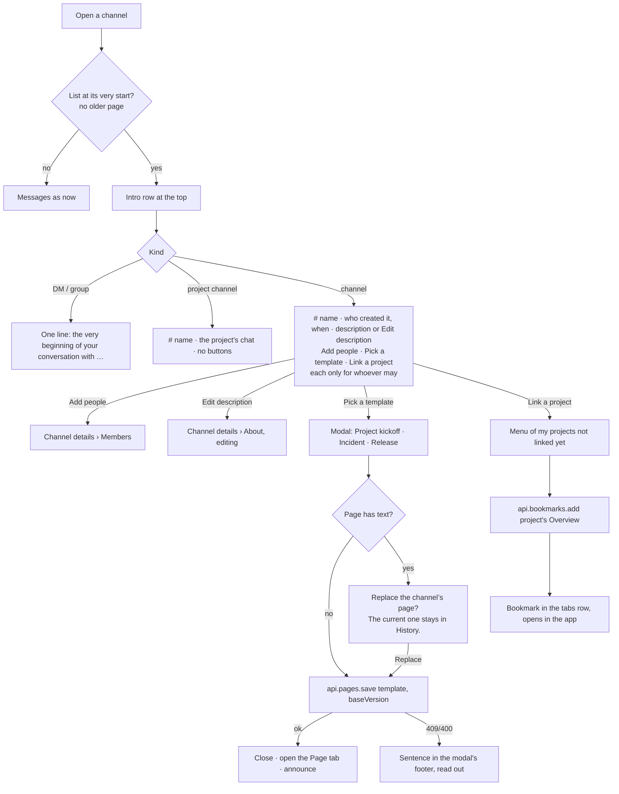

# New-channel intro and page templates — design

Chat spec `docs/flow-chat/FLOW_CHAT_REDESIGN.md` §6.14, second half ("New channel intro"). It follows the channel Page
tab (`docs/superpowers/specs/2026-11-10-channel-page-tab-design.md`, on dev since f6dd880).

## 1. Purpose

A channel's history starts with a short intro: what the channel is, who made it and when, and ways to set it up.
**Pick a template** fills the channel's page with a ready structure (kickoff, incident, release), so a new channel is
useful at once.

What success looks like:
- Opening a channel and scrolling to the very start always shows where it began.
- In a new channel, the intro offers Add people, Pick a template and Link a project to whoever may use them.
- A template turns into a real page in one step, on the Page tab.
- Every part works in light and dark, from the keyboard, and on a 390 px phone.

## 2. Decisions (approved 11 Nov 2026, Q1–Q7 "Yes, recommended")

| # | Question | Decision |
|---|---|---|
| 1 | Where the intro shows | At the top of every channel's history, once the list reaches the very start. It replaces "No messages here yet." |
| 2 | Direct messages | One line, no buttons: "This is the very beginning of your conversation with Nour El-Sayed." |
| 3 | Project channels | "…#nexus-core, Nexus Core’s chat." No Link a project and no Pick a template (and, as today, no one changes a project's channel or adds its people there) |
| 4 | Link a project | Adds a bookmark to the project's Overview in the tabs row (existing bookmarks) |
| 5 | What a template holds | The page only. Task list and Automations aren't on the cards until each has its own spec |
| 6 | A page that already has text | Ask "Replace the channel’s page? The current one stays in History." then replace |
| 7 | Templates | Project kickoff, Incident, Release, with the content in §7 |

## 3. Flow

## 4. Data (`src/api/types.ts`, mock DB v34)

- **`Channel.createdAt: string | null`** and **`Channel.createdBy: string | null`**: when the channel or conversation was
  made, and by whom.
  - `createChannel` and `openDm` set them.
  - The seed sets them for its channels.
  - Migration 33 → 34: `createdAt` is the channel's first message's `createdAt`, else `null`; `createdBy` is `null`.
    A channel with no known creator leaves the "X created…" sentence out.
- No new routes. Templates save through `PUT /api/channels/:id/page` (`api.pages.save`); Link a project uses
  `POST /api/channels/:id/bookmarks` (`api.bookmarks.add`).
- `docs/flow-chat/api-contract.md` gains the two `Channel` fields.

## 5. The intro (`pages/chat/ChannelIntro.tsx`)

### 5.1 Where

- `buildRows` (`pages/chat/messageRows.ts`) adds `{ kind: 'intro', key: 'intro' }` before the first message when there is no
  older page (`hasOlder` false). An empty channel shows the intro alone; "No messages here yet." goes.
- It's a row of the message list, so it scrolls with the history and sits above the first day divider.
- It shows in a channel and in a project's Chat tab.

### 5.2 Look (the kit's `.sf-intro`, sf tokens, Readex)

- Padding: 32 px top, 24 px sides (16 px on phones), 16 px bottom.
- **Heading:** `# release-v2` as an **`h2`** in the display type (28/36, 600). The screen's `h1` stays the channel name in
  the header. A private channel shows the lock icon in place of `#`, as the sidebar does.
- **Text:** `sf-body` in `text-secondary`, at most 640 px wide.
- **Buttons:** a wrapping row 16 px below the text. sf `Button` default variant, icon and label, `touch` on phones. No
  primary: the intro never takes the view's one red button.

### 5.3 Words

| Kind | Text |
|---|---|
| Channel, I made it | "You created this channel today. This is the very beginning of #release-v2." |
| Channel, someone else | "Nour El-Sayed created this channel on 3 Oct 2026. This is the very beginning of #release-v2." |
| Channel, creator unknown | "This is the very beginning of #release-v2." |
| Project channel | "This is the very beginning of #nexus-core, Nexus Core’s chat." |
| Direct message | "This is the very beginning of your conversation with Nour El-Sayed." |
| Group conversation | "This is the very beginning of your conversation with Nour El-Sayed and Mariam Fathy." (three or more: "Nour El-Sayed, Mariam Fathy and Karim Hassan") |

- The day reads "today", "yesterday" or "on 3 Oct 2026" (`lib/format.ts` `formatDate`, in the viewer's time zone).
- A channel's description, when it has one, is its own line under the text.
- **Edit description** (a link-style button after the text, or **Add a description** when there is none) opens Channel
  details › About with the description being edited. It shows only for whoever may change the channel
  (`detailsRights(…).manage`), so never in a project's channel or a DM.

### 5.4 Buttons (each only for whoever may use it; none in an archived channel)

| Button | Who sees it | What it does |
|---|---|---|
| **Add people** (`IconUserPlus`) | whoever may add members (`detailsRights(…).manage`, not a project's channel) | Opens Channel details › Members |
| **Pick a template** (`IconTemplate`) | whoever may edit the page (`useCanWrite === true`, not archived), channels only | Opens the template picker (§6) |
| **Link a project** (`IconLink`) | whoever may add bookmarks (may post and write), channels only, while there is a project left to link | Opens a menu of projects (§8) |

A DM has none of these.

## 6. Pick a template (`pages/chat/page/TemplatePicker.tsx`)

- An sf `Modal` titled **"Pick a template"**, description "It fills the channel’s page. You can change everything
  after."
- **Cards:** a radio group, one card per template, showing its name and what it holds; the first is chosen when the
  picker opens:
  - **Project kickoff:** "Goals, scope, who’s who and a kickoff checklist."
  - **Incident:** "A summary, a timeline and action items."
  - **Release:** "Scope, a release checklist and how to roll back."

  Cards stack on phones and sit in a row of three from 768 px. Arrow keys move between them (a radio group).
- **Footer:** `ModalCancelButton`, and the primary **"Use template"** (pending "Adding…").
- **A page with text:** Use template first asks in the footer, as the discard question does:
  "Replace the channel’s page? The current one stays in History." with **Keep the page** and **Replace** (`primary`;
  nothing is destroyed, because the old page stays in History).
- **Saving:** `api.pages.save(channelId, { body: template, baseVersion })`, with `baseVersion` from the page as just
  read (`useLatestPage`).
  - **Success:** close the modal, open the Page tab, and `announce('Template added to the page.')`.
  - **Refusal:** a 409 or 400 shows the server's sentence in the footer and is read out once; the modal stays open.
- **The hold:** the save claims the page as any save does, and the Page tab shows the page with "Saved just now by you".

## 7. Templates (`src/lib/pageTemplates.ts`)

Three `PageBody` constants, each passing `validPage`. Text in the app's voice, sentence case, curly apostrophes.

**Project kickoff**
- Heading 1 "Project kickoff"
- Heading 2 "Goals"; paragraph "What does this project have to achieve, and by when?"
- Heading 2 "Scope"; bulleted list: "In scope:", "Out of scope:"
- Heading 2 "Who’s who"; table: header "Role" | "Person"; rows "Project manager", "Lead engineer", "Client contact"
  (Person cells empty)
- Heading 2 "Kickoff checklist"; checklist: "Agree the scope and dates", "Set up the project in Flow", "Invite the team
  to this channel", "Book a weekly check-in"

**Incident**
- Heading 1 "Incident"
- Heading 2 "Summary"; paragraph "What happened, who is affected and where it stands now."
- Heading 2 "Timeline"; table: header "Time" | "What happened"; two empty rows
- Heading 2 "Action items"; checklist: "Find the cause", "Fix it and check the fix", "Tell the people affected",
  "Write up what we learned"

**Release**
- Heading 1 "Release"
- Heading 2 "Scope"; paragraph "What ships in this release, and what waits."
- Heading 2 "Release checklist"; checklist: "Freeze the scope", "QA sign-off", "Write the release notes", "Deploy",
  "Check it in production", "Tell the team"
- Heading 2 "Rollback"; numbered list: "How to roll back", "Who decides"

## 8. Link a project

- **The menu:** an sf `Menu` "Link a project", a bottom sheet on phones. It lists the workspace's projects I can see
  (`useProjectSummaries`), by name, without those already linked: a bookmark whose address is that project's Overview.
- **Picking one:** adds a bookmark titled with the project's name, at the absolute address of its Overview
  (`origin + paths.project(ws, key)`). Then `announce('Nexus Core linked.')`. A refusal shows its sentence under the
  button (`useCopyLink`'s note pattern) and is read out.
- **Bookmarks to Flow open in Flow** (`ChannelTabs`): a bookmark whose address is on the app's own origin is a router
  link without `target="_blank"`, so moving to the project feels like moving between sections of one app. Every other
  bookmark still opens in a new browser tab.

## 9. Code layout

- `src/api/types.ts`: `Channel.createdAt`, `createdBy`.
- `src/mocks/`: `db.ts` (v34), `migrations.ts` (33 → 34), `seed.ts`, `chat.ts` (`createChannel`, `openDm`),
  `db.test.ts`, `migrations.test.ts`, `chat.test.ts`.
- `src/lib/pageTemplates.ts` (+ test): the templates, `{ id, name, summary, body }[]`.
- `src/pages/chat/messageRows.ts` (+ test): the `intro` row.
- `src/pages/chat/ChannelIntro.tsx` (+ test): the words and buttons, from props (the channel, people, me, rights,
  projects, handlers). No queries inside, so it renders in jsdom.
- `src/pages/chat/MessageList.tsx`: renders the `intro` row through a prop from `ChannelPage`.
- `src/pages/chat/page/TemplatePicker.tsx` (+ test).
- `src/pages/chat/ChannelPage.tsx`: wires the intro's handlers (details tabs, the picker, the Page tab, bookmarks).
- `src/pages/chat/ChannelTabs.tsx`: in-app bookmarks.
- `src/help/chat.md`: a short "A new channel" section.
- `docs/flow-chat/api-contract.md`, `FLOW_CHAT_REDESIGN.md` §6.14 "Built" line, `CLAUDE.md` rule.

## 10. Testing

- **Unit:**
  - Templates pass `validPage`, and none holds `@channel`.
  - `buildRows` adds the intro only without older pages.
  - The migration and the mock set `createdAt` and `createdBy`.
  - `ChannelIntro` words for each kind (you, someone else, unknown, project, DM, group) and buttons by rights (none in an
    archived channel).
  - `TemplatePicker`: an empty page saves at once; a page with text asks first; a 409 stays with its sentence.
  - In-app bookmarks are router links.
- **Browser (whole app):**
  - Create a channel, and see the intro with Add people, Pick a template and Link a project.
  - Pick Release, and land on the Page tab with the checklist.
  - Link Nexus Core, and its bookmark opens the Overview in the app.
  - Phone: the intro's buttons answer touch, and the page doesn't scroll sideways.
  - axe in light and dark.
- **Layers:** "Pick a template" joins `src/layers.browser.test.tsx`.
- **UX matrix:** a new channel's empty history is covered by the walkthroughs. `UX_PAGES` keeps its pages: c-general
  doesn't open at its start.

## 11. Not in this change

- Task list (Pro) and Automations (each needs its own spec), and their entry points in the attach menu.
- Templates made by people (saving a page as a template).
- A real link between a channel and a project (a field, shown in the header).
- Intros in threads.
