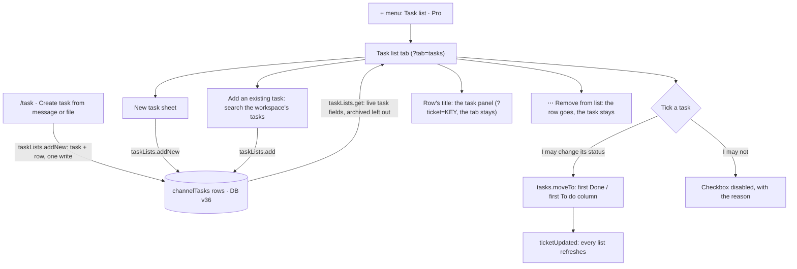

# Channel task list — design

Chat spec `docs/flow-chat/FLOW_CHAT_REDESIGN.md` §6.8 (the + menu's "Task list (Pro)"), §6.14 ("Task list (Pro) and
Automations … each needs its own spec"), §12 Phase 4 and §13 Q7 (plan gating); audit rows 6.8-101, 6.8-102 and 6.14-29.
Branch `feat/task-list` from dev 63af2d6.

## 1. Purpose

Let a channel keep track of the work it talks about without leaving the chat. Today a task made from a message lands on
its project's board and the channel only gets a "Created" card; nothing in the channel says which tasks it is following
or how they are going.

Success: in any channel, whoever may post adds new or existing Flow tasks to the channel's task list; everyone in the
channel sees each task's live status, assignee and due date in a Task list tab, ticks a task done when they may change
it, and opens it in the task panel. It works by keyboard and screen reader, in light and dark, on a 390 px phone.

## 2. Decisions

Approved 11 Nov 2026, Q1–Q8 "Yes, recommended":

1. **What it holds:** real Flow tasks (keys, board, time) by reference. There is no second kind of task; quick to-dos stay
   in the Page's checklists.
2. **Pro:** a Pro tag on the + menu item only. Nothing is locked or hidden (there are no paid plans yet; §13 Q7 stays
   open for real gating).
3. **Where:** channels only (`kind: 'channel'`), project channels included, as with the Page tab. No lists in DMs.
4. **Tasks made in the channel join its list:** /task, Create task from message and Create task from file add the new
   task to the list in the same write.
5. **Order:** open tasks first, by due date (soonest first, no date last), then by when they were added (oldest first);
   done tasks folded under "Done · N" at the bottom, in the order added. No dragging.
6. **Checkbox:** ticking moves the task to its project's first Done column; unticking moves it to the project's first
   To do column. Only for people who may change that task's status (today's rule).
7. **Templates:** unchanged (Project kickoff still fills the page only).
8. **When the tab shows:** once the list has a task, or while the address says `?tab=tasks` (the + menu opens it).

Rulings made while writing this spec, from how the code works today:

- **R1 · Who sees a task.** There is no task-view rule: `can()` has no task-view action, and `tickets.resolve`, search and
  the mention directory return every live task in the workspace. The list follows that: everyone who can read the channel
  sees every task on it. The design's "2 more tasks are in projects you’re not on" line is dropped. If a view rule comes
  later, the list read is the one place to filter.
- **R2 · How tasks join.** Create task from a message or file exists only in a project's channel (the create rule needs
  the message in the project's chat), and /task elsewhere sets no channel link. So every creation from a channel goes
  through `taskLists.addNew`, which makes the task with `linkedChannelId` set to the channel and adds the row in one
  write. /task in a DM stays as it is.
- **R3 · The project page.** A project's Chat tab (inside the project page) hides Task list, as it hides Files: the
  project's own Tasks tab is one click away. On the Chat side the project's channel shows it.
- **R4 · Live updates.** No new event type: list writes publish `channelChanged` (as bookmarks do), and `ticketUpdated`
  refreshes every task list, so a status, assignee or due date changed anywhere shows at once.
- **R5 · Audit.** A list's rows are the channel's content, as pins and bookmarks are, so adding and removing are not
  recorded; the task that `addNew` makes is recorded as `tasks.create` records it.

## 3. Flow



## 4. Data

### 4.1 Types (`src/api/types.ts`)

```ts
/** A task on a channel's task list (chat spec 6.14, DB v36): the row, not the task. */
export type ChannelTask = { id: string; channelId: string; taskId: string; addedBy: string; addedAt: string }
/** One task as the list shows it: the chip's fields plus what the row needs. */
export type TaskListTask = TaskRef & { id: string; projectId: string; dueAt: string | null; overdue: boolean }
export type TaskListEntry = { id: string; addedBy: string; addedAt: string; task: TaskListTask }
export type TaskList = { channelId: string; entries: TaskListEntry[] }
```

`Api.taskLists`:

```ts
taskLists: {
  /** The channel's list: every live task on it (archived tasks left out), in the order added. */
  get(channelId: string): Promise<TaskList>
  /** Adds an existing task of the channel's workspace; whoever may post in the channel. */
  add(channelId: string, taskKey: string): Promise<TaskListEntry>
  /**
   * Makes a task by `tasks.create`'s rules, with `linkedChannelId` = the channel, and adds it, in one write. Returns the
   * task, as `tasks.create` does (the task sheet and its openers take a `TaskView`).
   */
  addNew(channelId: string, input: NewTicket): Promise<TaskView>
  /** Takes a task off the list; the task itself stays. */
  remove(channelId: string, taskKey: string): Promise<void>
}
```

### 4.2 Mock (`src/mocks`)

- `DB_VERSION = 36` ("36: channel task lists"); `DbData.channelTasks: ChannelTask[]`, listed in `COLLECTIONS`.
- **Migration 35** fills `channelTasks` with one row per live task whose `linkedChannelId` names a `kind: 'channel'`
  channel of the task's workspace: `addedBy` = the task's reporter, `addedAt` = its `createdAt`. Today that is NEX-106 on
  #frontend-dev.
- **Seed:** the same derivation (NEX-106), plus NEX-105, NEX-103 (in Done) and MOB-103 (To do, past its due date, a
  second project) on #frontend-dev's list, added by Mariam Fathy, so the tab, a late date, the project column and the
  Done fold show in the prototype and the UX matrix.
- **`src/mocks/taskLists.ts`** (`taskListsApi(db, hub)`), each write one `db.update`:
  - every call: `readableChannel` (today's 404/403); a DM → 400 "Task lists are for channels."
  - `get`: rows of the channel whose task is live (not archived), mapped to `TaskListEntry` with the task's derived
    fields (`overdue` from `derive.ts`, status label and category from the project's board).
  - `add` and `addNew`, after `checkCanWrite` (archived channel, who may post, Only admins):
    - the task doesn't exist → 404 "That task no longer exists."
    - the task is archived → 400 "This task is archived. Restore it first."
    - its project is in another workspace → 400 "That task is in another workspace."
    - already on the list → 409 "That task is already on this list."
    - the list has 200 tasks → 400 "A task list holds up to 200 tasks."
  - `addNew` creates through `createTicket` (its rules, sentences, audit and events stay: `task.manage` on the project,
    an archived project, a `linkedMessageId` outside the project's chat). It needs one change: an optional
    `then(data, created)` that runs inside `createTicket`'s write, where `addNew` adds the row. A refusal from either
    leaves neither the task nor the row.
  - `remove`, after `checkCanWrite`: not on the list → 404 "That task isn’t on this list."
  - list writes publish `{ type: 'channelChanged', channelId }`.
- **Delete for good** (`mocks/archive.ts`): the task branch drops the task's rows; the project branch drops the rows of
  all its tasks.
- **Audit:** `taskLists.get` is `READ`; `taskLists.add` and `taskLists.remove` go in `NOT_RECORDED` ("a channel’s task
  list is its content, as pins and bookmarks are"); `taskLists.addNew` is `RECORDED` as a task created.

### 4.3 Queries, transport and contract

- `qk.taskList(channelId)` = `['chat', 'taskList', channelId]`; `dataKeysFor`: `channelChanged` adds
  `qk.taskList(channelId)`, `ticketUpdated` adds the prefix `['chat', 'taskList']`.
- Hooks in `src/api/taskLists.ts`: `useTaskList(channelId)`, `useAddToTaskList()`, `useAddNewToTaskList()`,
  `useRemoveFromTaskList()`; each mutation invalidates all queries (the app's rule).
- `lib/http.ts`: `GET /channels/{id}/task-list`, `POST /channels/{id}/task-list` `{ taskKey }`,
  `POST /channels/{id}/task-list/new` (a `NewTicket`), `DELETE /channels/{id}/task-list/{taskKey}`.
- `docs/flow-chat/api-contract.md`, "Phase 4 · Slice TL": the four calls, `ChannelTask` and `TaskListEntry`, the
  sentences above, `channelChanged` on writes and the list refreshing on `ticketUpdated`.

## 5. The Task list tab

- **Tab:** `ChannelTab` gains `'tasks'`: label "Task list", Tabler `IconListCheck`, count = open tasks (as Pins shows its
  count). `channelTabs(channel)` keeps it only for `kind: 'channel'`; `ChannelTop` shows it while the list has an entry
  or the tab is `tasks` (it reads `useTaskList`). The project page's `ChatTab` hides it (`hideTabs={['files', 'tasks']}`).
- **Body:** `pages/chat/tasks/ChannelTaskList.tsx`, inside the tab panel with the `sf` class like the Page tab, a column
  of at most 760 px.
  - **Top row:** "4 open · 2 done" (`sf-meta`) at the start; at the end Add an existing task (secondary) and New task
    (primary; only when I may make tasks in some project, `useTaskProjects`). Neither shows for someone who can't post
    (`useCanWrite`); they get the channel's read-only line instead.
  - **Rows**, a list (`role="list"`), ordered by `orderTaskList` (§2 Q5): checkbox · key (`sf-meta`) and title, the title
    a link to the task panel (`withInspector`, `?ticket=KEY`; the tab stays) · assignee (Avatar 24 and name, "—"
    unassigned) · due ("3 Oct", or "3 Oct · late" in the error colour when `overdue`; "—" none) · status (the chip's
    `StatusDot` and label) · project key, only when the list holds more than one project · ⋯ (Task actions for NEX-112:
    Open task, Remove from list for whoever may post).
  - **Done:** a "Done · 3" button (`aria-expanded`) under the open rows, folded on every visit; done rows read struck
    through in `text-sf-text-secondary`.
  - **Checkbox:** sf `Checkbox`, "Mark NEX-112 done" / "Reopen NEX-112". Ticking calls `tasks.moveTo(key,
    firstOf(project, 'done').id, 0)`, unticking `firstOf(project, 'todo').id`; disabled while it saves. When the rule
    (`task.manage`, or `task.updateOwnStatus` for the assignee) says no, it is disabled with the reason as its title:
    "Only the project’s manager or the task’s assignee can change its status." A refusal from the server shows as that
    row's sentence.
  - **Empty:** "No tasks on this list yet." and "Add tasks this channel is working on. Their status stays up to date."
    with both buttons for whoever may post.
  - **Loading and errors:** pulse skeleton rows; "Couldn’t load the task list." with Try again.
  - **Phone (below `md`):** each row is checkbox · two lines (title; then "NEX-112 · Nour · 3 Oct · late · In review") ·
    ⋯; every control has a 44 px touch (`max-md:touch-target`); no sideways scroll at 390 px. The top row wraps the two
    buttons under the count.
- **Saying what changed:** `announce()` after each write: "NEX-112 added to the task list.", "NEX-112 removed from the
  task list.", "NEX-112 marked done.", "NEX-112 reopened.", "Task NEX-120 created and added to the task list."

## 6. Adding tasks

- **New task:** `TaskSheet` gains `onto?: { channelId: string }`; with it the sheet saves through `addNew` instead of
  `tasks.create`. In a project's channel the project is that project (as Create task from message does); elsewhere the
  sheet's Project field offers `useTaskProjects`, like /task. Saving closes the sheet and the new task shows on the list.
- **/task and Create task from message or file:** `useTaskFromMessage` passes `onto` for every `kind: 'channel'` channel,
  so these join the list (§2 Q4, R2). /task keeps posting its "Created KEY" message; Create task from message keeps
  linking the message.
- **Add an existing task** (`pages/chat/tasks/AddTaskDialog.tsx`, an sf `Modal`, title "Add an existing task"): a search
  field ("Find a task", placeholder "Key or title") and a result list. Before typing it lists my open tasks ("Assigned to
  you", up to 8); typing matches key and title word starts over the workspace's live tasks (the mention directory and
  `mentionOptions`' matching, up to 20). Picking a result adds it at once and marks it "On the list"; one already on the
  list shows that and can't be picked. The dialog stays open for more; Done closes it and focus returns to its opener.
  A refusal shows under the search field. No discard question (each pick is saved).
- **The + menu:** after a separator, "Task list" with an sf `Tag` "Pro", in a channel's composer only (not DMs, not the
  thread box), on desktop and phones; it opens the tab (`?tab=tasks`). `RichComposer` takes `onTaskList?: () => void`,
  as it takes `onSnippet`.

## 7. Words

| Where | Words |
|---|---|
| Tab | Task list |
| + menu | Task list · Pro |
| Top row | 4 open · 2 done; Add an existing task; New task |
| Done fold | Done · 3 |
| Empty | No tasks on this list yet. / Add tasks this channel is working on. Their status stays up to date. |
| Checkbox | Mark NEX-112 done; Reopen NEX-112; Only the project’s manager or the task’s assignee can change its status. |
| Row menu | Task actions for NEX-112; Open task; Remove from list |
| Dialog | Add an existing task; Find a task; Key or title; Assigned to you; On the list; No tasks match “…”.; Done |
| Errors | §4.2's sentences; Couldn’t load the task list. |
| Announcements | §5 |

## 8. Code layout

| File | Role |
|---|---|
| `src/api/types.ts`, `src/api/taskLists.ts`, `src/api/queryKeys.ts` | §4.1, §4.3 |
| `src/mocks/taskLists.ts`, `src/mocks/{db,migrations,seed,index,archive,tickets}.ts`, `src/mocks/audit.test.ts` | §4.2 |
| `src/lib/http.ts`, `docs/flow-chat/api-contract.md` | §4.3 |
| `src/lib/taskList.ts` | `orderTaskList(entries)` (§2 Q5), `listCounts(entries)` → `{ open, done }` |
| `src/pages/chat/tasks/ChannelTaskList.tsx`, `TaskListRow.tsx`, `AddTaskDialog.tsx` | §5, §6 |
| `src/pages/chat/ChannelTabs.tsx`, `ChannelPage.tsx`, `src/pages/projects/ChatTab.tsx` | the tab |
| `src/pages/chat/useTaskFromMessage.tsx`, `src/pages/projects/TaskSheet.tsx` | `onto` |
| `src/pages/chat/composer/RichComposer.tsx` | the + menu item |
| `src/pages/chat/MessageBody.tsx` | exports `StatusDot` |
| `src/help/chat.md`, `FLOW_CHAT_REDESIGN.md` (Built line), `docs/flow-chat/AUDIT.md` (rows), `CLAUDE.md` (rule) | docs |

## 9. Testing

- **Unit (node):** every `taskLists` rule and sentence; `addNew` leaves neither task nor row when either part is refused;
  migration 35 (a linked task joins its channel's list; a DM link doesn't); delete for good drops the rows (task and
  project); `orderTaskList` (due date, no date last, ties by added, done after); `qk` events; `http` paths; the audit
  lists.
- **Component (jsdom):** a row's labels, the disabled checkbox's reason, "· late"; the dialog's empty and typed states
  and "On the list".
- **Browser (Chromium), the whole app:** #frontend-dev's tab and count; add an existing task; New task from the tab;
  /task joins the list; tick and untick move the task (its board column changes); Remove from list; the Done fold; the
  title opens the task panel with the tab kept; phone 390 px: two-line rows, 44 px, no sideways scroll; dark; keyboard
  only (title link, checkbox, ⋯ menu); a reader who can't post sees no add buttons.
- `UX_PAGES` gains `'c/c-frontend?tab=tasks'`; `src/layers.browser.test.tsx` gains "Add an existing task" (modal) and
  "New task from the task list" (sheet, "Discard this new task?").

## 9a. Final review changes (11 Nov 2026)

- /task and Create task join the list with `optional`: a full list, or a channel I may not post in, still gets the task,
  just not the row (`?optional=true` on `…/task-list/new`). Only tasks the list shows count toward 200.
- `projectChanged` refreshes every list too (a column renamed or retyped, a project archived).
- Unticking goes to the board's To do column, or the first To do-type column when that one was given another type.
- A checkbox I can't use stays a Tab stop (`aria-disabled`), with its reason as its description and said on a tap;
  focus moves to the next task after a tick or a removal; a refusal on a row is read out.
- Rows lay out by the list column's own width, so the task panel beside the list doesn't squeeze the titles: columns from
  36rem with titles on up to two lines, the assignee's name from 44rem, two-line rows below.

## 10. Not in this change

Dragging to reorder, custom columns or fields, more than one list per channel, lists in DMs, templates that make tasks
(§2 Q7), Pro gating (§13 Q7), filters and sort controls, notifications when a task is added, a task-view permission rule
(R1), and Automations.
