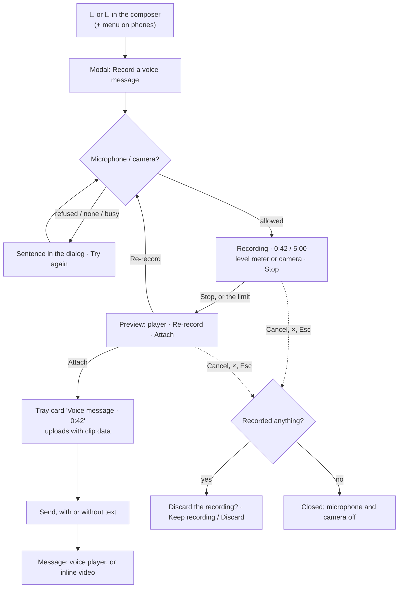

# Voice and video messages — design

Chat spec `docs/flow-chat/FLOW_CHAT_REDESIGN.md` §6.8 (action row) and §6.9 (voice and video messages); audit rows 6.8-24
to 6.8-26 and 6.9-65 to 6.9-71. Branch `feat/voice-messages` from dev e86d1c6.

## 1. Purpose

Let people record a short voice or video message in the browser, check it, and send it like a file, and let everyone
play it in the channel. Today nothing records (no `getUserMedia` or `MediaRecorder` in `src/`); video files already play
inline, audio files are plain file cards.

Success: from a channel or a thread, a person records, previews, re-records or attaches, then sends with or without
text; a voice message plays from a waveform player, a video message inline; it works by keyboard and screen reader, in
light and dark, on a 390 px phone.

## 2. Decisions (approved 11 Nov 2026, Q1–Q7 "Yes, recommended")

1. **Scope:** voice and video together; they share one recorder.
2. **Entry points:** Record a video message and Record a voice message in the composer's action row after a divider
   (spec order: + · Aa · emoji · @ | video · voice), from `md` up; on phones they are items in the + (Attach) menu. In the
   channel box and a thread's reply box (both take files); never in a message being edited or in task comments.
3. **Recorder:** an sf `Modal` (on phones a centred box nearly the screen's width): recording with a timer and a level meter or the camera's picture,
   Stop; then a preview with Re-record and Attach. Cancel asks first when something was recorded.
4. **Limits:** voice up to 5 minutes, video up to 2 minutes at 720p (about 20 MB, under the 25 MB file limit). At the
   limit it stops by itself and says so.
5. **In messages:** voice gets the `sf-clip` player (play button, waveform, length); video plays inline as video files do
   today, labelled "Video message · 0:42". Uploaded audio files (.mp3, .m4a, .wav) stay file cards.
6. **Playback speed:** not in this change.
7. **Show transcript:** not in this change, and no placeholder, until a transcription provider is chosen (§13 Q5).

## 3. Flow



## 4. Data

### 4.1 Types (`src/api/types.ts`)

- `Attachment.clip: Clip | null`, beside `snippet`:
  `type Clip = { kind: 'voice' | 'video'; durationMs: number; waveform: number[] }`. `waveform` is 48 bar heights from 0
  to 1 (two decimals) for voice, and `[]` for video.
- `uploadForChat(channelId, file, options?: UploadOptions & { snippet?: …; clip?: Clip })`. A file is a snippet or a
  clip, never both.

### 4.2 Mock (`src/mocks`)

- `DB_VERSION = 35` ("35: voice and video messages"); migration 34 sets `clip: null` on every attachment; seed files get
  `clip: null`, and the seed adds one voice message (Nour, #general, 0:04) so the player shows in the prototype and the
  UX matrix. Its bytes are a 4-second 8 kHz mono WAV of a soft tone, built by `voiceNoteWav()` in `mocks/seedFiles.ts`
  (code, not a base64 block); seed data skips `checkClip` as it skips every upload check.
- `checkClip(file, clip)` in `mocks/files.ts`, run by `uploadForChat` before the upload is stored. Refusals are 400s:
  - type: voice `audio/webm`, `audio/mp4`, `audio/ogg`; video `video/webm`, `video/mp4` → otherwise "That recording’s
    format isn’t supported."
  - length: `durationMs` from 1 to the kind's limit plus 1 s of slack → otherwise "Voice messages can be up to 5 minutes."
    or "Video messages can be up to 2 minutes."
  - waveform: voice exactly 48 numbers in [0, 1]; video empty → otherwise "That recording can’t be added."
  - with `snippet` too → "That recording can’t be added."
- Everything else is today's upload: size limit, scan, who may post, `uploadedBy`, title. The title is "Voice message" or
  "Video message".

### 4.3 Transport and contract

- `lib/http.ts`: `uploadForChat` passes `clip` in the upload's `extra`, as it does `snippet`.
- `docs/flow-chat/api-contract.md`, Slice VM: `clip` on the upload request and on `Attachment`; the server checks the type
  and works out the length from the file itself (it must not trust `durationMs`), keeps the waveform as given after the
  shape check, and applies the same limits and sentences.

## 5. Recording (`src/lib/recorder.ts`)

The only module that touches `getUserMedia`, `MediaRecorder` and Web Audio; tests replace it.

```ts
export type ClipKind = 'voice' | 'video'
export type Recording = { blob: Blob; mimeType: string; durationMs: number; waveform: number[] }
export type RecordError = 'denied' | 'missing' | 'busy' | 'failed'
export type Recorder = {
  stream: MediaStream                // for the camera preview
  level(): number                    // 0–1, now (the meter)
  elapsedMs(): number
  stop(): Promise<Recording>
  cancel(): void                     // stops the tracks, keeps nothing
}
export function canRecord(kind: ClipKind): boolean
export function startRecording(kind: ClipKind, opts: { maxMs: number; onLimit: () => void }): Promise<Recorder> // rejects with a RecordError
export function pickMimeType(kind: ClipKind, isTypeSupported: (t: string) => boolean): string | null
export function waveformOf(levels: number[], bars?: number): number[]
```

- **Formats, first supported wins:** voice `audio/webm;codecs=opus`, `audio/mp4`, `audio/ogg;codecs=opus`; video
  `video/webm;codecs=vp9,opus`, `video/webm;codecs=vp8,opus`, `video/mp4`. `canRecord` is false without
  `navigator.mediaDevices.getUserMedia`, `MediaRecorder` or a supported type, and then the buttons don't show.
- **Quality:** voice `audioBitsPerSecond` 32 000 (5 minutes ≈ 1.2 MB); video `{ width: { ideal: 1280 }, height: { ideal:
  720 }, frameRate: { ideal: 30 } }`, `videoBitsPerSecond` 1 200 000, `audioBitsPerSecond` 64 000 (2 minutes ≈ 19 MB).
- **Limits** (`src/lib/clips.ts`): `VOICE_MAX_MS = 300_000`, `VIDEO_MAX_MS = 120_000`, `WAVE_BARS = 48`. At `maxMs` the
  recorder stops itself and calls `onLimit`.
- **Level and waveform:** an `AnalyserNode` on the stream gives the RMS level every 50 ms; the meter reads `level()`;
  for voice the levels are kept and `waveformOf` turns them into 48 bars (each bar the loudest of its share, scaled so
  the loudest bar is 1).
- **Errors:** `NotAllowedError`/`SecurityError` → `denied`; `NotFoundError`/`OverconstrainedError` → `missing`;
  `NotReadableError` → `busy`; anything else → `failed`.
- **Tracks** stop on Stop, Cancel, Re-record and unmount, so the browser's microphone and camera light goes off.
- **File:** `new File([blob], clipName(kind, now, mimeType))`, e.g. "Voice message 11 Nov 2026 2.32 PM.webm"
  (`.webm`, `.m4a` for audio/mp4, `.ogg`, `.mp4`).

## 6. The recorder dialog (`pages/chat/clips/RecordDialog.tsx`)

An sf `Modal`, title "Record a voice message" or "Record a video message", `dirty` while recording or once a recording
exists, `discardQuestion` "Discard the recording?". `Modal` gains `keepLabel` (default "Keep editing"): "Keep recording"
while recording, "Keep the recording" once stopped.

| State | Body | Footer |
|---|---|---|
| Asking | "Waiting for your microphone…" ("…camera…") as text; no spinner | Cancel |
| Recording | a red dot and "Recording", the time `0:42 / 5:00` (`tabular-nums`); voice: a level meter of 24 bars; video: the camera's picture (muted, mirrored, 16:9, up to 480 px wide) | Cancel · **Stop** (primary, focused) |
| Stopped | voice: the player (§8) on the recording; video: the recording in a `<video controls>`; at the limit, "Stopped at 5:00, the longest a voice message can be." | Cancel · Re-record · **Attach** (primary) |
| Error | the sentence (§9) | Cancel · Try again |

- Re-record discards the recording and starts again (no question: the person asked for it).
- Attach closes the dialog and adds the file to the composer's tray with its `clip`; focus returns to the composer.
- Said once each (`announce`): "Recording started.", "Recording stopped, 0:42.", the error sentence. Nothing per second.
- Phones: the sf `Modal`, which is a centred box nearly the screen's width (it isn't a full-screen sheet); buttons 44 px (`touch`). (Corrected in the final review.)

## 7. The composer

- `RichComposer`'s `files` prop gains `onRecorded?: (file: File, clip: Clip) => void`; the channel box and
  `ThreadComposer` pass it. The buttons show only when it's passed and `canRecord(kind)`.
- From `md`: a divider (`sf-cbar-sep`), then IconButtons "Record a video message" (`IconVideo`) and "Record a voice
  message" (`IconMicrophone`), `size="sm"`, `tone="muted"`, after @. Below `md`: the same two as items at the end of the
  + menu.
- `useUploads` gains `addClip(file, clip)`; the item keeps its `clip`, uploads it with `uploadForChat(…, { clip })`, and
  counts toward the 10 files. The tray card's subline reads "Voice message · 0:42" or "Video message · 0:42".

## 8. In messages

- **Voice** (`pages/chat/clips/VoicePlayer.tsx`, the kit's `.sf-clip`): a 380 px card (max 100%), `radius-lg`, 1px
  `line`, `surface`; a 32 px round `accent-fill` play button (`IconPlayerPlayFilled` / `IconPlayerPauseFilled`, label
  "Play voice message" / "Pause voice message"); the waveform: 48 bars, 3 px wide, 2 px apart, heights from the
  waveform, `line-strong`, turning `accent` up to the played point; the time (`tabular-nums`): the length while stopped,
  the position while playing.
  - The waveform is a slider (`role="slider"`, "Position", `aria-valuetext` "0:12 of 0:42"): click or tap seeks; ← →
    move 5 s, Home and End go to the ends.
  - One plays at a time: starting one pauses any other (`lib/clipPlayback.ts`, a tiny module-level "now playing").
  - Plays through `safeFileUrl`, `preload="none"`; a file the browser can't play shows the file card instead.
- **Video:** today's inline video, with the type label "Video message · 0:42" instead of the file type.
- **Files tab:** `fileKind` gains `'audio'` (an `audio/*` type, or .mp3, .m4a, .wav, .ogg), checked before video so a
  voice `.webm` is audio; the Type chips gain "Audio" (`IconHeadphones`) after Videos.

## 9. Words

| Where | Words |
|---|---|
| Buttons | Record a voice message · Record a video message |
| Dialog titles | Record a voice message · Record a video message |
| Asking | Waiting for your microphone… · Waiting for your camera… |
| Recording | Recording · `0:42 / 5:00` · Stop |
| Stopped | Re-record · Attach · Stopped at 5:00, the longest a voice message can be. · Stopped at 2:00, the longest a video message can be. |
| Denied | Flow can’t use your microphone. Allow it in your browser’s site settings, then try again. (camera for video) |
| Missing | No microphone found. · No camera found. |
| Busy | Your microphone is in use by another app. · Your camera is in use by another app. |
| Failed | Couldn’t record. Try again. |
| Discard | Discard the recording? · Keep recording (while recording) · Keep the recording (stopped) · Discard |
| Tray and labels | Voice message · 0:42 · Video message · 0:42 |
| Player | Play voice message · Pause voice message · Position · 0:12 of 0:42 |
| Server | That recording’s format isn’t supported. · Voice messages can be up to 5 minutes. · Video messages can be up to 2 minutes. · That recording can’t be added. |

## 10. Code layout

| File | Role |
|---|---|
| `src/lib/clips.ts` | limits, `Clip` helpers, `clipName`, `clipLabel` ("Voice message · 0:42") |
| `src/lib/recorder.ts` | §5, the browser seam |
| `src/lib/clipPlayback.ts` | one player at a time |
| `src/lib/format.ts` | `formatClipLength(ms)`: "0:42", "4:05", "12:30" |
| `src/pages/chat/clips/RecordDialog.tsx` | §6 |
| `src/components/sf/Modal.tsx` | `keepLabel` |
| `src/pages/chat/clips/VoicePlayer.tsx` | §8, used in messages and the dialog's preview |
| `src/pages/chat/composer/RichComposer.tsx`, `ThreadComposer.tsx`, `ChannelPage.tsx`, `uploads/useUploads.ts`, `uploads/UploadTray.tsx` | §7 |
| `src/pages/chat/MessageFiles.tsx` | §8 |
| `src/lib/fileTypes.ts`, `pages/chat/files/FilesTab.tsx` | the Audio kind |
| `src/api/types.ts`, `src/mocks/{db,migrations,seed,files}.ts`, `src/lib/http.ts` | §4 |
| `src/help/chat.md`, `docs/flow-chat/api-contract.md`, `FLOW_CHAT_REDESIGN.md` (Built line), `CLAUDE.md` (rule) | docs |

## 11. Testing

- **Unit (node):** `pickMimeType` order; `waveformOf` (48 bars, 0–1, loudest = 1, silence = all 0, fewer levels than
  bars); `clipName`; `formatClipLength`; `fileKind` audio before video; `checkClip` sentences; migration 34; http passes
  `clip`; `audit.test` lists nothing new (no new `Api` method).
- **Component (jsdom), recorder faked:** the dialog's states and words, Stop at the limit, Re-record, Attach hands file
  and clip, Cancel asks only with a recording, errors per `RecordError`, tracks stopped on close; `VoicePlayer` play and
  pause labels, slider keys and `aria-valuetext`, one at a time.
- **Browser (Chromium):** the whole app with the recorder faked: record → attach → send in a channel and in a thread;
  the message's player plays (a real short clip); phone: the items are in the + menu, 44 px, no sideways scroll; axe
  serious/critical in both themes; the new dialog joins `src/layers.browser.test.tsx`.
- **One real-media test** if Chromium's fake devices can be turned on in the browser project
  (`--use-fake-device-for-media-stream`, `--use-fake-ui-for-media-stream`): `startRecording('voice')` records about a
  second and stops with a non-empty blob. If the flags can't be set there, this stays a manual check, said so in the plan.
- `UX_PAGES` needs no new page; the seeded voice message puts the player into the matrix on #general.

## 12. Not in this change

Transcripts and "Show transcript" (§13 Q5), playback speed, the player for uploaded audio files, recording in task
comments, pausing a recording, video thumbnails made by the server, and noise suppression settings.
