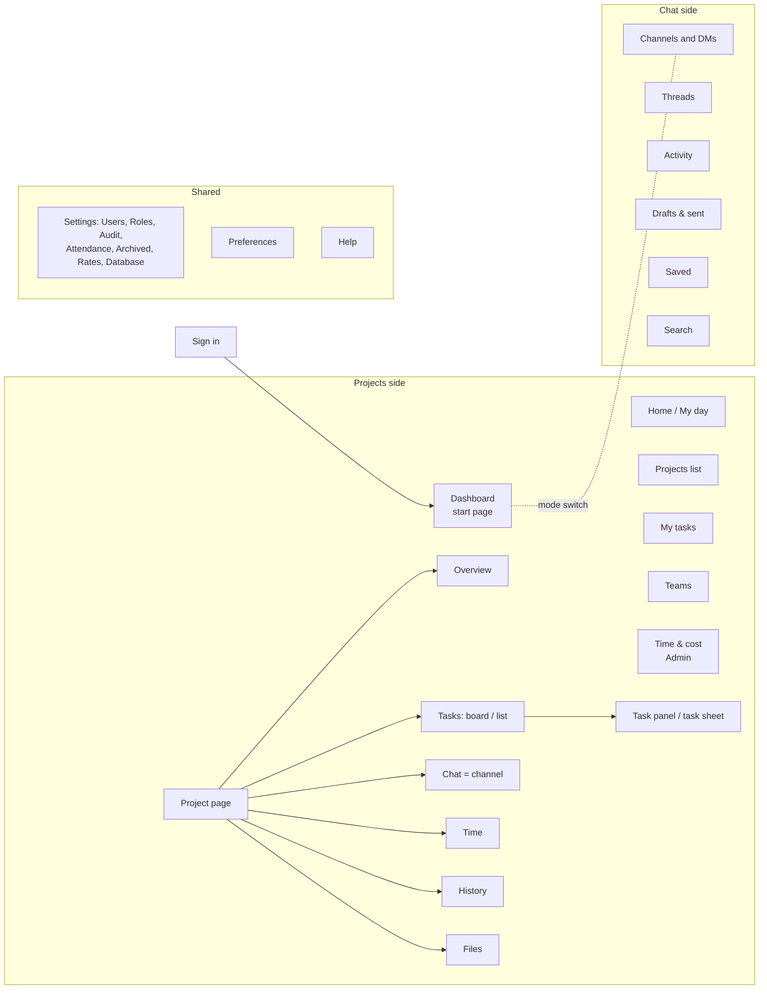

# Spark Flow web: UI/UX audit and implementation roadmap

**Date:** 9 Nov 2026
**Code:** branch `feat/more-file-types` = `origin/dev` at `15555e7`
**Status:** report only. No code was changed. The roadmap waits for your approval.

**Update, 9 Nov 2026:** roadmap approved. Phase 1 (items 1.1–1.7) is built on branch `feat/ux-phase-1` (worktree `.worktrees/ux-phase-1`), not merged or pushed yet. Plan: `docs/superpowers/plans/2026-11-09-ux-phase-1-critical-usability.md` on that branch.

**Update, 9 Nov 2026 (later):** Phase 1 is on `dev` (c2e6cb9). Phase 2 (items 2.1–2.8) is built on branch `feat/ux-phase-2` (worktree `.worktrees/ux-phase-2`), not merged or pushed yet, with the user's rulings: Dashboard for all with Home and My tasks merged into My work; Settings, Preferences and Help always on the Projects side.

**Update, 9 Nov 2026 (Phase 3):** Phase 2 is on `dev` (f0e4cb4, then 5210cc3). Phase 3 (items 3.1–3.7) is built on branch `feat/ux-phase-3` (worktree `.worktrees/ux-phase-3`), not merged or pushed yet, with the user's rulings: shared pieces identical (one round coloured avatar, one red brand-500 and one danger style, the shell's font follows the screen, New channel / New message on the chat dialog, Preferences in the kit look). Plan: `docs/superpowers/plans/2026-11-09-ux-phase-3-visual-consistency.md` on that branch.

**Update, 10 Nov 2026 (Phase 6):** Phase 6 (6.1–6.4) is on `dev` (ea3458a, fast-forwarded from 9b96ac1 on 10 Nov 2026; built on branch `feat/ux-phase-6`), with the user's answers: the audit's checks run in `npm test` as a pairwise set (122 page loads) and in full with `npm run test:ux` (968 loads: every page × role × theme × size), every sheet and dialog is tested from the keyboard, the four role walkthroughs are tests at desktop light and phone dark, help and specs follow the earlier rulings, and the open polish items plus 28 earlier deferred minors are fixed. The new tests found and fixed real problems: focus lost to the page heading after every sheet in dev, a table row's menu cut off by its cell on laptops, and a few screen-reader gaps. One design question stays open: on a 390 px phone the channel's tab row leaves the bookmark strip about 19 px wide. Plan: `docs/superpowers/plans/2026-11-10-ux-phase-6-checks-and-polish.md` on that branch.

**Update, 10 Nov 2026 (Phase 5B):** Phase 5B (5.1–5.4, 5.8, 5.10, and 5A's tablet panel) is on `dev` (9b96ac1, 10 Nov 2026; built on `feat/ux-phase-5b`), with the user's answers: contrast fixed where colours are used (tokens stay CRM's) with a darker field border (`line-input`), the phone project page folds its facts and sticks its tabs, the panel is a modal below 1280 px, the bottom bar marks More for My work, and search folds to a button below 1280 px while a timer runs. A final review's seven critical and important findings were fixed before it landed, including Overview running wider than a phone (from before this phase). Plan: `docs/superpowers/plans/2026-11-10-ux-phase-5b-phones-and-contrast.md` on that branch.

**Update, 10 Nov 2026 (Phase 5A):** Phase 4 is on `dev` (a621b47). Phase 5 is split: 5A (keyboard and screen readers: 5.5, 5.6, 5.7, 5.9, 5.11, 5.12, 5.13) is on `dev` (351eaa4, 10 Nov 2026; built on `feat/ux-phase-5a`), with the user's answers: the task panel is a modal bottom sheet on phones, single-key shortcuts can be turned off per person (Preferences → Keyboard), and after a move from the navigation focus goes to the new page's heading. 5B (5.1–5.4, 5.8, 5.10: phones, contrast, colour-only status) comes next. Plan: `docs/superpowers/plans/2026-11-10-ux-phase-5a-keyboard-and-screen-readers.md` on that branch.

**Update, 9 Nov 2026 (Phase 4):** Phase 3 is on `dev` (a0f0047). Phase 4 (items 4.1–4.10) is built on branch `feat/ux-phase-4` (worktree `.worktrees/ux-phase-4`), not merged or pushed yet, with the user's answers: a pick in Start timer starts it (the first start confirms), tables leave out low-value columns before they scroll, Attendance shows "Map · ±25 m", and the Dashboard's tiles lead to their lists. Plan: `docs/superpowers/plans/2026-11-09-ux-phase-4-forms-tables-dashboards.md` on that branch.

---

## Contents

1. [Summary](#1-summary)
2. [The product today](#2-the-product-today)
3. [How the audit was done](#3-how-the-audit-was-done)
4. [How to read the findings](#4-how-to-read-the-findings)
5. [Findings and roadmap, phase by phase](#5-findings-and-roadmap-phase-by-phase)
   - [Phase 1: Critical usability](#phase-1-critical-usability)
   - [Phase 2: Navigation and information architecture](#phase-2-navigation-and-information-architecture)
   - [Phase 3: Visual design and consistency](#phase-3-visual-design-and-consistency)
   - [Phase 4: Forms, tables, dashboards and workflows](#phase-4-forms-tables-dashboards-and-workflows)
   - [Phase 5: Responsive design and accessibility](#phase-5-responsive-design-and-accessibility)
   - [Phase 6: Final testing and polish](#phase-6-final-testing-and-polish)
6. [Roadmap at a glance](#6-roadmap-at-a-glance)
7. [Recommendations that change an existing rule](#7-recommendations-that-change-an-existing-rule)
8. [What already works well (keep it)](#8-what-already-works-well-keep-it)
9. [Appendix](#9-appendix)

---

## 1. Summary

Spark Flow is in good shape for a prototype. It follows its design kit closely: no raw grey colours, no spinners, no browser dialogs, no toasts outside chat's Undo, and no physical left/right classes. Every page loads with no console errors, and only one page scrolls sideways (Attendance on a tablet). Dark mode works on every page.

The problems are not about the details. They are about **trust, lost work and space**:

- **Users can't trust one key word.** "Overdue" means "past the due date" *or* "more hours than estimated". A task due tomorrow shows a red "Overdue" pill. The Dashboard's "Overdue tasks 8" mixes both.
- **Users can lose work.** No form asks "Discard …?". Cancel, ✕ and the browser's Back button throw away a typed task, its description and its uploads.
- **The project Chat tab has no room.** On a laptop only one message fits. On a phone, the message box sits behind three fixed bars.
- **The app speaks two visual languages.** The sidebar, top bar and chat use one font, icon set, avatar style and red. The pages use another. Users see both on every screen.
- **The start of the day is split.** The Dashboard is everyone's start page, but a Member's daily tools (timer, due today, mentions) are on Home, and My tasks is a third page. On phones, Home and My tasks are hidden in "More".
- **Keyboard and screen-reader users hit walls.** Sheets don't keep or return focus, project rows open only with a mouse, and Enter on a board card starts a drag instead of opening the task.

### Top 10 issues

| # | Issue | Priority | Effort | Phase |
|---|---|---|---|---|
| 1 | "Overdue" means two things ([1.1](#11-overdue-means-two-different-things)) | Critical | Medium | 1 |
| 2 | Typed work is lost with no warning ([1.2](#12-typed-work-is-lost-with-no-warning)) | Critical | Medium | 1 |
| 3 | Project Chat tab is too small; phone message box hidden ([1.3](#13-the-project-chat-tab-has-no-room)) | High | Medium | 1 |
| 4 | "Delete for good" needs no typed confirmation ([1.4](#14-delete-for-good-needs-no-typed-confirmation)) | High | Small | 1 |
| 5 | Two start pages plus My tasks; phone hides the daily tools ([2.1](#21-the-start-of-the-day-is-split-across-three-pages)) | High | Medium | 2 |
| 6 | Two visual languages on one screen ([3.1](#31-two-visual-languages-on-one-screen)) | High | Large | 3 |
| 7 | Tables and the board hide columns with no cue ([4.1](#41-tables-and-the-board-hide-columns-with-no-cue)) | High | Medium | 4 |
| 8 | Phones lose up to 45% of the screen to headers and bars ([5.1](#51-phones-lose-too-much-of-the-screen-to-fixed-bars-and-headers)) | High | Medium | 5 |
| 9 | Sheets, file viewer and task panel lose focus ([5.5](#55-sheets-the-file-viewer-and-the-task-panel-lose-focus)) | High | Medium | 5 |
| 10 | Keyboard users can't open projects, files or board tasks ([5.6](#56-keyboard-users-cant-open-some-records)) | High | Small | 5 |

### Scorecard

| Area | Rating | Comment |
|---|---|---|
| Usability of core tasks | Needs work | Good flows, but lost work and the "Overdue" word hurt trust. |
| Navigation and IA | Needs work | Clear sidebar; split start pages, a sidebar that changes side on Settings, a dead-end Teams page. |
| Visual consistency | Mixed | Very clean inside each look; two looks side by side. |
| Forms and feedback | Good, with gaps | Clear error sentences; no discard guard, errors stay after a fix, Enter rarely submits. |
| Tables, filters, dashboards | Needs work | Columns hidden, few filters, tiles that are not links. |
| Responsive | Good on width, weak on height | No sideways scroll on phones; too little room for content. |
| Accessibility | Needs work | Good names and labels; focus handling and keyboard paths missing. |
| Light and dark | Good | Works everywhere; a few contrast and brightness issues. |

---

## 2. The product today

### What it is and who uses it

Spark Flow is Spark Systems' own project management and team chat app (a Jira + Slack replacement for about 30 people). It is a sister product of Spark CRM and must look and behave like it.

| Role | Demo person | What they mainly do |
|---|---|---|
| Admin | Youssef Abdelrahman | Sees every project, cost and attendance. Manages users, roles, rates, archive and data. |
| Project manager (PM) | Nour El-Sayed, Ahmed Shawky | Runs projects: phases, tasks, board, deliverables. Adds time for team members. Sees attendance of their projects. |
| Member | Mariam, Salma, Hossam, Dina, Tarek | Works on tasks, runs the timer, chats, comments, reports bugs. |
| Sales | Karim Hassan | Creates and edits projects, sees every project's dashboard. Does not log time. |

"View as" in the user menu switches between these people (prototype only).

### Map of the app

- **Sidebar:** one side at a time, Projects or Chat, switched under the logo. Settings and Search keep the last side.
- **Top bar (desktop):** search (⌘K), Start timer or the running timer, Help, bell, workspace switcher ("SE"), user menu.
- **Phone:** top bar (menu, search, help, workspace, avatar), a timer bar when a timer runs, and a bottom bar: Dashboard, Projects, Chat, More.

### Main journeys and where they hurt

| Journey | Steps today | Friction found |
|---|---|---|
| Member starts the day | Sign in → Dashboard (charts) → open Home or My tasks → Start timer → pick project, then task | Daily tools are not on the start page; on phones they are in More ([2.1](#21-the-start-of-the-day-is-split-across-three-pages)). Start timer needs two drop-downs ([4.3](#43-starting-a-timer-takes-too-many-steps)). |
| Member works a task | Board → card → task panel → comment / status / timer | "Overdue" pill on tasks not yet due ([1.1](#11-overdue-means-two-different-things)). Keyboard can't open a card ([5.6](#56-keyboard-users-cant-open-some-records)). |
| PM plans work | Project → New task sheet → fill → Save | Cancel loses the draft and uploads ([1.2](#12-typed-work-is-lost-with-no-warning)). From Overview, Chat or Time nothing visible happens after Save ([1.5](#15-a-new-task-leaves-no-visible-result)). |
| PM talks with the team | Project → Chat tab | One message fits on a laptop; phone message box hidden ([1.3](#13-the-project-chat-tab-has-no-room)). |
| PM fixes time | Project → Time → row actions | No Edit or Delete on phones ([1.7](#17-phones-cant-fix-a-time-entry)). |
| Admin checks the business | Dashboard → Time & cost → Attendance | Overdue count mixes two meanings; tables hide columns; raw GPS numbers ([4.1](#41-tables-and-the-board-hide-columns-with-no-cue), [4.8](#48-attendance-shows-raw-coordinates)). |
| Admin manages people | Settings → Users / Roles | Teams can't be created anywhere ([2.4](#24-teams-is-a-dead-end)). Roles changes are lost when you leave the page ([1.2](#12-typed-work-is-lost-with-no-warning)). |

---

## 3. How the audit was done

- **Rules used as the baseline:** `spark-flow-web/CLAUDE.md` (hard rules and the chat redesign scope), `Spark-Flow-Design-Kit/` = `design/` (foundations, shell, components, page patterns, UX rules), and the deferred items in `tasks/todo.md`.
- **Live checks** on the dev server (`npm run dev`, port 5174 because 5173 was busy) with the seeded mock data:
  - A Playwright script opened **31 pages** in **9 set-ups**: Admin, PM, Member and Sales on desktop 1440 × 900 light; Admin desktop dark; Admin and Member on a 390 × 844 phone (light); Member phone dark; PM tablet 768 × 1024. That is 279 page loads.
  - On each load it saved a screenshot and checked: sideways scroll, items past the right edge, red (primary) buttons, spinners, headings, phone touch targets, input font size, console errors, and **axe-core** (WCAG 2.2 AA and best practice).
  - A second script checked Home, loading states, a 1280 × 720 laptop, sheets on phones, keyboard Tab order and table widths.
  - By hand in the browser pane: user menu, View as, Start timer, New task (empty save, Cancel with text), global search, notifications, task panel, phone drawer, phone project chat.
- **Code reading** in three parallel read-only passes: design-system consistency, page states and forms, and accessibility (with contrast worked out from the token values). Their key claims were checked again in the code.
- **Not covered:** the real .NET backend, real phones (only emulated), screen-reader testing with VoiceOver or NVDA (only code and axe), Arabic/RTL in a real right-to-left layout, and the `/dev/ui` gallery.

Screenshots of key problems are in [`2026-11-09-shots/`](2026-11-09-shots/).

---

## 4. How to read the findings

Each finding has the same parts: **where**, **problem**, **user impact**, **solution**, **expected result**, **files**. Some also have **evidence** (a screenshot or a measurement) and a **rule note** when the fix changes an existing rule.

| Priority | Meaning |
|---|---|
| **Critical** | Users lose work or make wrong decisions in a core task. Fix first. |
| **High** | Big friction in a common task, or a broken rule users meet every day. |
| **Medium** | Friction in a less common task, or an inconsistency users notice. |
| **Low** | Polish. |

| Effort | Meaning |
|---|---|
| **Small** | Up to 1 day, one or two files. |
| **Medium** | 1 to 3 days, a few files or a shared component. |
| **Large** | More than 3 days, a cross-cutting change or a new API. |

Paths are under `spark-flow-web/src/` unless they say otherwise.

---

## 5. Findings and roadmap, phase by phase

The findings are grouped by the phase that should fix them. Inside each phase they are in priority order.

---

### Phase 1: Critical usability

**Goal:** nobody loses work, nobody is misled by a number, and every core task can be finished on every device.

#### 1.1 "Overdue" means two different things

**Critical · Medium effort**

- **Where:** board cards, task list, task panel, Home "Due today and overdue", Dashboard "Overdue tasks" tile and table, Projects "Overdue" tile, Overview "N overdue".
- **Problem:** the app marks a task "Overdue" when its due date has passed **or** when its logged hours are more than its estimate (`mocks/derive.ts`). The pill and the counts use one word for both. On the phone Home, NEX-105 (due 10 Nov) and NEX-106 (due 15 Nov) both show a red "Overdue" pill on 9 Nov.
- **User impact:** people read "Overdue" as "late". A PM sees "Overdue tasks 8" and thinks eight tasks are late; some are only over their estimate. Members chase the wrong task. Trust in every number drops.
- **Solution:** split the state in two.
  - **Overdue** (red): the due date has passed. Text: "Overdue 2d".
  - **Over estimate** (amber): logged hours are more than the estimate. Text: "Over estimate · 21.9 / 6 h".
  - Add `overEstimate` next to `overdue` in the task view and the dashboard stats. Show both counts where a count is shown ("Overdue 3 · Over estimate 5"). Home's card becomes "Due today and late"; over-estimate tasks get their own line or filter.
- **Expected result:** red means late, always. PMs can see budget problems separately from deadline problems.
- **Files:** `mocks/derive.ts`, `mocks/dashboard.ts`, `api/types.ts`, `pages/projects/ticketPills.tsx`, `pages/projects/TicketRow.tsx`, `pages/home/HomePage.tsx`, `pages/dashboard/DashboardPage.tsx`, `pages/projects/ProjectsPage.tsx`, `pages/projects/OverviewTab.tsx`, help chapters `help/tasks.md`, `help/dashboard.md`.
- **Evidence:** [05-phone-home-overdue-label.jpg](2026-11-09-shots/05-phone-home-overdue-label.jpg).
- **Rule note:** changes the "Derived values" rule in `CLAUDE.md` and the API contract. See [section 7](#7-recommendations-that-change-an-existing-rule).

#### 1.2 Typed work is lost with no warning

**Critical · Medium effort**

- **Where:** every sheet (New/Edit task, New/Edit project, Add time, Deliverable, Column, Phases, Users, Roles edit, New channel, New message), the Roles and Rates pages, and sheets opened by the address (`?new=1`, `?person=`).
- **Problem:**
  - `components/ui/Sheet.tsx` has no "changed" check. Cancel and ✕ close at once. Tested live: typing "Test" in New task and pressing Cancel closed the sheet with no question.
  - Closing the task sheet also cancels uploads still running (`pages/projects/TaskSheet.tsx:110,176`).
  - `PhasesSheet` closes on Esc or a click outside (`dismissible`, `PhasesSheet.tsx:98`) and drops an edited row.
  - The browser's Back button closes sheets held in the address and drops their text.
  - Leaving the Roles or Rates page drops unsaved changes. Nothing uses `useBlocker` or `beforeunload`.
- **User impact:** a PM writes a long description with pictures, clicks Cancel by mistake, and it is gone. The design kit's rule 4 ("Forms don't get lost") is broken everywhere.
- **Solution:**
  - Give `Sheet` a `dirty` prop. When it is true, Cancel, ✕ and Back show a short line in the sheet footer: "Discard this task? · Keep editing · Discard". No second dialog.
  - Make every form pass `dirty` (compare to its starting values).
  - Make `PhasesSheet` non-dismissible like the others.
  - Use React Router's `useBlocker` and `beforeunload` on Roles and Rates when there are unsaved changes.
  - Keep running uploads alive until the user confirms the discard.
- **Expected result:** no typed text or uploaded file is lost by one click.
- **Files:** `components/ui/Sheet.tsx`, `pages/projects/{TaskSheet,ProjectSheet,PhasesSheet,ColumnSheet,DeliverableSheet}.tsx`, `pages/time/AddTimeSheet.tsx`, `pages/settings/{UsersPage,RolesPage,RatesPage,AttendancePage}.tsx`, `pages/chat/{ChannelSheet,NewMessageSheet}.tsx`, `pages/projects/useUploadQueue.ts`.

#### 1.3 The project Chat tab has no room

**High · Medium effort**

- **Where:** Project → Chat (`pages/projects/ChatTab.tsx`, `ProjectPage.tsx`).
- **Problem:** the tab stacks five headers above the messages: project header, phase bar, project tabs, "Open in Chat" link, channel header with its own tabs (Messages, Files, Pins, Page).
  - Desktop 1440 × 900: the message area is about 300 px high.
  - Laptop 1280 × 720: about 150 px, one message.
  - Phone (PM with a running timer): the message box is hidden behind three fixed bars (the pinned "New task" bar, the timer bar and the bottom bar). The user must scroll the page, then scroll a second, inner list. The date pill covers the first author's name.
- **User impact:** project talk moves to the separate Chat side, or does not happen. The tab looks broken on phones.
- **Solution:**
  - On the Chat tab, show a compact project header (name, status, tabs) and hide the phase bar.
  - Let the channel fill the rest of the height (`flex-1 min-h-0`); the page itself should not scroll.
  - Remove the channel's own Files tab here (the project already has Files with a "Chat" filter) and drop the "Open in Chat" line (put it in the channel's ⋯ menu).
  - On phones, hide the pinned "New task" bar on the Chat tab: here the message box is the main action.
- **Expected result:** at least 8 messages on a 1440 desktop, 5 on a 1280 × 720 laptop, and a visible message box on a phone without scrolling.
- **Files:** `pages/projects/ProjectPage.tsx`, `ChatTab.tsx`, `ProjectTabs.tsx`, `pages/chat/ChannelPage.tsx` (embedded mode), `layout/MobileNav.tsx` / `TimerBar.tsx` (phone bars).
- **Evidence:** [01-phone-project-chat-pm.jpg](2026-11-09-shots/01-phone-project-chat-pm.jpg), [02-laptop-project-chat.jpg](2026-11-09-shots/02-laptop-project-chat.jpg).
- **Rule note:** the kit says record pages pin their main action above the bottom bar on phones. This finding hides it on one tab only, because the message box is that tab's main action.

#### 1.4 "Delete for good" needs no typed confirmation

**High · Small effort**

- **Where:** Settings → Archived records → Delete for good (`pages/settings/ArchivedPage.tsx:290-321`); also Roles → Delete role (`RolesPage.tsx:183-190`).
- **Problem:** one click on a red button deletes a project with its tasks, phases and files. The kit says destructive deletes need the user to type the record's ID.
- **User impact:** an Admin can wipe a project's history by mistake. There is no undo.
- **Solution:** reuse `components/ui/DeleteDialog.tsx` (it already has the typed-name pattern): "Type NEX to delete Nexus Core for good." Also show what goes ("12 tasks, 3 phases, 4 files").
- **Expected result:** no accidental permanent deletes.
- **Files:** `pages/settings/ArchivedPage.tsx`, `pages/settings/RolesPage.tsx`, `components/ui/DeleteDialog.tsx`.

#### 1.5 A new task leaves no visible result

**High · Small effort**

- **Where:** "New task" in the project header while on Overview, Chat, Time, History or Files (`ProjectPage.tsx:133,219`); the sidebar "+" on any page (`layout/NewTaskButton.tsx:51`).
- **Problem:** the sheet closes and the screen does not change. There are no toasts (by design), so nothing shows that the task exists.
- **User impact:** users are unsure it worked, create it twice, or go looking for it.
- **Solution:** after Save, open the new task's panel (`?ticket=KEY`) on the page the user is on, or go to the Tasks tab with the new card briefly highlighted. Both follow the kit's "close the sheet and show the result".
- **Expected result:** every create ends with the new task on screen.
- **Files:** `pages/projects/ProjectPage.tsx`, `layout/NewTaskButton.tsx`, `pages/projects/TaskSheet.tsx`.

#### 1.6 "Restore channel" fails for channel managers

**High · Small effort**

- **Where:** an archived channel's notice (`pages/chat/ChannelActions.tsx:105-116`).
- **Problem:** the button shows for anyone who can manage the channel, but the server allows only Admins (`mocks/chat.ts:339-340`). The 403 then says "Only admins can archive channels." on a *restore*.
- **User impact:** a broken button and a wrong error.
- **Solution:** show the button only with `channel.archive`. For others, show the reason as text: "Only Admins can restore channels." (kit rule 5, "Explain, don't hide"). Make the server message match the action.
- **Expected result:** no dead button; the reason is clear.
- **Files:** `pages/chat/ChannelActions.tsx`, `mocks/chat.ts`.

#### 1.7 Phones can't fix a time entry

**High · Small effort**

- **Where:** Project → Time on phones (`pages/projects/TimeTab.tsx:125-143`).
- **Problem:** the phone list leaves out `EntryRowExtras`, so there is no Edit, Delete or "12 h · Fix" on a phone. The desktop table has them.
- **User impact:** a forgotten timer that booked 12 h can't be fixed from a phone, where people often notice it.
- **Solution:** add the same row menu (⋯) to the phone list items, with a 44 px hit area.
- **Expected result:** the same time actions on every device.
- **Files:** `pages/projects/TimeTab.tsx`, `pages/time/EntryRowExtras.tsx`, `pages/time/EntryActions.tsx`.

---

### Phase 2: Navigation and information architecture

**Goal:** every role lands where their work is, the sidebar is predictable, and every page leads somewhere.

#### 2.1 The start of the day is split across three pages

**High · Medium effort**

- **Where:** Dashboard (start page for everyone), Home ("My day": timer, today's time, due today, mentions), My tasks (open tasks list). Phone bottom bar: Dashboard, Projects, Chat, More.
- **Problem:**
  - A Member signs in to charts of team hours. Their own work is on two other pages.
  - On phones, Home and My tasks are only in More. On the phone Home, the bottom bar highlights "Projects".
  - "Home" is not the home page. No-access pages say "Go to Home" while the logo and Not found go to the Dashboard.
  - My tasks for an Admin with no tasks says "Nothing assigned to you." and offers nothing else.
- **User impact:** extra taps every morning; the word "Home" confuses; Members feel the app is built for managers.
- **Solution (recommended):**
  - Merge Home and My tasks into one page, **My work**: today's timer and time, my open tasks (overdue first, with filters), mentions with "See all".
  - Make the start page role-aware, as kit rule 9 says ("home page … depend[s] on the role"): Admin, Sales and PM start on Dashboard; Members start on My work.
  - Phone bottom bar: first tab is the start page for that role; the other one goes into More.
  - Rename every "Go to Home" to the start page's name.
- **Expected result:** each role opens the app on the page they use most; one fewer page in the menu.
- **Files:** `navigation.ts`, `lib/paths.ts` (`start`), `layout/MobileNav.tsx`, `layout/LastVisitRedirect.tsx`, `pages/home/HomePage.tsx`, `pages/tasks/MyTasksPage.tsx`, no-access messages (`grep "Go to Home"`), `lib/workspaceMode.ts`, `help/home.md`, `help/getting-started.md`.
- **Rule note:** changes the approved "dashboard start for everyone" decision. See [section 7](#7-recommendations-that-change-an-existing-rule).

#### 2.2 The sidebar changes side on Settings

**Medium · Small effort**

- **Where:** Settings and every Settings page.
- **Problem:** Settings "keeps the last side" (`lib/workspaceMode.ts`). After a visit to a channel, Settings → Users shows the chat channels in the sidebar, and the Projects pages are gone from it.
- **User impact:** the same page looks different each time; Admins working in Settings lose their project links.
- **Solution:** give Settings (and Preferences and Help) a fixed side: Projects. Keep "last side" only for Search.
- **Expected result:** Settings always looks the same.
- **Files:** `lib/workspaceMode.ts`, `lib/workspaceMode.test.ts`.
- **Evidence:** [07-settings-with-chat-sidebar.jpg](2026-11-09-shots/07-settings-with-chat-sidebar.jpg).
- **Rule note:** changes spec 5.5's "Settings and search keep the last side".

#### 2.3 Notifications are spread over three places

**Medium · Medium effort**

- **Where:** the bell (mentions only), Chat → Activity, Home's Mentions card (5 items, no "See all").
- **Problem:** three lists with different scopes. Task events that matter (assigned to me, due today, a comment on my task, a status change on my task) don't reach the bell.
- **User impact:** people miss work that is not a chat mention.
- **Solution:** make the bell the one inbox for both sides (mentions plus task events), with "See all" opening Activity. Add "See all" to Home's Mentions.
- **Expected result:** one place to catch up.
- **Files:** `layout/NotificationsMenu.tsx`, `pages/chat/ActivityView.tsx`, `pages/home/HomePage.tsx`, `mocks/mentions.ts`, `mocks/activityFeed.ts`, `lib/notifyRules.ts`.

#### 2.4 Teams is a dead end

**Medium · Medium effort**

- **Where:** Teams page (`pages/teams/TeamsPage.tsx`), Settings home "Teams 4" tile, Users → Edit person ("Teams are named on Teams", `UsersPage.tsx:431`).
- **Problem:** nothing in the app creates, renames or removes a team. The Users sheet sends Admins to a page that can't do it.
- **User impact:** an Admin who hires a new team can't set it up.
- **Solution:** add New team, Rename and Remove (for `settings.manage`) on the Teams page, or add Settings → Teams. Make the Settings tiles links.
- **Expected result:** teams can be managed where the app says they can.
- **Files:** `pages/teams/TeamsPage.tsx`, `pages/settings/SettingsPage.tsx`, `pages/settings/UsersPage.tsx`, new `api` and `mocks` team methods (with audit entries, see `mocks/audit.test.ts`).

#### 2.5 The same thing appears twice in a project

**Medium · Small effort**

- **Where:** project page.
- **Problem:** "Files" is a project tab and also a tab inside the Chat tab's channel. "Chat" is a tab and also an "Open in Chat" link. "Start timer" is in the top bar, on Home and on each task row.
- **User impact:** users don't know which "Files" is the full list.
- **Solution:** see [1.3](#13-the-project-chat-tab-has-no-room): hide the channel's Files tab inside the project. Keep one way to each place.
- **Files:** `pages/projects/ChatTab.tsx`, `pages/chat/ChannelTabs.tsx`.

#### 2.6 The workspace button looks like a second avatar

**Medium · Small effort**

- **Where:** top bar, round "SE" button (`layout/WorkspaceSwitcher.tsx`).
- **Problem:** a round button with two letters sits next to the user's avatar. Only its tooltip says "Workspace: Spark Engineering".
- **User impact:** people don't know it switches workspaces, or think it is another person.
- **Solution:** on desktop show "Spark Engineering ▾" as a text button (or a square tile with the workspace's initials); on phones keep the icon but give it a visible label in the menu header.
- **Files:** `layout/WorkspaceSwitcher.tsx`, `layout/TopBar.tsx`.

#### 2.7 Address and history don't keep state

**Medium · Small effort**

- **Where:** filters on Projects, Tasks tab and Time & cost (`replace: true`, `ProjectsPage.tsx:72`, `TasksTab.tsx:82`, `TimeCostPage.tsx:152`); Activity, Saved and Drafts tabs; Help search; Edit project, New task and Phases sheets.
- **Problem:** Back skips over filter changes; tabs and search are lost on reload; sheets can't be linked. Kit rule 6 says the address is the state.
- **Solution:** push (not replace) filter changes; move tabs and Help search into the query string; put `?edit=1`, `?new=task`, `?phases=1` in the address.
- **Files:** as listed.

#### 2.8 Small IA clean-ups

**Low · Small effort**

- "Change password · Soon" in the user menu (`layout/UserMenu.tsx`): hide it until it works.
- Not found has no heading and its link says "Back to Dashboard" while no-access pages say "Go to Home" (`pages/NotFound.tsx`).
- The Settings tiles (People, Roles, Teams) look like links but do nothing (`SettingsPage.tsx`).

---

### Phase 3: Visual design and consistency

**Goal:** one product, one look, one red.

#### 3.1 Two visual languages on one screen

**High · Large effort**

- **Where:** everywhere. The sidebar, top bar, chat and Preferences use the chat redesign's look (Readex Pro font, Tabler icons, `sf-` tokens, black square avatars). Pages use the design kit's look (Inter, lucide, semantic tokens, coloured round avatars).
- **Problem:**
  - Every standard page shows two fonts at once: Readex Pro in the top bar and sidebar, Inter in the content (checked live).
  - The same person has three avatar styles: black square in chat, coloured circle on Teams and Users, grey square in the top bar.
  - Modules cross over: New channel and New message (chat) open standard sheets (`pages/chat/ChannelSheet.tsx`, `NewMessageSheet.tsx`); Preferences uses the chat look while all Settings pages use the standard look; the timer popover mixes both (`layout/TimerBar.tsx:64-94`); the standard task panel and help panel open beside chat.
- **User impact:** the app feels like two products stuck together, which is the opposite of the "one product with Spark CRM" goal.
- **Solution:** decide one direction, then move in steps.
  - **Recommended:** keep the chat look inside chat, but make the **shared pieces identical**: one avatar component and style for people everywhere, one red token, one font for the shell and the page it frames (the shell follows the page font outside chat), and the right primitives in each module (chat sheets on the chat `Modal`; Preferences on the standard look like the rest of Settings).
  - **Alternative:** move the whole app to one look (either way). Bigger, but cleaner.
- **Expected result:** a user can't see where one module ends and the other starts.
- **Files:** `styles/flow-tokens.css`, `index.css`, `components/sf/Avatar.tsx`, `components/ui/Avatar.tsx`, `layout/TopBar.tsx`, `layout/Sidebar.tsx`, `layout/TimerBar.tsx`, `pages/chat/ChannelSheet.tsx`, `pages/chat/NewMessageSheet.tsx`, `pages/preferences/PreferencesPage.tsx`, `layout/InspectorFrame.tsx`, `layout/PageHelpPanel.tsx`.
- **Evidence:** [10-chat-us-date-format-two-fonts.jpg](2026-11-09-shots/10-chat-us-date-format-two-fonts.jpg), [12-dashboard.jpg](2026-11-09-shots/12-dashboard.jpg).
- **Rule note:** touches the approved chat redesign's scope. See [section 7](#7-recommendations-that-change-an-existing-rule).

#### 3.2 Two reds and two danger styles

**Medium · Small effort**

- **Problem:** the chat look's red is `#b72427` (`styles/flow-tokens.css:8,47`); the kit's `brand-500` is `#b72126` (`index.css:23`). Standard danger buttons are Tailwind `red-600`; the chat `danger` button is the same as `primary` (`components/sf/Button.tsx:10-13`). Chat's Remove member and Delete file confirmations use the primary style (`ChannelMembers.tsx:242`, `files/FileActions.tsx:199`).
- **User impact:** a "Delete" looks the same as "Save" in chat; reds don't match side by side.
- **Solution:** one red token (alias the chat red to `brand-500`), one danger style used by both button sets, and danger (not primary) on every destructive confirm.
- **Files:** as listed.

#### 3.3 Red is used for things that are not urgent

**Medium · Small effort**

- **Where:** project progress bars (Projects table, Overview "Progress"), Settings section bullets (red and orange diamonds), the current phase in the phase bar, and in a channel up to three red fills at once ("N new messages", "Jump to latest", Send) (`MessageList.tsx:397,454`, `RichComposer.tsx:571`).
- **Problem:** the kit keeps red for the primary action, active state, focus and counters, and the app uses red for "late". A normal 20% progress bar in red reads as a warning next to a red due date.
- **Solution:** progress bars in ink grey (emerald at 100%, red only when late); neutral bullets on Settings; "Jump to latest" as a secondary pill. Keep red for the key chart series as the chart rule says.
- **Expected result:** red means "act" or "late".
- **Files:** `components/ui/ProgressBar.tsx`, `pages/projects/ProjectsPage.tsx`, `pages/projects/OverviewTab.tsx`, `pages/settings/SettingsPage.tsx`, `components/ui/StageProgress.tsx`, `pages/chat/MessageList.tsx`.

#### 3.4 Dates are written in different ways

**Medium · Small effort**

- **Problem:** chat day dividers use US English, "Wednesday, November 4" (`pages/chat/messageRows.ts:43`), while the rest of the app writes "4 Nov 2026". Nine places build their own date format instead of using `lib/format.ts` (`ChannelMessage.tsx:200`, `outbox/DraftsView.tsx:28`, `DashboardCharts.tsx:25`, `dashboardCard.ts:7`, `projects/phases.ts:7`, `time/TimeCostPage.tsx:38`, …). Dashboard chart days show only "27 … 9" with no month.
- **Solution:** add the missing formats to `lib/format.ts` (day divider "Wed 4 Nov", chart day "4 Nov") and use them everywhere.
- **Files:** as listed, `lib/format.ts`.

#### 3.5 Missing shared building blocks

**Medium · Medium effort**

- **Problem:** the standard look has no `IconButton`, so about 12 icon buttons are hand-styled at 6 sizes (`TaskAttachments.tsx:55`, `PhasesSheet.tsx:34`, `ProjectBoard.tsx:119`, `DescriptionToolbar.tsx:49`, `HelpPage.tsx:87`, `PageHelpPanel.tsx:111`). There are 7 hand-built segmented controls and 4 copies of the KPI tile. The main content card is `rounded-[12px]` (`layout/mainCard.ts:8`), not the kit's `rounded-2xl`.
- **User impact:** small differences in size, focus ring and hover across pages.
- **Solution:** add `components/ui/IconButton`, `SegmentedControl` and `StatTile`, then replace the copies. Use the kit's radius for the main card.
- **Files:** `components/ui/*`, `DashboardPage.tsx:31`, `TimeCostPage.tsx:40,203`, `OverviewTab.tsx:17`, `AuditLogPage.tsx:141`, `TasksTab.tsx:39`, `ProjectSheet.tsx:184`, `TaskSheet.tsx:242`.

#### 3.6 Dark mode details

**Low · Small effort**

- The white "Projects" pill in the mode switch and the white "+" button are the brightest things on a dark screen (`layout/ModeSwitch.tsx`, `layout/Sidebar.tsx`). Use the dark raised surface.
- Status colours drift in dark: background `/15`, `/20` and `/10`; text `-300` and `-400` (`ui/Avatar.tsx:5-10`, `ui/StageProgress.tsx:84`, `projects/ticketPills.tsx:25-28`). Use the kit's `dark:bg-{c}-500/15 dark:text-{c}-300` everywhere.

#### 3.7 Copy details

**Low · Small effort**

- 71 straight apostrophes in new copy (`DeleteDialog.tsx:67`, `AccountState.tsx:10`, `NotFound.tsx:5-6`, `ChannelActions.tsx:95`); use ’.
- Three local file-size helpers repeat `lib/fileTypes.ts` (`FileDrop.tsx:6`, `FileViewer.tsx:20`, `ProjectFiles.tsx:17`).
- About 33 icon buttons have `aria-label` but no `title` (kit asks for both).

---

### Phase 4: Forms, tables, dashboards and workflows

**Goal:** lists help people find work fast, forms guide instead of block, and dashboards lead to action.

#### 4.1 Tables and the board hide columns with no cue

**High · Medium effort**

- **Where and evidence:**
  - Projects at 1440 × 900: the table is 1306 px in a 1106 px box. **Cost** and **Overdue** are cut off; a stray letter shows at the edge ([03](2026-11-09-shots/03-projects-table-clipped.jpg)).
  - Projects on a 768 tablet: **Due, Progress, Hours** are off-screen while Client and Manager show ([13](2026-11-09-shots/13-tablet-projects-columns.jpg)).
  - Attendance at 1440: **Location** is cut and late/early can't be seen ([04](2026-11-09-shots/04-attendance-clipped-coordinates.jpg)); on a tablet the whole page scrolls sideways by 253 px (the only sideways scroll found).
  - Board: "In review" is half cut and later columns are hidden; scrollbars are hidden on macOS, so there is no cue ([09](2026-11-09-shots/09-board-hidden-columns.jpg)).
- **User impact:** the most important numbers (due, progress, cost, overdue) are the ones hidden.
- **Solution:**
  - Give `DataTable` column priorities: hide low-value columns first (Client, Manager, IP, Device) below `xl`, keep key columns.
  - Add a right-edge fade and a "more columns →" cue when a table still scrolls; keep the first column sticky.
  - Board: show a visible scroll bar or ‹ › buttons and a count ("4 of 6 columns").
- **Expected result:** at 1280 and up all key columns fit; when they don't, users can see that they can scroll.
- **Files:** `components/ui/DataTable.tsx`, `pages/projects/ProjectsPage.tsx`, `pages/settings/AttendancePage.tsx`, `pages/projects/ProjectBoard.tsx`.

#### 4.2 Lists are missing the kit's list pattern

**Medium · Large effort**

- **Where:** My tasks (`pages/tasks/MyTasksPage.tsx:30-53`), project Tasks tab (`TasksTab.tsx:115-151`), Projects (`ProjectsPage.tsx:151-244`), Time & cost tables.
- **Problem:** kit rule 7 says every list page starts with attention tiles that are one-click filters and sorts "needs attention first".
  - My tasks: a plain list with no tiles, filters, search or state in the address.
  - Tasks tab: phase and sprint filters only; no search, assignee, priority or type filter, and no result count. "No tasks here." doesn't say a filter is hiding tasks.
  - Projects: no search or paging; with "Show archived" on, the tiles still look active but do nothing; a failed archive load says "No archived projects.".
- **User impact:** in a growing project people scroll instead of filter.
- **Solution:** one shared filter bar (search, assignee, priority, type, sort) held in the address; attention tiles on My tasks (Overdue, Due today, In progress, Over estimate); counts ("Showing 6 of 23 · Clear filters"); empty states that name the filter.
- **Files:** as listed, plus a new `components/ui/FilterBar.tsx`.

#### 4.3 Starting a timer takes too many steps

**Medium · Medium effort**

- **Where:** Start timer dialog (`layout/StartTimerDialog.tsx`), from the top bar.
- **Problem:** two native drop-downs: pick a project, then a task. No search, no "my tasks" or "recent" list. This is the most frequent action of a Member's day.
- **Solution:** one search box ("Find a task…") that lists my open tasks first, then recent ones, then search results; "Log on the project only" as a secondary link. Keep the privacy note.
- **Expected result:** start a timer in two clicks.
- **Files:** `layout/StartTimerDialog.tsx`, `pages/time/useLogTargets.ts`.

#### 4.4 Form errors and keys

**Medium · Small effort**

- **Problem:**
  - Errors are checked only on Save and **stay after the fix** (tested: "Give the task a title." stayed while "Test" was in the field) (`TaskSheet.tsx:124-128`, `ProjectSheet.tsx:96`, `AddTimeSheet.tsx:53`, `UsersPage.tsx:319-322`).
  - Enter does not submit most sheets (no submit button in the `<form>`): ProjectSheet, TaskSheet, AddTimeSheet, DeliverableSheet, work hours; ChannelSheet has no `<form>`. Users does it right with a hidden submit button.
  - Some errors show at the sheet's foot, not by the field (AddTime overlap, ColumnSheet name, ProjectSheet start date under Due).
- **Solution:** after the first Save, check each field on change and clear its error when fixed; add a hidden submit button; put each error under its field.
- **Files:** as listed, `components/ui/Field.tsx`.

#### 4.5 Loading states are not shaped like the page

**Medium · Small effort**

- **Problem:** on first load the board and Projects show one big grey block, not columns or rows; the sidebar's menu is empty until data arrives; the timer pill shows "—" and the workspace button is an empty circle ([06](2026-11-09-shots/06-loading-generic-skeleton.jpg)). On a filter change, Time & cost, project Files and Attendance drop back to a skeleton instead of dimming the old content to 60% (only Audit log dims). The task panel shows "Loading…" text for Sprint.
- **Solution:** page-shaped skeletons (board columns with 2 cards each, 5 table rows); render the static menu at once and fade in permission-based items; `placeholderData: keepPreviousData` on filtered queries.
- **Files:** `layout/PageSkeleton.tsx`, `layout/Sidebar.tsx`, `api/time.ts:37-42`, `pages/projects/FilesTab.tsx:141`, `pages/settings/AttendancePage.tsx:184`, `pages/projects/TicketInspector.tsx:191`.

#### 4.6 The Dashboard informs but doesn't lead

**Medium · Small effort**

- **Where:** `pages/dashboard/DashboardPage.tsx`, `DashboardCharts.tsx`.
- **Problem:**
  - KPI tiles are not links (`DashboardPage.tsx:184-192`).
  - "Working now —" shows for Sales, who can never see anyone.
  - The hours chart card is stretched to the right column's height and leaves about 150 px empty.
  - In "Hours per day" the viewer's own hours ("You") are the grey series and everyone else is red, so your own data is the muted one; "You" shows in the legend at 0 h.
  - The overdue table is below the fold on a 900 px screen.
- **Solution:** tiles link to filtered lists (Overdue → tasks filtered by overdue; Active projects → Projects); hide "Working now" without permission; let the chart card size to its content; for a Member make "You" the red series; move the overdue table up or add a "See overdue tasks" link on the tile.
- **Files:** as listed.

#### 4.7 Time & cost page layout

**Medium · Medium effort**

- **Where:** `pages/time/TimeCostPage.tsx`.
- **Problem:** filters take three rows (period, a full-width project drop-down, Export CSV on its own row); tables can't be sorted; on phones the tables scroll sideways (no list view); empty text doesn't change when a project filter is on.
- **Solution:** one filter row (period · project · Export CSV on the right); sortable columns; phone lists like Projects; empty text that names the filter.
- **Files:** `pages/time/TimeCostPage.tsx`.

#### 4.8 Attendance shows raw coordinates

**Low · Small effort**

- **Where:** Attendance → Days, Location column (`pages/settings/AttendancePage.tsx`).
- **Problem:** "30.05716, 31.22…" as a red link, cut off.
- **Solution:** show a short place ("Cairo · ±25 m") with the map link on it; show the coordinates in the link's title.

#### 4.9 Form copy

**Low · Small effort**

- No placeholder starts with "e.g." (`ColumnSheet.tsx:63`, `ChannelSheet.tsx:73,77`, `UsersPage.tsx:376`, `TaskSheet.tsx:288,291`).
- Optional fields are marked three ways ("Optional" hint, "(optional)", nothing); ProjectSheet's Client, About and Links aren't marked at all (`ProjectSheet.tsx:160-165`).
- The Attachments hint lists about 30 file types in 4 lines (`TaskAttachments.tsx`, `ProjectFiles.tsx`; [11](2026-11-09-shots/11-phone-new-task-sheet.jpg)). Use "Images, documents, audio, video and archives, up to 25 MB." with the full list in a "Which files?" tooltip.

#### 4.10 Smaller workflow gaps

**Low · Small effort each**

- Roles: "Save changes" is only at the top of a long table; make the action bar sticky (`RolesPage.tsx`).
- Rates: no green "Saved" after an in-place save; Enter doesn't save (`RatesPage.tsx:53-60`).
- Column type change and "Move them to" (delete column) change what counts as done with no warning (`ColumnSheet.tsx:26`, `DeleteColumnSheet.tsx:33-41`).
- Overview: "Expected finish 4 Dec 2026 · Due 4 Dec 2026" repeats itself; show "On time" when they match (`OverviewTab.tsx`).
- History: only the event list, with no date groups and no filter by person (`HistoryTab.tsx`).
- Teams: eight identical outlined "Message" buttons; use an icon button with a label (`TeamsPage.tsx:30`).
- Someone on no project still sees Start timer; the dialog then says "You aren’t on any projects you can log time on." with no next step, and its disabled Start button gives no reason (`StartTimerDialog.tsx:25,38,46`).

---

### Phase 5: Responsive design and accessibility

**Goal:** every screen works on a 390 px phone, a tablet and a 1280 laptop, and with only a keyboard or a screen reader.

#### 5.1 Phones lose too much of the screen to fixed bars and headers

**High · Medium effort**

- **Where:** project pages on phones; any page with a running timer.
- **Problem:** the project header (name, badges, client, manager, dates, link), the stage bar and the tabs take about 45% of the first screen before any content ([08](2026-11-09-shots/08-phone-project-header-height.jpg)). Below, up to three fixed bars stack: the pinned record action, the timer bar and the bottom bar, about 170 px of 844.
- **Solution:**
  - Collapse the project header when the page scrolls: keep a one-line sticky title and the tabs.
  - Put client, manager and dates in a "Details" line that opens on tap.
  - Merge the timer bar into a small pill on top of the bottom bar, or let it collapse to a dot.
  - Show the pinned action only on Overview and Tasks.
- **Expected result:** content starts in the top third of the screen.
- **Files:** `pages/projects/ProjectPage.tsx`, `components/ui/RecordHeader.tsx`, `components/ui/StageProgress.tsx`, `layout/TimerBar.tsx`, `layout/MobileNav.tsx`.

#### 5.2 Phone details

**Medium · Small effort**

- The project tab row hides "Files" (6 tabs in 390 px); add a right-edge fade so users know it scrolls (`ProjectTabs.tsx`).
- On Home the bottom bar highlights "Projects" (`MobileNav.tsx`).
- The channel composer's 10 formatting icons wrap to two rows inside the project chat; on phones hide them behind "Aa" as the thread composer does (`pages/chat/composer/RichComposer.tsx`).
- The top bar mixes a plain play icon with ringed round buttons (`layout/TopBar.tsx`, `TimerBar.tsx:103-114`).

#### 5.3 The laptop top bar gets crowded

**Medium · Small effort**

- **Where:** 1280 px with a running timer ([02](2026-11-09-shots/02-laptop-project-chat.jpg)).
- **Problem:** the timer pill pushes the search box down to a 40 px box that shows only "S" and ⌘K.
- **Solution:** below `xl`, show search as an icon button while a timer runs, and cut the pill's task title shorter.
- **Files:** `layout/TopBar.tsx`, `layout/TimerBar.tsx`, `layout/GlobalSearch.tsx`.

#### 5.4 Touch targets are small on phones

**Medium · Small effort**

- **Problem (measured at 390 px):** History links 17 px high; project Files "From" links 16 px (axe `target-size`); the date-clear button 22 px (`DateTimePicker.tsx:92-93`); timer bar Pause/Stop 24 px (`TimerBar.tsx:43`); Teams "Message" 24 px; chat star, bookmark and date pills 28 px; sheet and panel close buttons 28 px (`Sheet.tsx:83`, `InspectorFrame.tsx:72`); board column menu 28 px; row menus 32 px (`RowMenu.tsx:21`, `EntryActions.tsx:36`); top bar buttons 32 px. The chat spec asks for 44 px.
- **Solution:** keep the look, grow the hit area on phones (`max-sm:min-h-11 max-sm:min-w-11` or padding); give text links in lists a full-row hit area.
- **Files:** as listed.

#### 5.5 Sheets, the file viewer and the task panel lose focus

**High · Medium effort**

- **Problem:**
  - `components/ui/Sheet.tsx:48-58` moves focus in but doesn't keep Tab inside and doesn't return focus when it closes. It backs 16 dialogs.
  - `FileViewer` is a modal dialog but never moves, keeps or returns focus (`FileViewer.tsx:64-71`).
  - The task and thread panels don't move focus in or back (`InspectorFrame.tsx:44-47`, `TicketInspector.tsx:289`); on phones the 85% bottom sheet isn't modal.
  - `MenuPanel` returns focus only on Esc; picking an item drops focus to the page body, and it has `role=menu` without arrow keys (`components/ui/Menu.tsx:80-85`).
- **User impact:** after each save or cancel, keyboard and screen-reader users start again from the top of the page (WCAG 2.4.3).
- **Solution:** reuse the chat side's working pattern (`components/sf/layers.tsx:37-81`, `lib/useDialogFocus.ts`) in `Sheet`, `FileViewer`, `InspectorFrame` and `MenuPanel`; add arrow keys to `MenuPanel`.
- **Files:** as listed.

#### 5.6 Keyboard users can't open some records

**High · Small effort**

- **Problem:**
  - `DataTable` rows open on mouse click only (`<tr onClick>`, `DataTable.tsx:166`). On Projects (the name is a plain span, `ProjectsPage.tsx:100-111`) and project Files (`FilesTab.tsx:80-88`) a keyboard user can't open a row.
  - On the board, Enter on a movable card starts a drag, because the card's link has `tabIndex=-1` and the board uses the default keyboard sensor, which picks up on Enter and Space (`ProjectBoard.tsx:60-72`, `lib/dragSensors.ts:14`). The sidebar already solved this: Space picks up, Enter opens.
- **Solution:** make the first cell a real link in `DataTable` rows; use the sidebar's key set on the board (Space picks up, Enter opens).
- **Files:** `components/ui/DataTable.tsx`, `pages/projects/ProjectsPage.tsx`, `pages/projects/FilesTab.tsx`, `pages/projects/ProjectBoard.tsx`.

#### 5.7 No skip link, one page title, silent page changes

**Medium · Small effort**

- **Problem:** there is no skip link and the sidebar comes before `<main>`; the first Tab stops are the logo, the mode switch, "Work", then every menu item (`AppLayout.tsx:53-65`). The tab title is always "Spark Flow" (`index.html:31`). Page changes move no focus and say nothing (WCAG 2.4.1, 2.4.2).
- **User impact:** many Tab presses on every page; browser tabs and history can't be told apart (this also hurts sighted users with many tabs).
- **Solution:** a "Skip to content" link; set `document.title` per page ("Nexus Core · Tasks · Spark Flow"); after a route change move focus to the page's `h1` and announce it.
- **Files:** `layout/AppLayout.tsx`, `router.tsx` (route `handle.title`), `components/ui/PageHeader.tsx`, `components/ui/RecordHeader.tsx`.

#### 5.8 Contrast failures

**Medium · Small effort**

| Pair | Light | Dark | Where |
|---|---|---|---|
| `fg-subtle` on surface / sunken / muted (placeholders, date picker, chart labels) | 2.56 / 2.45 / 2.34 | 3.26 / 3.43 / 2.89 | `Field.tsx:6`, `DateTimePicker.tsx:86,300,325,367`, `BarList.tsx:50`, `ProjectBoard.tsx:278` |
| `fg-muted` on `surface-muted` (inactive segments, phase bar) | 4.34 | 4.88 | `TasksTab.tsx:33-39`, `TimeCostPage.tsx` period switch, `StageProgress.tsx:86`, `FilesTab.tsx:87` |
| Phase bar due dates `#8794a7` on `#f1f5f9` | 2.80 | — | `StageProgress.tsx` (axe) |
| `sf-text-muted` on mention background | 4.35 | 5.06 | `NotificationsMenu.tsx:126-136` |
| Sidebar muted text on the active row | 4.18 | 5.78 | `Sidebar.tsx:174` |
| Input border `line`, checkbox ring `line-strong` (UI parts, need 3:1) | 1.23 / 1.48 | 1.22 / 1.57 | `Field.tsx:6`, `OverviewTab.tsx:72` |
| `brand-500` focus ring on dark surface (UI part) | — | 2.64 | focus rings in dark mode |

- **Solution:** darken `fg-subtle` (or stop using it for text), raise inactive segment text to `fg-secondary`, use `line-strong` for input borders, and a lighter brand ring in dark mode. Axe found contrast failures on 37 of 279 page loads.
- **Files:** `index.css` (tokens), `styles/flow-tokens.css`, the components above.

#### 5.9 Forms for screen readers

**Medium · Small effort**

- Required fields show only a visual `*`; no `required` or `aria-required` anywhere (`components/ui/Field.tsx:30`).
- Errors are inside the label text, not linked with `aria-describedby`, and focus doesn't move to the first error (`Field.tsx:33-37`).
- Project link rows use placeholders ("Label", "https://") as their only label (`ProjectSheet.tsx:263-264`).
- Overview's file input has no label (axe `label`, critical, on every Overview load).

#### 5.10 Status shown by colour only

**Medium · Small effort**

- A late due date is red text with no word on Projects (`ProjectsPage.tsx:121,236`) and Overview (`OverviewTab.tsx:83`). Add "Overdue" or "Late 2d".
- The phone bottom bar's active tab differs from the others by colour only (1.26:1), and `aria-current` comes from the link's own match, not the shown state (`MobileNav.tsx:27`). Add a top marker or bold label.
- The running vs paused timer dot is colour only (`TimerBar.tsx:27-29`).
- Presence dots are hidden from screen readers where avatars are decorative (`Sidebar.tsx:261`, `ChannelMembers.tsx:92`).

#### 5.11 Structure problems found by axe

**Medium · Small effort**

| Rule | Pages | Cause and fix |
|---|---|---|
| `list` (serious) | 154 of 279 | A `role=status` element sits directly inside a `<ul>` in the sidebar on every page. Move it outside the list. |
| `nested-interactive` + `aria-allowed-role` + `label-content-name-mismatch` | 8 (board) | Each board column header is `role=button` (drag handle) with buttons inside. Use a separate drag handle button. |
| `aria-progressbar-name` | 15 | Progress bars on Projects and Overview have no name. Add `aria-label="Progress 20%"`. |
| `region` | 18 | The composer's typeahead list renders outside any landmark. Portal it into the main area. |
| `page-has-heading-one` | Not found | Add an `h1`. |

#### 5.12 Too much or too little is announced

**Low · Small effort**

- The composer's remaining-character count is a live region that speaks on every key (`RichComposer.tsx:547`).
- Upload rows announce every progress percent (`TaskAttachments.tsx:63`, `ProjectFiles.tsx:82`, `uploadQueue.ts:23`).
- Saves in sheets are not announced, and focus is lost (see [5.5](#55-sheets-the-file-viewer-and-the-task-panel-lose-focus)). Use the existing `announce()` ("Task NEX-111 created.").
- `aria-label` on plain elements is ignored, so "Unread" is never read (`NotificationsMenu.tsx:138`, `HomePage.tsx:139`).

#### 5.13 Motion and shortcuts

**Low · Small effort**

- 64 `animate-pulse` skeletons have no `motion-safe:` outside `.sf`; Help's smooth scroll ignores reduced motion (`HelpPage.tsx:217`).
- Single-key shortcuts ("/", G then P, G then C) can't be turned off (WCAG 2.1.4). Add a switch in Preferences.

---

### Phase 6: Final testing and polish

**Goal:** prove the fixes work for every role, theme and screen, and stop regressions.

#### 6.1 Make the audit checks part of the test suite

**High · Medium effort**

- Turn the audit script into a browser test project: every page × role (Admin, PM, Member, Sales) × light/dark × 1440 / 1280 × 720 / 768 / 390. Fail on: sideways scroll, axe serious or critical, more than one primary button, any spinner, console errors, missing `h1`, phone targets under 24 px.
- Add a keyboard test per sheet: Tab stays inside, Esc/Cancel asks "Discard …?" when changed, focus returns to the opener.
- **Files:** a new `src/ux.browser.test.tsx` (or `scripts/ux-check.mjs`), `vitest` browser project.

#### 6.2 Role walkthroughs

**Medium · Small effort**

Run these as each role, on desktop and phone, light and dark, after each phase:

| Role | Walkthrough |
|---|---|
| Member | Sign in → start timer on my task → add a comment with a file → move the task → stop timer → fix a wrong entry on the phone. |
| PM | Create a task with description and attachment → cancel by mistake (must ask) → create it → assign → add time for a team member → read the Dashboard. |
| Admin | Add a person and a team → change a role → check Attendance and Time & cost → archive and delete a project for good (must ask to type). |
| Sales | Create a project → read the Dashboard → open a project's Overview. |

#### 6.3 Update help, docs and rules

**Medium · Small effort**

- Rerun `npm run help:shots` after Phases 1–3 (Home, Dashboard, board and project pictures change).
- Update `help/*.md` for "Over estimate", the start page and My work, Teams management, and the Discard question.
- Update `CLAUDE.md` and the specs for each approved rule change in [section 7](#7-recommendations-that-change-an-existing-rule).

#### 6.4 Polish backlog

All **Low** items from Phases 2–5 that were not done in their phase: [2.8](#28-small-ia-clean-ups), [3.6](#36-dark-mode-details), [3.7](#37-copy-details), [4.8](#48-attendance-shows-raw-coordinates), [4.9](#49-form-copy), [4.10](#410-smaller-workflow-gaps), [5.12](#512-too-much-or-too-little-is-announced), [5.13](#513-motion-and-shortcuts), plus these deferred items from `tasks/todo.md`:

- Saved row action buttons are 32 px on phones (chat review, 29 Oct).
- No 20-file cap shown before Save on a task (task-files review).
- `fileChanged` doesn't refresh the task list; `messageChanged` doesn't refresh the Files tab (task-files review).
- A failed Undo shows its error as a second toast, not near the cause (`MessageActions.tsx:101`).

---

## 6. Roadmap at a glance

Effort is in developer days for one person who knows the code. Each phase ends with its checks from [Phase 6](#phase-6-final-testing-and-polish) (6.1 grows phase by phase).

| Phase | Items | Effort | Depends on | Done when |
|---|---|---|---|---|
| **1. Critical usability** | 1.1–1.7 | 7–10 days | Approval of the "Over estimate" rule (1.1) | No form loses typed work; "Overdue" means late; project chat usable on phone and laptop; deletes for good ask for typing; every create shows its result. |
| **2. Navigation and IA** | 2.1–2.8 | 7–10 days | Approval of the start page and Settings side rules | Each role lands on its page; phone bar fits the role; Settings always looks the same; teams can be managed; state is in the address. |
| **3. Visual design and consistency** | 3.1–3.7 | 8–12 days | A decision on the shared look (3.1) | One red, one avatar, one font per screen, one danger style; shared IconButton, SegmentedControl and StatTile; all dates through `lib/format.ts`. |
| **4. Forms, tables, dashboards, workflows** | 4.1–4.10 | 10–14 days | 3.5 (shared blocks), 1.1 (counts) | Key columns visible at 1280+; filter bar on lists; two-click timer start; errors clear when fixed; Enter submits; tiles are links. |
| **5. Responsive and accessibility** | 5.1–5.13 | 8–11 days | 1.3 (chat layout), 3.5 (IconButton for target sizes) | No axe serious/critical; keyboard can open every record; focus kept and returned; contrast passes; content starts in the top third on phones. |
| **6. Final testing and polish** | 6.1–6.4 | 5–7 days, plus 6.1 grows in each phase | All phases | The UX check runs in `npm test`; role walkthroughs pass; help and rules updated. |

**Total:** about 45–64 developer days. Phases 1 and 2 bring the most value per day. Inside a phase, items are mostly independent and can be split across people (they touch different files), except 3.1, which should come before the rest of Phase 3.

**Suggested order inside Phase 1:** 1.2 (shared `Sheet` change, unblocks the rest) → 1.4, 1.5, 1.6, 1.7 (small) → 1.1 (needs the rule approval) → 1.3.

---

## 7. Recommendations that change an existing rule

These need your approval before work starts, because they change a rule in `CLAUDE.md`, a spec, or an approved decision.

| Finding | Rule today | Change | Why |
|---|---|---|---|
| [1.1](#11-overdue-means-two-different-things) | "Derived values": `overdue` = past due **or** more hours than estimated. | Split into `overdue` (date) and `overEstimate` (hours). API contract gets the new field. | One word with two meanings misleads the main KPI. |
| [1.3](#13-the-project-chat-tab-has-no-room) | Kit: record pages pin their main action above the bottom bar on phones. | Not on the project Chat tab (and History/Files, see 5.1). | The pinned bar covers the message box, which is that tab's main action. |
| [2.1](#21-the-start-of-the-day-is-split-across-three-pages) | Dashboard is everyone's start page (dashboard slice); Home is in More on phones. | Role-aware start: Members start on "My work" (Home + My tasks merged). | Kit rule 9 asks for a role-aware home page; Members' daily tools are not on the Dashboard. |
| [2.2](#22-the-sidebar-changes-side-on-settings) | Spec 5.5: Settings and search keep the last side. | Settings, Preferences and Help always use the Projects side; Search keeps the last side. | The same page should look the same every time. |
| [3.1](#31-two-visual-languages-on-one-screen) | Chat redesign look only inside the shell and chat (`.sf`), kit look elsewhere. | Shared pieces become identical across both: avatar, red, danger, and one font per screen. | Two looks on one screen break "one product with Spark CRM". |
| [3.2](#32-two-reds-and-two-danger-styles) | Chat red `#b72427`, kit red `#b72126`. | One red token. | The two reds sit side by side. |

No recommendation in this report adds toasts, spinners, overlays or a second primary button.

---

## 8. What already works well (keep it)

- **Design discipline:** 0 raw slate/gray classes, 0 spinners, 0 `window.confirm`/`alert`, 0 `...`, 0 Title Case labels, 0 physical direction classes. Status pills always have a dark variant.
- **Stability:** 0 console errors across 279 page loads; only one sideways scroll (Attendance on a tablet).
- **Phones:** every page fits 390 px; inputs are 16 px (no iOS zoom); menus become bottom sheets; the drawer and bottom bar work; the board swipes by column.
- **Error copy:** short, specific sentences near the cause ("Give the task a title.").
- **Sheets don't close by accident** (Esc and outside clicks are ignored, except Phases).
- **Charts:** every chart has a "view as table" switch, labels, and respects reduced motion.
- **Timer:** clear pill and phone bar, live announcements only on start, pause and stop, and a privacy note on start.
- **Global search:** fast, grouped results with a "search messages and files" row.
- **Help:** a page-specific help panel one click away, with pictures.
- **Dark mode:** works on every page tested.
- **Sidebar order:** a keyboard-friendly drag (Space picks up, Enter opens) with announcements; reuse this on the board.

---

## 9. Appendix

### A. Automated check results (279 page loads)

| Check | Result |
|---|---|
| Console errors | 0 |
| Spinners | 0 |
| Sideways page scroll | 1 (PM, tablet, Attendance, 253 px) |
| Pages with more than one red primary button | 0 |
| Inputs under 16 px on phones | 0 |
| Pages without `h1` | Not found (and Home under a wrong address in the script, re-checked by hand: Home has an `h1`) |

| axe rule | Impact | Page loads | Elements |
|---|---|---|---|
| `list` | serious | 154 | 235 |
| `color-contrast` | serious | 37 | 140 |
| `nested-interactive` | serious | 8 | 81 |
| `aria-allowed-role` | minor | 8 | 81 |
| `region` | moderate | 18 | 43 |
| `aria-progressbar-name` | serious | 15 | 33 |
| `label-content-name-mismatch` | serious | 5 | 22 |
| `label` | critical | 9 | 9 |
| `page-has-heading-one` | moderate | 8 | 8 |
| `target-size` | serious | 3 | 6 |

### B. Pages and set-ups covered

Pages: Sign in, Dashboard, Home, Projects, My tasks, Teams, Time & cost, project Overview / Tasks (board, list, task panel, New task) / Chat / Time (Add time) / History / Files, a channel, Activity, Threads, Search, Preferences, Saved, Drafts & sent, Settings, Users, Roles and permissions, Audit log, Archived records, Attendance, Hourly cost, Database, Help, a help chapter, Not found, the user menu, notifications, global search, Start timer.

Set-ups: Admin, PM, Member, Sales × desktop 1440 light; Admin desktop dark; Admin and Member phone 390 light; Member phone dark; PM tablet 768; Member and PM laptop 1280 × 720 (extra checks).

### C. Screenshot index

| File | Shows |
|---|---|
| [01-phone-project-chat-pm.jpg](2026-11-09-shots/01-phone-project-chat-pm.jpg) | Phone project chat: message box behind three fixed bars (1.3) |
| [02-laptop-project-chat.jpg](2026-11-09-shots/02-laptop-project-chat.jpg) | 1280 × 720 project chat: one message fits; search squeezed by the timer pill (1.3, 5.3) |
| [03-projects-table-clipped.jpg](2026-11-09-shots/03-projects-table-clipped.jpg) | Projects table cuts Cost and Overdue at 1440 (4.1) |
| [04-attendance-clipped-coordinates.jpg](2026-11-09-shots/04-attendance-clipped-coordinates.jpg) | Attendance: cut Location, raw coordinates (4.1, 4.8) |
| [05-phone-home-overdue-label.jpg](2026-11-09-shots/05-phone-home-overdue-label.jpg) | "Overdue" on tasks due 10 and 15 Nov, on 9 Nov (1.1) |
| [06-loading-generic-skeleton.jpg](2026-11-09-shots/06-loading-generic-skeleton.jpg) | First load: one grey block, empty sidebar (4.5) |
| [07-settings-with-chat-sidebar.jpg](2026-11-09-shots/07-settings-with-chat-sidebar.jpg) | Settings with the chat sidebar (2.2) |
| [08-phone-project-header-height.jpg](2026-11-09-shots/08-phone-project-header-height.jpg) | Phone project header and bars before the board (5.1) |
| [09-board-hidden-columns.jpg](2026-11-09-shots/09-board-hidden-columns.jpg) | Board columns cut off with no cue (4.1) |
| [10-chat-us-date-format-two-fonts.jpg](2026-11-09-shots/10-chat-us-date-format-two-fonts.jpg) | US date dividers; chat look next to the page look (3.1, 3.4) |
| [11-phone-new-task-sheet.jpg](2026-11-09-shots/11-phone-new-task-sheet.jpg) | New task on a phone: long file-type hint (4.9) |
| [12-dashboard.jpg](2026-11-09-shots/12-dashboard.jpg) | Dashboard: red "everyone else", grey "You", empty space under the chart (4.6) |
| [13-tablet-projects-columns.jpg](2026-11-09-shots/13-tablet-projects-columns.jpg) | Tablet Projects: Due, Progress and Hours hidden (4.1) |

### D. Not changed by this audit

No source file, test, config or commit was changed. The only new files are this report and the `2026-11-09-shots/` folder next to it.
