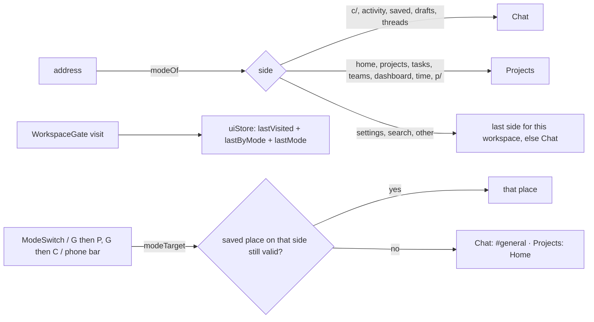
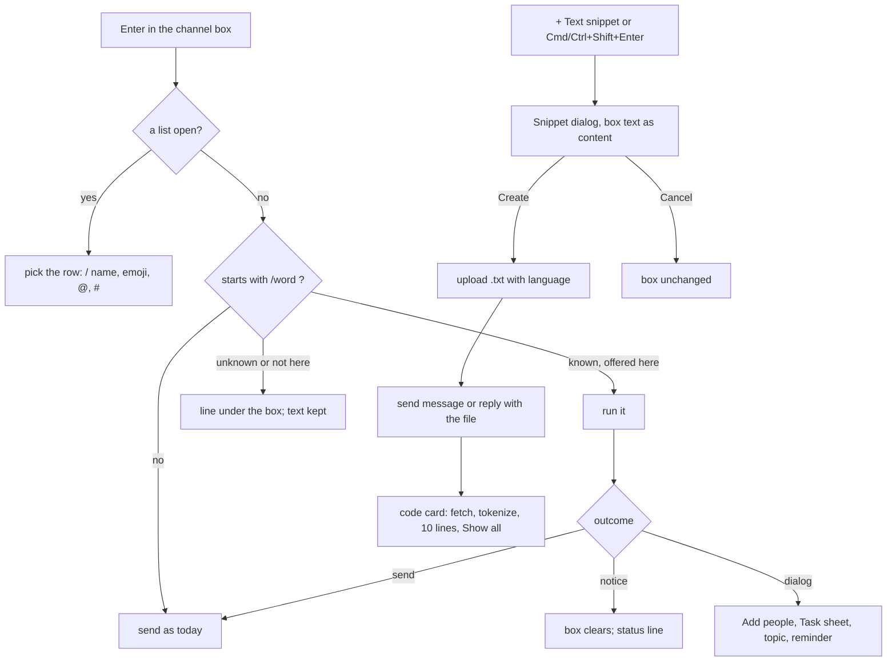
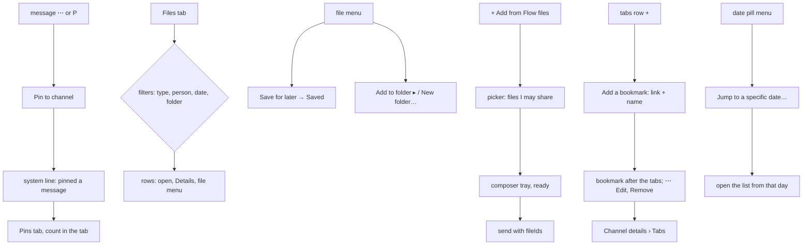
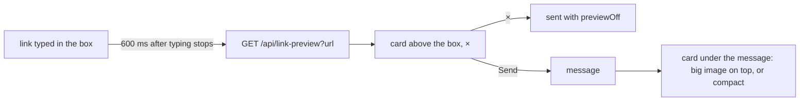
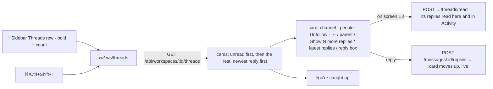
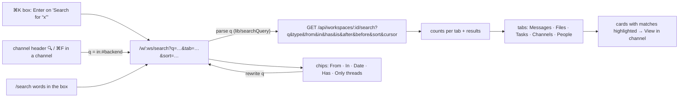
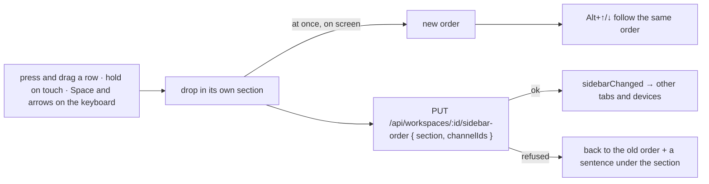
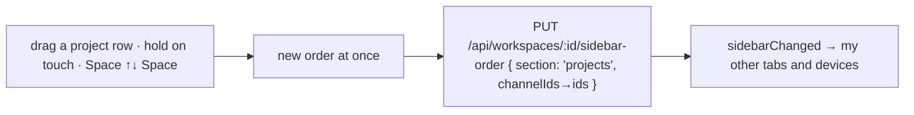
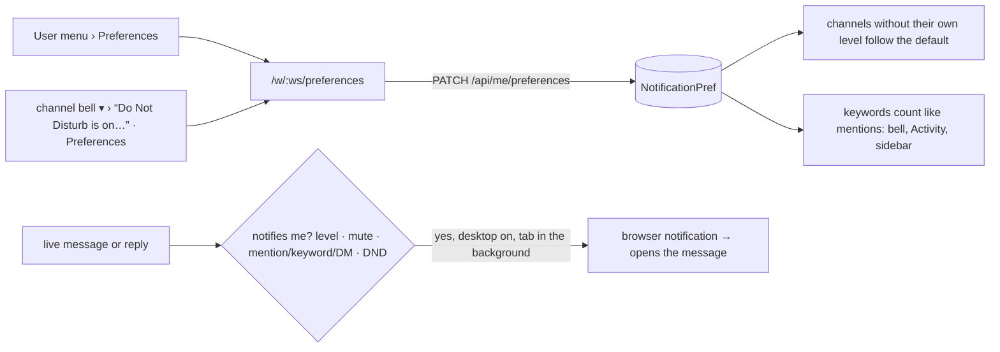
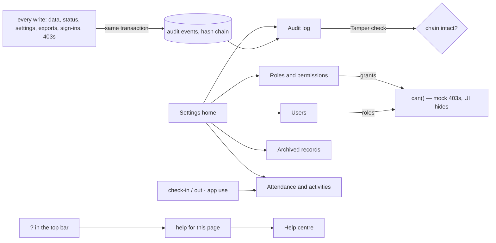

# Scaffold Spark Flow app from the design kit — 2026-10-26 — scaffold

Why: `Spark-Flow-Design-Kit/reference-code/` couldn't run. It's 84 files copied out of Spark CRM that import 84 modules
never included (`api/*`, `mocks/*`, `lib/useRole|useAuth|useMarket`, ~35 pages), with no `tsconfig.json`, root-absolute
imports in `main.tsx`, and a CRM-backend guard in `vite.config.ts`. The kit README says to copy it into a Spark Flow repo.

## Plan

- [x] Scaffold `spark-flow-web/`: package.json (CRM versions), tsconfig trio, vite.config.ts, `public/` from kit assets
- [x] index.html + manifest: Spark Flow name, theme key `spark-flow.theme`
- [x] Copy as-is: `index.css`, `components/ui/*`, `components/charts/*`, `lib/{format,loading,useTheme,sorting,fileTypes}`
- [x] `lib/ThemeProvider.tsx`: storage key `spark-flow.theme`
- [x] Stand-ins: `lib/roles.ts`, `lib/useRole.ts` (sample Management user), `api/notifications.ts` (empty list)
- [x] Layout adapted: AppLayout, Sidebar (logo `FLOW`), TopBar, MobileNav, UserMenu, NotificationsMenu, GlobalSearch + searchShortcuts (pages and actions only)
- [x] Pages: HomePage, PlaceholderPage (Settings)
- [x] main.tsx / router.tsx / navigation.ts (Home + Settings)
- [x] Kit copied to `design/`, `CLAUDE.md` at root
- [x] `npm install`

## Review — scaffold

- `npm run build`: passes (tsc + vite). CSS 52 kB.
- `npm run lint`: clean.
- Playwright on `npm run dev`:
  - 1440px light and dark: dark sidebar with Spark | FLOW, floating rounded panel, top bar search, bell, avatar.
  - Avatar menu → Dark: applied, saved as `spark-flow.theme`, kept after reload, `theme-color` `#1c1c1d`.
  - Search "set" → Settings hit, Enter opens `/settings`.
  - 390px: bottom bar (Home + More), drawer, bell opens as bottom sheet, no horizontal scroll.
  - Console: no errors or warnings.
- Found while verifying: Tailwind v4 scans the whole project, so `design/reference-code` CRM classes doubled the CSS
  (104 kB). Fixed with `@source not '../design'` in `index.css` (the one change to that file). oxlint likewise
  ignores `design/` via `.oxlintrc.json`.

## Left out on purpose — scaffold (copy from `design/reference-code` when the feature arrives)

- Sign-in, View as, change password (needs auth + API): ActivityTracker, ViewingAsBanner, ChangePasswordSheet, lib/api.
- Markets (CRM-only): MarketSwitcher, PhoneInput, lib/phone, Flags.
- Page help panel (needs a guide): PageHelpPanel, PageHelpButton, pageHelpTopics, usePageHelp.
- Uploads and Excel export (need API): FileDrop, UploadGroup, ExportLink.
- Record search in GlobalSearch (needs API).

## Next

- Spark Flow's real sections in `src/navigation.ts`, with their pages.
- Auth + API layer (`lib/api.ts`), then replace the `useRole` stand-in and save the theme on the account.

---

# Phase 1 + 2 — shell and backend-ready data layer — 2026-10-26

Spec: `docs/superpowers/specs/2026-10-26-spark-flow-shell-data-layer-design.md`
Plan: `docs/superpowers/plans/2026-10-26-spark-flow-shell-data-layer.md` (execution: subagent-driven)

## Plan

- [x] Task 0 — Git baseline
- [x] Task 1 — Tooling: `@/` alias, dev proxy, prod guard, Vitest, Zustand
- [x] Task 2 — RTL readiness (logical classes, `dir`, `slide-in-end`)
- [x] Task 3 — Contracts, `ApiError`, mock database
- [x] Task 4 — Seed data
- [x] Task 5 — Realtime interface and mock hub
- [x] Task 6 — Mock API
- [x] Task 7 — `lib/api.ts`, query keys, hooks
- [x] Task 8 — UI store, `RealtimeBridge`, persona from `useMe`
- [x] Task 9 — Routes, landing redirect, sidebar groups, switcher, search, settings
- [x] Task 10 — Channel and project pages, inspector
- [x] Task 11 — CLAUDE.md rules, gates, Playwright run, review

## Review — Phase 1 + 2

### Gates

- `npm test`: 17 files, 135 tests, all pass.
- `npm run build:prototype`: passes (`tsc -b` + `vite build --mode prototype`), main chunk 324.51 kB (100.25 kB gzip).
- `npm run lint`: exit 0, no warnings.
- `npm run build` (no env): fails on purpose with "Production build needs VITE_BACKEND=on and VITE_API_URL." The guard works.

### Browser checks (preview pane on `npm run dev`)

1. 1440 light: `/` → `/w/engineering/c/c-general`. Sidebar groups CHANNELS / DIRECT MESSAGES / PROJECTS. `#frontend-dev` unread pill 3, cleared after opening (markRead). ✓
2. Workspace switcher: check on the current workspace; Spark Design → `/w/design/c/c-design`, sidebar swaps; `/w/nope` → `/` → last workspace. ✓
3. Nexus Core → Board (5 tinted columns, Board | Backlog control); Backlog grouped Active / Planned / No sprint. `/p/NEX` and `/p/NEX/timeline` → `/board`. ✓
4. `?ticket=nex-101` → inspector beside the content at xl, `TICKET · NEX-101`, all fields. `Escape` closes and clears the param. `?ticket=NOPE-1` → "This ticket doesn't exist or was removed." `/p/NOPE/board` → project 404. ✓
5. `?thread=m-g04` → thread inspector docked beside at 1440. The 1100px slide-over was not separately captured.
6. Stale saved place (`/c/c-nope`) then `/` → `#general`. Settings → Reset demo data → `/w/engineering/c/c-general`; `/` again → `#general`. ✓
7. Second tab: `window.__sparkFlowDev.sendMessage` in tab A → tab B on `#backend` shows it without a refresh. Tried 3 times; on the 2nd and 3rd attempts the message appeared live and persisted in storage. ✓
   - ⚠️ On the 1st attempt, right after the second tab was created, the message was written (`sendMessage` returned it with `linkedTicketKeys: ["NEX-101"]`) but was later missing from `localStorage`; a later write did not include it. The same sequence (fresh tab + reload, then send) did not reproduce it. Cause unknown; see Known follow-ups.
8. Dark mode: 375px dark channel page legible. Dark at 1440 was not separately captured for the board and inspector.
9. 375px: bottom bar Chat · Projects · Search · More. No horizontal page scroll on channel, board and backlog (html scrollWidth 375). The inspector bottom sheet renders; its fade-up animation can't be observed because the preview pane freezes `document.timeline` at 0 (environment artifact).
10. `dir="rtl"`: sidebar measures at x 1184–1440 (right side). Verified by measurement, since the screenshot tool shows stale frames.
11. Console: no errors or warnings on any page checked. ✓

Added after the Task 11 review (same preview, 1440 light):

- Check 2: Engineering `#backend` → Design → `/w/engineering` lands on `/w/engineering/c/c-backend` (last place) ✓
- Check 3: after opening Backlog, the sidebar Nexus Core link is `/w/engineering/p/NEX/backlog` (choice remembered) ✓
- Check 4: `?ticket=NEX-101` → Escape closes → browser back reopens `?ticket=NEX-101` with the inspector ✓
- Check 6: reload keeps `/w/engineering/p/NEX/board?ticket=NEX-101`, the ticket is shown, and earlier writes ("Fourth check") are still in storage ✓

Extra: `/w/design/c/c-general` (another workspace's channel) → "This channel doesn't exist or was removed." ✓

### Left out on purpose — Phase 1 + 2

See spec §10 (`docs/superpowers/specs/2026-10-26-spark-flow-shell-data-layer-design.md`). Later phases:

- Phase 3: sending messages, reactions, attachment upload, typing indicators in the UI, simulated colleague messages.
- Phase 4: drag-and-drop, backlog table, filters, create/edit ticket.
- Phase 5: ticket unfurling, message → ticket, discussion tab, command palette, split view.
- Later: sign-in and the real .NET/SignalR connection; Arabic strings, an i18n layer and an Arabic font (the layout is RTL-ready now).

### Known follow-ups

- FileViewer iframe sandbox (security): tighten before it renders untrusted files. Phase 3.
- Lost write across tabs (check 7 ⚠️), explained:
  - Root cause: Chromium caches localStorage per renderer, the mock db writes the whole document, and a fresh tab's mount-time `markRead` wrote its stale copy last, erasing the other tab's message.
  - Mitigation done: the current user's read markers moved out of the document into per-channel keys (`spark-flow.mockdb.v1.read.<channelId>`), so `markRead` never rewrites the document.
  - Phase 3 prerequisite, still open: serialise mock writes across tabs (an IndexedDB transaction, or a single writer tab via `navigator.locks`). Two tabs writing the document at the same moment can still lose one write; Review Focus #2 holds for sequential writes only.
- Before the first production build: load `@/mocks` with a dynamic `import()` behind `backendOn`. Today it ships in the production bundle and opens a BroadcastChannel.
- Extract `backendOn` / `apiUrl` to `lib/env.ts` to remove the `lib/api.ts` ↔ `lib/http.ts` import cycle.
- Before showing the demo: fix the seed narrative contradictions (messages that cite tickets created later, two "tonight 23:00", freeze dates).
- The mock backend's `markRead` triggers a broad refetch; narrow the invalidation.

---

# M0 Foundation — company system — 2026-10-27

Spec: `docs/superpowers/specs/2026-10-26-spark-flow-company-system-design.md`
Plan: `docs/superpowers/plans/2026-10-26-m0-foundation.md` (executed inline)

## Plan

- [x] Task 1 — IndexedDB mock store with memory fallback
- [x] Task 2 — Contracts and roles
- [x] Task 3 — Async MockDb on the store, export/import, legacy localStorage cleanup
- [x] Task 4 — Company-system seed story
- [x] Task 5 — Permissions and View as
- [x] Task 6 — Database page; safe file previews
- [x] Task 7 — Verify, docs

## Review — M0

### Gates
- `npm test`: 168 passed (19 files). `npm run build:prototype`: passes. `npm run lint`: clean.

### Browser checks (preview pane, 1440 light unless noted)
- A browser holding Phase 1+2 localStorage data: legacy keys removed, IndexedDB `spark-flow.mock` created, seed loads, no errors ✓
- View as Salma (Member): Settings hidden; Database page shows "You don't have access to the database." with no actions ✓; back to Youssef (Admin): Settings shown ✓
- Database: Export downloads `spark-flow-export-YYYY-MM-DD.json` that parses (5 projects, 9 users) ✓; Reload seed → `#general` ✓; Reset needs typing "reset", then → `#general` ✓
- Two tabs, the Phase 1+2 lost-write sequence (fresh tab opening #backend while the other tab sends), 3 runs: all 3 messages stored and shown live, read markers kept ✓
- Database page at 375px dark: no sideways scroll ✓; RTL mirrors ✓
- New seed: `#mobile-app` project chat with an `@all` message renders ✓
- FileViewer: covered by unit tests (`safeFileUrl`, `isPdf`); seeded PDF/PNG get a browser check in M1 when the project Files tab exists.

### Left for later milestones
- M1 projects/phases/tasks UI, M2 time, M3 chat writing and mentions UI, M4 dashboard (spec §8).

---

# M1 — Projects & tasks

Plan: `docs/superpowers/plans/2026-10-27-m1-projects-tasks.md` (executed inline)

## Plan

- [x] Task 1 — Project-scoped permissions
- [x] Task 2 — Derived values
- [x] Task 3 — Project, phase, deliverable, task and file APIs
- [x] Task 4 — Projects list and New project
- [x] Task 5 — Project page: header, phases, Overview
- [x] Task 6 — Tasks tab, task form, inspector edits, My tasks
- [x] Task 7 — Chat and Time tabs
- [x] Task 8 — Verify, docs

## Review — M1

### Gates
- `npm test`: 218 passed (32 files). `npm run build:prototype`: passes. `npm run lint`: clean. (Seed reloaded before the checks.)

### Browser checks (preview pane)
1. Admin: Projects shows 4 Engineering rows (the seed's 5th project, BRD, is in Design), tiles Active 2 · Overdue 2 · Due this month 1 · Delivered 1, Cost column ✓. NEX Overview: phases, deliverables, team, files ✓. Tasks board/list; QA chip → 1 task; Sprint 14 → 7; cleared → 10 ✓. New task → NEX-111 listed; renamed through the inspector's Edit task ✓
2. Sales (Karim): New project "Sela kiosk" (key SK, waterfall) → 5 phases, channel `c-p-sk` in the sidebar, no Cost column, no Manage phases ✓
3. PM (Ahmed): NEX has no Edit project or New task; MOB About edited; QA moved up and back; "Hypercare" added and deleted (typed confirm) ✓
4. Member (Tarek): `/projects?new=1` shows no New project and no form; My tasks: MOB-102 (Bug, Overdue), MOB-104 (Overdue), MOB-108; MOB-104 status → In review from the inspector; no Edit task ✓
5. Upload on MOB: swatch.png previews as an image, handover.pdf and the seeded mobile-2.4.0-scope.pdf preview in the frame; a 0-byte file → "That file is empty." ✓
6. `/p/NEX/board` → `tasks?view=board`, `/p/NEX/backlog` → `tasks?view=list`, `/p/NEX` and `/p/NEX/bogus` → `overview` ✓
7. 390px light and dark, LTR and RTL: Projects, NEX Overview, Tasks list, MOB Time, My tasks have no sideways scroll ✓. The TaskSheet's 24px is the pane's frozen slide-in animation (translateX 24), not layout. Phase chips moved to their own row on phones. No console errors after reload ✓
8. Two tabs: a task created in tab A appeared on tab B's board without a reload ✓

### Left for later milestones
- M2 time logging (timer, manual), M3 chat writing and mentions, M4 dashboard.

---

# M2 — Time

Plan: `docs/superpowers/plans/2026-10-27-m2-time.md` (executed inline)

## Plan

- [x] Task 1 — Time API: check-in, one running timer, manual entries
- [x] Task 2 — Rates API and the Hourly cost page
- [x] Task 3 — Time hooks, live clock and the timer bar
- [x] Task 4 — Add time, and timer controls on tasks
- [x] Task 5 — Home / My day, and its navigation
- [x] Task 6 — Verify, docs

## Review — M2

### Gates
- `npm test`: 248 passed. `npm run build:prototype`: passes. `npm run lint`: clean. Seed reloaded before the checks.

### Browser checks (preview pane; it was about 1:30 AM locally, so manual time went on yesterday)
1. Admin: `/` → `/w/engineering` Home, lit in the sidebar ✓. Checked in with a plan ✓. Start timer on NEX-101 (pill NEX-101), then NEX-102 → pill NEX-102 and NEX-101's entry closed ✓. Add time 07:00–08:00 yesterday on NEX ✓; the same window again → "That overlaps time you already logged." ✓. Check out → "Checked out at 1:29 AM" ✓. NEX on Projects 115h · EGP 38,200 → 116h · EGP 38,854 ✓
2. Member (Tarek) at 390px: checked in with MOB-104; the phone timer bar sits right above the bottom nav (bar 744–788, nav from 787) and `--timer-bar` is set ✓; bottom bar is Home · Projects · Chat · More ✓; `/settings/rates` → "You don't have access to hourly costs." ✓. As Ahmed (PM) on MOB, the RecordHeader action bar ends exactly where the timer bar starts (744) ✓. A done task (MOB-101, MOB-105) has no Start timer ✓
3. Admin, Hourly cost: Mariam 300 → 500 saved; NEX cost EGP 38,854 → 46,354 (her 37.5 h × 200) ✓
4. Two tabs: tab B showed tab A's running MOB-103; starting MOB-102 in tab B moved tab A's bar to MOB-102 without a reload ✓
5. Reload with a timer running: the clock went on from its true start (0:00:16 after a reload at ~0:00:10), not from zero ✓
6. 390px, light and dark, LTR and RTL: Home, Hourly cost and Add time have no sideways scroll ✓ (Home first overflowed by 132px: grid columns got `min-w-0`). No console errors ✓
   - Found and fixed: a timer started after check-out was hidden on the checked-out card (it now shows with Stop); on a 1024px desktop the pill squeezed the search box (the task title now shows from `xl`; key and clock always).

### Left for later milestones
- M3 chat writing, mentions and the Home mentions card; M4 dashboard (checked in now) and Time & cost page.

---

# M3 — Collaboration

Plan: `docs/superpowers/plans/2026-10-28-m3-collaboration.md` (executed inline)

## Plan

- [x] Task 1 — M2 carry-over fixes (midnight entries, live clocks, timer a11y, Settings)
- [x] Task 2 — Chat send and reply with parsed mentions
- [x] Task 3 — Composer, mention autocomplete and chips
- [x] Task 4 — Comments and bugs: API, task Activity, chat cards
- [x] Task 5 — Mentions in the bell and on Home
- [x] Task 6 — Verify, docs

## Review — M3

### Gates
- `npm test`: 279 passed. `npm run build:prototype`: passes. `npm run lint`: clean. Seed reloaded before the checks.

### Browser checks (preview pane)
1. Admin in `#general`: typed `@no` → Nour (Enter), `@NEX-101` (Tab), `@NEX` (Tab), sent → person chip, task chip (`?ticket=NEX-101`), project chip (`/p/NEX/overview`) ✓; Shift+Enter makes a new line ✓
2. Nour: bell "2 unread" with "Youssef Abdelrahman mentioned you" first ✓; clicking it opened `#general` and the count went to 1 ✓; Home's Mentions card lists it ✓. Nour replied in the `m-g01` thread with `@all` → Mariam's bell has "Nour El-Sayed mentioned you · @all token rotation ships Thursday.", and it opens the thread ✓
3. Salma on NEX-105 → Activity: a Bug with repro.png + steps.pdf and `@Mariam` from the popup → image thumbnail, file row, chip ✓; a second comment with screen.mp4 plays in a `<video controls>` ✓ (found: video types weren't accepted — added MP4/WebM/MOV); a 0-byte file → "That file is empty.", nothing posted ✓. `#nexus-core` shows both cards (Bug, Comment) with NEX-105 links ✓. Mariam's bell has Salma's bug first ✓
4. Tarek (not on NEX): `#nexus-core` has no composer, shows "You can read this channel. Only its project's people can write here." ✓; NEX-101 Activity shows "Only the project's people can comment here." ✓
5. Two tabs: a message sent in tab A appeared in tab B live ✓. (Both tabs share one demo persona, so a cross-tab bell bump can't be staged; the bell's refresh on message/reply/comment events is covered by `keysForEvent`.)
6. `<b>plain</b>` shows as literal text ✓. 390px dark, LTR and RTL: `#general`, NEX Chat tab, Home and the Activity panel have no sideways scroll ✓; the `@` popup opens above the composer ✓. A fresh tab through chat, Activity, Home and the bell has no console errors ✓

### Left for later milestones
- M4: dashboard (checked in now), Time & cost page, demo polish and the final review.

---

# M4 — Manager and polish

Plan: `docs/superpowers/plans/2026-10-28-m4-manager-polish.md` (executed inline). Demo script: `docs/demo-script.md`.

## Plan

- [x] Task 1 — Dashboard API with per-role scope
- [x] Task 2 — Dashboard page and the MANAGE group
- [x] Task 3 — Time & cost report
- [x] Task 4 — Teams page and the live demo seed
- [x] Task 5 — Polish for Thursday
- [x] Task 6 — End-to-end pass, docs

## Review — M4

### Gates
- `npm test`: 305 passed. `npm run build:prototype`: passes. `npm run lint`: clean. Seed reloaded before the pass.

### End-to-end (preview pane; it was about 2:40 AM locally)
1. Story 1: Karim created "Sela kiosk" (key SK, Ahmed PM, Tarek on it) → 5 phases ✓; Back from the new project returned to Projects without the form ✓. Ahmed added SK-101 (due 15 Nov) and SK-102 (6 h) for Tarek ✓. Tarek checked in on SK-101 (pill SK-101) and added 1 h on SK-102 ✓. Ahmed's Dashboard: SK "1h of 6h", TL 1h in the last 7 days, Tarek under Checked in now ✓. Found and fixed: a checked-in person on a project outside the PM's scope showed "—" for their task (Hossam on NEX); it now names the task.
2. Story 2: Salma checked in, started NEX-105 from its panel (the check-in picker lists only her own tasks), reported a Bug with board.png and @Mariam → card with image in #nexus-core, Mariam's bell "Salma Ibrahim mentioned you" ✓; started NEX-108 (pill moved), checked out → "Checked out at 2:43 AM" with both entries ✓
3. Admin Dashboard: 5 projects (with SK), NEX cost, Checked in now: Tarek, Hossam, Mariam, Nour ✓
4. Time & cost: 7/30/90 days tiles 184.2h/229.2h/229.2h; By project and By person sum to the same within display rounding (0.1h) ✓; By week chart titled by the peak week ✓; Edit hourly costs → Hossam 900 → 30-day cost EGP 75.6K → 98K ✓
5. Access: Sales has Dashboard (no cost, no Checked in now list), no Time & cost; Nour (PM) sees "The projects you manage."; Tarek (Member) gets both denial sentences and only Teams in the nav ✓
6. Polish: Back after create ✓, Escape keeps the @ list shut ✓, private DM read-only wording ✓, screenshot-only bug ✓ (others covered by unit tests; HEIC/MOV fallback and the per-channel send error weren't exercised in the browser)
7. 390px dark, LTR and RTL: Dashboard, Time & cost (project and week) and Teams have no sideways scroll ✓. Two tabs: Admin checked in in tab A → tab B's Dashboard listed Youssef live ✓; fresh tab, no console errors ✓

# Flow chat — Phase 1 keyboard shortcuts (spec §10) — 2026-10-28 — done

Scope: Alt+↑/↓, Alt+Shift+↑/↓, Esc, Shift+Esc, U (with a Mark unread menu item) and L on a focused message.

## Plan

- [x] `channelKeys.ts`: `sidebarOrder` (Starred, Channels, DMs), `stepChannel` (no wrap; unread = bold row), `channelKey`
- [x] `useChannelKeys.ts`: one `keydown` listener on `window`, after every document-level layer; skips prevented keys, open `aria-modal` dialogs and IME composing; Esc and Shift+Esc skip typing in fields other than the channel composer (`data-channel-composer`)
- [x] `ChannelShortcuts.tsx`: wires the keys on the channel page; Alt+↑/↓ navigate with `{ focus: 'composer' }` state, the new channel's composer takes focus (`RichComposer autoFocus`); Shift+Esc confirm `MarkAllReadModal` (`useMarkAllRead`, one `/read` per unread channel)
- [x] Mark unread route: `POST /api/channels/:id/unread { seq }` in contract, types, http, mock (`seq - 1`, either way, 400 outside 1..lastSeq), `useMarkUnread`
- [x] `readState.ts`: `useReadHold` (one held channel), `useReadHoldScope` (ends on leaving the channel, not on tab switch), `useChannelReadState` (New line moves to `seq - 1`; marking read myself ends the hold); `MessageList holdRead` stops auto-read
- [x] U and L in `ChannelMessage` (status line under the message: "Marked unread", "Link copied", failures stay); "Mark unread" item with `aria-keyshortcuts="U"` in `MessageActions`
- [x] Esc ownership: `MenuPanel` and the Inspector `preventDefault()` the Esc they use, so one Esc doesn't also mark the channel read
- [x] Tests first: channelKeys, useChannelKeys, readState, ChannelShortcuts (modal), ChannelMessage (U, L), MessageList (held read), RichComposer (autoFocus), mock + http (route), a11y (modal, menu)

## Review — keyboard shortcuts

- `npm test`: 939/939 (103 files). `tsc -b`, lint, `build:prototype` pass.
- Watched RED first for each: route (`markUnread is not a function`), held read (`onMarkRead` called once without the change), ⋯ menu Esc (marked read without `MenuPanel` fix), U/L, modal, autoFocus.
- In the app (1280px): U on Mariam's message in #frontend-dev → New line above it, "Marked unread", row bold; at the end with focus it stays unread; Esc marks it read; Alt+↓ → #general with the caret in the composer; Alt+Shift+↓ skips read #release-v2 to the unread DM; Shift+Esc asks "Mark everything read?" and marks it read; ⋯ menu shows "Mark unread U".
- Not verified in the app: L's success path (the browser pane refuses clipboard writes; the header's Copy link fails the same way there). Covered by tests.
- Rulings: U only on someone else's message (mine never count as unread); U moves the marker either way, like Slack; Alt moves don't wrap; Alt+↑/↓ work while typing; Shift+Esc confirms first and includes muted channels; muted channels are skipped by Alt+Shift; Esc does nothing when the channel has nothing unread.
- Seen, not changed: the ⋯ menu on the last message opens downward and is cut off by the composer (existing; the new item makes it a row taller). Shift+Esc right after U can miss the channel until its unread count has refreshed.

# Flow chat — ⋯ menu on the last message opens upward — 2026-10-28 — done

- [x] Test first (`src/components/ui/Menu.browser.test.tsx`, Chromium, 1280px): opens below with room; on the last row of a scrolling list it opens upward inside the list, the list doesn't scroll and focus is on the first item; near the window's bottom it opens upward. RED: both opened downward and the list scrolled ~39px to the focused item.
- [x] `MenuPanel` (desktop): measures the room above and below its trigger inside the window and every ancestor that scrolls or clips (`roomAround`); opens upward (`bottom-full mb-2`) when it doesn't fit below and there's more room above. Focus moves to the first item only once placed, so it never scrolls the list. Phones keep the bottom sheet.

## Review — ⋯ menu

- `npm test`: 942/942 (104 files). Lint and `build:prototype` (with `tsc -b`) pass.
- In the app (1280px, #general scrolled to the end): the last message's ⋯ (trigger 514–546) opens its menu at 340–507, inside the list (156–644) and clear of the composer; list scrollTop unchanged; focus on the first reaction. A row near the top still opens below. Phone (375px): bottom sheet as before.
- Ruling: the flip is in the shared `MenuPanel`, so every menu near the bottom of a list or the window gets it (time entries, comments, rows); top-bar menus always have room below, so they don't change.
- Seen, not changed: the error note under the ⋯ (react or delete failed) still opens downward and can be cut off on the last row. In the phone emulation the bottom sheet ends 6px below the window, the same before this change.

# Flow chat — review of the work since the Phase 1 fix pass — 2026-10-28 — done

Range `0e6a9a6..e1cbc21` (pinch zoom, 16px phone text, keyboard shortcuts with Mark unread, the menu flip). One fresh reviewer: no Critical, 3 Important, 8 Minor. Verdict "with fixes".

## Fixed (each RED → GREEN)

- [x] Alt+↑ from an empty channel composer opened my last message for editing instead of the previous channel (Lexical sends Alt+↑ as Up; KeysPlugin's "Up in an empty box" took it). Up with Alt, Shift, Ctrl or Meta is now left to the page. Test: `RichComposer.browser.test.tsx` "leaves Up with Alt, Shift, Ctrl or Meta to the page" (RED: edit opened twice).
- [x] One Esc closed an image preview and also marked the channel read (with a real key the preview is gone before the page's listener checks for a dialog). `useChannelKeys` now notes whether a dialog was open in the capture phase, before any listener runs. Test: `useChannelKeys.browser.test.tsx` with real keys (RED: marked read once).
- [x] Alt+↑/↓ while typing a thread reply or an inline edit moved to another channel and lost the text (those fields have no draft). The channel keys now follow one rule: from the page or the channel composer, not while typing in another field. Test: `useChannelKeys.test.tsx` "not while typing in another field" (RED: the key was taken).

## Review — fix pass

- `npm test`: 945/945 (105 files). Lint and `build:prototype` (with `tsc -b`) pass.
- In the app (1280px, real keys): Alt+↑ in the empty #general composer → #frontend-dev, no edit opened; Alt+↓ while typing in a thread reply → stays, reply kept. The image preview case is covered by the real-key browser test only: no seeded message has an image and uploads come with Phase 2.
- Ruling changed: "Alt+↑/↓ work while typing" is now "only from the page or the channel composer" (reviewer: it lost replies and edits).
- Deferred minors: a failed U releases the hold from an earlier successful U; Esc right after U (count not refreshed yet) does nothing and leaves the hold; no ⋯ (so no Mark unread item) where I can't react, edit, delete or create tasks; U and L leave the desktop ⋯ menu open and holding U repeats the request; a partial Shift+Esc failure leaves holds for the channels that succeeded; Esc on a ⋯ menu inside the thread panel also closes the panel (existing); a menu that flips upward isn't capped to the room above; every row renders an empty `role="status"`.

# Flow chat — the 8 deferred minors from the review — 2026-10-28 — done

Each test written first and watched fail (the one guard that already passed is noted).

- [x] A refused U after one that went through dropped the first hold. U now remembers whether the channel was already held and only releases its own. Test: `readState.test.tsx` "a refused U after one that went through keeps the first hold".
- [x] Esc right after U (unread count not refreshed yet) did nothing and left the hold on; a held channel whose U'd message was deleted could never be released. `markOpenChannelRead` marks a held channel read even at 0 and always ends the hold; with nothing unread and nothing held it sends nothing. Tests: `readState.test.tsx` "Esc: markOpenChannelRead".
- [x] Where I can't react, edit, delete or create tasks there was no ⋯, so no Mark unread item. `MessageActions` now also shows for Mark unread alone. Test: `MessageActions.test.tsx` "is offered even where I can do nothing else".
- [x] U and L acted inside the open desktop ⋯ menu and left it open; a held U sent a request per repeat. The row ignores repeats and keys from inside its menu; `MenuPanel` picks the item that names the letter in `aria-keyshortcuts` (U → Mark unread, which closes the menu). Tests: `ChannelMessage.test.tsx` "holding U down marks it unread once", "in the open ⋯ menu, U picks Mark unread".
- [x] A partial Shift+Esc failure left holds on the channels that went through and refreshed nothing. `useMarkAllRead` throws `MarkAllReadError` with `failedIds` and refreshes on error; the dialog releases every hold but the failed ones. Tests: `ChannelShortcuts.test.tsx` "the ones that went through end their hold, and everything refreshes" (RED); "a channel that failed keeps its hold" (guard, passed before and after).
- [x] Esc on a ⋯ menu in the thread panel also closed the panel (existing). The Inspector leaves Esc to an open menu, as it does to a dialog. Test: `useChannelKeys.test.tsx` "Esc with a ⋯ menu open in the thread panel is the menu's".
- [x] A menu that flips upward could still run past the top of a short box. `MenuPanel` caps its height at the room on the side it opens to (8px from the edge, at least one item, never over 80vh). Test: `Menu.browser.test.tsx` "with little room either way".
- [x] Every row rendered an empty `role="status"`. One shared `Announcer` (`components/sf/Announcer.tsx`, mounted in `AppLayout`) reads notes out; the row shows its note only while there is one. Tests: `Announcer.test.tsx`; `ChannelMessage.test.tsx` "a row has no live region of its own".

## Review — minors

- `npm test`: 959/959 (106 files). Lint and `build:prototype` (with `tsc -b`) pass.
- In the app (1280px, real keys): ⋯ open on Salma's message in #frontend-dev, U → menu closed, "Marked unread" under it, read out once through the shared region, New line moved; Esc → row no longer bold. Thread panel: ⋯ open on a reply, Esc → only the menu closed, panel stayed, focus back on its ⋯. The page has 3 status regions in all, none per row.
- Ruling: the shared announcer is mounted once in the shell; a note shown in a row is plain text now, read out through it.

# Flow chat — Phase 2 slice 1: message toolbar and ⋯ menu (spec 6.4, 6.5) — 2026-10-28 — done

Approved scope: the toolbar and the ⋯ menu on the sf Menu with today's actions, plus T (Reply in thread) and Copy text. No server changes. Hidden until their own slices: Get notified about replies (threads), Pin, Save for later, Forward. Remind me is Phase 3; the AI action is OPEN (spec 13).

## Plan

- [x] `src/lib/roomAround.ts`: the room above and below an element inside everything that clips it (moved out of `components/ui/Menu`, shared with the toolbar). `menuItemClass` moves to `components/ui/Menu` (RowMenu, CommentRow use it; the chat no longer does).
- [x] sf `MenuItem` gets `shortcut` (hint + `aria-keyshortcuts`); in the menu, a letter that is an item's shortcut picks it before the letter jump.
- [x] `MessageActions.tsx`: More (⋮) + sf Menu in spec order: Mark unread (U) · — · Create task · Copy link (L) · Copy text · — · Edit (E) · Delete (danger). Separators only between groups that have items. The delete flow (Undo toast, confirm, focus after delete) stays.
- [x] `MessageToolbar.tsx`: `role="toolbar"` "Message actions", one Tab stop per row (←/→, Home/End move along it), ✅ 👀 🙌 (pressed when mine; a toggle), Add reaction (emoji picker, adds only), Reply in thread (T; top-level messages outside their own thread), More. Shown while the row is hovered or has focus, and while its menu or picker is open; hidden, it takes no pointer. 16px above the row's top end; inside the row when there's no room above it (the top row of the list or the panel).
- [x] Phones (below 768px): no toolbar; the ⋯ stays and its sheet starts with ✅ 👀 🙌, Add reaction and Reply in thread, then the menu.
- [x] `ChannelMessage`: renders the toolbar; T opens the thread with the reply box focused; Copy text copies the message as plain text ("Text copied" / "Couldn't copy the text"); after an edit or a delete, focus goes back to the row's toolbar.
- [x] `ThreadInspector` + `Composer` `autoFocus`: opened by Reply in thread or T, the reply box takes focus, also when that thread is already open.
- [x] `useTaskFromMessage`: Create task as an sf `MenuItem`.
- [x] Tests first: sf Menu shortcut letters; MessageActions (order, separators, hints, delete flow); MessageToolbar (roving keys, buttons, pressed, T, no Reply on replies); ChannelMessage (Copy text, T, focus back); ThreadInspector focus; browser: the toolbar isn't clipped on the top row and stays while its menu is open; axe on the toolbar and the menu.

Rulings approved with the plan: the quick reactions are fixed to ✅ 👀 🙌 (spec: "later: the viewer's three most recent"); Create task stays on project channels with the project set (the spec's project picker needs `POST /tasks/from-message`); the desktop menu has no emoji row (the toolbar carries reactions); Copy text copies the message as plain text.

## Review — slice 1

- `npm test`: 986/986 (108 files). Lint and `build:prototype` (with `tsc -b`) pass.
- Watched RED first: sf Menu shortcut letters (`aria-keyshortcuts` null); MessageMenu, MessageToolbar and useReplyFocus (modules missing); ChannelMessage (no More actions, no Reply in thread, no Copy text); the placement and stay-open browser tests fail with the inside/`has-[aria-expanded]` code taken out; the sheet's missing row keys (a React warning).
- In the app, 1280px, real keys: hovering Salma's message in #frontend-dev shows ✅ 👀 🙌, Add reaction | Reply in thread, More above its top end; More opens Mark unread (U) · — · Copy link (L) · Copy text · — · Delete (Admin), and the toolbar stays while it's open; Esc closes it back to More; ← moves to Reply in thread (tooltip "Reply in thread T") and the Tab stop follows; T opens the thread with the reply box focused. The thread's root has no Reply in thread. Dark theme looks right (checked by adding the `dark` class; the app has no theme toggle yet) and axe passes in both themes.
- 390px: no toolbar, ⋯ on every row, no sideways scroll; the sheet reads ✅ 👀 🙌, Add reaction, Reply in thread, then the menu; Add reaction opens the picker sheet with search focused.
- Rulings: More is the row's first Tab stop (the old ⋯ was the row's focus target, and Enter on a reaction by accident is worse); the arrows wrap, like the sf Menu; in the menu an item's own letter picks it (L picks Copy link, U Mark unread, E Edit), other letters jump; on phones the picker opens from a visually hidden trigger in the row, which is where focus goes when the picker closes; `menuItemClass` moved to `components/ui/Menu` (RowMenu, CommentRow) and `roomAround` to `lib/roomAround.ts`.
- Not verified in the app: Copy text's success (the browser pane refuses clipboard writes; tests cover it).

# Flow chat — review of Phase 2 slice 1 — 2026-10-28 — done

Range `592aaca..c6861c6`. One fresh reviewer: no Critical, 3 Important, 9 Minor. Verdict "with fixes". Re-graded M1 (a mouse click left that row's toolbar showing, two at once) to Important: it happens on every mouse reaction.

## Fixed (each RED → GREEN)

- [x] I1 — in the 384px thread panel the toolbar covered the reply's time, and long author names. `placeToolbar` keeps the spec's 16px rise when it hides neither the name nor the time (`data-row-header`), else puts it fully above the row, else inside, under the name line. Test: `a11y.browser.test.tsx` "in the thread panel (384px) it never covers the author name or the time" (RED: [true, true]).
- [x] I2 — in the thread panel, one Esc in the emoji picker's grid closed the picker and the whole panel. The panel's Esc now yields while any sf layer (menu, picker, tooltip, dialog) is open (`hasOpenLayer`), and sees a dialog as it was when the key went down (`lib/keyStart.ts`, shared with `useChannelKeys`). It stays on the document so it still runs before the channel's keys (on window). Tests: `layout/Inspector.browser.test.tsx` with real keys: picker (RED: panel closed), image preview (guard), and "closes the panel and doesn't also mark the channel read" (RED for a window listener, which I tried first).
- [x] I3 — on touch screens of 768px and up with no hover (tablets) no message action could be reached. `useNoHover` (`(hover: none)`) sends them to the ⋯ path like phones. Test: `MessageToolbar.test.tsx` "on a touch screen with no hover" (RED: the toolbar rendered).
- [x] M1 — keyboard focus shows the toolbar (`group-has-[:focus-visible]`), a mouse click doesn't pin it. Tests: "a mouse click doesn't keep a row's toolbar showing" (RED: '1'), "keyboard focus in the row shows it" (guard).

## Review — fix pass

- `npm test`: 993/993 (109 files). Lint and `build:prototype` (with `tsc -b`) pass.
- In the app (1280px): in the thread panel, the root's toolbar sits under its name line (no room above) and the replies' toolbars sit fully above their rows; no name or time is covered. Esc in the picker opened from a reply's toolbar closed only the picker; the thread stayed open with focus back on Add reaction. (A script's `.focus()` fires no `focusin` while the pane isn't the focused window; the checks dispatched it or used real hovers.)
- Not checked in the app: a real tablet without hover (covered by the unit test).
- Deferred minors: M2 typing "de" toward Delete picks Edit (E is a shortcut letter); M3 the phone ⋯ is 32px, under 6.16's 44px (existing size); M4 on phones the picker closes onto the invisible Add reaction button, a duplicate screen-reader stop per row; M5 Reply in thread and T are offered where I can't post (the thread opens without a reply box); M6 T or Reply on the thread already open adds a history entry; M7 `useReplyFocus` can miss the caret if the reply box mounts after its wrapper on a cold load; M8 the unread bar can cover the top rows' raised toolbars; M9 the delete error sits inside the hidden toolbar and hides with it (existing).

# Flow chat — the 8 deferred minors from the slice 1 review — 2026-10-28 — done

Each test written first and watched fail.

- [x] M2 — typing "de" toward Delete picked Edit (E is its key). In the sf Menu a shortcut letter picks its item unless it continues a typed prefix of an item's name. Test: `layers.test.tsx` "typing on toward an item".
- [x] M3 — the phone ⋯ was a 32px target. It keeps its 32px look with a 44px touch area (`after:-inset-1.5`, spec 6.16). Test: `a11y.browser.test.tsx` "on a phone the ⋯ answers a 44px touch" (RED with the class taken out).
- [x] M4 — on phones the picker closed onto an invisible "Add reaction" button, a duplicate screen-reader stop per row. It's `aria-hidden` now and passes focus straight on to the ⋯. Test: `MessageToolbar.test.tsx` "closing it puts focus back on the ⋯".
- [x] M5 — Reply in thread and T were offered where I can't post (a thread with no reply box). Now only where I may post; the thread summary still opens threads to read. Test: `ChannelMessage.test.tsx` "where I may not post there is no Reply in thread".
- [x] M6 — T or Reply on the thread already open added a history step. It replaces then; another thread is still a new step. Tests: "on the thread already open … without adding to the history", "another thread is a new step".
- [x] M7 — the reply box could miss the caret when it came after its wrapper (cold load). `useReplyFocus` waits for it (MutationObserver). Test: `useReplyFocus.test.tsx` "a reply box that comes after the thread has loaded".
- [x] M8 — the unread bar (and the day pill) could cover the top rows' raised toolbars. They're marked `data-list-overlay`; `placeToolbar` keeps below them. Test: `a11y.browser.test.tsx` "it keeps clear of a bar laid over the list" (RED: 20 < 56).
- [x] M9 — a refused delete's message sat inside the hidden toolbar and hid with it. `MessageMenu` reports it (`onDeleteError`) and the toolbar shows it outside itself. Test: `MessageToolbar.test.tsx` "a delete the server refuses".

## Review — minors

- `npm test`: 1001/1001 (109 files). Lint and `build:prototype` (with `tsc -b`) pass.
- Not seen in the app: the unread bar case (the pane runs as a background page, so the list never positions itself and the bar doesn't come up after a fresh load); covered by the browser test.
- Asked along the way: several emoji per message is by design (spec 6.6: one reaction per person per emoji, up to 50 per message). After Mark unread, coming back keeps it unread until its newest message is on screen in a focused window, or Esc / Mark as read (spec 6.2); Slack's default marks a channel read on opening. Both are open for the user to change.

# Flow chat — opening a channel marks it read (spec 6.2 change) — 2026-10-28 — done

Approved: opening a channel marks it read at once, like Slack, while still starting at the New line. No new route.

## Plan

- [x] `readState.ts` `useChannelReadState`: when the Messages tab opens, mark the channel read up to its newest message at opening (`POST /api/channels/:id/read { seq: lastSeq }`), once per visit; not when the channel is held by U (a tab switch inside it) or has nothing unread; a page opened in the background waits until it's shown. Returns `readOnOpen` (that seq, or null).
- [x] `ChannelPage` PaneFeed: the New line (`newAfterSeq`) and the unread count stay as they were at opening; the list is told about the mark (`markedSeq` = the larger of the marker and `readOnOpen`) so it doesn't send it again.
- [x] `MessageList` unread bar: "N new messages since 9:03 PM · Mark as unread" (was Mark as read): the first message after the New line goes back to unread through Mark unread, held until I leave; the bar goes.
- [x] Spec 6.2 and the API contract say so.
- [x] Tests first: readState (marks once up to lastSeq, the New line stays; nothing unread; held; hidden page waits), MessageList (the bar's Mark as unread, on the first new message).

Rulings approved with the plan: a permalink or a date jump opens the channel too, so it's marked read; opening straight onto Files or Pins waits for the Messages tab; muted channels follow the same rule; messages that come in while I'm in the channel keep the old rule (read once the newest is on screen in a focused window).

## Review — mark read on open

- `npm test`: 1006/1006 (109 files). Lint and `build:prototype` (with `tsc -b`) pass.
- Watched RED first: readState (no call to `markRead('c1', 9)`; `readOnOpen` undefined), MessageList (the bar still said Mark as read).
- In the app: #frontend-dev, unread at 11: opening it marked it read (17), its sidebar row stopped being bold, and the New line still showed. Mark unread on a message (marker 0), Files tab and back: still 0 (held). Leaving and coming back: 17.
- Not seen in the app: the bar's Mark as unread (the pane runs as a background page and the bar doesn't come up there; covered by the browser test).
- Seen, not changed: the project's Chat tab (`ChannelFeed`) has its own read handling and isn't part of this change.

# Flow chat — Phase 2 slice 2: threads (spec 6.7) — 2026-10-28 — done

Approved: part A (following and the panel header menu), then part B (the rich thread composer, Also send to #channel, broadcast replies), with the contract updated.

## Plan

Part A — following
- [x] Data: `threadFollows` (person, root, following: my explicit choice), DB_VERSION 11 with its migration; `following` on every message read, worked out per person: my choice, else the author, anyone who replied, anyone mentioned (by name) in the root or a reply. Replying, or a new mention, clears my choice (I follow again).
- [x] Routes: `PUT` / `DELETE /api/messages/:id/follow` → 204 (the thread's root only; read access); `messageChanged` live. Api `setFollowing(messageId, following)`, http, `useSetFollowing`.
- [x] ⋯ menu, first item on top-level messages: "Get notified about replies" / "Turn off notifications for replies" while following.
- [x] Thread panel header ⋮ (sf Menu): Copy link, the same follow item, Open in a new window. `InspectorFrame` gets an `actions` slot.

Part B — replies
- [x] Reply route `POST /api/messages/:id/replies { content, body?, alsoInChannel? }`: rich text; with `alsoInChannel` it also takes the channel's next seq (one record: the reply). Channel pages list it as a message with `broadcast: { rootId, rootText }`, its id the reply's; its edits, deletes and reactions go to `/api/replies/:id`. Counts as unread like any message. `replyReceived` carries `alsoInChannel`.
- [x] Thread composer: the rich composer with its formatting row hidden until Aa, a draft per thread, and "Also send to #channel" (a DM: "Also send to <name>"), unchecked each time.
- [x] Channel: a broadcast reply reads "replied to a thread: <first line>" (a link to the thread), stands alone (no grouping); its toolbar acts on the reply, Reply in thread opens its root's thread.
- [x] Panel: a broadcast reply shows "↪ Also sent to #channel".
- [x] Contract (`docs/flow-chat/api-contract.md`): the routes, fields and events above.
- [x] Tests first: mock (follow rules, broadcast seq / unread / one record), http, migration; menus, header menu, composer checkbox, the broadcast row and label; axe on the header menu and the thread composer.

Rulings approved with the plan: one record for a broadcast reply; following is stored and shown, not yet delivered (bell, Activity, Threads come later); no Mute in the header menu; the panel stays 384px; the same wording for following everywhere.

## Review — threads slice

- `npm test`: 1045/1045 (111 files). Lint and `build:prototype` (with `tsc -b`) pass.
- Watched RED first: part A: `setFollowing is not a function`, `following` undefined, migration null; the menu item and the header menu missing. Part B: no `alsoInChannel` / `seq`, the reply not in the channel's list, rich body ignored, nested replies allowed; the composer's formatting row shown, no ThreadComposer, no "replied to a thread:", reactions on the message route, no "Also sent to".
- In the app: the database moved to version 11 on load. The thread panel's ⋮ shows Copy link, Get notified about replies, Open in a new window, and following flips its label. The thread composer has no formatting row (Aa shows it) and "Also send to #frontend-dev"; a reply sent with it showed in the channel as "replied to a thread: Bug: a long ticket title…", with a link to the thread, and in the panel with "↪ Also sent to #frontend-dev"; the box came back unchecked.
- Fixed along the way: the "L copies the link … then clears" test could miss its timer under load (it now lets the note's effect start the timer first).
- Not changed: the project's Chat tab still uses the old plain composer for its own messages; following doesn't notify yet (bell, Activity, Threads come later).

# Flow chat — review of Phase 2 slice 2 (threads) — 2026-10-28 — done

Range `1819445..52de4fc`. One fresh reviewer: no Critical, 2 Important, 6 Minor. Verdict "with fixes". Re-graded M2 (the contract contradicted the mock) to Important: the .NET team builds from it.

## Fixed

- [x] I1 — once anyone followed a thread, an export no longer imported ("That file isn't a Spark Flow export."), and the next DB_VERSION bump would have reseeded the mock database: the records check wanted an `id`. A thread follow is now checked by its person and thread. Tests: `db.test.ts` "thread follows survive an export and an import" (RED), "a follow without its person or thread is refused on import" (guard).
- [x] I2 — a broadcast reply opened two edit boxes (channel row and thread panel share its id), and an edit in the panel scrolled the channel. The editing store keeps the place too (`channel` / `thread`); the list only follows the channel's. Tests: `ChannelMessage.test.tsx` "edited where I started" (RED: the panel row lost its toolbar), `MessageList.browser.test.tsx` "an edit started in the thread panel doesn't move the channel" (RED: 199 ≠ 814).
- [x] M2 — the contract now says what the mock does: `following` on top-level messages only, and for a broadcast id `GET` returns it, its replies are `[]`, writes through `/api/messages/:id` are `404`, replying or following is `400`. (Text only.)

## Review — fix pass

- `npm test`: 1049/1049 (111 files). Lint and `build:prototype` (with `tsc -b`) pass.
- In the app: with the thread open, Up in the empty channel composer opened one edit box, in the channel, with focus there (the broadcast reply "Fixed on staging too").
- Deferred minors: M1 the thread ⋮'s "Link copied" is only read out, not shown; M3 Create task from a broadcast row links the task to its channel entry, not the reply (the chip shows only in the channel); M4 a non-member of a public channel gets "Also send to #channel" in the thread panel while the channel asks them to join first; M5 Reply in thread or T puts the caret at the start of a saved draft; M6 `CLAUDE.md` still says the old textarea Composer serves threads.

# Flow chat — the 5 deferred minors from the threads review — 2026-10-28 — done

Each test written first and watched fail (M6 is text).

- [x] M1 — the thread ⋮'s "Link copied" (and its failure) was only read out. It's shown under the ⋮ too: a success clears after 2s, a failure stays. Tests: `ThreadMenu.test.tsx` "says so, on screen and read out", "a copy the browser refuses says so".
- [x] M3 — Create task from a broadcast row linked the task to its channel entry, not the reply. A broadcast row offers no Create task (`canMakeTask`), and the mock refuses one: "A task can't be made from a thread reply." Tests: `taskDraft.test.ts` "canMakeTask", `tasks.test.ts` "a thread reply also sent to the project's chat is refused".
- [x] M4 — a non-member of a public channel got the thread's reply box (and Also send) while the channel asks them to join first. One rule, `mustJoin` (`lib/channels.ts`), shows Join channel in both. Test: `channels.test.ts` "mustJoin".
- [x] M5 — Reply in thread or T put the caret at the start of a saved draft. `useReplyFocus` puts it at the end. Test: `useReplyFocus.test.tsx` "the caret goes after the draft" (RED: offset 0).
- [x] M6 — `CLAUDE.md` says a thread replies with `ThreadComposer` and edits use the rich editor; the old textarea Composer serves the project Chat tab and task comments.

## Review — minors

- `npm test`: 1056/1056 (111 files). Lint and `build:prototype` (with `tsc -b`) pass.
- In the app: a thread draft "half a thought", closed and reopened with Reply in thread: the caret came back at its end (typing "!" gave "half a thought!"). The thread ⋮'s Copy link showed "Couldn't copy the link" under it (the pane refuses clipboard writes).
- Not seen in the app: the Join channel line in a thread (needs a public channel I'm not in); covered by the rule's test and the same line as the channel page.

# Flow chat — Phase 2 slice 3: Activity and channel notifications (spec 6.11, 6.12) — 2026-10-28

Approved: part A (activity data and routes), part B (the Activity page), part C (the channel bell menu and the levels), with the contract updated.

## Plan

Part A — activity data
- [x] Types: `ActivityItem` (kind mention | reaction | thread, actor, channel, message or reply, excerpt, emoji, time, read); Api `inbox.list(workspaceId)`, `inbox.markRead(workspaceId, ids?)` (`activity` is already the project history); `chat.setNotifyLevel(id, level)`; live `notificationCreated { userId }`.
- [x] Mock DB version 12: `notifications` (stored reaction and thread items), with its migration; a channel's level that was "all" (nobody could choose yet) becomes "mentions"; a DM stays "all". New state starts at the kind's default.
- [x] A reaction to my message or reply stores an item for me (taking it back removes it); a reply in a thread I follow stores one for every follower but the replier, those it mentions (they get the mention) and those who can't read the channel.
- [x] `GET /api/workspaces/:id/activity`: my mentions (as today) and stored items in that workspace, newest first, at most 100, without channels set to Nothing; `POST /api/workspaces/:id/activity/read { ids? }` (no ids: all); a mention's read state is the bell's. The bell also leaves out channels set to Nothing.
- [x] `PATCH /api/channels/:id/me { notifyLevel }`; http; hooks; query keys and live refresh.

Part B — the Activity page
- [x] `/w/:ws/activity`: header "Activity", tabs All / Mentions / Reactions / Threads, Unread only, Mark all read; rows with the unread dot, avatar, kind line, text and time, an "Earlier" group; opening a row goes there and marks it read; "Nothing here yet." / "You're all caught up."; phones full screen.
- [x] The sidebar's Activity link opens it, with the count of unread items in the workspace.

Part C — the channel bell menu
- [x] Channel header bell → "Notify me about": All new messages / Mentions and keywords / Nothing (checked), — Mute channel. Mute leaves the ⋮ menu.
- [x] Sidebar row by level: All → unread count; Mentions → my mentions (today); Nothing → no count; muted → no bold, no count, last in its group.
- [x] Contract: the routes, fields and event above.
- [x] Tests first for each step; axe on the page and the menu.

Rulings approved with the plan: one Activity route (mentions worked out, reactions and thread replies stored, in the mock); the top-bar bell stays mentions only; keywords, desktop / mobile / email and Do Not Disturb wait for Preferences; reading a message in its channel doesn't mark its Activity item read; Reminders stays hidden until Phase 3.

Rulings while building: the Api namespace is `inbox`, since `api.activity` is task and project history (routes unchanged); a new message also refreshes Activity, as it can mention me; a row opens a message on it in its channel and a reply in its thread (the bell opens every mention's thread, as before); Mark all read on a tab other than All marks that tab's unread rows; a DM is "a direct message" in the kind line; the tab row became the sf `Tabs` primitive (the channel's tabs use it); the Activity error is `text-sf-accent`, since `text-sf-error` (red-600) fails contrast in dark; the bell is "Channel notifications" ("Conversation notifications" in a DM), with its icon off when muted or at Nothing; picking the level already set sends nothing; at Nothing a row stays bold with unread; muted rows go last in Starred too; the tab row's line became an inset shadow, as the accent rule 1px below it made the row scroll (a stray scrollbar on phones, the channel tabs too).

## Review

- Part A (c96b81f): DB v12 with stored reaction and thread items, the Activity feed and routes, levels with their defaults and `PATCH …/me { notifyLevel }`, `notificationCreated`, hooks and live refresh.
- Part B (2638101): `/w/:ws/activity` with tabs, Unread only, Mark all read, unread then Earlier, row links that mark read; the sidebar row counts unread Activity; the sf `Tabs` primitive.
- Part C: the channel bell menu (levels and Mute; Mute left the ⋮ menu), sidebar counts by level, muted rows last, the contract section, and the tab row's stray scrollbar.
- Verified: 1101 tests (unit and browser, axe in light and dark for the view and the bell, a 390px fit check), tsc, lint, `build:prototype`; in the app, as Nour a reaction and a thread reply reached Youssef's Activity (count 2), opening a row jumped to the message and marked it read, Nothing hid #general's mention, Mute moved #general last, Unread only and Mark all read ended at "You’re all caught up.", at 375px in light and dark.
- Not pushed.

## Fresh review (slice 3) — 0 critical, 3 important, 10 minor

Fixed, test first:
- [x] Activity listed stored items from a private channel I left (its text as edited later) and kept storing reactions there → read check when the list is read, and no reaction item without read access.
- [x] The 50-mention window was cut before the workspace and Nothing filters, so a busy channel at Nothing (or another workspace) emptied the bell and Activity's mentions, and Mark read dropped older ids → filter first; Activity takes its own 100; Mark read accepts any of my mentions.
- [x] Mention or thread row was chosen at post time, by name only → every reading follower gets the thread item; a reply that mentions me as it reads now (`@all`, edits) shows once, as the mention.
- [x] The contract named `GET /api/mentions/me`; the route is `GET /api/mentions` (re-graded up: it would mislead the .NET team). Contract rules updated for the three fixes.
- [x] `text-sf-error` failed 4.5:1 in dark (2.94:1): the `error` token is red-400 in dark, as accent ("Same as Spark Red"), in the design file, its CSS and the app tokens; error joins the contrast pairs test; Activity's error is `text-sf-error` again.

Deferred minors, then fixed test first:
- [x] Mark read with ids ignores the route's workspace.
- [x] `channelChanged` (leave, removal) doesn't refresh Activity or the bell until the poll.
- [x] A reaction row reads "Omar Hassan Shipped the fix", as if he wrote my message.
- [x] A channel at All announces its count as mentions (DMs already did).
- [x] Activity's "3h ago" doesn't tick while the page stays open (`useNow`).
- [x] The header bell's name doesn't say muted or Nothing.
- [x] Activity's switch (20px) and Mark all read (28px) are under 44px on phones, and tapping "Unread only" does nothing (re-graded: the header's star and bell are under 44px too).
- [x] Activity refetches on every new message anywhere (until the server sends `notification.created` for mentions).
- [x] Dead `unreadMentions().total`, a stale test comment, `excerptOf` copied twice, mentions.ts and activityFeed.ts import each other.

How each was fixed: Mark read with ids keeps to the route's workspace; `channelChanged` refreshes the bell and Activity; a reaction's line names who reacted and its text is my message alone; `countNoun` reads a count at All as new messages; Activity's times tick with `useNow(60_000)`; the bell is named "Channel notifications: muted" or "…: nothing"; "Unread only" is a 44px label that flips the switch and Mark all read has a 44px touch area (`Button touch`); a new message or reply sends `notificationCreated` to whoever it mentions, so Activity no longer refreshes on every message; `unreadMentions` keeps only `byChannel`, `excerptOf` lives in `shared.ts`, and the channel state rules moved to `membership.ts` (no import cycle).


# Flow chat — Phase 2 slice 4: Channel details (spec 6.10, 6.1, §9) — 2026-10-28

Approved with my picks: part A (data and routes), part B (the Channel details modal and Add people), part C (Who can post in the channel), with the contract updated.

## Plan

Part A — data and routes
- [x] Channel `description` (≤ 250, '') and `whoCanPost` ('everyone' | 'admins', 'everyone'); mock DB v13 with its migration; seed and new channels get the defaults.
- [x] `PATCH /api/channels/:id` takes `description`; `whoCanPost` admins only (403); no more `memberIds` (the members routes replace it).
- [x] `POST /api/channels/:id/members { userIds }` and `DELETE /api/channels/:id/members/:userId`: members and admins, workspace people only, not yourself (Leave), not a project's channel or a DM; system messages "added …" and "removed … from the channel."; `channelChanged`.
- [x] At "Only admins", a non-admin's message or reply is refused (403 "Only admins can post in #x."); reactions still work.
- [x] http, hooks, query keys; tests first.

Part B — the Channel details modal
- [x] One levels menu shared by the header bell and the details header.
- [x] Modal: `# name` (lock when private), star, level button, ×; tabs About, Members (count), Settings (managers).
- [x] About: Channel name, Topic, Description cards with Edit in place (Save, Cancel, errors near the field); a project's channel shows its project read-only with Open project; Copy channel link ("Link copied"); Leave channel.
- [x] Members: Find members, rows (avatar, presence, name, title, "you"), Remove for managers; Add people (workspace people only, "Add N people"); a project's channel says its people follow the project.
- [x] Settings: Who can post (admins change it), Archive channel, the private note.
- [x] Entry points: the name (About, for everyone who can read), the members button (Members), Add a topic (Topic open), ⋮ "Channel details". The old drawer stays for New channel only.
- [x] Phones: 16px gutters, content scrolls, 44px targets; light and dark; axe.

Part C — Who can post in the channel
- [x] At "Only admins" a non-admin sees "Only admins can post in #x." instead of the composer, in the channel and the thread.

- [x] Contract section for slice 4. Tests first throughout; app check.

Rulings approved with the plan: linked project read-only (no linking for other channels yet); Add people takes workspace people only (emails and guests in slice 5); "Only admins" means workspace admins and covers thread replies; no details for DMs, no Tabs or Integrations tabs, no Start a call, no system message for the description.

Rulings while building: posting rules live in `can()` (`channel.restrictPosting`, `channel.post`); edits, deletes and reactions still work at Only admins (only new posts are refused); a private channel may go down to just me through Remove (the "Add at least one person" rule is for a new channel); the old drawer is now New channel only; ChannelDetails is presentational and ChannelPage wires it to the API; Archive from Settings closes the details and asks its usual question; Add people answers a typed email with "Pick someone in Spark Systems. Inviting by email comes later."; every sf Modal was 508px wide on a 390px phone (its max width was a percentage of its own grid track), now `min(540px, 100vw - 32px)`; sf Tabs are 44px tall on phones and show a count ("Members 4"); `useCanWrite` gates the composer only (useCanPost still gates reactions, edits and deletes).

## Review

- Part A (cd7f358): `description` and `whoCanPost` on channels (DB v13), the members routes with "added" and "removed" system messages, the PATCH without members, Only admins refused for new posts; `can()` rules.
- Part B (33b2587): Channel details with About, Members and Settings, Add people, the shared levels menu, the four entry points; sf Modal fits phones, sf Tabs counts and 44px phone height.
- Part C: "Only admins can post in #x." in place of the channel and thread composers; the contract section for slice 4.
- Verified: 1150 tests (axe in light and dark on every tab, the level menu and Add people; a 390px fit and 44px touch check), tsc, lint, `build:prototype`; in the app as Youssef: description saved, Mariam added then removed (both system messages shown), Only admins set; as Nour the composer line shows; set back to Everyone.
- Not pushed.

## Fresh review (slice 4) — 0 critical, 3 important, 16 minor

Fixed, test first:
- [x] On Settings, losing the right to manage (archived elsewhere, or taken off a public channel) crashed the page (`tabs.find(...)!`) → the shown tab falls back to About; an open field closes when its right goes.
- [x] An archived channel could still be renamed, re-described, re-staffed and re-archived → 400 "This channel is archived." on the details and members routes; `detailsRights` makes the details read-only (no Edit, no Settings) while archived.
- [x] Esc in the Add people suggestions closed the whole dialog and dropped the picks → `useEscapeLayer` skips an Esc a field already used (`defaultPrevented`); tested with real key presses inside the Modal.
- [x] Esc in an open card closed the details and lost the draft (re-graded up from minor, same harm) → Esc cancels the edit only; a second Esc closes the details.

Deferred minors:
- Enter doesn't save an open field (Ctrl/⌘+Enter for the description).
- Several cards can be open at once: several red Save buttons.
- First focus lands on the level button; focus can drop to the page after the topic is added.
- "Add a topic" reopens the topic field on coming back to About; a tab switch drops open drafts.
- Remove has no confirmation; two quick removes share one pending state.
- A description's line breaks are shown as one line.
- The Who can post radio jumps back while saving.
- Star, level and mute errors from the details header show behind the modal.
- Add people's refusals aren't announced (no live region on the TokenInput error).
- Under 44px on phones: the Modal ×, Add people's footer buttons, a chip's ×, Open project, Find members.
- A removed person's open thread says "couldn't load" rather than "You're not in this channel."
- Contract: who receives `channel.updated` on add and remove; the 403 sentence for a non-member of a private channel.
- Bad stored values (`whoCanPost: 'owner'`, a number for the description) block every edit.
- A retried send that already arrived gets 403 after a switch to Only admins (the clientId lookup should come first).
- An admin not in a public channel can "add" themselves ("added Youssef Abdelrahman").
- An archived project's channel shows no Project card.


## Slice 4 review minors — plan (2026-10-28)

Fix all 16, test first, one commit. Not pushed.

Details window (`ChannelDetails.tsx`, `Modal.tsx`, `TokenInput.tsx`)
- [x] M1 Enter saves a name or topic; Ctrl/⌘+Enter saves the description.
- [x] M2 One card edits at a time: About holds which card is open; opening another closes the first.
- [x] M3 Modal focuses the first control after × (the selected tab), not the level button; on close, a gone opener falls back to the header's name button.
- [x] M4 About stays mounted (hidden) on other tabs: drafts survive a tab switch and "Add a topic" opens the field once.
- [x] M5 Remove asks first ("Remove Nour El-Sayed from #backend?", what it means for a private or public channel); the question holds its own pending state, so no two removes overlap.
- [x] M6 A description keeps its line breaks (`whitespace-pre-line`).
- [x] M7 Who can post shows the picked choice while it saves, until the channel changes; back on failure.
- [x] M8 Star, level and mute errors show under the details header while it's open (reset on open), not behind it.
- [x] M9 TokenInput's error is its own `role="alert"` node, so Add people's refusals are announced.
- [x] M10 44px phone targets: Modal ×, Add people's footer buttons, chip ×, Open project, Find members; the phone test checks them.
- [x] M15 Add people doesn't suggest me; the server answers adding myself with 400 "Join the channel instead."

Page and thread
- [x] M11 A thread whose channel answers 403 says "You're not in this channel."
- [x] M16 An archived project's channel shows its Project card (archived projects looked up as in `useChannelRights`).

Mock and contract
- [x] M13 Migration 12 → 13 normalises bad values (`whoCanPost` not 'admins' → 'everyone', a non-string description → ''); `whoCanPost` is checked only when the patch sends it.
- [x] M14 A retried send finds its stored `clientId` before the rights check.
- [x] M12 Contract: `channel.updated` goes to the members and to whoever was added or removed; a private channel I'm not in answers 403 "You're not in this channel."; add myself → 400.

Rulings: Remove asks first in every channel, and the question holds the pending state (no per-row set needed); opening a second card closes the first and drops its draft; About stays mounted behind other tabs and `focusables` skips `[hidden]` parts; adding myself is 400 "Join the channel instead." and the UI never suggests me; the ChannelTop wiring (header errors reset on open, focus back to the name, archived project lookup) is covered by tests of its parts plus an app check, with no ChannelTop test.

## Review — slice 4 minors

- All 16 fixed, each test first (watched RED, then GREEN); the phone-size fixes made before their browser test were each undone once to see it fail.
- New tests: ChannelActions.test.tsx (`useChannelProject`), ThreadInspector.test.tsx (403 channel); more in ChannelDetails.test.tsx, layers.test.tsx, channelDetails.test.ts, migrations.test.ts, a11y.browser.test.tsx.
- Verified: 1182 tests, tsc, lint, `build:prototype`; in the app, details open with focus on About, Remove asks "Remove Hossam Gaber from #backend?" with Cancel focused, and closing gives focus back to the channel's name.
- Not pushed.


# Flow chat — Phase 2 slice 5: Add people with email invites (spec 6.10, §7 Invitation, §8) — 2026-10-28

Approved with my picks: part A (invitations data and routes), part B (Add people with emails, teams and the default-channel switch), part C (Invited in Members, with Revoke), with the contract updated. Guests (accepting, the guest role, what guests see) get their own slice.

## Plan

Part A — data and routes
- [x] `Invitation` { id, workspaceId, channelId, email (lowercased), role 'guest', invitedBy, status pending | accepted | revoked, createdAt }; channel `isDefault` (false; #general true in the seed); mock DB v14 with its migration.
- [x] `POST /api/channels/:id/members { userIds, emails? }`: emails trimmed and lowercased, valid ("x isn't an email address."), at most 20; an email of someone in Spark Systems adds that person; already in or already invited are skipped; nothing new → 400 "Everyone you picked is already in #x or invited."; email invites Admins only (403 "Only admins can invite people by email."); no system message for an invite.
- [x] `GET /api/channels/:id/invitations` (pending, for whoever may manage it) and `DELETE /api/invitations/:id` (whoever invited, or an Admin).
- [x] `PATCH /api/channels/:id { isDefault }`: Admins only, public channels only (a project's channel is refused already).
- [x] `can()`: `channel.inviteByEmail`, `channel.setDefault` (Admins). Invite and revoke send `channelChanged`, which refreshes the Invited list. http, hooks, query keys; tests first.

Part B — Add people (spec 6.10)
- [x] TokenInput chips by kind: person (avatar), email (mail icon, Guest tag), group in suggestions (team icon).
- [x] Suggestions: people by name or email, teams ("Backend · 4 people", adds those not in yet), and the typed email ("Invite as a guest", Admins); refusals near the field for anything else.
- [x] Helper text for email chips (one, or several); "Add N people" counts people and emails.
- [x] Admin-only block (eye icon, "Only admins can see this setting") with "When new people join Spark Systems, add them to #x", saving at once; public channels only.

Part C — Invited in Members
- [x] "Invited · N" under the members: mail icon, email, Guest tag, "Invited by X · 3h ago", Revoke (whoever invited, or an Admin); Find members narrows it too.

- [x] Contract section for slice 5; axe in both themes, 390px and 44px checks, real key presses for Enter and comma; app check.

Rulings while building: `addMembers(id, userIds, emails?)` keeps its slice 4 shape and adds emails, so one Add is one write; a team suggestion turns into a chip for each of its people not in yet (the server takes people only); a typed email matches a person from the start of their address (a shared domain would match everyone); the Members tab, Add people and the Remove question moved to `ChannelMembers.tsx` (ChannelDetails had grown past 600 lines), with `usePicked` shared by Who can post and the default switch; TokenInput chips and suggestions have a `kind` (person, email, group) instead of `person: true`; typed text no suggestion matches says why ("No one in Spark Systems matches “zed”.", "x isn't an email address.", "x is already invited to #backend.", "Nour El-Sayed is already in #backend.", "Only admins can invite people by email.").

## Review

- Part A (b7cbb0f): Invitation and `isDefault` (DB v14), email invites in the members route, the Invited and Revoke routes, the default-channel rule, `can()` actions, http and hooks.
- Parts B and C: Add people with emails, teams and the admin-only switch; Invited under the members with Revoke; the contract section for slice 5.
- Verified: 1210 tests (axe in light and dark on Add people with a guest chip, a team suggestion and the switch, and on the Invited list; 44px on a 390px phone for Revoke and the switch; Enter and comma with real key presses), tsc, lint, `build:prototype`. In the app as Youssef: invited sam@client.com and the Frontend team in one Add (2 people added, "added Mariam Fathy and Dina Mansour."), Invited · 1 shown, Revoke removed it live; #backend's members put back.
- Not pushed.

## Fresh review (slice 5) — 0 critical, 2 important, 5 minor

Re-graded by effect: M1 (a pasted "sam@client.com;" stored as an undeliverable invite beside the real one; a pasted list refused) and M3 (an email typed and not yet a chip silently dropped by Add, the slice's main path) up to Important.

Fixed, test first:
- [x] I1: a name already in the channel, mine, or a team all in said "No one in Spark Systems matches" → typed text is resolved by email, name and team: "Nour El-Sayed is already in #backend.", "Join the channel instead.", "Everyone in Backend is already in #backend.", "Everyone matching “a” is already in #backend.".
- [x] I2: Revoke, the default switch and Who can post dropped keyboard focus to the page while saving (a disabled control loses focus) → they stay enabled and focused while saving (Revoke is aria-disabled, a second press waits); after a revoke, focus goes to the next Revoke, else the one before, else Find members. Tested with real key presses in Chromium.
- [x] M1 → Important: emails allow letters, digits and . _ % + ' - before the @ and letters, digits and hyphens in the domain; a pasted list (commas, semicolons) becomes a chip each, and what can't be added stays typed with why. Contract updated.
- [x] M3 → Important: what's typed and not yet a chip goes with Add (and counts in "Add N people", with the guest helper text); text that can't be added stops the Add and says why.

Verified: 1217 tests, tsc, lint, `build:prototype`.

Minors, fixed afterwards on request (test first):
- [x] An error stayed after its cause was gone and hid the guest helper text → removing a chip or typing again clears it.
- [x] An archived channel could show a cached Invited list with a working Revoke → `useInvitations` shows none while it isn't enabled, and the mock's revoke answers 400 "This channel is archived." (contract updated).
- [x] A long email chip overflowed the field on a 390px phone → chips shorten with an ellipsis (the × keeps the full address), checked in Chromium at 390px.

Verified: 1222 tests, tsc, lint, `build:prototype`. Not pushed.


# Flow chat — Phase 2 slice 6: Files (spec 6.8 Attach menu, 6.9, §7 File, §8 files) — 2026-10-29

Approved with my picks: part A (files data and routes), part B (tray and upload), part C (file card, previews, menu, Share), part D (File details panel), with the contract updated. Not pushed.

## Plan

Part A — files data and routes
- [x] One file record for chat, comments and project files: today's `Attachment` plus uploadedBy, title, description, scanStatus (pending | clean | blocked), thumbUrl/previewUrl (backend), deletedAt; mock DB v15.
- [x] Upload in three steps: `POST /api/files/upload-url { channelId, name, size, mimeType }` → `{ file, uploadUrl }`; PUT the bytes (progress, cancel); `POST /api/files/:id/complete` → the file. One `api.files` call runs them; the mock simulates progress.
- [x] send and reply take `fileIds` (≤ 10, mine, complete, clean, uploaded for this channel); idempotent by clientId.
- [x] `GET /api/files/:id` serves chat files to whoever reads a channel they're in; `GET /api/files/:id/details`; `PATCH /api/files/:id { title?, description? }` and `DELETE /api/files/:id` (uploader or Admin; "This file was deleted." where it was); `POST /api/files/:id/share { channelId, content? }`.
- [x] Project-file removal moves to `DELETE /api/projects/:projectId/files/:fileId`.
- [x] Security review of part A: Share is for whoever uploaded the file or an Admin (nobody else carries it to a wider channel); Edit file details and Delete file are refused while a project or channel the file is in is archived.
- [x] Events: shared, updated, deleted refresh the messages, threads and details that show the file. http, hooks, query keys; tests first.

Part B — Attach menu, tray, upload
- [x] + opens the Attach menu ("Upload from your computer ⌘U") and turns into ×; ⌘U; drop onto the channel or thread; paste an image ("Pasted image …").
- [x] Tray: 232px cards (thumbnail or type icon, name, 4px progress or "PNG · 412 KB", ×); errors on the card with Retry.
- [x] Send waits for uploads ("Uploading 2 files…"); text and files as one message through the send queue; the thread composer too. 10 a message, size limit a setting (25 MB in the prototype).

Rulings while building: chat takes the same file types as the rest of the app (`fileTypes.ts`, Ahmed's list of 9 Oct, which the API checks too), not any type: widening uploads is a security call, and a one-line change if wanted; ⌘/Ctrl+U uploads in the channel and thread boxes (spec 6.8), so Underline there is its button only, and ⌘U still underlines in an edit; a drop anywhere on the messages pane or the thread's box adds files, and the box shows "Drop to add files" while they're over it.

Part C — file card, previews, menu, Share
- [x] Card: type label ("PDF ▾", collapses), 380px, title, "PDF · 184 KB", hover pill Download / Share / Details / More (phones: ⋯); "Checking for viruses…", "This file was blocked.", "This file was deleted.".
- [x] Previews: images and video inline (≤ 420px); PDF and text in the viewer (PDF frame sandboxed); office/RTF through the backend's preview, else download.
- [x] Menu: Copy link to file, Create task from file (project channels), Edit file details, Delete file (confirm; uploader or Admin).
- [x] Share: a channel or DM I can post in, an optional message.

Part D — File details panel
- [x] Right panel (full screen on phones), `?file=<id>`: preview, title, type and size, Download / Share / Open, Uploaded by, Uploaded, Shared in, Access, Description (Edit file details).

Rulings while building (C, D): the PDF preview frame stays unsandboxed: Chrome blocks PDFs in sandboxed frames, and the risk is covered by the `%PDF-` check, the application/pdf blob, the browser's own isolated viewer, and HTML/SVG not being uploadable at all; Share (and so its button) is for whoever uploaded the file or an Admin, after the security review; Create task from file is for channel messages, not thread replies; on a phone the card's ⋯ is always shown and holds Download, Share and Details too; the panel's address `?file=` closes a thread or ticket panel, one panel at a time.

- [x] Contract section for slice 6; axe in both themes, 390px and 44px, real key presses for ⌘U, drop and paste; app check.

Waits: Save for later (Saved, Phase 3); Add to folder and Add from Flow files (Files tab, Phase 3); Text snippet and code highlighting (Phase 3); voice and video (Phase 4); "Add to section" (OPEN).

## Review

- Part A (e06915e, then 3847cec after the security review): one file record (DB v15), the three-step upload, send and reply with files, details, Edit file details, Delete file, Share, project-file removal moved; Share is uploader or Admin, and files in an archived project or channel can't be edited or deleted.
- Part B (99af28f): + Attach menu, Cmd/Ctrl+U, paste, drop, the tray, Send waiting for uploads, the send queue and thread replies with files.
- Parts C and D (d1c6ec2): the file card, its pill and menu, the scan and deleted states, Edit file details, Delete file and Share windows, Create task from file, the File details panel.
- Checks: axe in light and dark on the tray, a card with its open menu, the three windows and the panel (it caught the card's open-button name, now "Open" + what it shows); on a 390px phone the tray's ×, the card's ⋯ (always shown) and the panel's buttons answer a 44px touch (it caught the tray clipping the ×'s touch area); the size limit reads VITE_MAX_FILE_MB.
- Verified: 1270 tests, tsc, lint, `build:prototype`. In the app as Youssef: dropped release-scope.pdf on #backend ("Uploading 1 file…", then "PDF · 1 KB"), sent it with text, opened Details (Uploaded by, Shared in, Access), renamed it (card and panel updated live), shared it to #general (Shared in updated live), deleted it ("This file was deleted." in both); the two test messages were deleted after.
- Seen in the app, not fixed: after Details from the card's ⋯ menu its tooltip can stay over the panel's ×; deleting a message whose file is already deleted still says "Its files are deleted with it."
- Not pushed.

## Fresh review (slice 6) — 0 critical, 5 important, 14 minor

Re-graded by effect: M5 (the file pill invisible but tappable on touch tablets, so Share, Details, Edit and Delete can't be found there; the message toolbar already handles no-hover screens) up to Important.

Fixed, test first:
- [x] I1: a paste from Word or Excel (text plus a picture of it) added a "Pasted image" and dropped the text → only a paste of files alone goes to the tray, as Lexical decides; tested with a real paste in Chromium.
- [x] I2: a file the scan blocked came back ready, so the send failed for good and the other files left the tray → only a clean file is ready; a blocked one says "This file was blocked." with only ×, and Send waits ("Remove the files that were blocked."); a still-checking one can be tried again.
- [x] I3: an office file's viewer saved the converted PDF under the .docx name (or left the app for a storage address) → the viewer shows the preview but Download saves the file itself under its own name.
- [x] I4: File details said "People on <project>" for a file in a project's channel, which the whole workspace can read → Access goes by the channel's own audience; "People on X" only for a project's own files.
- [x] I5: "Delete message?" said "Its files are deleted with it." (false since files can be in several places) and asked when every file was deleted already → it asks only for files not deleted, and says "Its files go from this message but stay wherever else they're shared."; contract updated.
- [x] M5 → Important: on a screen without hover the pill is always shown, and everywhere it stays while its menu is open.

Minors, fixed afterwards on request (test first; 8 of 13 before the spec audit paused fixing):
- [x] Undo of a deleted message brings back the file as it is now (renamed or deleted meanwhile).
- [x] Create task from file only where a task can come from the message (not a reply's copy); unsent rows offer only Download.
- [x] Edit file details and Delete file aren't offered in an archived channel or project (`frozen`).
- [x] The type label is named "PDF · <title>" and is 44px wide on a phone.
- [x] The mock refuses to open a file still being checked (400 "This file is still being checked.").
- [x] A file sent only in a thread reply (or in a message deleted within Undo) counts as sent, so its uploader loses it with the channel.
- [x] A message with a file can have its text edited away (mock and the edit box's Save).
- [x] A blocked or still-checking file keeps Details and, for whoever may, Delete file.

Parked when the spec audit came in (not fixed yet):
- After Details or a ⋯ item by keyboard, focus stays on the card and its tooltip over the panel; after Delete file, focus can be lost.
- The thread composer drops files added while a reply is still sending.
- The File details panel takes about 7s to say a file is gone (its query retries on 404).
- The panel's Open ignores the office preview; the viewer fetches a preview with cookies.
- Upload progress re-renders the whole channel page.

Earlier list, for reference:
- Undo of a deleted message brings back stale file copies (a file deleted or renamed meanwhile).
- After Details or a ⋯ item by keyboard, focus stays on the card and its tooltip over the panel; after Delete file, focus can be lost (your observation a).
- Create task from file is offered on a reply's copy in the channel; every file action is offered on unsent rows.
- Edit file details and Delete file are offered in archived channels and projects, where they fail.
- The type label is named only "PDF" (which file?) and is 39px wide on a phone.
- The thread composer drops files added while a reply is still sending.
- The File details panel takes about 7s to say a file is gone (its query retries on 404).
- The mock opens files still being checked.
- The mock's "not sent yet" ignores thread replies, so an uploader keeps access after leaving a private channel.
- A message with files can't have its text edited away, though files alone can be sent.
- A blocked file in a message has no Details or Delete file for its uploader or Admins.
- The panel's Open ignores the office preview; the viewer fetches a preview with cookies (CORS on signed addresses, unverified).
- Upload progress re-renders the whole channel page (not measured).

Verified: 1278 tests, tsc, lint, `build:prototype`. Not pushed.

## Audit fixes, batches A–D (29 Oct 2026)

From `docs/flow-chat/AUDIT.md` "Fix first" 1–4. Test first; not pushed.

- [x] A. The New line and unread bar stay after Files/Pins/Page and back (`readState.ts` visit store, scoped like the U hold); the New line takes the 24px desktop gutter. Tests: `readState.test.tsx` (4 new), `MessageList.browser.test.tsx` "on desktop the New line is inset 24px". 274a62f
- [x] B. One sticky date at a time; the next day's pill pushes it out, clipped at its slot so it never covers the unread bar. Tests: `MessageList.browser.test.tsx` "sticky date" (2, scroll 6px at a time across four days, with and without the bar). 6be349a
- [x] C. ⌘K in the composer opens Link only; the top-bar search leaves a key a control already took (`opensSearch` in `searchShortcuts.ts`). Tests: `searchShortcuts.test.ts`, `RichComposer.browser.test.tsx` "⌘K in the composer". 6636d35
- [x] D. Image and video frames hug the media, at most 420px (cap moved from the img to the wrapper). Tests: `MessageFiles.browser.test.tsx` (1600×900, 2000×300, 400×1600, 100×100). 8358442

Review: full suite 128 files / 1303 tests pass; tsc, lint and the prototype build are clean. Checked in the app: ⌘K in the #backend composer keeps focus in Link address; in #general the unread bar and New line are still there after Files → Messages. Video frame: same fix as images, not covered by a test (headless Chromium can't play a generated clip).

## Audit fixes, batches E–H (29 Oct 2026)

From `docs/flow-chat/AUDIT.md` "Fix first" 5–10. Test first; not pushed.

- [x] E. Task chip privacy. Ruling: no leak in this model. Every workspace member sees all its projects, keys are unique across workspaces, and `useBodyContext` already drops a resolved task whose project isn't in the viewer's set; the per-project check is the backend's. Pinned with `useBodyContext.test.tsx`; contract says the server filters by project access and omits keys silently. Cost if wrong: once projects can be private, the mock's `resolve` needs the same rule as `projects.list`. 2093f8e
- [x] F. Main card of a chat pane on the chat surface (`layout/mainCard.ts`); Send 28×36 with a 16px icon; + as the round pill that inverts when open; action row 0 8 8 4; editor 50vh; formatting icons text-secondary on focus (pressed ones stay text); typing line text-secondary with names in text. Tests: `mainCard.test.ts`, `RichComposer.browser.test.tsx` "metrics" (4, computed against the tokens), `ChannelTyping.test.tsx`. 5734570
- [x] G. Thread panel header: "Thread" + "#channel" subline in a 52px sf header (InspectorFrame `sub`), sf "N replies" divider; summary shows up to 5 faces and "today at 9:41 AM" / "yesterday at …" / "5 days ago" (`lastReplyWhen`). Place and 384px width stay as ruled; task and file panels keep the old frame. Tests: `ThreadInspector.test.tsx` (2), `format.test.ts`, `ChannelMessage.test.tsx` (5 faces). f9c4853
- [x] H. "(edited)" inline at the end of the last paragraph; the time's full date with weekday in the sf Tooltip; emoji picker active-tab accent bar. Ruling: the channel tab rule stays at bottom 0 (the row's line is an inset shadow inside it, so 0 covers the same pixels as the reference's -1px over a border). Tests: `ChannelMessage.test.tsx` (2), `EmojiPicker.test.tsx`. 3e47fd4

Review: 131 files / 1317 tests pass (one browser file timed out starting its iframe in the full run and passed on a rerun of the browser project, 9/9 files); tsc, lint and the prototype build are clean. Checked in the app at 1440×900: thread panel header, last-reply copy, main card on white.

## Audit fixes, batches I–M (29 Oct 2026)

From `docs/flow-chat/AUDIT.md` "Fix first" 11–15. Test first; not pushed.

- [x] I. Focus after a delete: the landing spot (next row, the one before, the list) is found before the delete and focus moves there from a timeout too, since in the channel the row and its menu leave as soon as the delete lands. A press on a modal's scrim is held; the dialog takes focus itself on a press on its padding. Tests: `MessageActions.test.tsx` "the deleted row leaves the list at once", `layers.test.tsx` scrim press. 6014db8
- [x] J. Reactions are sets: `PUT`/`DELETE /…/reactions/:emoji`, `react(target, emoji, on)`, `setReaction`; a repeat changes nothing and sends no event. Replies carry a client id; a repeat returns the stored reply; the reply mutation retries network failures. Tests: `reactions.test.ts`, `chat.test.ts` (2), `http.test.ts`, `MessageToolbar.test.tsx` (mine → off). 194f63f, 9fa251b (`toggleReaction` removed)
- [x] K. `@channel` (stored as `all`; `@all` still parses) and `@here` (active members), in the parser, body, @ list, chips and notify; a confirm ("Notify everyone in #general?", Send and notify) before either goes to more than 25 members, in channel and thread boxes; Cancel keeps the text. Tests: `mentions.test.ts`, `messageBody.test.ts`, `mentionQuery.test.ts`, `chat.test.ts` (@here reach), `useGroupConfirm.test.tsx` (3). 43b5d62
- [x] L. Account and workspace menus on sf `Menu`, the bell on sf `Popover`, search results, phone search and bottom bar on sf tokens, nav and search icons Tabler. Tests: `shellMenus.test.tsx` (behaviour + style), `shellTokens.test.ts` (source scan: no lucide or CRM classes in the shell files). Ruling: the task inspector's frame keeps the projects module's style — it is not chat. 18760f1
- [x] M. "Add channels" row at the end of Channels (opens New channel); ⌘/Ctrl+Shift+A opens Activity anywhere in a workspace. Ruling: no Channels options button, the spec names no options. Tests: `SideLink.test.tsx`, `useAppShortcuts.test.tsx` (2). 4232efc

Review: 135 files / 1344 tests pass; tsc, lint and the prototype build are clean. Checked in the app at 1440×900: account menu (headings, checks, Soon items), bell panel in the chat tokens, "Add channels" row, ⌘⇧A → Activity.

## Review of audit batches A–M: fixes (29 Oct 2026)

Fresh review of 274a62f..e14f886. Fixed test first; not pushed.

- [x] Important 1. The visit and the U hold were ended by StrictMode's remount in the dev app (opening a channel from another page, then Files and back, lost the New line). The scope's end now waits a microtask and is dropped when the channel's page is back. Test: `readState.test.tsx` under `reactStrictMode` (RTL's option; a `<StrictMode>` wrapper doesn't double effects there). Checked in the dev app. 6550db0
- [x] Important 2. View as keeps the account menu open until the switch lands, so a failure shows there (`MenuItem keepOpen`, closed with `useCloseMenu` on success). Test: `shellMenus.test.tsx`. 2f7fb85
- [x] Important 3. `@here` keeps who it reached (`hereIds`, set when @here first appears, dropped when an edit takes it out); the live notice and Activity read it. Contract updated. Tests: `mentions.test.ts` (2). d185130
- [x] Important 4. The textarea Composer: task comments don't offer @here; the project Chat tab asks before @channel/@here to more than 25 members. Tests: `mentionQuery.test.ts`, `Composer.test.tsx` (2). edc70de
- [x] Minor 5. ⌘/Ctrl+Shift+A matches `code` (any layout), ignores repeats and open dialogs. Minor 6. `trapTab` handles focus on the container. Minor 7. The toolbar sends one reaction at a time. Minor 10. Logo's doc comment back on Logo. Tests: `useAppShortcuts.test.tsx`, `layers.test.tsx`, `MessageToolbar.test.tsx`.
- Ruling (minor 8): `@here` highlights the row for every member, away ones included — the row says what the message is (a group mention), not whether it notified me; the notice and Activity are the per-person part. Cost if wrong: a highlight an away person didn't get a ping for.
- Ruling (minor 9): the confirm counts the channel's members, sender included ("all 26 people in this channel") — it describes the channel, and the spec's rule is "more than 25 members". Cost if wrong: one person off in the sentence.

Review: 136 files / 1352 tests pass; tsc, lint and the prototype build are clean.

## Decisions on the audit's open items (29 Oct 2026, approved as recommended)

- Ruling: Forward, Save for later, Pin to channel, the emoji picker's Custom tab and skin tone move to Phase 3 — Save and Pin need Phase 3 data (Saved, Pins tab) and Forward has no flow in the spec — cost if wrong: they slip one phase.
- Ruling: Enter on a touch screen makes a new line (Send is the button), as Slack does on phones — the spec's key table names no touch case — cost if wrong: one key on phones.
- Ruling: the Guest tag and member invites (by workspace policy) go into the guests slice; External stays undefined until the spec defines it; channel member roles and linking a project to any channel wait for that slice's design — cost if wrong: those rows stay Different/Missing until then.
- Ruling: notification delivery (desktop, push, email digest), Do Not Disturb and the global default level move to Phase 3 with Preferences — §12 gives them no phase — cost if wrong: the popover's Phase 2 rows stay open.
- Ruling: the chatRedesign sidebar rows (Threads, Drafts & sent, Saved) stay hidden until their views exist (Phase 3) — the flag is already off in production — cost if wrong: none for users.
- Action: ask the .NET team for the realtime hub contract (events, client frames, auth, resume and replay by seq) now; the SignalR client behind RealtimeClient (audit 8-81) waits for it.

## Clean-up slice, batches N–Q (29 Oct 2026)

Test first; not pushed.

- [x] N. `can()` gains `message.edit` (author only, Admins included), `message.delete` (author or Admin) and `channel.archive` (Admins who may manage the channel); `messageRights` and the mock use them. Archive in ⋮ and Settings is an Admin's. ⋮ has Notification settings (the bell's levels and Mute, shared `NotifyLevelItems`). Tests: `permissions.test.ts`, `chat.test.ts`, `ChannelHeader.test.tsx`, `ChannelDetails.test.tsx`. 3a694d5
- [x] O. Invite on send: a message that mentions someone not in the channel asks "Add Nour El-Sayed to #backend?" (Add and send / Leave them out; without the right: Send anyway / Cancel), in channel and thread boxes. Tests: `useInviteOnSend.test.tsx` (4). Checked in the app. 914fb76
- [x] P. Tooltips on Send, the tray ×, dialog ×, token ×, toast dismiss, search clears and the phone menu buttons; autoformat tests for `1. `, `> ` and the fence; Activity header `pe-4`. Tests: `RichComposer.browser.test.tsx`, `UploadTray.test.tsx`, `layers.test.tsx`, `ActivityView.test.tsx`. 5f6ee04
- [x] Q. The five parked slice 6 items: focus into File details and after Delete file; thread tray keeps files added while a reply sends (`clear(keys)`); no retry on a 404 in File details; Open in the panel shows the office preview (`viewedFile`), and the viewer sends cookies only to our API (`fetchCredentials`); upload progress in `uploadProgress` (a card redraws, not the page). Tests: `FileInspector.test.tsx`, `FileActions.test.tsx`, `useUploads.test.tsx`, `UploadTray.test.tsx`, `fileView.test.ts`, `api/files.test.tsx`. ac037b0

Review: 139 files / 1378 tests pass; tsc, lint and the prototype build are clean. In the app: the invite prompt on @Mariam in #backend (Esc keeps the text), ⋮ with Notification settings.

## Phase 3 plan: Find and follow up (30 Oct 2026, approved)

Spec §12 Phase 3, split into slices. R comes first because S and T need its timer; U–Z stand alone. Guests slice skipped for now.

- [x] R. Scheduler + Flowbot: `Reminder` and `ScheduledMessage` stored (DB_VERSION 16); `mocks/scheduler.ts` fires what's due every 15 s in one transaction (each item once, however many tabs), a reminder as a Flowbot DM quoting the message, a scheduled message as its author with every send check (`writeMessage` / `writeReply`, now shared with send and reply), a refused one marked failed with Flowbot saying why. Flowbot (`lib/flowbot.ts`) is an app, not a user: its DM is listed under Apps, its messages show the app square, nobody posts there (reactions allowed; `cantWriteLine`). Dev helper `__sparkFlowDev.remindMe(messageId, seconds)`. Contract updated. Tests: `scheduler.test.ts` (10), `channels.test.ts`, `useCanPost.test.tsx`, `ChannelMessage.test.tsx`, `migrations.test.ts`. Checked in the app: a reminder on m-e01 put Flowbot under Apps with 1 unread, the quote and the read-only line.
  - Ruling: Flowbot is not a `User` — a user record would put it in @ autocomplete, member pickers, View as and the dashboard; names go through `senderName` — cost if wrong: a few more lookups move to `senderName` later.
  - Ruling: Flowbot's messages are plain text, so a quoted @mention or task key in a reminder notifies nobody twice — cost if wrong: no chips in the quote.
  - Ruling: no `reminder.fired` / `scheduled.sent` events yet; `messageReceived` and `channelChanged` refresh what R shows, and S and T add those events with their views — cost if wrong: none until S/T.
  - Found and fixed: `time.test.ts` "forgotten timer" assumed 16:00 + 12 h reads 04:00, false tonight (Cairo leaves DST on 30 Oct 2026); it now measures 12 hours elapsed. a4879c9

Review: 140 files / 1394 tests pass; tsc, lint and the prototype build are clean.
- [x] S. Saved + Remind me (route `/w/:ws/saved`), in four commits:
  - 0d7f2de: saved items (one per person and message or reply; In progress, Archived, Completed) with `remindAt` / `firedAt`; routes list, `PUT` save, `PATCH`, `DELETE`; `savedChanged`; the scheduler fires an item once as Flowbot's card plus an Activity item of kind `reminder`; DB_VERSION 17. Tests: `saved.test.ts` (12), `scheduler.test.ts`, `migrations.test.ts`.
  - 919a66e: the Saved view (tabs with the In progress count; checkbox, author, source line, text, reminder time in accent within 24 h; Change reminder, Archive / Move to In progress, Remove from Saved) and the sidebar Saved row with its muted count, no longer behind `chatRedesign`. Tests: `SavedView.test.tsx` (10), `remindTimes.test.ts` (4), `paths.test.ts`.
  - 619fd6a: toolbar Save for later (S, pressed while In progress; again removes it), on the phone sheet too; ⋯ Remind me about this ▸ (In 20 minutes, In 1 hour, In 3 hours, Tomorrow 9:00 AM, Next week Mon 9:00 AM, Custom…). Tests: `MessageToolbar.test.tsx` (3), `ChannelMessage.test.tsx` (4).
  - Flowbot's reminder card (View message, Mark complete, Snooze, "Completed" once done) and Activity's Reminders tab. Tests: `ChannelMessage.test.tsx` (4), `ActivityView.test.tsx`, `activityRows.test.ts`.
  - Ruling: the spec's Reminder record folds into SavedItem (`remindAt`, `firedAt`) — the spec says reminders appear in Saved, and two records would drift — cost if wrong: a split later if the backend wants a reminders table; the API shape stays.
  - Ruling: Save for later on a message already In progress takes it out of Saved (a toggle, as Slack's Later) — cost if wrong: one press semantics.
  - Ruling: completing or archiving cancels the reminder; a new time brings the item back to In progress — the spec is silent — cost if wrong: a reminder that fires on done work, or one that doesn't.
  - Ruling: saving files (the file menu's Save for later) moves to slice W with the Files tab — cost if wrong: one menu item later.
  - Found in the app: a document opened mid-edit (DB_VERSION 17 before its step existed) reseeded the local data; a real v16 document put back in IndexedDB migrated its reminder into Saved on reload.
  - Deferred minor: the Saved row's action buttons are 32px on phones, under spec 6.16's 44px touch target.
  - Process note: the part 1 tests (`saved.test.ts`) were written first but not run before the code, so their RED wasn't watched; every later part was.

Review: 143 files / 1434 tests pass; tsc, lint and the prototype build are clean. In the app: a reminder fired into Flowbot's DM with View message, Mark complete (then "Completed") and Snooze; Activity → Reminders lists it; Saved at desktop and 375px.
- [x] T. Schedule send and Drafts & sent (route `/w/:ws/drafts`), in three commits:
  - e705f26: routes to list, schedule (checks what a send checks, now), reschedule or edit, delete and send now; a refused Send now changes nothing; `scheduledChanged` from every change and from the scheduler; `GET /workspaces/:id/sent`. Tests: `scheduled.test.ts` (9).
  - 87e3934: split Send: the chevron opens Schedule message (Tomorrow at 9:00 AM, Monday at 9:00 AM, Custom time…, "Times are in <tz>. Scheduled messages are in Drafts & sent."); it runs the @channel and invite prompts, empties the box and says when it goes out. Tests: `RichComposer.browser.test.tsx` (3), `remindTimes.test.ts`.
  - Drafts & sent: Drafts (open where written, Delete draft), Scheduled ("Sends tomorrow at 9:00 AM", a failed one's reason; Send now, Reschedule, Edit in a dialog with the rich editor, Delete; the time zone note), Sent (opens the message or the reply's thread); the sidebar row with the drafts plus scheduled count, out of `chatRedesign`. Tests: `DraftsView.test.tsx` (7), `queryKeys.test.ts`, `paths.test.ts`.
  - Ruling: scheduled messages are text only (Schedule is off while files are added) — slice R's record has no files — cost if wrong: files wait for a later slice.
  - Ruling: in a thread, Schedule steps aside while Also send to #channel is ticked — the record has no broadcast flag — cost if wrong: one combination unavailable.
  - Ruling: Schedule runs the same @channel/@here and invite prompts as Send, at scheduling time; the job doesn't ask again — cost if wrong: membership can change before it goes out (the job's checks still apply).
  - Found and fixed while building: `DraftsPage` first called `useShownError` behind `??`, which skips hooks; it now calls all three.

Review: 145 files / 1454 tests pass; tsc, lint and the prototype build are clean. In the app: scheduled "Scheduled check from T" in #general for tomorrow 9:00 AM (box cleared, note shown), saw it under Scheduled with the time zone note, Send now posted it, Sent lists it first, the sidebar count went 1 → none.
- [ ] U. Threads view: followed threads, unread first, latest replies and an inline reply box, "You're caught up."; ⌘⇧T; the sidebar row. Route `/w/:ws/threads`.
- [ ] V. Search view: a mock index that respects channel access; tabs with counts; From, In, Date, Has, Only threads chips; `from:`, `has:`, quoted phrases; View in channel; channel search button and ⌘F (`in:#channel`). Route `/w/:ws/search?q=`.
- [x] W. Pins and Files tabs (slice W below): Pin to channel, the Pins count, the Files tab, the tabs "+" (bookmarks), jump to date.
- [x] X. / shortcuts (built-ins) and the text snippet (slice X below) (⌘⇧↵).
- [ ] Y. Sidebar drag to reorder Starred and Channels (`sidebar_position`).
- [ ] Z. Preferences: delivery (desktop, push, email digest), Do Not Disturb, the global default level, keywords.

Left out: GIFs (OPEN, spec 13.6); app commands in / (Phase 4 apps); Forward (no flow in the spec, needs a ruling).

# Workspace split: Projects | Chat (30 Oct 2026, approved)

Design: the "Separate workspaces" row of the Flow Chat Redesign canvas (Projects workspace, Chat workspace, Task inside Chat, Workspace switch states) and `ModeSwitch` in the Spark Flow design system. Taken over from Claude Code after slice T (d5370e3).



- [x] 1. `lib/workspaceMode.ts`: `modeOf(pathname)` (chat, projects or null for shared pages) and `modeTarget(slug, mode, lastByMode, channels, projects)` (the saved place on that side while it still leads somewhere, else #general or Home). Tests: `workspaceMode.test.ts`.
- [x] 2. `uiStore`: `visit` also keeps `lastByMode[slug][mode]` and `lastMode[slug]`; `forgetPlaces` clears them. Tests: `uiStore.test.ts`.
- [x] 3. `layout/useWorkspaceMode.ts`: the side on screen (from the address, else the last side, else Chat). `useSidebarGroups` gains `chatCount` (the red counts of every chat row) and `projectNews` (my unread mentions in task comments). Tests: `useWorkspaceMode.test.tsx`.
- [x] 4. `layout/ModeSwitch.tsx`: tablist of Projects and Chat; white thumb that slides 300 ms (none with reduced motion); roving focus, arrows move, Enter or Space switches; tooltip "Projects · G then P" / "Chat · G then C"; Chat shows `chatCount`, Projects a dot for `projectNews`; sizes `sidebar` (40px), `rail` (48×88, collapsed sidebar) and `phone` (48px). Tests: `ModeSwitch.test.tsx`.
- [x] 5. Sidebar by side: Projects shows Work, Manage, Projects; Chat shows Threads (flag), Activity, Drafts & sent, Saved, Starred, Channels, Direct messages, Apps; Settings in both. The switch under the logo; the drawer gets the phone size. Header button: New message on Chat; on Projects New task (a menu of the projects where I may add tasks, then the existing TaskSheet; one project skips the menu; hidden with none). Tests: `Sidebar.test.tsx`, `NewTaskButton.test.tsx`.
- [x] 6. Top bar search placeholder by side ("Search projects, tasks, people…" / "Search channels, people, tasks…"); results stay global (slice V orders them by side). Phone bottom bar uses `modeTarget` instead of its own copy. Tests: `MobileNav.test.tsx`, `GlobalSearch` placeholder.
- [x] 7. `useAppShortcuts`: G then P, G then C (within 1 s; not in a text box, not with a dialog open, not on repeats, by `code`). Tests: `useAppShortcuts.test.tsx` and a real-key browser test (lesson of 28 Oct).
- [x] 8. Docs: spec §5.5 Workspaces; CLAUDE.md line; review here. Full suite, tsc, lint, prototype build; app check at 1440×900 light and dark and at 390px.

## Review (30 Oct 2026)

- Done as planned, test first, with these differences:
  - Step 7 lives in its own `layout/useModeShortcuts.ts` (called from `AppLayout`) rather than inside `useAppShortcuts`: it listens in the capture phase so the second key never reaches a focused message, which the other shortcuts must not do. `useModeShortcuts.browser.test.tsx` presses real keys and fails if the listener moves to the bubble phase.
  - The tooltip shows the side's name ("Switch to Chat" on the other side) with the G P / G C keys as `Kbd`s, as the other tooltips do.
  - `--color-sf-red-600` was added to `index.css` for the open side's icon.
- Checks: unit and browser suites, `tsc -b`, lint and `build:prototype` pass. The entry chunk grows 0.46 kB gzipped. App checked at 1440×900 in light and dark (both sides, the collapsed rail) and at 390px (bottom bar, drawer); a click on Projects then Chat comes back to the same channel, and G then C from a project opens #general.
- Already flaky before this change (on d5370e3 one of them failed in 3 of 4 full runs on a 2-CPU machine): `RichComposer` "@ offers people", `a11y` "the open mention list" and `MessageList` "opens at the New line". Each passes alone. Left for a separate fix.


# Slice X: / shortcuts, : emoji and Text snippet (spec 6.8, 6.9) — 30 Oct 2026, approved (with /remind)

Goal: the composer runs the built-in `/` shortcuts, offers emoji after `:`, and makes text snippets that show as code cards. The `+` menu gets Text snippet.
Architecture: commands are data in `lib/slashCommands.ts`; the page decides which apply and what they do (`useChannelCommands`); the composer only lists, parses and runs them. A snippet is a chat file (`.txt`) with a language, so upload, scan, Share, Delete, File details and the coming Files tab all work on it unchanged.
Stack: what the repo has (Lexical typeahead, sf primitives, the files API). No new dependency.



Rulings (cost if wrong):
- Built-ins now: /shrug, /mute, /leave, /topic, /invite, /task, and /remind (X8, separable). /search comes with slice V, /call with Calls (Phase 4); /status has no feature in the spec, so it waits for one; app commands and `POST /commands/:name` wait for apps (Phase 4) — they appear later.
- Commands run in the channel box only, not in a thread or an edit — the spec places them in the composer and threads have no channel actions — a thread's `/mute` sends as text.
- A `/word` at the start that isn't a command here doesn't send ("/foo isn't a shortcut. To send it as a message, start with a space."), as Slack does; `/v2/invoices …` (no space after the word) sends as text — a typo'd command never posts.
- Built-ins call the endpoints the UI already uses; nothing new on the API for them.
- Snippets are `.txt` chat files with `snippet: { language }` (Plain text, Bash, C#, CSS, HTML, JavaScript, JSON, Markdown, Python, SQL, TypeScript, YAML), up to 100,000 characters — `.txt` is on Ahmed's list, so no new file type — a backend that wants a snippet table later maps it.
- Highlighting is ink weights only (spec 6.3: keywords 600, strings secondary, comments muted), from our own small tokenizer — highlight.js would add ~40 KB and colours to strip — fewer languages until asked.
- The dialog's editor has line numbers but no live highlighting (the card has it) — the artboard shows bold keywords while typing.
- What's in the box moves into the snippet and the box empties once it's created; Cancel leaves the box alone. The thread box makes snippets too (as a reply).
- The card is up to 720px wide (the dialog's width) and shows 10 lines, then "Show all N lines".
- `:` opens after 2 letters at the start or after a space, shows 8, inserts the emoji itself, and counts it in Frequently used.

Review focus (each has a test in its task):
1. Text that only looks like a command: `/v2/invoices is slow`, ` /mute` (leading space), `/etc/hosts` send as messages.
2. Enter while the `/` or `:` list is open, or while an IME composes, never runs a command or sends.
3. Colons in times and links (`10:30`, `https://x`) never open the emoji list.
4. A snippet that fails to upload (archived channel, offline) keeps the dialog open with its content and the reason; nothing is sent.
5. A long line or a 5,000-line snippet: the card scrolls inside itself at 390px, and Show all renders without freezing (tested at 5,000 lines).

## Plan

- [x] X1. `:` emoji autocomplete. `AutocompletePlugin`: trigger `(^|[\s(]):([a-z0-9_+-]{2,})$`; rows = `searchEmoji(q).slice(0, 8)` as emoji + `:alias:`; picking inserts the character and a space and calls `rememberEmoji`; listbox name "Emoji". Browser tests in `RichComposer.browser.test.tsx`: `:thu` + Enter inserts 👍 and doesn't send; `10:30` and `https://x` open nothing; `:z` (1 letter) opens nothing. Commit.
- [x] X2. Command data, `lib/slashCommands.ts`:
  - `type CommandName = 'remind' | 'task' | 'invite' | 'topic' | 'mute' | 'leave' | 'shrug'`; `type SlashCommand = { name: CommandName; args: string; description: string; icon: TablerIcon }`; `COMMANDS` in the spec's order.
  - `parseCommand(body: Body): ParsedCommand | null` with `ParsedCommand = { name: string; args: string; userIds: string[] }` — only `^/[a-z]+(\s|$)` at the very start.
  - `commandOptions(query, offered: SlashCommand[])` (prefix match), `shrugBody(body: Body): Body` (drops `/shrug `, appends ` ¯\_(ツ)_/¯`, keeps marks and mentions).
  - Unit tests `slashCommands.test.ts`: the three review-focus 1 strings return null; `/invite @[Nour](u-2) @[Hossam](u-3)` gives both ids; `/shrug *ok*` keeps bold and ends with `¯\_(ツ)_/¯`. Commit with X3.
- [x] X3. Composer runs commands. `RichComposer` gains `slash?: ComposerSlash` (`{ commands: SlashCommand[]; run: (c: ParsedCommand) => Promise<CommandOutcome> }`, `CommandOutcome = { notice?: string; send?: Body }`):
  - `/` at the start of an empty first line lists `commands` (heading "Shortcuts", command in mono, args `text-secondary`, description; name "Shortcuts").
  - Enter or Tab on a row fills `/name `; Enter with the list closed: command → run; `send` goes through the normal send (prompts included); `notice` shows as a status line under the box until I type; a throw shows its message as the error line; the box clears only on success. Schedule is off while the text is a command.
  - A `/` button (Shortcuts) after `@`, behind a divider, enabled while the box is empty; it types `/`.
  - Browser tests: the review-focus 1 and 2 cases; `/mu` + Enter fills `/mute `, a second Enter runs it once; an unknown `/foo` keeps the text and says why; a failing run keeps the text. Commit.
- [x] X4. The channel's commands. `pages/chat/composer/useChannelCommands.ts`: `useChannelCommands(channel, ui): ComposerSlash` with `ui = { openDetails(tab: DetailsTab, opts?: { editTopic?: boolean; addPeople?: string[] }): void; newTask(draft: { title: string; assigneeId: string | null }): void }`, offered by rights:
  - /shrug always; /mute (says Mute or Unmute) anywhere; /leave where the ⋮ menu offers Leave channel; /topic and /invite where I may manage the channel; /task in a project's channel where I have `task.manage`.
  - /topic text sets it (no text: About with the topic open); /invite opens Members › Add people with the mentioned people filled in; /task opens the Task sheet with the title and the first mention as assignee; /mute answers "#backend is muted. Type /mute to unmute it."; /leave leaves and goes Home.
  - For this, the Channel details state moves up from `ChannelTop` to `ChannelPage`; `ChannelMembers` takes `startAdding` and `addPeople: string[]`; `useTaskFromMessage` gains `fromCommand({ title, assigneeId })`.
  - Tests: `useChannelCommands.test.tsx` (what's offered as Admin, Member and in a DM; each run calls its mutation or opens its UI); `ChannelMembers.test.tsx` (prefilled Add people). Commit.
- [x] X5. Snippet data and tokens:
  - `Attachment.snippet: { language: CodeLanguage } | null`; DB_VERSION 18 (existing files get null).
  - Upload-url takes `snippet` (the mock refuses an unknown language and a non-.txt name); `uploadChatFile(channelId, file, options & { snippet })`; contract section.
  - `lib/codeTokens.ts`: `CODE_LANGUAGES`, `tokenize(code, language): CodeToken[][]` with `CodeToken = { text: string; kind: 'plain' | 'keyword' | 'string' | 'comment' | 'number' }` (one array per line; `\r\n` counts once).
  - Tests: `files.test.ts` (snippet stored, bad language refused), `migrations.test.ts`, `codeTokens.test.ts` (SQL keywords any case, a keyword inside a string stays a string, an unclosed string ends at the line, TS block comments across lines, Plain text has no tokens). Commit.
- [x] X6. Make a snippet. `pages/chat/snippets/`:
  - `SnippetDialog` (720px: `Modal` gains `wide`): Title, Type (a Menu of languages), Content (mono textarea with a line-number gutter, counter in the last 1,000), Message (optional), "Shares to #channel", Cancel, Create snippet ("Creating…"; off while Content is blank).
  - `useSnippet({ where, send })` returns `{ dialog, open(text): Promise<boolean> }`, the same shape as `useGroupConfirm`. Create uploads, then sends: the channel through the send queue, the thread as a reply.
  - Composer: `onSnippet?: (text: string) => Promise<boolean>`, the `+` item "Text snippet" (⌘⇧↵ / Ctrl+Shift+Enter) and that key in `KeysPlugin`; the box empties when it resolves true.
  - Tests: `SnippetDialog.test.tsx` (blank content can't be created; an upload failure keeps content and shows the reason; Create sends the file with the message), a browser test for ⌘⇧↵ carrying the box's text in. Commit.
- [x] X7. The code card. `SnippetCard` in `MessageFiles` for a clean file with `snippet`:
  - Label "SQL snippet ▾", the title, "SQL · 6 lines".
  - Code in mono 13/20 on `surface-sunken` with a line gutter, scrolling sideways inside itself; 10 lines then "Show all N lines" / "Show less".
  - The pill gains Copy (the text) beside Download, Share, Details and More.
  - Tests: `SnippetCard.test.tsx` (header, 10-line fold, Copy writes the text, keyword spans are weight 600); `MessageFiles.browser.test.tsx` (a 5,000-line snippet and a 2,000-character line at 390px: no page scroll); axe in both themes in `a11y.browser.test.tsx`. Commit.
- [x] X8. /remind (separable: drop it and the rest stands):
  - `SavedItem.target` gains `{ kind: 'note'; text: string; channelId: string }` (DB_VERSION 19).
  - /remind [what] opens "Set a reminder" with What filled in and the Remind me times (In 20 minutes … Custom…); no time parsing from the text.
  - Saved lists it ("Reminder set in #backend"), and the scheduler fires it as Flowbot's card with Mark complete and Snooze, no View message.
  - Tests: `saved.test.ts`, `scheduler.test.ts`, `SavedView.test.tsx`, `ChannelMessage.test.tsx`. Commit.
- [x] X9. Close: spec notes on the rulings in 6.8 and 6.9, the CLAUDE.md line, the contract; full suites, tsc, lint, `build:prototype`; app check at 1440×900 light and dark and at 390px; the review here.

## Review (30 Oct 2026)

- Built as planned, test first, nine commits on top of a63d847 (X2 and X3 together, and one fix):
  - X1 `:` emoji · X2–X3 `/` in the composer · X4 the channel's commands · X5 snippet files and tokens (DB v18) · X6 Create a text snippet · X7 the code card · X8 /remind notes (DB v19) · a fix: menus and popovers inside a modal.
- Rulings beyond the plan:
  - `ComposerSlash.run` takes the body too, so /shrug keeps bold and mentions.
  - A snippet's title is its name without `.txt` (set by the API).
  - A snippet's message runs the @channel and invite prompts after the upload; a snippet made in a thread is a plain reply.
  - A /remind note makes no Activity item (Activity rows open a message); Flowbot's DM still counts.
  - The prefilled Add people test lives in `ChannelDetails.test.tsx` (there is no `ChannelMembers.test.tsx`).
- Found in the app check and fixed: menus at `--z-menu` drew under modals, so Channel details' notification level (already broken) and the snippet's Type couldn't be clicked; `InModalScope` puts them at `--z-modal-layer`, with a real hit-test.
- Checks: 1,399 unit and 161 browser tests, tsc, lint, `build:prototype` (the entry chunk grows 1.8 kB gzipped). In the app: the `/` list, /mute (the bell and sidebar show it; the line says how to undo), `/foo` refused, `:thu` → 👍, ⌘⇧↵ → snippet → SQL card in light and dark, 390px without page scroll, /remind → Saved "Reminder set in #backend".

# Slice W: Pins, Files, bookmarks, folders and jump to date (spec 6.1, 6.2, 6.5, 6.9, 6.10) — 31 Oct 2026, approved (workspace folders; Add from Flow files: files I may share)

Goal: the channel's Files and Pins tabs work; Pin to channel, bookmarks (+), Add from Flow files, Save for later and Add to folder on files, and Jump to a specific date. The Page tab stays a stub (Phase 4) and Channel details › Integrations waits for apps.
Architecture: three new records in the mock (Pin, Bookmark, Folder, DB v20) and a file target for saved items, each with routes, an event and query keys like the slices before; the tabs read them through `@/api/*` hooks. No new dependency.



Rulings (cost if wrong):
- Pins: anyone who may post in the channel pins and unpins, as Slack; each pin posts a system line "pinned a message" — §9 is silent — cost: a rule in `can()`.
- Bookmarks are links only (http/https) until Flow pages exist (Phase 4); anyone who may post adds them, and they show after the tabs, in the order added — cost: a reorder later.
- Add from Flow files offers the files I may share (spec 6.9 security ruling: I uploaded them, or I'm an Admin), from channels I read and my projects — anyone else's file goes by Share or a link — cost: a narrower picker. **Asked below.**
- Folders are workspace folders, one per file (spec §7 `folder_id`); whoever may edit the file's details puts it in one or makes a new one; File details shows it and the Files tab filters by it. "Add to section" stays OPEN (13.2). **Asked below.**
- Save for later on a file is the same saved item as for a message (Saved shows the file's card) — cost: none.
- Jump to a specific date opens the list from local midnight of that day; a day with no messages lands on the next message.

Review focus:
1. A pin, bookmark or folder change by someone else shows live (events), and on a message that's deleted the pin goes too.
2. Private channels: Files, Pins and the Add from Flow files picker never show what I can't read.
3. Bookmark links: only http/https, never `javascript:`; shown with `rel="noopener noreferrer"`.
4. Files tab with 500 files at 390px: filters fit, the list pages in, no page scroll.
5. Jump to a date before the channel existed or in the future: the beginning, or "No messages from that day on."

## Plan

- [x] W1. Pins. Data and routes (Pin, DB v20; `PUT`/`DELETE /api/messages/:id/pin`, `GET /api/channels/:id/pins`; `pinsChanged`), `can('message.pin')`, the system line; ⋯ Pin to channel / Unpin from channel (P), "Pinned by Nour" on the message; the Pins tab (count, newest first, Jump, Unpin). Tests: `pins.test.ts`, `permissions.test.ts`, `ChannelMessage.test.tsx`, `PinsTab.test.tsx`, real P key.
- [x] W2. Files tab. `GET /api/channels/:id/files?type&from&since&folder&cursor` (files in messages and replies, newest first, 50 a page); filters Type (Images, PDFs, Documents, Snippets, Videos, Other), Person, Date (Any time, Today, Last 7 days, Last 30 days), Folder; rows with the file card's actions. Tests: `channelFiles.test.ts`, `FilesTab.test.tsx`, 390px browser test.
- [x] W3. Save for later on files. `SavedTarget` gains `{ kind: 'file'; id }`; the file menu item; the Saved row shows the file. Tests: `saved.test.ts`, `SavedView.test.tsx`, `MessageFiles.test.tsx`.
- [x] W4. Folders. Folder record, `GET/POST /api/workspaces/:id/folders`, `PATCH /api/files/:id { folderId }`; Add to folder ▸ (folders, New folder…), File details › Folder, the Files filter. Tests: `folders.test.ts`, `FileActions.test.tsx`, `FileInspector.test.tsx`.
- [x] W5. Add from Flow files. `GET /api/workspaces/:id/files?q=` (files I may share); `+` item and picker (search, type icon, where it is); picked files join the tray as ready; send accepts them. Tests: `chatFiles.test.ts`, `FilePicker.test.tsx`, `useUploads.test.tsx`.
- [x] W6. Bookmarks. Bookmark record, `GET/POST /api/channels/:id/bookmarks`, `PATCH/DELETE /api/bookmarks/:id`, `bookmarksChanged`; the tabs row's bookmarks and +; Channel details › Tabs (rename, remove). Tests: `bookmarks.test.ts`, `ChannelTabs.test.tsx`, `ChannelDetails.test.tsx`.
- [x] W7. Jump to a specific date. The pill menu's last item and a date dialog; `jumpSince` takes a date. Tests: `messageRows.test.ts`, `MessageList.browser.test.tsx`.
- [x] W8. Close: contract, spec notes, CLAUDE.md; axe both themes, 390px; full suites, tsc, lint, build; app check; fresh review; move the commits to your branch.

# Slice L: link previews for any link (spec 6.3 URL unfurls) — 31 Oct 2026, approved ("go")

Asked (31 Oct): any web link gets a card, it shows in the box before Send with × to drop it, the prototype uses sample data. Changes the spec's "for allowed domains" (6.3) to "any http/https link, read by our server with safeguards".



Rulings (cost if wrong):
- One card per message, for its first http/https link outside code; `PREVIEW_DOMAINS` stays only as nicer site names.
- The client never fetches other sites: the API reads the page. The contract asks the server to refuse internal addresses (private, loopback, link-local, after every redirect, at most 3), give up after 5 s or 1 MB, read `og:*`, `twitter:*`, `<title>` and the meta description, serve the image through our API (a viewer's address never reaches the other site), and cache 24 h — cost: backend work, written down for the .NET team.
- The card: an image wider than it is tall shows on top at full width (as in your screenshot), a small one as a thumbnail at the side, none: text only; title (600), two lines of description, the host with a link icon; Spark tokens, light and dark; an image that fails to load just goes.
- × in the box sends the message without a card (`previewOff`, stored on the message); editing the message keeps that choice.
- Prototype: sample cards for a few sites (elevenlabs.io from your screenshot, GitHub, Figma, staging), any other link shows the host and the address — no made-up titles.

## Plan

- [x] L1. Any link: `firstPreviewable` drops the allowlist (http/https only, not in code); the mock answers any link (samples, else host + address). Tests: `linkPreview.test.ts`, `linkPreviews.test.ts`.
- [x] L2. The card: big image / thumbnail / text, image errors, host line. Tests: `LinkPreviewCard.test.tsx`, axe in both themes, 390px.
- [x] L3. The box: the card above the composer after typing stops, × to drop it; `previewOff` on send, schedule and edit (`ChatMessage.previewOff`, send input). Tests: `RichComposer.browser.test.tsx`, `chat.test.ts`, `ChannelMessage.test.tsx`.
- [x] L4. Close: contract (the server rules above), spec 6.3 note, CLAUDE.md; full suites, tsc, lint, build; app check; review; to your branch.

### Review (slice L)

- Built test-first. Unit 1,480 tests pass; browser 190 tests, with one or two autocomplete or scroll timing tests flaking per run on the 2-CPU container. A different test flakes each run, and the baseline (slice W) flakes the same way. tsc, lint and build:prototype are clean. Checked in the app: the card in the box, × sending without it, a wide card and a thumbnail card, at desktop and 390px.
- Changed from the plan, more simply:
  - The × choice is stored on the body's first link as `noPreview: true`, not as `ChatMessage.previewOff`. Every path that carries a body (send, reply, schedule, edit, drafts, shortcuts) keeps it with no API change.
  - `siteName` and `PREVIEW_DOMAINS` are gone. The card shows the host, as in the screenshot.
- Review fixes:
  - A × is now kept in the draft.
  - The card links to the message's own address, not to the one the server answered.
  - Images load only from the app or the API (`ownImage`).
  - The contract pins the checked IP against DNS rebinding and allows no SVG or sniffing on the image route.
  - The same link typed again waits for the pause again.
  - A shortcut that sends keeps the ×.
  - A half-typed host (no dot) isn't fetched.
  - The box card is a labelled group.
- Left as is:
  - The prototype's sample images are our own SVGs in `public/`. The image-route rule (no SVG) is for fetched images.
  - The old textarea composer (project Chat tab) has no box card. Its sent messages still get the card underneath.

# Slice U: the Threads view (spec 6.12 Threads, 6.7 Following) — 31 Oct 2026, approved ("yes")

Asked: the agreed order X → W → L → U. Threads lists every thread I follow, unread first, so I can catch up and reply without opening each channel.



Rulings (cost if wrong):
- **What "unread" is:** a reply in a followed thread that I haven't read. One read state is shared with Activity: the thread items it already keeps, plus mentions of me in replies. Reading a thread in one place clears it in the other, with no second record. Cost: none for users; a backend that stores per-thread markers maps them onto the same call.
- **Order and paging:** threads with unread replies first, then the rest, each newest reply first, 20 per page with Load more. Only threads I follow, in channels I can still read, whose parent isn't deleted with no replies left.
- **The card:**
  - Header: #channel or the DM's name, up to 5 participants' avatars, Unfollow, and ⋯ (View in channel, Copy link).
  - Body: the parent, then "Show N more replies", then the latest replies (the unread ones, at least 2, at most 10), then the thread reply box (Also send to #channel).
  - Parent and replies are the same message rows as the channel and thread panel, with the same toolbar (react, edit, save, ⋯).
- **Read:** a card counts as read once it has been on screen for 1 second. Its "New" marks stay until I leave the view, so nothing jumps while I read. No Mark all read button here; Activity has one.
- **Unfollow:** the card stays where it is, folded to "You won't be told about new replies. Follow again", until I leave the view. No toast, since toasts are only for Undo after a delete.
- **Sidebar:** the Threads row leaves the `chatRedesign` flag and shows for everyone. It is bold while any followed thread has unread replies, with a muted count of those threads (a mention count stays Activity's).
- **⌘/Ctrl+Shift+T** opens Threads, as in the spec. Chrome and Safari keep ⌘⇧T for reopening a tab and don't pass it to pages, so on Mac browsers the key may do nothing. It works in the desktop app and where the browser allows it. Cost: low, since the sidebar row is always there.
- **Phones:** full screen like Activity. The reply box sits inside the card, and the keys stay usable at 390px.
- **Not in this slice:** Mute a thread (AA clean-up) and "open in a new window".

## Plan

- [x] U1. **API and mock.**
  - `api.threads.list(workspaceId, cursor?)` returns `{ items: ThreadCard[], nextCursor }`. A `ThreadCard` is the root, the channel, its participants, the replies shown, `unreadCount`, `totalReplies` and `following`.
  - `api.threads.markRead(workspaceId, rootIds)` marks those replies read, shared with Activity. It publishes `threadsRead`, which invalidates Threads, Activity and the bell.
  - Live keys: a reply, an edit, a delete, a follow change, `threadsRead`.
  - Tests: `mocks/threads.test.ts` (order, unread count, the replies picked, permissions, deleted parents, paging, markRead clearing Activity), `queryKeys.test.ts`.
- [x] U2. **The view.**
  - `pages/chat/threads/ThreadsView.tsx` (cards, Load more, empty and caught-up states) and `ThreadCard.tsx` (header, parent, more replies, latest replies, reply box, folded Unfollow).
  - A card is marked read after it has been on screen for 1 s (IntersectionObserver), and the "New" marks are a snapshot taken on load.
  - Route `/w/:ws/threads` on the Chat side.
  - Tests: `ThreadsView.test.tsx` (jsdom) and `ThreadsView.browser.test.tsx` (read on screen, reply moves the card, 390px), plus axe in both themes.
- [x] U3. **Ways in.**
  - The sidebar row (no flag, bold and count).
  - ⌘/Ctrl+Shift+T in `useAppShortcuts`, and `PLACE` in paths so the last place is remembered.
  - Tests: `Sidebar.test.tsx`, `useAppShortcuts.test.tsx`, `workspaceMode.test.ts`, `paths.test.ts`.
- [x] U4. **Close.**
  - Docs: the contract (`/threads`, `/threads/read`, the event), a spec 6.12 note and a CLAUDE.md line.
  - Checks: tsc, lint, unit, browser, build, an app check in both themes and at 390px, a review, then onto your branch.

### Review (slice U)

- **Checks:** unit 1,506 and browser 208 all pass. tsc, lint and build:prototype are clean. App check: Threads at desktop in light and dark, and at 390px.
- **Test-first gaps:** U1's tests were run only once the module existed, and the ThreadsPage and threadOrder tests were written alongside the code. To make up for it, the "keeps its place" test was mutation-checked: it fails with the order snapshot removed.
- **Changed from the plan:** reads publish the existing `readChanged` event instead of a new `threadsRead`, since it already refreshes Activity, the bell and now Threads.
- **Review fixes:**
  - The view keeps every card it has shown, as the server last sent it. A card read past the loaded pages, or unfollowed, can't vanish or show twice.
  - Follow again no longer blinks. The keyboard moves between Unfollow and Follow again.
  - Channels set to Nothing count nothing unread, as in Activity.
  - Activity's Mark all read now marks every item, not only the 100 it lists.
  - Reply boxes mount on Reply… or when a draft waits, not on every card.
  - `useSeen` fires once per stretch.
  - The RTL double flip of the avatar overlap is gone.
  - The view starts afresh in another workspace, without a second fetch.
  - A failed load of channels or people says so.
- **Refactors:**
  - `ThreadReplyBox`, shared by the panel and the cards.
  - `useCopyLink`, shared by both menus.
- **Left as is:**
  - The `chatRedesign` flag stays in place with nothing behind it now.
  - A card whose thread is deleted while the view is open stays until the view is left.
  - The seed has no unread followed threads for Youssef, so the demo opens with nothing new until someone replies.

# Slice V: the Search view (spec 6.12 Search, 5.2, 6.1 channel search, §8, §9) — 31 Oct 2026, approved ("yes")

Asked: the agreed order X → W → L → U → V. Today ⌘K only jumps to pages, channels, tasks and people; nothing searches what people wrote.



Rulings (cost if wrong):
- **The address holds the query** (`?q=`), and the chips rewrite it: `from:@nour in:#backend has:file is:thread after:2026-10-01 "exact words" deploy`. The URL and Back always match what is on screen, and one parser (`lib/searchQuery.ts`) is shared by the page and the mock. The client sends the parsed filters as separate parameters, as the spec's §8 route has them, so the server never parses operator syntax.
- **Matching:**
  - Every word must match the start of a word, case and accents ignored ("deploy" finds "Deploys").
  - A quoted phrase matches as written.
  - `from:@nour` is anyone whose first name or email name starts with "nour".
  - `in:#backend` is a channel by name; `in:@nour` is my DM with them.
  - `has:` takes file, link, pin or reaction; `is:thread` is a thread's parent or reply.
  - A filter that names no one or nothing says so under the box, e.g. "No one matches @x".
- **What it searches (the index respects access, §9):**
  - **Messages:** messages and replies in public channels of the workspace and the private channels and DMs I'm in. Archived channels are included. Deleted and system lines aren't. A reply also sent to the channel counts once.
  - **Files:** files shared there, by title.
  - **Tasks:** tasks in projects I can see, by key or title.
  - **Channels:** channels I can see, by name or topic.
  - **People:** people in the workspace, by name or title.
- **The view:**
  - Header: "Results for “query”" and a Sort control (Most relevant / Newest). Relevant means more words matched, a phrase matched, then the newest first.
  - Tabs: the five above, each with its count.
  - Chips: From, In, Date (Today, Last 7 days, Last 30 days), Has, Only threads. A set chip is inverted with ×.
  - Operator hint: `from:@nour` · `has:file` · "quoted words".
  - Messages: 20 at a time with Load more. Other tabs: up to 50.
- **The message card:** channel or DM and date, author, then the text with each match highlighted (`surface-selected`, 600 weight). It is plain text, never HTML, about 240 characters around the first match. On hover or focus "View in channel" shows (always on phones). It jumps to the message and selects it, or opens a reply in its thread.
- **Ways in:**
  - **⌘K box:** typing shows the usual jump results and a last row, "Search messages and files for “x”". Enter on it, or ⌘/Ctrl+Enter anywhere in the box, opens Search. While on Search, the box shows the query with a × to clear it (spec 5.2).
  - **Channel header:** a new 🔍 button opens Search with `in:#channel` and the caret in the box (spec 6.1).
  - **⌘/Ctrl+F in a channel:** does the same, in place of the browser's find. It does this only on a channel page, so ⌘F stays the browser's everywhere else.
  - **`/search words`:** in the channel box, opens Search for those words across the workspace, as Slack does.
- **Tasks:** results open the task panel. **People:** results open my DM with them. **Channels:** results open the channel.
- **Not in this slice:** recent searches, saved searches, search inside Pages, and a real full-text index (the contract describes it for the backend).

## Plan

- [x] V1. **The query** (`lib/searchQuery.ts`): `parseQuery`, `withFilter` and `withoutFilter` (for chips), `matches` and `matchRanges` (word-start and phrase matching, case and accents ignored), and `excerpt`. Tests: `searchQuery.test.ts` (operators, quotes, unknown words kept as text, round trips, Arabic and accents, ranges).
- [x] V2. **The API and mock index:** `api.search.run(workspaceId, query, { tab, sort, cursor })` returns `{ counts, items, nextCursor }` (`SearchResults`). The mock is `src/mocks/search.ts`, with access rules, from/in/has/is/dates, relevance and newest. HTTP uses the §8 route. Tests: `mocks/search.test.ts` (private channels and DMs hidden, broadcast once, deleted and system left out, each filter, both sorts, paging, counts), `http.test.ts`.
- [x] V3. **The view:** `pages/chat/search/SearchPage.tsx` (header, Sort, tabs with counts, chips, operator hint, Load more, empty states "Nothing matches “x”." with Clear filters), `SearchResultCard` (highlighted excerpt, View in channel), rows for files, tasks, channels and people, and the route `/w/:ws/search` on the Chat side. Tests: jsdom view and card tests, `SearchPage.browser.test.tsx` (chips rewrite q, tabs, View in channel, 390px), axe in both themes.
- [x] V4. **Ways in:** the ⌘K row and ⌘/Ctrl+Enter, the box showing the query with ×, the header 🔍, ⌘/Ctrl+F in a channel, and `/search`. Tests: `GlobalSearch` tests, `ChannelHeader.test.tsx`, `useChannelKeys.test.tsx`, `useChannelCommands.test.tsx`, `workspaceMode.test.ts`, `paths.test.ts`.
- [x] V5. **Close:**
  - Docs: the contract (route, parameters, access rules, relevance, the index for the .NET team), a spec 6.12 note and a CLAUDE.md line.
  - Checks: tsc, lint, unit, browser, build, an app check in both themes and at 390px, a review, then onto your branch.

### Review (slice V)

- **Checks:** unit 1,555 and browser 218 all pass. tsc, lint and build:prototype are clean. App check: ⌘F in #backend, then "page size", then ⌘Enter, at desktop in light and dark; the 🔍 button at 390px.
- **Test-first gaps:** V1 to V4 were each run red before the code, but the mock search tests and the SearchPage browser tests were first run with their code.
- **Changed from the plan:**
  - Search keeps the side you were on, as spec 5.5 and `modeOf` already said. The plan wrongly put it on the Chat side.
  - Phones get the view's own query box, since the top bar there has only a button.
  - Channels and people come with the request as data. The page resolves names itself (`resolveSearch`).
  - The request now sends `tz`.
- **Review fixes:**
  - `in:@sam` takes the exact handle over Samir, and says when several people fit.
  - The viewer's time zone goes with the dates.
  - Arriving focuses the box once: the state is cleared, so Back or Forward doesn't steal focus again.
  - A highlight inside a character that unfolds to several (½) is no longer empty.
  - An unclosed quote is a phrase to the end, and empty quotes are dropped.
  - A highlight crossing the excerpt's cut keeps its inside part, and the end cut never splits an emoji.
  - Folding no longer uses the locale (Turkish "I").
  - ⌘F goes by the letter on Latin layouts (Dvorak), and by place otherwise.
  - "Last 7 days" really covers 7 days.
- **Left as is:**
  - Tasks, channels and people ignore the from, in, has and date filters, so their counts can show with an `in:` chip set. This was ruled in the plan.
  - Results don't update live while open; any change I make refreshes them.
  - Group DMs have no 🔍 or ⌘F, because `in:` can't name them.

# Slice Y: drag to reorder the sidebar (spec 5.1: "Drag to reorder channels within Starred and Channels") — 31 Oct 2026, approved ("yes")

Asked: the agreed order X → W → L → U → V → Y. Today Channels are A–Z and Starred follows the same rule; nobody can put #backend first.



Rulings (cost if wrong):
- **Where:** rows drag within Starred and within Channels, as the spec says. Starred includes DMs starred there. A row can't be dropped into the other section, since starring is what moves a row between them. Direct messages and Apps keep their newest-first order.
- **Order is kept per person, per workspace, on the server**, so it follows you to another device. It's stored as one list per section: `{ starred: string[], channels: string[] }`. The mock adds a record, DB v21 with a migration.
- **What isn't in the saved order:**
  - a channel I join or star later goes at the end of its section;
  - with no saved order the section stays A–Z, as today.
  - "Sort A–Z" in the section's ⋯ throws the saved order away. It only shows once there is one.
- **Muted rows still sink to the end** (spec 6.11), in the order you gave them. A muted row reorders among the muted ones, an unmuted one among the unmuted.
- **Hands:**
  - Mouse: drag after 5px, so clicking still opens the row.
  - Touch, in the phone drawer: press and hold for 250ms, so scrolling still works.
  - Keyboard: Space picks the row up, ↑/↓ move it, Space drops it and Esc cancels. A screen reader hears every step.
  - This is the same dnd-kit setup the project board uses.
  - In the collapsed icon rail, rows don't drag.
- **Feedback:**
  - The new order shows at once.
  - A refusal puts the old order back with "Couldn't save the order. Try again." under the section, and no toast.
  - Other tabs follow through a `sidebarChanged` event.
- **Alt+↑/↓** follow the order you set, because they read the same lists.

## Plan

- [x] Y1. **The rule** (`lib/sidebarOrder.ts`):
  - `applyOrder(rows, saved)` puts saved ids first, then the rest in their default order, with muted last.
  - `moveInOrder(ids, from, to, mutedIds)` stays within the row's own muted or unmuted part.
  - Tests: `sidebarOrder.test.ts` (unknown and removed ids, starred and unstarred, muted part, stable A–Z for new ones).
- [x] Y2. **The API and mock:**
  - `api.sidebar.order(workspaceId)` and `api.sidebar.setOrder(workspaceId, section, channelIds)`.
  - DB v21 migration with `sidebarOrders`, and the `sidebarChanged` event with its query key.
  - The mock drops ids I can't list there and keeps each once.
  - Tests: `mocks/sidebarOrder.test.ts`, `migrations.test.ts`, `queryKeys.test.ts`, `http.test.ts`.
- [x] Y3. **Dragging:**
  - `SortableSideList` (dnd-kit) for Starred and Channels, with the sensors and announcements shared with the board through a small hook.
  - An optimistic save that rolls back with the error sentence, and "Sort A–Z" in the section's ⋯.
  - No dragging in the rail.
  - Tests:
    - `Sidebar.test.tsx` (order applied, Sort A–Z shown only with an order)
    - `SortableSideList.browser.test.tsx` (mouse drag, keyboard Space, ↓ and Space, Esc cancels, a muted row stays in its part, a failed save rolls back, a click still opens, 390px drawer)
    - axe
- [x] Y4. **Close:**
  - Docs: the contract (`GET`/`PUT /sidebar-order`, the event), a spec 5.1 note and a CLAUDE.md line.
  - Checks: tsc, lint, unit, browser, build, an app check in both themes and at 390px, a review, then onto your branch.

### Review (slice Y)

- **Checks:**
  - Unit 1,576 and browser 230 pass, and tsc, lint and build:prototype are clean. Earlier full runs had known timing flakes (the mention list, the unread bar); they passed when run alone.
  - App check: a real mouse drag of release-v2 to the top of Channels stays on #backend and survives a reload. Then the keyboard (Space, ↑, Space), then Sort A–Z back. The board still drags without a page load, and the phone drawer shows the rows.
- **Not test-first:** the mock order tests and `applyOrder`/`moveInOrder` were run together with their code.
- **Found by the app check, not the tests:** dropping a row loaded the whole page on the link. dnd-kit stops the click a drag ends with on its way to React, but doesn't cancel it, so the link's own navigation ran. The fix cancels that click on the window during a mouse or touch drag. Its test was mutation-checked: it fails without the fix.
- **Review fixes:**
  - **Touch:** dragging now uses a mouse sensor and a touch sensor instead of one pointer sensor. Before, a finger lifted a row after 5px, so the 250ms hold never counted. This also fixes the board, which shares the sensors.
  - **Saving:** drops still saving are kept per workspace and section, and shown over the server's copy until they land. Only the latest drop of a section decides, so two quick drops don't jump back, and an older failure is quiet. A failed order request doesn't retry for seconds while the sidebar waits.
  - **Stale ids:** starring, unstarring or leaving takes the id out of my order, so the row comes back at the end. Sort A–Z only counts an order that still names a listed row.
  - **Dropping:** only rows on the dragged row's side of the muted line are offered as drop places, for both the preview and the announcements. Keyboard drags leave clicks elsewhere alone.
  - **Focus:** focus after a keyboard drop is checked moving both up and down.
- **Left as is:**
  - DMs and Apps don't drag (spec).
  - The collapsed rail doesn't drag.
  - Another person's order is never sent to me: `sidebarChanged` only refreshes my own.

# Slice Y+: drag to reorder Projects in the sidebar too — 31 Oct 2026, approved ("Approve, build it"; reset is "Reset order")

Asked (31 Oct, with a screenshot of the Projects section): "sort the project also".



Rulings (cost if wrong):
- **Same machinery as Starred and Channels:** `SortableSideList`, the shared sensors, drops that show at once, the latest drop deciding, and the error line under the section. Projects become a third section in my sidebar order (`'projects'`), per person and workspace, saved on the server. No new record or migration: the v21 list just takes a third section.
- **Which ids are kept:** for this section, the server keeps ids of projects in the workspace, not channels. The contract's field becomes `ids` (`channelIds` stays accepted).
- **Projects have no muted rows,** so any row can go anywhere.
- **New and archived projects:** a project created after I ordered goes at the end. An archived one leaves the list; restored, it comes back where it was. The row's link and its "lit while inside the project" behaviour stay as they are.
- **Rail:** in the collapsed rail, projects don't drag (as with channels).

## Plan

- [x] Y+1. **API and mock:** `SidebarSection` gains `'projects'`, and the mock keeps project ids for it. Tests: `mocks/sidebarOrder.test.ts`, `api/sidebar.test.tsx`.
- [x] Y+2. **Sidebar:** the Projects section uses `SortableSideList` with the order applied, plus the ⋯ reset item (see the question below). Tests: `Sidebar.test.tsx`, a browser drag on a project row, axe.
- [x] Y+3. **Close:** contract, spec note, CLAUDE.md; tsc, lint, unit, browser, build, an app check, a review, then onto your branch.

### Review (slice Y+)

- **Checks:**
  - Unit 1,581 and browser 230 pass, and tsc, lint and build:prototype are clean. One known composer timing flake passed when run alone.
  - App check: dragging Sela booking above Nexus Core stays on the page with no reload, and survives a reload. Reset order brings back the creation order.
- **Test-first:** the mock, migration, HTTP and sidebar tests were run red first.
- **Changed from the plan:**
  - The stored field and the body are now `ids`, not `channelIds`. DB v22 migrates v21 records, so no one's saved order is lost. The plan had said the API would keep accepting `channelIds`; it doesn't.
  - No separate browser drag test for project rows: `SortableSideList`'s own tests cover dragging, and the app check covered a real project drag.
- **Left as is:** there was no separate review agent this time, since the change reuses the reviewed slice Y parts. The diff was read once more before committing.

# Slice Z: Preferences, notifications (spec 6.11, §7 NotificationPref) — 31 Oct 2026, approved ("yes")

Asked: the agreed order X → W → L → U → V → Y → Z. Today each channel has its own level, and nothing else can be set: there is no default, no keywords, no Do Not Disturb, and nothing outside the app tells you anything.



Rulings (cost if wrong):
- **Where:** a "Preferences" item in the user menu opens `/w/:ws/preferences`, which keeps the side you were on, like Settings. Preferences are per person across every workspace; there's one record (§7 NotificationPref). Admin Settings stays as it is.
- **Default level (spec 6.11: "Per-channel levels override the global default"):**
  - The default covers channels: All new messages, Mentions and keywords (today's), or Nothing. DMs keep All unless set in the DM.
  - A channel follows the default until you pick a level in its bell menu.
  - Your existing choices stay. A stored level equal to today's default becomes "follows the default" (DB v23 migration), so nothing changes on screen.
- **Keywords:**
  - Up to 20 words or phrases, matched like Search (word starts, case and accents ignored).
  - In a channel you're in at "Mentions and keywords" or "All", someone else's message or reply with a keyword counts like a mention: the bell, Activity ("Matched “deploy” in #backend") and the sidebar's red count.
  - Not in channels set to Nothing or muted, as with mentions.
- **Delivery:**
  - **Desktop notifications** are a switch, and turning it on asks the browser for permission. It says plainly when the browser blocks it.
  - A notification is shown for something that notifies you while the Flow tab is in the background: a mention or keyword, a DM, or any message in a channel set to All. Never your own messages, never muted channels, never during Do Not Disturb.
  - Clicking one opens the message.
  - **Mobile push** and the **email digest of missed mentions** (Off / Hourly / Daily) are stored and in the contract for the backend. The prototype sends neither and says so under each.
- **Do Not Disturb (spec 6.11: "has a schedule"):**
  - "Pause notifications" for 30 minutes, 1 hour, 2 hours, until tomorrow 9:00 or a custom time, with Resume.
  - A daily schedule: on or off, from and to, which days, in your time zone.
  - While it's on, only desktop, push and email are held back. Badges and counts in the app don't change.
  - The channel bell menu ends with the spec's note, for example "Do Not Disturb is on until 9:00 AM · Preferences", and a small moon on your avatar in the top bar shows it.
- **Not in this slice:** the theme, which already lives in the user menu; sounds; per-channel email; phone push itself (it needs the app); and anything OPEN in §13.

## Plan

- [x] Z1. **API and mock:**
  - The `Preferences` type with `api.preferences.get()` / `update(patch)`, and DB v23 with `notificationPrefs` plus the channel states' own-level migration.
  - Channels report their effective level and whether it's their own (`notifyLevelOwn`).
  - Tests: `mocks/preferences.test.ts` (validation and limits, default level applied, own level kept, DND fields), `migrations.test.ts`, `http.test.ts`, `queryKeys.test.ts`.
- [x] Z2. **Keywords as mentions:** `mentionsFor` adds keyword hits (`MentionItem.keyword`), and the Activity row wording follows. Tests: `mentions.test.ts`, `activity.test.ts`, `activityRows.test.ts`.
- [x] Z3. **The Preferences page:**
  - `pages/preferences/PreferencesPage.tsx` with four sections: Notify me about, Keywords (TokenInput), Delivery and Do Not Disturb.
  - Each change saves on its own, with an error line near its control and no toasts.
  - The user menu item and the route.
  - Tests: jsdom page tests, axe in both themes, 390px.
- [x] Z4. **Desktop notifications and Do Not Disturb:**
  - `lib/notifyRules.ts`: the pure `notifies(event, ctx)` and `dndActive(prefs, now)`, including schedules that run past midnight.
  - `layout/DesktopNotifier.tsx` listens to live events.
  - The DND note in the bell menu and the moon on the avatar.
  - Tests: `notifyRules.test.ts`, `DesktopNotifier.test.tsx` (stubbed Notification), `NotifyLevelMenu` tests.
- [x] Z5. **Close:**
  - Docs: the contract (`/api/me/preferences`, keyword mentions, the effective level, the DND rules for push and email), a spec 6.11 note and a CLAUDE.md line.
  - Checks: tsc, lint, unit, browser, build, an app check in both themes and at 390px, a review, then onto your branch.

### Review (slice Z)

- **Checks:**
  - Unit 1,644 and browser 235 pass, and tsc, lint and build:prototype are clean. The first full browser run had the two known timing flakes (the mention list, the unread bar); they passed when run again.
  - Preferences has an axe check in light and dark (with a refusal shown and the Pause menu open) and a 390px check. The bell menu with the Do Not Disturb item and the account button with the moon are in the chat axe suite.
  - App check, both themes and 390px: pause for an hour, then the moon and the bell's "Do Not Disturb until 2:17 AM", which opens Preferences, and Resume. A DM sent as Nour in a second tab showed a desktop notification in Youssef's background tab, and clicking it opened the DM. A second Flow tab in front kept the first one quiet.
- **Test-first:** the rules, the notifier, the bell, the moon and all the review fixes were run red first. Some of Z1–Z3 (the page and the mock) were written alongside their tests.
- **Changed from the plan:**
  - The bell's menu also has "Desktop, mobile and email…", which opens Preferences, as in the spec's 6.11 artboard; the Do Not Disturb item only shows while it's on. It reads "Do Not Disturb until 9:00 AM", not "… is on until … · Preferences", so it fits a phone's sheet.
  - `notifyRules` has `dndState` (the plan's `dndActive`), and `notifies` takes the message, channel, me, preferences and the time.
- **Review fixes:**
  - **Keywords from when they're added:** the server keeps when each keyword was added and only matches newer messages. Before, adding a common word turned old messages into dozens of unread mentions.
  - **Muted channels:** keyword hits there no longer count, as the plan said. A mention of me still does.
  - **Quick edits:** saves are optimistic, so a second day or keyword builds on the first. Schedule times save when you leave the field: Chrome reports each keystroke as a whole time.
  - **One rule for desktop, push and email:** the desktop switch moved out of `notifies` into the notifier. Keywords match only someone's own words (`keywordable`), the same for the bell and desktop.
  - **Several tabs:** a hidden tab no longer notifies while another Flow tab is in front. Tabs tell each other over a BroadcastChannel (`lib/flowInFront.ts`); a tab that vanishes stops counting after a minute.
  - **The schedule's end** is an actual time in the schedule's zone, shown in mine, even across a clock change. Before, a Cairo schedule seen from Dubai said 9:00 AM for 11:00 AM.
  - **Refusals in place:** a custom pause in the past, a keyword over 40 characters (the text stays to fix), more than 20 keywords, and a browser prompt closed without an answer each get their own sentence. The server refuses a schedule whose start and end are the same.
  - `preferencesChanged` also reloads open channels and Threads. The pause times are worked out when clicked. The Do Not Disturb label renders only when its words change, not every 30 seconds.
- **Left as is:**
  - **Pinning the default from the bell** isn't possible, and neither is going back to following the default once a level is picked. `notifyLevelOwn` is in the API for that. This is a question for you.
  - "Until tomorrow at 9:00 AM" pressed after midnight means the next day's 9:00. Keyword matching uses Search's word-start rule, so "PR" matches "project".


# Admin and help: Users, Roles and permissions, Audit log, Archived records, Attendance, Help — 31 Oct 2026, approved ("yes")

Decided (31 Oct): roles are editable and a person may hold several; check-in records IP, device and location; archived
channels are only restored, never deleted for good; help chapters carry screenshots taken by a script.

Asked (31 Oct, with screenshots of the Oasis CRM Settings, Audit log, Roles and permissions, User attendance and
activities, Archived records, the page help panel, the user menu and the Help page): "I want to manage Users, Audit log
with chain of events, Roles and permissions, Archived records, User attendance and activities, Help for each page, help
center. Plan those first." AA (the chat clean-up) waits until these are done.

Today: Settings has Hourly cost and Database only. Roles are four fixed values in code (spec §2, §4.3), one per person.
Nothing records who changed what. Projects, tasks and channels can be archived, but there's no one place to find them.
Check-in records the time only. There is no help.



## Order (each its own slice: plan items, test first, review, commit, onto your branch)

1. **Roles and permissions** first: every other page decides who may open it through these permissions.
2. **Audit log** second, so users, archives and attendance settings are recorded from the day they exist.
3. **Users.**
4. **Archived records.**
5. **User attendance and activities.**
6. **Help**, last, so it describes the finished pages.

The Settings home is redone in slice 1 like the CRM's (count tiles, then "People and access" and "Data" groups of
cards). Each card shows only to people who may open it, and new cards join as their slice lands. These pages use the
Projects side's tokens and `components/ui` (they're CRM-style pages, as in the screenshots), not the chat's `sf` set.

## Slice 1: Roles and permissions

Rulings (cost if wrong):
- **Roles become records** `{ id, name, builtIn, grants }`. A person holds one or more (`User.roleIds`) and gets every
  permission of every role they hold, as in the CRM. This changes spec §2 ("Roles: Admin, Sales, PM, Member") and §4.3;
  I'll amend both.
- **Nobody's rights change on the day:** Admin, Sales, Project manager and Member are seeded with exactly today's
  rights. DB v24 turns `role` into `roleIds`. A test runs every action against every seeded case under the old table
  and the new one and expects the same answer.
- **Permissions are a fixed list** in `lib/permissions.ts`, grouped (General, Projects and tasks, Time and cost, Chat,
  Settings and data), each with a sentence ("See rates and cost", "Archive or restore projects"…). New ones for these
  pages: "Change settings, users and roles", "See the audit log", "See everyone's check-ins and app use", "Manage
  archived records".
- **What stays in code:** the rules that depend on the record, not the role. The manager of a project has PM rights on
  it, authors edit their own messages, a private channel's members manage it, and an archived project is frozen.
  `can()` keeps them; only "is an Admin / Sales…" becomes "holds a role with this permission". The 14 places outside
  `permissions.ts` that check `role === …` move to permissions.
- **The page** is the CRM's matrix: permissions down the side, roles across with how many people hold each. Changes
  collect until **Save changes**, the one red button. **Add role** takes a name and a role to copy. Renaming works for
  any role. Deleting works only for a role nobody holds; the four built-in roles can't be deleted.
  - On a phone a 5+ column matrix doesn't fit, so you pick one role and its permissions show as a list of switches.
- **Guard rail:** the server refuses a change that leaves nobody able to change settings, users and roles.
- Who: "Change settings, users and roles" (Admins today). The user menu's View as lists each person's roles under
  their name.

Plan:
- [x] 1.1 **API and mock:** `Role`, `api.roles` (list, create, rename, delete, save grants), DB v24, a grants-based
  `can()`. Tests: the old-vs-new equivalence test, the guard rail, the mock's 403s, migration, HTTP.
- [x] 1.2 **Callers:** the persona carries roles and grants, `usePermission` reads them, role labels come from data, and
  the 14 direct checks go. Tests: the existing permission and page tests stay green.
- [x] 1.3 **Pages:** the new Settings home and Roles and permissions with Add role. Tests: jsdom, axe in both themes,
  390px.
- [x] 1.4 **Close:** contract, spec §2/§4.3, CLAUDE.md; tsc, lint, unit, browser, build, app check, review, commit,
  onto your branch.

### Review (slice 1)

- **Checks:**
  - Unit 1,674 and browser 240 pass, and tsc, lint and build:prototype are clean. One known composer timing flake passed when run alone.
  - Settings and Roles and permissions have an axe check in light and dark (with a change waiting and a role's menu open) and a 390px check.
  - App check: Member given "Create projects" and saved, then View as Mariam showed New project and was refused the Roles page. Taking "Change settings, users and roles" from Admin was refused with the guard rail's sentence. A QA lead role copied from Member was added and deleted. Both themes and 390px were checked.
- **Nobody's rights changed:** `permissionsLegacy.test.ts` keeps the old table and compares 93,312 cases for the four built-in roles. A mutation (Sales without "Comment… on any project") fails it. The one change is that the PM role no longer stands in while it isn't known yet whether someone manages a project.
- **Test-first:** the equivalence test, the page and Settings tests, and the review fixes were run red first. The roles API and the migration were written just before their tests, then mutation-checked: the guard rail, the held-role rule and the 403s each fail a test when removed.
- **Changed from the plan:**
  - Save changes sends what changed in each role (`add`, `remove`), not whole lists. Another Admin's change to the same role in the meantime is then kept.
  - The Settings home counts People, Roles and Teams; the CRM's pipeline and price tiles have no Flow equivalent.
- **Review fixes:**
  - Project managers find Dashboard in search again. Managing a project now counts there as in the sidebar.
  - The ticks lock while saving, so a tick can't be lost or a save sent twice.
  - A changed tick says "Not saved yet" to screen readers. The phone's role picker marks roles with unsaved changes, and checkbox names read "Member: Create projects".
  - The v24 migration keeps a frozen copy of the four roles, so a permission added later can't reach old documents by accident.
  - Import refuses people without a list of roles and roles without a list of permissions. A `/me` without `grants` counts as no permissions.
  - An empty save sends no event. Name errors show under Name.
  - The dashboard's scope goes through `can()` (`dashboard.everyProject`). Copy was fixed, and an unused helper removed.
- **Left as is:** message rows each read who I am (`useRole`) for "Delete anyone's messages", like their Saved lookup. "See everyone who is checked in" only shows on the Dashboard until attendance (slice 5).

## Slice 2: Audit log, with a chain of events

Rulings (cost if wrong):
- **What's recorded,** in the CRM's five groups:
  - **Data changes:** projects, phases, tasks, deliverables, teams, channel settings and members, time entries and
    hourly cost, with each field's old and new value.
  - **Status and archive:** project status, archive and restore of projects, tasks and channels, and deleting for
    good.
  - **Sign-in and access:** sign-ins, failed sign-ins, and refused requests (every 403, as "Access denied").
  - **Settings and users:** roles, permissions, people, retention and working hours.
  - **Exports and downloads:** Database export, the Time and cost CSV, file downloads and the audit export itself.
- **Not recorded:** messages, reactions, reads, drafts and personal preferences. The exception is someone deleting
  another person's message (spec §11: "Audit log for admin actions").
- **Each event:** a number (#341), the server's time, who (or the email that was tried), the action, the record (type,
  id, name), the field changes, the result (done, refused, failed), IP, device and a request id.
- **The chain:** each event stores the hash of the one before it, and its own hash covers that plus the event
  (SHA-256 over a fixed field order). **Tamper check** walks the chain and names the first event that doesn't match:
  an edited field, a removed event or a reordered one.
  - Honest limit, written into the contract: whoever can rewrite the whole table can rebuild the chain. The backend
    must keep the log append-only and anchor the latest hash where the app server can't change it (a separate key or
    store).
  - In the prototype the log lives in the browser's demo database, so the check shows how it works rather than
    protecting anything.
- **Written in the same transaction as the change** by the mock's write layer, never after it. A coverage test lists
  every write in the API and fails when one of the recorded kinds doesn't log.
- **Sign-ins in the prototype:** there's no sign-in yet (spec §10), so View as is recorded as "Signed in · Demo user
  switcher (prototype only)", as the CRM prototype does. The seed carries a few failed sign-ins so the page has
  something to show.
- **The page** is the CRM's:
  - Tiles: Events today, Data changes, Sign-ins, Failed sign-ins, Access denied, Tamper check.
  - **Needs a look** (last 7 days): 3 or more failed sign-ins from one IP within 10 minutes, 3 or more refusals for
    one person within 10 minutes, role or permission changes, and someone's roles changed.
  - Filters: search, period, person, record type and result, plus the five groups as chips with counts.
  - The table runs newest first, 50 a page. A row opens a sheet with the field changes and its hash.
  - **Export** downloads a CSV that Excel opens (the same way as the Time and cost export), and the export is itself
    recorded.
- Who: "See the audit log" (Admins). There's no way to change or remove an entry, for anyone.

Plan:
- [x] 2.1 **`lib/auditChain.ts`:** canonical form, hash, verify. Tests: an intact chain, an edited field, a removed
  event and a reordered one.
- [x] 2.2 **Mock:** the `audit` collection (DB v25), events from every write listed above and from 403s, and
  `api.audit` (list, counts, needs-a-look, verify, export). Tests: the coverage test, filters and paging, and the
  rules.
- [x] 2.3 **Page and detail sheet.** Tests: jsdom, axe in both themes, 390px.
- [x] 2.4 **Close,** as in 1.4.

### Review (slice 2)

- **Checks:**
  - Unit 1,770 and browser 243 pass, and tsc, lint and build:prototype are clean.
  - The audit log page has an axe check in light and dark (with a broken chain and an entry open) and a 390px check.
  - App check:
    - A role change, View as Mariam (refused the page) and back each landed in the log and in Needs a look.
    - Browsing as a Member raised no refusals.
    - The Sign-in and access chip with "Mariam" narrowed the list and the address.
    - Export CSV saved `audit-log-<day>.csv` with a BOM, and the export was then in the log.
    - The Time and cost CSV and a project file's download were each recorded.
    - Both themes and 390px were checked.
- **Coverage:** `mocks/audit.test.ts` lists all 143 `Api` methods as recorded (with a call that must log) or not (with why).
  - A new method fails it until someone decides.
  - Mutation-checked: removing the rates entry, or one listed method, fails it.
- **Test-first:** the review fixes were run red first. The chain, the SHA-256 and the page were written just before their tests.
- **Changed from the plan:**
  - A table row shows its result under the action only when it isn't Done, so the table fits at 1440px.
  - `audit.get(seq)` was added, so a link to #341 or a Needs a look line opens an entry that isn't on screen.
  - The prototype's reset and import keep the log as it was. The log isn't demo data, and nothing removes an entry.
  - Unit tests run in Cairo time (`TZ` in the vitest config), so "today" reads the same on any machine.
- **Review fixes:**
  - A burst is any 3 within 10 minutes, with the window sliding one entry at a time. Before, 9, 11 and 12 minutes in was missed.
  - An empty value staying empty is no change: a new project no longer lists "Teams: — → —".
  - A task's due date shows without a time. Text that only starts like a time stays text.
  - Reset and import no longer replace the log. The entry names whoever did it, and every tab reloads even if the entry fails.
  - A linked entry isn't fetched before access is known. A Member opening `?entry=2` no longer adds a refusal.
  - Imported entries must have a list of changes.
  - The CSV injection test now fails without the guard.
  - A test checks that messages, replies, comments, reactions and pins stay out of the log, and what they say too.
  - Spec §4.5 names the exact JSON and time format a .NET backend must hash.
- **Left as is:**
  - Every refusal is an entry, even a refused read that a page asks for again. The client hides what someone may not do, so this is rare (spec §4.5).
  - A download from a video player's own controls isn't noted.

## Slice 3: Users

Rulings (cost if wrong):
- **The list:** search; filters for role, team and status; columns for name and title, email, roles, teams, last
  active and status.
- **Add person** (a sheet): name, email (unique), title, one or more roles, and teams. **Edit** uses the same form.
- **Deactivate,** with an optional reason:
  - They leave every picker and View as. Their running timer stops and their check-in closes.
  - Their work, time and messages stay.
  - The server refuses to deactivate yourself or the last person who can change settings, users and roles.
  - **Reactivate** brings them back.
- **Sign-in, invitations and passwords wait for the backend** (spec §10 keeps sign-in out of the prototype). A new
  person can be tried through View as. "Change password" stays as it is.
- People are company-wide, not per workspace. Teams are still edited on Teams, and hourly cost on Hourly cost; the
  row links there for Admins.
- Who: "Change settings, users and roles". Every change is recorded in the audit log.

Plan:
- [x] 3.1 **API and mock:** `api.users` create, update, deactivate and reactivate, and what deactivating does to
  timers, check-ins and pickers. Tests: the rules, refusals, audit events and HTTP.
- [x] 3.2 **Page and person sheet.** Tests: jsdom, axe in both themes, 390px.
- [x] 3.3 **Close.**

### Review (slice 3)

- **Checks:**
  - Unit 1,802 and browser 246 pass, and tsc, lint and build:prototype are clean.
  - Users has an axe check in light and dark (the list, Edit of someone deactivated, and Deactivate) and a 390px check.
  - App check:
    - Laila Hamdy was added after the taken email was refused under Email.
    - Mariam was deactivated with a reason. She left View as and the dashboard's "Checked in now", and the log had both entries.
    - Reactivate brought her back.
    - A second tab acting as Mariam reloaded to "You're signed out" and switched back to someone else through View as.
    - Both themes and 390px were checked.
- **Test-first:** the mock's rules and the page were written just before their tests. The review fixes were run red first. Mutation-checked: without the sign-out guard, or without Edit waiting for the teams, a test fails.
- **Changed from the plan:**
  - A row opens Edit, which holds Deactivate, Reactivate and the links to Teams and Hourly cost. A ⋯ menu inside a table cell was cut off by the cell (the browser test caught it).
  - Rows show their actions only in Edit, so the phone list is one 44px button per person.
  - New `peopleChanged` event. A change to anyone's name, roles or status reloads every page, as a role change does.
  - The conversation someone deactivated was already in still opens, to read. A new one with them is refused.
- **Review fixes:**
  - A deactivated person's session is refused on every call (401), except listing people and View as. Before, chat reads, read marks and stars still went through.
  - Edit opens once the teams have loaded. Before, opening it by link could save someone off their teams.
  - Deactivating closes a check-in forgotten on an earlier day at that day's last entry, as checking in does, not at the moment of deactivating. It also sets them offline, so @here no longer reaches them.
  - "Last active" counts starts, not the server closing a timer or check-in.
  - Chat search's People leaves deactivated people out. The project sheet's manager and People lists each keep only their own chosen people, marked "(deactivated)".
  - Add people refuses only those it would add.
  - In the prototype, "You're signed out" points to View as instead of a sign-in page that doesn't exist.
  - The person form shows its own sentence for a bad email, not the browser's, and errors are linked to their fields.
- **Left as is:**
  - A deactivated person's scheduled messages stay. The scheduler fails each one when it's due, and Flowbot says so.
  - Another Admin can deactivate the prototype's default person. Fresh tabs then show "You're signed out" and View as gets them back.

## Slice 4: Archived records

Rulings (cost if wrong):
- **One list of everything archived** in Spark Flow: projects, tasks and channels. It has search (names and reasons),
  type chips with counts, and columns Record, Type, Archived (when, by whom), Why, and Can be deleted.
- **Archiving asks "Why?"** (optional, at most 200 characters), as the CRM does. Existing archives show "—".
- **Restore** follows each type's existing rights and rules.
- **Keep archived records for N days** (default 365, Admins). After that the record can be deleted for good, except:
  - **always kept:** a project or task with time logged on it, since its hours and cost stay in reports, like the
    CRM's "records that were quoted, ordered or approved are always kept".
  - **channels:** restored only, never deleted for good, until message retention (OPEN in the chat spec, §13 item 8)
    is decided. Their "Can be deleted" column reads "Restore only".
- Deleting for good asks first (a Sheet naming what goes with it: its tasks, files and so on) and is recorded in the
  audit log.
- Who: "Manage archived records" (Admins).

Plan:
- [x] 4.1 **API and mock:** `api.archive` (list, retention, delete for good) and `reason` on archive. Tests: who sees
  what, the always-kept rule, retention dates and audit.
- [x] 4.2 **Page,** plus the "Why?" field in the three archive dialogs. Tests: jsdom, axe, 390px.
- [x] 4.3 **Close.**

### Review (slice 4)

- **Checks:**
  - Unit 1,831 and browser 249 pass, and tsc, lint and build:prototype are clean. One chat-composer browser test
    (shortcuts, untouched here) failed once under load and passed on reruns.
  - Archived records has an axe check in light and dark and a 390px check.
  - App check on `npm run dev` (per the new lesson):
    - #release-v2 and Sela booking were archived with a "Why?", both listed with who, when and why.
    - Sela booking reads "From 1 Nov 2027"; the channel reads "Restore only".
    - Restore brought the channel back, and the log shows all three entries with the reasons.
    - 390px has no sideways scroll; no console errors.
- **Test-first:** the mock's rules and the page were written just before their tests. The review fixes were run red first.
- **Changed from the plan:**
  - DB v26 adds `settings` (the retention days) and gives the built-in Admin "Manage archived records".
  - A project's channel is listed with its project, not alone. After the project is deleted for good, the channel stays,
    archived, and shows on its own as "Restore only".
- **Review fixes:**
  - Archiving an archived task again changes nothing. Before, it wiped its reason and restarted its retention.
  - A project deleted for good retires its key, so a new project can't take PIL and confuse the log and old links.
  - A task takes no files with it: a comment's files stay on its project-chat card. Before, "Goes with its 2 files" overstated it.
  - Each row says why this viewer can't restore it ("Restore its project first.", or their rights) instead of a Restore that fails.
  - The reason's length is checked after access, so someone who can't archive hears that first.
- **Left as is:**
  - Changing the retention sends no event; another open tab sees the new dates on its next load.
  - "Can be deleted: Now" compares with the browser's clock. The server checks again on delete.

## Slice 5: User attendance and activities

Rulings (cost if wrong):
- **Check-in and check-out record** the server's time, IP, device and location. Location is latitude, longitude and
  accuracy from the browser: "Location blocked" when refused, "No location" when the device
  has none. Before the first check-in the button says what's recorded.
  - This changes the spec's §1 assumption ("check-in is for tracking work, not surveillance"); I'll amend it.
- **App use:** while Flow is on screen and was used in the last 5 minutes, it reports once a minute (the CRM's
  `ActivityTracker`). It's stored as visits (start, end, minutes, IP, device) per person per day.
- **The page,** with the CRM's tabs:
  - **Check-ins:** one row per check-in or check-out. Amber marks an IP or device that differs from that person's
    previous one, and the location opens Google Maps in a new tab.
  - **Day view:** one day, a row per person with in, out, hours checked in and app time.
  - **Activity log:** the visits.
  - **Report:** per person for a period: days in, average in and out, late arrivals and early leaves, hours checked in
    and app time.
  - Filters: person and period on every tab.
- **Working hours** for late and early: Sunday to Thursday, 09:00–17:00, Africa/Cairo, a setting on this page
  (Admins). Holidays come later.
- **Who sees whom:**
  - "See everyone's check-ins and app use": Admins see everyone.
  - The manager of a project sees the people on it (as "Checked in now" does today).
  - Everyone can open the page for themselves.
- **In the prototype:** the browser can't know its public IP, so the mock keeps a made-up one per browser, and Help
  says so. The device comes from the browser; the server records the real IP.

Plan:
Design (1 Nov, within the rulings):
- **Where:** Settings → Attendance (`/w/:ws/settings/attendance`), listed for whoever sees others' check-ins; the user
  menu gets **My attendance** so everyone reaches their own. Tabs in the address (`?tab=checkins|day|activity|report`).
- **Who sees whom** reuses the two permissions "Checked in now" has, relabelled: `checkins.all` "See everyone’s
  check-ins and app use", `checkins.managed` "See check-ins and app use of the people on projects they manage". No new
  permission. Working hours need "Change settings, users and roles".
- **Contract** (`api.attendance`): `scope()` (whose I can see), `checkIns({days, userId})`, `day(day, userId)`,
  `visits({days, userId})`, `report({days, userId})`, `workHours()`, `setWorkHours()`, `ping()`. Periods are Today,
  7, 30 and 90 days. `time.checkIn` and `checkOut` take `location` (`{lat, lng, accuracy}`, `'blocked'` or `'none'`);
  the server adds IP and device. A check-in Flow closed (a forgotten day, deactivating) is marked "by Flow" and never
  counts as leaving early.
- **Amber** = this event's IP or device differs from the same person's previous check-in or check-out that had one.
- **Late / left early:** on a working day, in the working hours' time zone, in after the start or out before the end.
- **Visits:** a ping within 5 minutes of my last visit's end, same IP and device and day, extends it by a minute;
  anything else starts a new one. Pings aren't audited (too many; Attendance is their record) and send no event; the
  page refreshes app time once a minute.
- DB v27: `visits`, `settings.workHours`; seed adds IPs, devices, places, a few late and early days and visits.

- [x] 5.1 **API and mock:** check-in and check-out take device and location; visits; working hours; the four views as
  queries; who sees whom. Tests: the rules, amber detection, late and early, and visibility.
- [x] 5.2 **`layout/ActivityTracker.tsx`,** from the CRM. Tests: visible and used counts, hidden or idle doesn't.
- [x] 5.3 **Page and the check-in button's notice.** Tests: jsdom, axe, 390px.
- [x] 5.4 **Close.**

### Review (slice 5)

- **Checks:**
  - Unit 1,875 and browser 252 pass, and tsc, lint and build:prototype are clean.
  - Attendance has an axe check in light and dark (check-ins with a new IP and device, the day view, the working hours
    sheet) and a 390px check.
  - App check on `npm run dev`, with the browser's place allowed:
    - Home showed the notice before the first check-in. Checking in recorded the IP, browser and place, which links to Google Maps.
    - All four views loaded with the seed's late day, early day and blocked place.
    - Working hours changed to 8:30 and the audit log shows "Starts: 9:00 AM → 8:30 AM".
    - A fresh phone tab at 390px in dark had no sideways scroll, and its app time started at once. No console errors.
- **Test-first:** the mock's rules, `workHours`, `geo`, the tracker and the page were written just before their tests;
  the check-in notice just before its test. The review fixes' tests were written before the fixes.
- **Changed from the plan:**
  - No new permission: the two that "Checked in now" uses are relabelled. "Settings" now opens for whoever sees others'
    check-ins, so Project managers and Members find Attendance there; everyone also has **My attendance** in the user menu.
  - The seed checks people in at 5:50 UTC. Cairo was on summer time (UTC+3) until 29 October, so the old 6:50 read as late.
  - Check-ins Flow closes are marked "By Flow" and are never "left early".
- **Review fixes:**
  - People who checked in before this slice now get the notice once. Before, only brand-new people did.
  - Checking out a check-in forgotten on an earlier day ends it with that day's last entry, as Flow. Before, it counted the night and read as leaving early.
  - A check-out after midnight is never early. Early is judged against the check-in's own day.
  - A second ping within 50 seconds (another tab, or the tick right after coming back) adds nothing. The tracker skips that tick too, and each device keeps its own visit.
  - An import with unreadable working hours is refused. A file from before Attendance gets the defaults (tested).
  - The amber mark also says "new" in text, not only in colour.
  - On an earlier day, an open check-in reads "Not checked out".
  - The server rounds a place to 5 decimals, and periods count calendar days.
- **Left as is (spec §4.8, Open):**
  - A "day" is the browser's local day in the prototype. The backend should cut days in the working hours' time zone.
  - Changing working hours sends no event, and the date box uses the browser's date format.

## Slice 6: Help for each page, and the Help centre

Rulings (cost if wrong):
- **The round ? in the top bar** (beside the bell) opens help for the page you're on, as `design/02-app-shell.md` §7
  and the CRM screenshot show. It sits beside the page on the widest screens, slides over it below that, and rises from
  the bottom on phones. It doesn't dim the page and stays open as you move between pages. At its foot is "Open the help
  centre →". The user menu gets **Help** too.
- **The Help centre** (`/w/:ws/help`):
  - Chapters grouped like the sidebar, with search, topic chips and sections.
  - The header reads "shown for your roles: …". A chapter names the permission it needs, so people only see help for
    what they can use.
- **The content** is Markdown files in `src/help/`, one per chapter, shown as elements (never as HTML).
  `lib/pageHelp.ts` maps each route to its chapter, or to some of its sub-headings, and a test fails when a route has
  no help and isn't listed as having none.
- **The chapters:**
  - Getting started: the screen, search, help, your menu, lists, phone, light or dark.
  - Home and My day, Projects, the project page, Board and tasks, Time, Dashboard, Time and cost, Teams.
  - Chat: channels, messages, threads, search, Saved, Activity, Drafts and Preferences.
  - One chapter for each Settings page.
  - Written in the house voice and checked once against the pages.
- **Screenshots in help:** `npm run help:shots` takes them from the demo build with Playwright (light theme, seeded
  data) into `public/help/`. Each has alt text and a caption; rerun it when a page changes.

Plan:
Design (1 Nov, within the rulings):
- **Content:** `src/help/<id>.md`, front matter `title`, `group` (Getting started, Work, Chat, Manage, Settings, as the
  sidebar), `order`, `summary` and, when it needs one, `needs` (a `can()` action such as `audit.view`). Body: `##`
  sections, paragraphs, `-` and `1.` lists, `**bold**`, `` `keys` ``, `> ` tips, links to a chapter
  (`[Time](help:time)`, `help:time#section`) or to https, and ``. `lib/helpMarkdown.ts`
  parses it into blocks; `pages/help/HelpDoc.tsx` renders elements. Anything else stays plain text.
- **Loading:** the chapters are one lazy chunk (`src/help/index.ts`, `import.meta.glob`), loaded when help first opens.
- **Who sees which chapter:** `needs` through `can()`; the header says "Shown for your roles: Admin, Member"; a chapter
  with `needs` names it ("For people who can see the audit log").
- **Page → help:** `lib/pageHelp.ts` maps each route under `/w/:ws` (project tabs one by one) to a chapter and, if it
  covers more than the page, some of its `##` sections; `NO_HELP` lists routes without, each with why. A test reads the
  router's routes and fails on one that's in neither.
- **Panel:** `layout/PageHelpPanel.tsx`, open state in `uiStore` (kept across pages, not reloads). Beside the card from
  1536px, over the page from 640px, a bottom sheet on phones; no dimming; Escape closes it unless a sheet is open.
  "Back to this page" after following a link inside. Foot: "Open the help centre →".
- **Help centre:** `/w/:ws/help/:chapter?`, keeping the last side like Settings. Chapters by group on the left (a select
  on phones), group chips, search over titles and text with a snippet, "On this page" on wide screens, Previous / Next.
- **Screenshots:** `npm run help:shots` (Playwright on the prototype build, 1280×800, light, seeded data, JPEG) into
  `public/help/`.

- [x] 6.1 **Help panel and button,** from the CRM's `PageHelpPanel`. Tests: opens for the page, stays open across
  pages, phone sheet, axe.
- [x] 6.2 **Help centre and search.** Tests: jsdom, axe, 390px; the every-route-has-help test.
- [x] 6.3 **The chapters and their screenshots** (`npm run help:shots`).
- [x] 6.4 **Close.**

### Review (slice 6)

- **Checks:**
  - Unit 1,897 and browser 257 pass, and tsc, lint and build:prototype are clean. In one full browser run, two chat
    browser test files (untouched) failed under load; they passed alone and on the next full run.
  - Help has axe checks in light and dark (the help centre on a chapter with a picture and a tip, the panel) and a 390px
    check (chapter picker, the panel as a bottom sheet with a 44px close).
  - App check on `npm run dev`:
    - On a project's Tasks tab, "?" opened "Board and tasks" beside the card at 1600px.
    - Moving to Time & cost switched it to "Time and cost"; a link inside opened "Hourly cost".
    - "Open the help centre" opened that chapter. A dark 390px phone had no sideways scroll; no console errors.
- **Test-first:** the parser, the page-help coverage test and the help centre and panel tests were written before their
  code; HelpDoc and the screenshot script before theirs were run. The review fixes' tests were written first.
- **Changed from the plan:**
  - 24 chapters: Getting started; Home, Projects, the project page, Board and tasks, Time and Teams; five for Chat;
    Dashboard and Time and cost; one per Settings page.
  - Group chips are the "topic chips"; sections are each chapter's `##` headings, with "On this page" from 1280px.
  - `router.tsx` exports `workspacePages`, so the coverage test reads the real routes.
  - Pictures are JPEG (about 90 kB each).
  - Checked against the pages: the screenshots corrected several claims (phases and sprints on the board, the channel's
    tabs, "Drafts & sent", "Export CSV", "Add role").
- **Review fixes:**
  - Project managers now get the Dashboard chapter, as the sidebar gives them the page (`managesAny`).
  - Escape leaves the panel open while typing, or while a menu, picker or dialog is open (the Inspector's rule).
  - A link to a chapter the reader can't open reads as text.
  - Help and a thread, task or file panel no longer overlap: opening one closes the other.
  - Nothing reads "not in your help" while the account loads. The "?" decides from the page map alone, without loading
    the chapters.
  - A followed link is forgotten on Back, on a new page or on closing. Focus goes to the panel's title, or back to "?".
  - Sections are h3 under the chapter's h2. Help-centre links are real links.
  - Text fixes: who sees cost, the shortcuts' caveats, `Ctrl` + `K` in the composer, and permissions instead of "Admins".
  - The parser takes Windows line ends and wrapped list items, and refuses an order that isn't a number.
  - A broken `#` in the address no longer crashes the page.
  - The screenshot script waits for the server, stops if the port is taken, and always closes the browser and server.
- **Left as is:**
  - The panel slides in from the end; beside the card (1536px and up) it fades in.
  - Pictures are taken in light only.


# Slice AA: the chat clean-up — 1 Nov 2026, plan for approval

Asked (31 Oct): "AA (the chat clean-up) waits until these are done." Approved to plan on 1 Nov. AA isn't written down
anywhere else, so this plan collects what the chat slices left behind ("Not in this slice", "Left as is", deferred
minors). Nothing new from the spec beyond the thread ⋮ items it already lists.

Rulings (cost if wrong):
- **Thread ⋮ menu** (spec 6.6, line 393: copy link, follow or unfollow, mute, open in a new window). It gets the two
  missing items:
  - **Mute** keeps the thread in Threads, but its replies stop counting as new, stop reaching Activity, the bell and
    desktop notifications, and the card shows a bell-off "Muted". A mention of me still reaches me, as a muted channel
    already works. **Unmute** undoes it. Stored on the thread follow (`muted`), DB v28.
    Cost if wrong: one flag.
  - **Open in a new window** opens the thread's own address in a new tab.
- **Project Chat tab** shows the project's channel itself: the same feed, rich composer, threads and files as Chat,
  instead of the old textarea. It's one channel, so nothing moves.
- **Task comments** keep their textarea. Moving them to the rich editor would change how comments are stored (plain text
  with mentions, not message bodies), so that waits for a decision of its own.
  Cost if wrong: comments get Aa formatting later.
- **The bell's level menu** gets "Default (…)" to go back to following the default, through `notifyLevelOwn`. This
  answers slice Z's open question.
- **Small debts:**
  - Saved rows' buttons become 44px on phones (spec 6.16).
  - A deleted thread's card leaves Threads at once.
  - The empty `chatRedesign` flag and `lib/features.ts` go (the gallery toggle too).
- **Flaky tests:** the chat browser tests that fail only under a full parallel run (MessageList scrolling, RichComposer
  autocomplete, the dark mention-list axe check) get deterministic waits. One full browser run is not enough to clear
  them: they must pass 3 full runs in a row.
- **Not in this slice:**
  - Forward, the emoji picker's Custom tab and skin tones (no flow in the spec).
  - Scheduled messages with files.
  - 🔍 in group DMs (`in:` can't name one yet).
  - Recent and saved searches.

Plan:
- [x] AA1 **Mute a thread and Open in a new window.**
  - API and mock: `threads.mute(rootId, muted)`, plus the effect on unread counts, Activity, notifications and Threads.
  - DB v28 migration.
  - Menu items in the thread panel and on the card.
  - Tests: rules, migration, menu, card, notifier.
- [x] AA2 **Project Chat tab on the channel's own view.**
  - Retire `ChatTab`'s textarea path.
  - Tests: the tab shows the feed and rich composer, a thread opens, a phone fits.
- [x] AA3 **"Default (…)" in the level menu.** Tests: the menu and the saved preference.
- [x] AA4 **Small debts:** 44px Saved buttons, a deleted thread's card, the flag removed. Tests: one each.
- [x] AA5 **Flaky browser tests.** Find each cause (timing or focus), fix the waits, then 3 green full runs.
- [x] AA6 **Close:** spec, CLAUDE.md, help chapters (threads, chat), gates, dev-server check, review, commit.

### Review (slice AA)

- **Checks:**
  - Unit 1,905 pass; tsc, lint and build:prototype are clean.
  - Browser 258 passed three full runs in a row, after the fixes below.
  - App check on `npm run dev`:
    - NEX's Chat tab shows #nexus-core with its tabs and the rich composer; a message sent there arrived.
    - Mute thread on a Threads card showed "Muted".
    - #general's bell lists "Default (Mentions and keywords)" first.
    - No console errors.
- **Test-first:** the mute rules (mock, delivery rule, notifier, menu, card), Default (…) and the 44px Saved buttons
  had their tests written first; the 44px test was mutation-checked. The Chat tab test came with the change.
- **Changed from the plan:**
  - Mute needed no DB version: `muted` is optional on the thread follow.
  - **Open in a new window** was already in the thread panel's ⋮; only Mute was missing.
  - A deleted thread's card leaving Threads at once is **left as is**. It would take a fetch per card or a "gone" list
    from the server, for a rare case.
  - The Chat tab loads the channel's code with the tab, so the project page stays as small as before.
- **Flaky tests, causes found:**
  - MessageList: fixed pauses before measuring a scroll. They now wait for the scroll to land, and the day-pill scans
    get 60 s.
  - Composer lists: the typed text was there but Lexical's typeahead sometimes missed the caret on the last key, so the
    list opened only on the next update. Tests type after `focusEditor` and give one End if the list hasn't opened.
    For a person this is the list appearing a key later.
  - The mention list's frame read "Typeahead menu" until its choices came. It is now named at once, a real
    screen-reader fix.
- **Left as is:** task comments keep the textarea (as planned).


# Slice AB: the sign-in page, with demo people to sign in as — 1 Nov 2026, approved ("yes first page is login")

Asked (1 Nov, with the Oasis CRM's sign-in screenshot): "create login page with list of roles to join, something like
that". Today the prototype has no sign-in: you start as Youssef, and switch with View as in the account menu. With the
backend on, a 401 links to the backend's own `/signin` (spec §10 left sign-in out of the prototype; this changes it).

Rulings (cost if wrong):
- **`/signin`, outside the shell,** as the CRM's (two halves, one screen):
  - **Left, the dark ink panel:** the white Spark logo with `FLOW`; "Spark Flow" in red; the headline "Projects, time
    and chat in one place."; a line under it; four small cards:
    - Phases at a glance (a phase bar);
    - Time on every task (a running timer);
    - Chat and threads (a message with a reply count);
    - Who's in today (check-ins).
    Then "Spark Systems · Cairo, Egypt" at the foot. Hidden on phones, where only the right half shows.
  - **Right, on the page colour:**
    - the Light / Dark switch at the top;
    - "Welcome back" and "Sign in with your Spark email and password.";
    - Email, Password and **Sign in** (the one red button);
    - an error sentence under the form ("That email and password don't match.", "This account is deactivated. Ask an
      Admin to reactivate it.");
    - "Developed by Spark Systems" at the foot.
- **The demo list (prototype only):** "Prototype: pick someone to sign in as (password `flow2026`)". It lists every
  active person: avatar initials, name, and their **roles** (with the title after), so it reads as a list of roles to
  join. Admin first, then Project manager, Sales and Member, A–Z within each. Picking a row signs in as them at once.
  Cost if wrong: a row that only fills the form instead.
- **Contract** (`api.auth`):
  - `signIn(email, password)` sets the session.
  - `signOut()` ends it.
  - `demoPeople()` is the list above; prototype only, and a 404 on the backend.
  - The backend: `POST /api/auth/sign-in` sets the cookie, `POST /api/auth/sign-out`; spec §10 is amended.
  - The mock keeps `session: { userId } | null` (DB v28). Every other call gives 401 while signed out, and the
    workspaces list too.
  - Sign-ins and failed sign-ins go in the audit log (`signedIn`, `signInFailed`), as its seed already shows.
- **Ways in and out:**
  - Signed out, any page sends you to `/signin?returnTo=<where you were>`, and you come back there after signing in.
    AccountState's 401 box goes; other errors keep Try again.
  - The account menu's **Log out** stops being "Soon": it signs out and goes to `/signin`.
  - View as stays, as a demo shortcut for switching without signing out.
- **Change password** stays "Soon" (no passwords are stored in the prototype; one demo password for everyone).
- **A first visit opens on Sign in** (decided 1 Nov: "yes first page is login"): the seed starts signed out. Someone
  already using the demo stays signed in after the upgrade.

Plan:
- [x] AB1 **API and mock:** `api.auth`, the session (DB v28), 401 while signed out, audit, HTTP routes.
  Tests: the rules, refusals, audit and coverage.
- [x] AB2 **The page** (`pages/signin/SignInPage.tsx`) and its route, the redirect and returnTo, and Log out.
  Tests: jsdom, axe in light and dark, 390px.
- [x] AB3 **Close:**
  - spec §10, CLAUDE.md, a help section ("Signing in" in Getting started) and its screenshot;
  - gates, dev-server check, review, commit.

### Review (slice AB)

- **Checks:**
  - Unit 1,918 and browser 261 pass (three full browser runs in a row before the last small fixes, one after); tsc,
    lint and build:prototype are clean.
  - Sign in has an axe check in light and dark and a 390px check.
  - App check on `npm run dev`:
    - A first visit to Attendance opened Sign in; a wrong password said so; picking Salma came back to Attendance.
    - A second tab was signed in too. Log out opened Sign in, and the other tab went there on its next click.
    - A dark 390px phone had no sideways scroll; no console errors.
- **Found by the app check, fixed:**
  - `useShownError` set and cleared its error on every render when a query failed over cached data ("Too many
    re-renders" after signing out). Regression test checked red, then green.
  - Any 401 now asks for my account again, so a tab signed out elsewhere goes to Sign in.
  - Log out awaits the call itself; mutate's callbacks didn't run once the menu had gone.
- **Changed from the plan:**
  - No DB version: the session lives in the browser (localStorage), not the document.
  - Someone already using the demo is signed out once by this change, as a first visit is.
  - Tests start signed in through a setup file (`src/test/signedIn.ts`), so `vite.config.ts` changed.
- **Left as is:**
  - A person's title can repeat their role ("Project manager · Project Manager · Mobile").
  - No separate review agent this time.


# Task timer, timer timeout, dashboard for everyone — 5 Nov 2026, plan for approval

> **For agentic workers:** REQUIRED SUB-SKILL: Use superpowers:subagent-driven-development (recommended) or
> superpowers:executing-plans to implement this plan task-by-task. Steps use checkbox (`- [ ]`) syntax for tracking.

**Goal:** One Start timer (with Pause, Resume, Stop) replaces check-in. A workspace timeout auto-pauses forgotten
timers, and every role gets a dashboard with charts.

**Architecture:**
- A pause is a closed `TimeEntry` with `endReason: 'paused'`. The current timer (`MyDay.timer`) is worked out on read,
  from my newest timer entries.
- The mock scheduler enforces the timeout in its 15-second transaction.
- Attendance and "Working now" read timer entries instead of check-ins.
- The dashboard gets one new read, `stats`.

**Tech stack:** React 19, TS, Vite, Tailwind v4, TanStack Query, the IndexedDB mock, Vitest (unit, jsdom, browser).

**Spec:** `docs/superpowers/specs/2026-11-05-task-timer-and-dashboard-design.md` (amends
`docs/superpowers/specs/2026-10-26-spark-flow-company-system-design.md` §2, §4.3, §4.4, §4.8, §5, §6).

**Branch:** `feat/task-timer` (from `dev`).

## Global constraints

- Copy as the spec gives it: "Start timer", "Pause", "Resume", "Stop", "Switch task", "Starting…", "Pausing…",
  "Stopping…", "Still working?", "Continue", "Keep paused", "Working now", ` · ` between task key and title.
- Refusals, word for word:
  - `Your timer isn't running.`
  - `Nothing is paused.`
  - `There's no timer to stop.`
  - `Pick a whole number of hours from 1 to 12.`
- Timeout: a whole number of hours from 1 to 12, default 4, `settings.manage`, audited as `Timer timeout`.
- A running count is always `runningClock` / `useNow`, never a counter.
- Every write publishes `timeLogged`.
- The DB version goes up once per slice (v28, v29, v30), each with a step in `src/mocks/migrations.ts` and a
  `migrations.test.ts` case.
- Every new `Api` method is listed in `src/mocks/audit.test.ts` as recorded (with a call that must log) or not
  recorded (with why).
- Every screen works in light and dark and at 390px, with axe in both themes.
- Shell UI uses `sf` primitives (`sf/Modal`, `sf/Button`), with status colours per CLAUDE.md.
- One primary (red) button per view.
- Components import from `@/api/*` only.
- Each slice closes with:
  - the gates: `npx tsc -b`, `npm run lint`, `npx vitest run --project unit`, `--project browser`,
    `npm run build:prototype`;
  - an app check on `npm run dev`;
  - updates to `docs/` (contract and spec), `CLAUDE.md` and the help chapters;
  - one commit (or more), ending `Co-Authored-By: Claude Opus 5.5 <noreply@anthropic.com>`.
- Nothing is pushed without a go-ahead.

## Review focus

1. **Run across midnight:** started 23:00, paused 01:00. That counts as today's paused run (it ended today), and its
   count includes the part before midnight. Test in T1.
2. **Resume after the task went Done while paused:** the resume is refused, and the pill shows Start's refusal in
   the bar, not in a tooltip. Tests in T1 and T3.
3. **A laptop asleep past the timeout** (scheduler wakes 10 h later with a 4 h timeout): the entry ends at
   `startedAt + 4 h`, not at the moment the scheduler wakes. Test in T5.
4. **Timeout 12 against the 12-hour cap:** at exactly 12 h the entry ends once, with `'timeout'`, not `'flow'`.
   Test in T5.
5. **Start timer with no project to log on:** the dialog says `You aren't on any projects you can log time on.` and
   offers no Start. Test in T2.

---

## Slice 1: Timer with Pause, Resume and Stop

### T1. Mock and API: `endReason`, pause, resume, stop, `MyDay.timer`

**Files:**
- `src/api/types.ts`: `TimeEntry`, `MyTimer`, `MyDay`, `Api['time']`.
- `src/mocks/time.ts`.
- `src/mocks/timers.ts`, `src/mocks/projects.ts`, `src/mocks/users.ts`: the places Flow stops timers.
- `src/mocks/db.ts` and `migrations.ts`: v28.
- `src/lib/http.ts`, `src/api/time.ts`.
- Tests: `src/mocks/time.test.ts`, `migrations.test.ts`, `audit.test.ts`, `src/lib/http.test.ts`.

**Interfaces:**
- **Types:**
  - `TimeEntry`: `TimeEntry & { endReason: EndReason | null; startedFrom?: CheckSource | null }`, where
    `type EndReason = 'paused' | 'stopped' | 'timeout' | 'flow'`.
  - `MyTimer`:
    ```ts
    type MyTimer = {
      state: 'running' | 'paused'; target: TimeTarget; entryId: string
      runMs: number; startedAt: string | null; pausedBy: 'me' | 'timeout' | null
    }
    ```
  - `MyDay` gains `timer: MyTimer | null` and `firstStart: boolean`. `running` stays until T4, then goes. The
    check-in fields stay until slice 3.
- **`Api['time']`:**
  - `start(target: TimeTarget, location?: CheckLocation): Promise<MyDay>`
  - `pause(): Promise<MyDay>`
  - `resume(location?: CheckLocation): Promise<MyDay>`
  - `stop(): Promise<MyDay>`
- **Routes:** `POST /api/time/start` `{ ...target, location }`, `POST /api/time/pause`,
  `POST /api/time/resume` `{ location }`, `POST /api/time/stop`.
- **Mock helpers:**
  - `stopRunning(data, userId, at, reason: EndReason)`: every existing caller passes `'flow'`, except the user's Stop
    (`'stopped'`) and Pause (`'paused'`).
  - `currentTimer(data: DbData, userId: string, now: Date): MyTimer | null` is exported for T5 and slice 3.
- **Hooks:** `usePauseTimer()` and `useResumeTimer()` in `src/api/time.ts`. `useStartTimer` takes
  `{ target, location? }`.
- **The run (the algorithm the signatures leave open):**
  - Take my timer entries, newest first, and stop the walk at the first one that:
    - is on another target,
    - ended `'stopped'` or `'flow'`, or
    - ended before today's local midnight.

    The run is the entries before that point.
  - `runMs` is the sum of the run's closed entries.
  - The newest entry decides the state:
    - **Running:** it has no `endedAt`.
    - **Paused:** it ended `'paused'` or `'timeout'` today, and its task isn't Done or archived.
    - Otherwise there's no timer.

**Steps:**
- [x] Write the failing tests in `time.test.ts`:
  - `pause ends my running entry with 'paused' and keeps it as my timer`
  - `resume starts a new entry on the paused target; runMs carries the paused time`
  - `stop on a running timer ends it 'stopped'; on a paused one marks it 'stopped'; either way timer is null`
  - `start while paused ends the paused run and starts the new target from runMs 0`
  - `pause, resume and stop refuse with "Your timer isn't running." / "Nothing is paused." / "There's no timer to stop."`
  - `resume is refused like start when the task went Done while paused`
  - `a run started 23:00 and paused 01:00 is today's paused timer with both parts in runMs` (Review focus 1)
  - `yesterday's paused run is not today's timer, and stop refuses`
  - `start and resume record startedFrom; firstStart is true until one does`
  - `Flow's stops (task Done, archive, deactivate, 12 h) write endReason 'flow'`
- [x] Also write, then run all and watch them fail:
  - in `migrations.test.ts`, `27 → 28 sets endReason 'stopped' on ended timer entries and null on running and
    manual`;
  - in `http.test.ts`, the four routes;
  - in `audit.test.ts`, `pause`, `resume` and `stop` as recorded.
- [x] Implement the types, `currentTimer`, the three calls, the `stopRunning` reason, v28, the routes and hooks.
  `today()` returns `timer` and `firstStart`.
- [x] Run `npx vitest run src/mocks src/lib/http.test.ts < /dev/null`. Expected: all green, exit 0.
- [x] Commit: `feat(time): pause, resume and stop the timer; endReason on entries (timer slice 1)`.
- Rulings:
  - Pause and Resume aren't audited, like Start and Stop ("a person's own running clock"). The plan said recorded.
    Cost if wrong: one audit call each and a line in `audit.test.ts`.
  - The 12-hour limit always writes `'flow'`, even when it's a Pause, Stop or Start that hits it (`endEntry` in
    `mocks/timers.ts`). The spec lists the 12-hour limit as Flow's.
  - Stop's old refusal `No timer is running.` is now the spec's `There's no timer to stop.`
- Done: unit 1,931 pass, tsc and lint clean.

### T2. Start timer dialog and the project-then-task picker

**Files:**
- Create `src/pages/time/TargetFields.tsx`, extracted from `AddTimeSheet.tsx:71-101`.
- Create `src/layout/StartTimerDialog.tsx`.
- Modify `AddTimeSheet.tsx` to use `TargetFields`.
- Tests: `src/layout/StartTimerDialog.test.tsx`, `src/pages/time/AddTimeSheet.test.tsx` (stays green).

**Interfaces:**
- `TargetFields({ projectId, taskId, onChange })` lists projects by `useCanLog` and open tasks of that project, mine
  first. `taskId: ''` means "No task".
- `StartTimerDialog({ open, onClose, title = 'Start timer' })` calls `useStartTimer` with `currentLocation()`. "Switch
  task" passes `title="Switch task"`.

**Steps:**
- [x] Write the failing tests:
  - `Task waits for a project; picking both and Start timer starts that target`
  - `the notice shows while firstStart`
  - `with no project to log on it says "You aren't on any projects you can log time on." and has no Start`
    (Review focus 5)
  - `a refused start shows its error in the dialog`
  - `axe light and dark; full screen at 390px`
- [x] Implement the dialog with `sf/Modal`, primary button **Start timer** ("Starting…" while pending), then run the
  tests. Expected: green.
- [x] Commit: `feat(time): Start timer dialog with project then task`.
- Rulings:
  - `TargetFields` became the hook `useLogTargets(projectId, keepProjectId?)` (`pages/time/useLogTargets.ts`). The
    dialog is `sf` and Add time is a `ui` Sheet with `Field`, so they share the lists, not the markup. Cost if wrong:
    two small selects to keep in step.
  - `sf/Modal` isn't full screen on phones: it is the screen less 16px a side, like every chat dialog. The spec said
    full screen. The axe and 390px checks for the dialog run with T3's browser test.
- Security (review of T1): `time.list`, MyDay and an edit's reply leave `startedFrom` out (7834ae0), so IP, device and
  place reach only Attendance.
- Done: 7 dialog tests, Add time's tests green.

### T3. Top bar button, pill states and the phone bar

**Files:**
- `src/layout/TimerBar.tsx`: `TimerPill`, `PhoneTimerBar` and `TimerAnnouncer` read `MyDay.timer`.
- `src/layout/TopBar.tsx`.
- Test: `src/layout/TimerBar.test.tsx` (create if missing).

**Interfaces:**
- `TimerControls({ timer, layout: 'pill' | 'bar' | 'card' })`:
  - running: **Pause** and **Stop**;
  - paused: **Resume**, **Stop** and **Switch task**.

  Errors show inline (`StopError` generalised to any of the three).
- `StartTimerButton` shows when `timer === null`: a text button from `md:`, a round 36px icon button below it with
  `aria-label="Start timer"`.

**Steps:**
- [x] Write the failing tests:
  - `no timer: Start timer opens the dialog`
  - `running: the count, Pause, Stop`
  - `paused: the frozen count (runMs), Resume, Stop, Switch task`
  - `a refused Resume shows the refusal in the bar` (Review focus 2)
  - `the announcer says "Timer paused" and "Timer stopped"`
  - `390px: icon button in the top bar; running or paused uses the bottom bar`
  - `axe light and dark`
- [x] Implement, then run the tests. Expected: green.
- [x] Commit: `feat(shell): Start timer in the top bar; Pause, Resume and Stop in the pill and phone bar`.
- Rulings:
  - `MyTimer` gains `projectId`, because the bar looks its task up through the project's task list.
  - The pill now uses `sf` colours (`bg-sf-surface-mention text-sf-accent`). This was an existing bug: inside the
    `sf` top bar, `text-accent` took the sf accent while `bg-accent-soft` kept the app's own, and axe failed its
    contrast in dark.
  - The phone bar is a `section` labelled "Timer", so it's a landmark (axe `region`).
  - Resume says "Resuming…" while pending; the spec's list didn't name it.
- Done: 7 jsdom tests (`TimerBar.test.tsx`) and 8 browser tests (`TimerBar.browser.test.tsx`: axe in light and dark,
  wide and at 390px, for no timer, running, paused and the dialog).

### T4. Task inspector, Home, and closing slice 1

**Files:**
- `src/pages/projects/TicketInspector.tsx:189-204`.
- `src/pages/home/CheckInCard.tsx`: `TimerRow` uses `TimerControls layout="card"`.
- Remove `MyDay.running` and its readers.
- Docs: `docs/flow-chat/api-contract.md` or the time contract doc (whichever holds `/api/time`), `CLAUDE.md` "Time",
  `src/help/time.md`.

**Steps:**
- [x] Write the failing tests: in `TicketInspector.test.tsx`, `this task's running timer offers Pause and Stop; paused
  offers Resume`; in `CheckInCard.test.tsx`, `the timer row uses Pause and Stop`.
- [x] Implement it and remove `running`, then run the gates.
- [x] App check:
  - start from the top bar;
  - pause, resume and check the count carries on;
  - stop, start again and check it counts from 0;
  - switch task;
  - a second tab follows.
- [x] Update the docs, then commit: `docs(time): timer slice 1 contract, help and CLAUDE.md`.
- Rulings:
  - No `TicketInspector.test.tsx` exists, and the panel needs a lot of mocking. Its choice moved into
    `timerForTask(timer, taskId)` in `lib/hours.ts`, with a unit test. The controls are tested in T3, and the panel
    was checked in the app.
  - In the pill, Pause, Resume, Stop and Switch task show icons only below `xl`, with their names as `aria-label`. At
    1024px the wider pill squeezed the search box to 52px and its contents spilled under the pill. With icons only
    below `xl`, the search box gets 125px.
  - On Home and in the task panel, `TimerControls layout="card"` uses the page's own secondary buttons.
- Found, not this branch: `RichComposer.browser.test.tsx` "an unknown /word keeps the text and says why…" fails on
  `dev` (0b1c436) too, every run.
- Done:
  - Unit 1,948 pass; browser 268 pass, plus 1 failing on `dev` as well; tsc, lint and `build:prototype` are clean.
  - App check on `npm run dev` as Youssef: Start timer from the top bar (project, then task, mine first), 0:00:10
    running in the pill and on Home. Pause froze it at 0:01:30 for 5 s with Resume, Stop and Switch task shown.
    Resume went on from 1:30, and Stop cleared the bar (entry `endReason: 'stopped'`).
  - At 390px the play icon sits in the top bar, with no sideways scroll.

## Slice 2: Timer timeout

### T5. Setting, scheduler step and API

**Files:**
- `src/api/types.ts` (`Api['attendance']`), `src/mocks/attendance.ts`, `src/mocks/db.ts` (`settings`, import check),
  `migrations.ts` (v29), `src/mocks/scheduler.ts`, `src/mocks/time.ts`, `src/lib/http.ts`, `src/api/attendance.ts`.
- Tests: `scheduler.test.ts`, `attendance.test.ts`, `db.test.ts`, `migrations.test.ts`, `audit.test.ts`,
  `http.test.ts`.

**Interfaces:**
- `Api['attendance'].timer(): Promise<{ timeoutHours: number }>` and
  `setTimer(input: { timeoutHours: number }): Promise<{ timeoutHours: number }>`.
- Routes: `GET` / `PUT /api/settings/timer`.
- `timeoutTimers(data: DbData, now: Date): RealtimeEvent[]` is exported from `mocks/time.ts` and called inside
  `fireDue`.
- Hooks: `useTimerSetting()` and `useSetTimerSetting()`.

**Steps:**
- [x] Write the failing tests:
  - `a timer running 4 h with a 4 h timeout ends at startedAt + 4 h with 'timeout' and publishes timeLogged`
  - `asleep 10 h with a 4 h timeout: endedAt is startedAt + 4 h` (Review focus 3)
  - `timeout 12 at exactly 12 h ends once with 'timeout'` (Review focus 4)
  - `a resumed timer counts from its resume`
  - `setTimer needs settings.manage, refuses "Pick a whole number of hours from 1 to 12." for 0, 13, 2.5 and "4",
    and audits Timer timeout`
  - `28 → 29 sets timerTimeoutHours 4`
  - `an import with timerTimeoutHours 13 is refused`
  - the routes, and the audit listing
- [x] Implement, then run `npx vitest run src/mocks src/lib < /dev/null`. Expected: green.
- [x] Add the dev helper `__sparkFlowDev.ageTimer(hours)` in `mocks/index.ts`: it moves my running entry's
  `startedAt` back by that many hours, for the app check.
- [x] Commit: `feat(time): timer timeout setting, enforced by the scheduler (timer slice 2)`.
- Rulings:
  - The rule lives in `lib/hours.ts` (`DEFAULT_TIMEOUT_HOURS`, `timeoutProblem`), shared by the mock, the import
    check and, in T6, the sheet.
  - Timeouts aren't counted in `fireDue`'s `handled`, which stays reminders and scheduled messages; they only add
    `timeLogged` events.
- Done: 5 scheduler tests, the setting, 28 → 29, the import refusal, routes and audit; unit and lint green.

### T6. Still working dialog and the setting on Attendance

**Files:**
- Create `src/layout/StillWorkingDialog.tsx`, mounted in `src/layout/AppLayout.tsx` next to `TimerAnnouncer`.
- `src/pages/settings/AttendancePage.tsx`: `HoursBox` and `WorkHoursSheet`.
- Docs: `src/help/attendance.md`, `time.md`, `CLAUDE.md`.
- Tests: `StillWorkingDialog.test.tsx`, `AttendancePage.test.tsx`.

**Interfaces:** `StillWorkingDialog` shows while `timer?.pausedBy === 'timeout'` and the `sessionStorage` key
`spark-flow.timeoutSeen` doesn't hold `timer.entryId`.

**Steps:**
- [x] Write the failing tests:
  - `shows "Your timer paused after 4 h on NEX-101 Login page." with Continue (primary) and Keep paused`
  - `Continue resumes; Keep paused closes and stays closed for that entry`
  - `a failed Continue shows its error in the dialog`
  - `the box is titled "Working hours and timer" and says "Timers pause after 4 hours and ask if you're still
    working."; the sheet's "Pause timers after (hours)" saves`
  - axe light and dark, and 390px
- [x] Implement, run the gates, then do the app check:
  - set the timeout to 1 h;
  - run `ageTimer(1)` and see the dialog within 15 s;
  - press Continue and check the count goes on.
- [x] Update the docs, then commit: `feat(time): Still working dialog and the timer timeout on Attendance`.
- Rulings:
  - `useMyTimer` (`layout/useMyTimer.ts`) is split out of `TimerBar` so the dialog can share it.
  - The sheet is titled "Working hours and timer" and saves only what changed. Its button is "Change working hours
    and timer".
  - Found by the app check, then fixed test first: "my newest entry" went by start time, so a moved start (the dev
    helper, or an edited entry) could hide the running timer. It now goes by end time, with a running entry first.
    Test: "a running entry is my timer even when it started before one I already stopped".
- Done:
  - 4 dialog tests, 1 Attendance test, 2 browser tests (axe in light and dark, 390px); unit 1,963 pass; tsc, lint
    and build are clean.
  - App check: timeout 1 h, then `ageTimer(1)`. **Still working?** came up in 7 s, with the timer paused at exactly
    1:00:00. Continue went on from 1:00:00. The setting was put back to 4 h.

## Slice 3: Check-in removed (needs slices 1 and 2)

### T7. Mock: attendance from timer entries, Working now, v30

**Files:**
- `src/api/types.ts`: removes `CheckIn`, the check-in fields of `MyDay`, `checkIn` / `checkOut` / `undoCheckOut`,
  `CheckEvent` and `CheckedInNow`.
- `src/mocks/time.ts`, `attendance.ts`, `dashboard.ts`, `users.ts:69,163-164`, `seed.ts:473-510,566`, `db.ts`,
  `migrations.ts` (v30).
- `src/lib/http.ts`, `src/api/time.ts`, `src/api/attendance.ts`, `src/api/dashboard.ts`, `queryKeys.ts:76`.
- `src/lib/permissions.ts:15-16`: labels only.
- Tests: `time`, `attendance`, `dashboard`, `db`, `migrations`, `seed`, `people`, `roles`, `audit`, `http`,
  `permissions`, `workHours`.

**Interfaces:**
- `AttendanceDay`:
  ```ts
  type AttendanceDay = {
    id: string; userId: string; day: string; inAt: string; outAt: string | null; hours: number
    from: CheckSource | null; endReason: EndReason | null; newIp: boolean; newDevice: boolean; offHours: boolean
  }
  ```
  `Api['attendance'].days(query): Promise<AttendanceDay[]>` replaces `checkIns`, on route
  `GET /api/attendance/days`.
- `AttendanceDayRow` becomes `{ userId, inAt, outAt, hours, appMinutes, late, early }`: `byFlow` goes, and
  `checkedInAt` / `checkedOutAt` are renamed.
- `daysOf(data, userIds, since, now): AttendanceDay[]` lives in `mocks/attendance.ts`. It groups timer entries by
  person and the local day each started, and ignores manual entries.
- Early is false when the last entry ended `'flow'` or `'timeout'`, and false today while `currentTimer` isn't null.
- `WorkingNow = { userId; taskId: string | null; projectId: string; startedAt: string }`.
  `Api['dashboard'].workingNow(workspaceId)` replaces `checkedIn`, and `qk.workingNow(ws)` replaces `qk.checkedIn`.
- v30 deletes `doc.checkIns`. An import carrying `checkIns` is accepted and they are dropped.

**Steps:**
- [x] Write the failing tests:
  - `a day is first timer start to last timer end; manual entries make no day`
  - `late from the first start; early from the last end; never early after 'flow' or 'timeout', or today while a
    timer runs or is paused`
  - `days carry from, newIp, newDevice and offHours as check-ins did`
  - `visibleTo is unchanged`
  - `Working now lists running timers by checkins.all / checkins.managed`
  - `deactivating stops the timer with 'flow'`
  - `29 → 30 drops checkIns`
  - `the seed has days from timer entries with startedFrom`
  - removed routes are 404 in `http.test`
  - the audit listing updated
- [x] Implement, then run `npx vitest run --project unit < /dev/null`. Expected: the mock and lib tests are green.
  UI tests may be red until T8.
- [x] Commit: `feat(attendance): days from timer entries; check-in removed from the API (timer slice 3)`.
- Rulings:
  - `AttendanceDay` has `late` and `early` in place of `offHours`, so the In and Out cells each mark their own. The
    spec (§4.3) is amended to say so.
  - `newIp` / `newDevice` compare a day's first start with the same person's day before that had one.
  - Working now: `checkins.all` lists every running timer on this workspace's open projects; `checkins.managed` only
    those on projects they manage (a timer elsewhere isn't theirs to see, as Checked in now hid it). A paused timer
    isn't listed. The spec (§4.4) is amended.
  - v30 drops `checkIns` without turning them into timer entries, as the spec says; days before this change show
    only what their timer entries say. An import at v30 that still has `checkIns` is accepted and they are dropped,
    without changing the file passed in.
  - The seed's timers now start at 5:50 UTC (7:40 for Salma's late day) and end at 15:05 (13:30 for Dina's early
    day), each with `startedFrom`, so Attendance reads as check-ins did. On the third day the morning timer stops at
    9:00 and 9:00 to 11:00 is added by hand, so there's still a manual entry without moving the day's out. MOB-104
    goes from 20 h to 25.8 h (`tasks.test` updated; still past its 16 h estimate).
  - One commit for T7 and T8's code: a T7-only commit wouldn't type-check, since the pages used the removed types.


### T8. UI: Today card, Days tab, Working now, copy, docs

**Files:**
- Replace `src/pages/home/CheckInCard.tsx` with `TodayCard.tsx`, and update `HomePage.tsx`.
- `src/pages/settings/AttendancePage.tsx` and `attendanceView.ts`: tab `{ id: 'days', label: 'Days' }`; `tabOf`
  defaults to `'days'` and maps `checkins` to it.
- `src/pages/dashboard/DashboardPage.tsx`: Working now.
- Copy: `src/pages/settings/UsersPage.tsx:478`, `src/pages/signin/SignInPage.tsx:194`, `UserMenu.tsx` (My attendance
  stays).
- Help: `src/help/{attendance,home,dashboard,time,getting-started,users}.md`, then `npm run help:shots`.
- Docs: `docs/demo-script.md`; the company spec §2, §4.4, §4.8, §5 and §6 marked "amended 5 Nov 2026" pointing at the
  new spec; the API contract; `CLAUDE.md` "Time", "Attendance" and "Dashboard".
- Tests: `TodayCard.test.tsx` (from `CheckInCard.test.tsx`), `AttendancePage`, `attendanceView`, `DashboardPage`,
  `HelpPage`, `settings.browser.test`.

**Steps:**
- [x] Write the failing tests:
  - `Today shows Start timer, or the timer with its controls, and today's hours; no plan field`
  - `Attendance's Days tab lists in, out, hours and where from`
  - `?tab=checkins opens Days`
  - `Working now lists people with a running timer`
  - axe light and dark, and 390px, on the three pages
- [x] Implement, run the gates and `npm run help:shots`, then do the app check:
  - a first visit opens on Sign in, then Home's Today card;
  - start a timer and check Attendance's Days and Working now;
  - stop it and check Days shows "out".
- [x] Commit: `feat(home): Today card replaces check-in; Attendance Days and Working now; help and docs`.
- Rulings:
  - The Today card's **Start timer** (the page's primary button) opens the same Start timer dialog as the top bar,
    in place of the old inline task picker.
  - Day view: "Not checked out" and "Still in" go; a day with no out reads "Timer running". The hours columns are
    "Hours".
  - Days tab badges on Out: "By Flow", "Timed out" and "Paused", from the day's last `endReason`.
  - Working now shows each row's live count (`runningClock` with `useNow`), as the spec asks.
  - Fixed in passing, found by axe: the Today card's "Paused" line was too faint on the accent tint
    (`text-fg-secondary` now), and Working now's dot had `aria-label` on a plain span (`role="img"` now). Both were
    there before.
  - New tests: `DashboardPage.test.tsx` (there was none) and `pages/home/today.browser.test.tsx` (the Today card in
    each timer state and the dashboard, axe in light and dark, 390px).


## Slice 4: Dashboard for everyone (independent of slices 1 to 3)

### T9. Mock: rule, scope and stats

**Files:**
- `src/lib/permissions.ts:192-196`, `src/mocks/dashboard.ts`, `src/api/types.ts`, `src/lib/http.ts`,
  `src/api/dashboard.ts`, `queryKeys.ts`.
- Tests: `permissions.test.ts`, `dashboard.test.ts`, `audit.test.ts`, `http.test.ts`.

**Interfaces:**
- `can('dashboard.view')` returns true for anyone in the workspace.
- `inScope(data, workspaceId, me)`: with `dashboard.all`, every active project. Otherwise, the ones I manage or am on
  (member or team).
- `DashboardStats`:
  ```ts
  type DashboardStats = {
    days: { day: string; hours: number; mine: number }[]  // 14 entries, oldest first
    byProject: { projectId: string; hours: number }[]     // last 14 days, most first
    byStatus: { category: 'todo' | 'doing' | 'done'; count: number }[]  // done = moved Done in the last 14 days
    overdue: { taskId: string; key: string; title: string; projectId: string; assigneeId: string | null; dueAt: string }[]
  }
  ```
  `Api['dashboard'].stats(workspaceId): Promise<DashboardStats>`, on route
  `GET /api/workspaces/:id/dashboard/stats`.

**Steps:**
- [x] Write the failing tests:
  - `a Member may view the dashboard`
  - `scope: Admin and Sales all active projects; a PM managed ones plus ones they're on; a Member ones they're on;
    none for someone on none`
  - `stats: 14 days oldest first with mine ≤ hours; byProject most first; byStatus; overdue only in scope`
  - `cost stays cost.view only`
  - the route and the audit listing (not recorded: a read)
- [x] Implement, then run `npx vitest run src/mocks src/lib < /dev/null`. Expected: green.
- [x] Commit: `feat(dashboard): open to everyone, scoped to my projects, with stats (dashboard slice)`.
- Rulings:
  - `byStatus` uses the app's `StatusCategory` (`'todo' | 'inProgress' | 'done'`), not the plan's `'doing'`.
  - `overdue[].dueAt` is `string | null`: a task over its estimate with no due date is overdue too. Due soonest first,
    those with no due date last.
  - "Done in the last 14 days": the task's newest `task.moved` line into its current column in the project's history;
    with none, when it was made (it has been in that column since).
  - The 14 days are local days, as Attendance's; an entry is split at local midnight, and a running one counts up to
    now (capped by the 12-hour limit, `entryEnd`). `byProject` leaves out projects with no time.
  - "On a project" is `projectPeople` (manager, member, or through a team), the rule tasks and chat already use.
  - `managesAny` stays on `PermissionContext` until T10 takes out the UI that passes it; after T9 nothing reads it.
  - `permissionsLegacy.test.ts` (the roles slice's old-table check) no longer compares `dashboard.view`; its last test
    records the change. `searchShortcuts.test.ts` changes here, since a Member now finds the Dashboard.

### T10. Page, navigation and closing

**Files:**
- `src/pages/dashboard/DashboardPage.tsx` and `dashboardCard.ts`.
- `src/lib/navigation.ts:37`: move it to Work, after My tasks.
- `src/layout/Sidebar.tsx:371-418`.
- `src/lib/pageHelp.ts:22`: `needs` goes.
- Help: `src/help/dashboard.md`. Docs: the company spec §4.3 and §5, and `CLAUDE.md` "Dashboard".
- Tests: `DashboardPage.test.tsx`, `Sidebar.test.tsx`, `navigation` / search tests, `pageHelp.test.ts`.

**Steps:**
- [x] Write the failing tests:
  - `the Work group lists Dashboard after My tasks for a Member`
  - `charts: "{n} h logged in 14 days" columns (scope red, mine grey), Hours by project, Tasks by status`
  - `Overdue tasks table opens the task inspector`
  - `"You're not on any projects yet." with no scope`
  - axe light and dark, and 390px
- [x] Implement with `ColumnChart`, `BarList`, `DataTable` and `ChartCard`. Run the gates and `npm run help:shots`.
- [x] App check: as Admin, then as a Member (sign in as Mariam), in light and dark, at 390px.
- [x] Commit: `feat(dashboard): charts and overdue tasks for everyone; nav under Work`.
- Rulings:
  - The charts and the overdue table live in a new `pages/dashboard/DashboardCharts.tsx`; `dashboardCard.ts` stays the
    project card's facts.
  - Layout: hours per day takes 2/3, with Tasks by status and Hours by project stacked in the other 1/3; the overdue
    table gets its own full-width row (at 2/3 it scrolled sideways at 1280px).
  - The title reads `{n}h logged in 14 days` (`formatHours`, as the tiles). Done in 14 days is the red bar (the title's
    takeaway), To do and In progress grey; in Hours by project the top project is red, the rest grey.
  - Found in the app check: tasks overdue only for their hours showed a future due date in red. Their Due cell now
    says `Over estimate · {date}`; a past due date stays red.
  - Found in the app check: a Member with `checkins.managed` who manages none of the projects saw "Nobody has a timer
    running." beside their own running timer. The card is left out for them; the tile shows "—", as for Sales.
  - `managesAny` is gone: from `PermissionContext`, `requireCan`, archive's context, `canSee`, search shortcuts, the
    sidebar and help's `useMayRead`. `permissionsLegacy.test.ts` keeps it on its own `LegacyContext`.
  - Help: the chapter moves to Work (order 5; Time 6, Teams 7) and loses `needs`; `help-shots` waits for the
    "Hours per day" chart.
  - Fixed in passing, found by axe: `ColumnChart`'s columns had `aria-label` with no role (Time & cost too);
    they're `role="img"` now.

## Close

- [x] Whole-branch review by a fresh reviewer, then one fix pass, each fix red then green.
- [x] Add a review section here: checks, what changed from the plan, what's left as is.
- [ ] Ask before pushing `feat/task-timer` to `dev`.

## Review — task timer, timeout, dashboard for everyone (5 Nov 2026)

### Gates (after the fix pass)
- `npx tsc -b` clean, `npm run lint` clean, unit 1,976/1,976, browser 278/279 (the one failure is
  `RichComposer.browser.test.tsx` "an unknown /word…", failing on `dev` too), `npm run build:prototype` passes.
- App checks on `npm run dev` per slice; slice 4 as Youssef (Admin) and Mariam (Member), light and dark, 390px.

### Fresh review (most capable model): 0 critical, 2 important, 9 minor; ready "with fixes"
Fixed (each red, then green):
- Important: a Member saw each teammate's last-7-days hours by name on the project cards, which the project's Time
  tab hides from them. `week` now names people only with `time.seeTeam` on that project or `dashboard.everyProject`;
  anyone else gets their own row, and the new `weekHours` keeps the card's and the tile's totals whole. Tests:
  `a Member sees only their own row in a card's last 7 days…` (mock) and `the 7-day tile and each card add
  everyone's hours…` (page).
- Important: a running timer's count dropped at midnight when the run had a pause before midnight (22:00 start,
  22:30 pause, 23:00 resume: 89 min at 23:59, 61 at 00:01). The run now breaks only at a pause that spanned
  midnight. The reviewer's suggested cut (the newest entry's start day) would still lose the pre-midnight part when a
  run paused at 01:00 is resumed in the morning, so it wasn't used. Test: `a run paused and resumed before midnight
  keeps its count after midnight…`.
- Important (re-graded from minor: the plan asks for contract updates each slice): the company spec's contract now
  lists `GET`/`PUT /api/settings/timer` and `GET …/dashboard/stats` with `DashboardStats`, and `weekHours`. Also
  fixed: spec §3 `MyTimer.projectId`, §4.5's modal on phones, a stale `types.ts` comment, and help `time.md`'s
  misleading "stops counting after 12 hours" line.

### Deferred minors
- The timeout isn't applied on writes: a Pause, Stop or Start between `startedAt + timeout` and the scheduler's next
  pass (at most 15 s in the mock) ends the entry at "now", not at the timeout. The .NET job should clamp in its end.
- The timer controls can show a stale error from another action (two tabs: B's Pause fails, then a Resume works and
  the old error stays).
- Still working? quotes the current timeout setting, not the hours that entry ran.
- `useMyDay` doesn't refetch at local midnight: a tab open overnight offers Resume on yesterday's paused run, which
  then says "Nothing is paused."
- The seed has 27 timer entries longer than the 4-hour default timeout.
- `capped()` goes by duration only, so with the timeout at 12 a timed-out entry reads "Stopped at the 12 h limit".
- With `checkins.managed`, Attendance shows "Timer running" for a timer on a project the viewer doesn't manage,
  while Working now hides it.
- Which zone "local day" means for the .NET contract (the viewer's `X-Time-Zone` for days and stats, `workHours.timeZone`
  for late and early).

### Rulings on what the reviewer set aside
- A timeout that fires after midnight offers Still working? the next morning with last night's run: the spec's
  "paused today" applied as written.
- On a two-person project a Member can work out a colleague's daily hours from `hours − mine`: the spec chose the
  team's figures for everyone.
- Working now's count is the current entry since `startedAt`, matching its "since"; it can differ from the person's
  own pill after a pause.
- "Done in 14 days" counts a task moved Done → another done column recently: the last move into its column, as ruled.
- Every Start and Resume waits for the browser's place (up to 8 s): the spec records `startedFrom` on both.
- v30 drops check-ins without converting them: as the spec says.
- Attendance hours leave out manual entries while Today includes them: manual entries make no day, as specified.

# Dashboard start: the Dashboard is everyone's start page — 5 Nov 2026, approved ("Yes, build it")

Design approved in chat, menus "Dashboard first". Branch `feat/dashboard-start` from `dev` (1908eff).

- [x] `paths.start(ws)` = the Dashboard. `/` (`LastVisitRedirect`: a plain sign-in, the logo, Not found's way back),
  the Projects side with no last place (`modeTarget`), and leaving a channel (menu and `/leave`) land there.
- [x] Work lists Dashboard, Home, Projects, My tasks, Teams (`navigation.ts`, the sidebar, search). The phone bar is
  Dashboard, Projects, Chat, More; Home is in More. Projects opens the project list when its target is the Dashboard.
- [x] Not found reads "Back to Dashboard". A sign-in sent back to a page still goes there.
- [x] Help (getting started, Home, Dashboard first in Work), demo script, `CLAUDE.md`; help shots retaken.

## Review — dashboard start
- Gates: `tsc -b` and lint clean; unit 1,978/1,978; browser 278/279 (the known `RichComposer` failure, as on `dev`);
  the prototype build passes (in `help:shots`).
- App check (`npm run dev`): signing in as Salma lands on the Dashboard; the logo from Teams goes there; Work reads
  Dashboard, Home, Projects, My tasks, Teams; at 390px the phone bar is Dashboard (lit), Projects, Chat, More, and a
  wrong address offers "Back to Dashboard".
- Rulings: a saved Projects place that is Home still reopens Home (it's a place, not a fallback); the phone's
  Projects tab lights on Home, which lives on the Projects side; mention links that can't open still fall back to
  Home, as they did.
- Follow-up (approved: "Dashboard unless a deep link"): View as opens the workspace's Dashboard; `safeReturn` sends a
  bare workspace address (`/w/:ws`, nothing after it) to that workspace's Dashboard, while any other page, including
  Home with `?ticket=`, returns there. Tests: `shellMenus.test.tsx` (View as) and `SignInPage.test.tsx`. App check:
  View as from Teams lands on the Dashboard; opening `/w/engineering` signed out, then signing in, lands on the
  Dashboard. Gates: lint clean, unit 1,980/1,980, browser 278/279 (the known `RichComposer` failure), build passes.

# Add time for someone else — 7 Nov 2026, approved ("Yes, build it")

Branch `feat/add-time-for` from `dev` (5c501b0). Design in chat with a flow diagram.

- [x] `time.logFor` (project-scoped, frozen on archived projects): `time.othersAll` or the project's manager.
- [x] `NewManualEntry.userId` (optional); the mock checks `time.logFor`, the person active and on the project, then
  their own rules (overlap names them); the entry gets `addedBy`. Whoever added it may change or delete it.
- [x] Add time sheet: **Person** after Task, only when allowed on the chosen project: Me, then the project's active
  people by name; changing project goes back to Me; editing has no Person.
- [x] "Added by …" on Home's Today entries and the project Time tab (table and phone list).
- [x] Help (Time), the company spec's contract and permission table, `CLAUDE.md`.

## Review — add time for someone else
- Gates: `tsc -b` and lint clean; unit 1,991/1,991; browser 278/279 (the known `RichComposer` failure, as on `dev`);
  `build:prototype` passes.
- App check (`npm run dev`): as Nour, Add time on Nexus Core shows Person (Me, Dina, Hossam, Mariam, Salma); 02:00–
  02:30 for Mariam saved, and her row on the Time tab reads "Added by Nour El-Sayed" with Nour's ⋯; as Mariam, Today
  shows "Pairing on NEX-105 · Added by Nour El-Sayed" and her Add time has no Person; as Youssef on Mobile App,
  Person lists Me, Ahmed, Hossam, Salma, Tarek; dark at 390px fits.
- Rulings: the Admin picks from the project's people too (not everyone), matching "the person must be on the
  project"; the overlap refusal now names the person whenever it isn't me (it also improves an Admin's edit of
  someone's entry); no DB version bump, since an entry without `addedBy` reads as its person's own; no notification
  to the person (not asked; the bell can come later).

# UX Phase 1: critical usability — 9 Nov 2026, approved ("Approve, start Phase 1"; Q1–Q5 "Yes, recommended")

Audit `docs/ux-audit/2026-11-09-ui-ux-audit.md` (items 1.1–1.7). Plan with decisions, flow diagram and questions:
`docs/superpowers/plans/2026-11-09-ux-phase-1-critical-usability.md`. Branch `feat/ux-phase-1` from `origin/dev`
(15555e7) in `.worktrees/ux-phase-1`.

- [x] Unsaved-changes guard: store, one router blocker, `Sheet` "Discard …?" line, page "Leave without saving?" (1.2)
- [x] Project and time sheets join the guard; Phases no longer closes on Esc (1.2)
- [x] Settings and chat forms join the guard; Roles and Hourly cost pages guarded (1.2)
- [x] Delete for good asks for the record's key (1.4)
- [x] `overEstimate` next to `overdue` in the mock and types; dashboard `attention` list (1.1)
- [x] "Over estimate" on screen, help, `CLAUDE.md` and spec §3 (1.1)
- [x] A new task opens its panel (1.5)
- [x] Restore channel only for those who may (1.6)
- [x] Phones can change time entries (1.7)
- [x] Project Chat tab fills the screen (1.3)
- [x] Phase check, help pictures, review here

## Review — UX Phase 1
- Gates: `tsc -b` and lint clean; unit 2,150/2,150; `build:prototype` passes. Browser 2,437/2,442 in the worktree:
  the known `RichComposer` "unknown /word" failure, and `MessageList` "Jump to latest" ×2, which fail the same way on
  the untouched base (15555e7) checked out in a worktree with the shared `node_modules` link (they pass in the main
  checkout): an environment effect of the worktree, not this branch. The dashboard's light and dark axe checks pass.
- App check (Playwright on `npm run dev` of this branch, port 5175): New task → type → Cancel asks "Discard this new
  task?"; Save opens the new task's panel; the board and the dashboard say "Over estimate"; Settings → Users → Add
  person → type → Back asks and keeps the sheet; leaving the page load gets the browser's own prompt; Roles change →
  sidebar link asks "Leave without saving?"; phone Time list has the ⋯ menu; the project Chat tab measures a 253 px
  message list at 1280 × 720 (was about 150), 433 px at 1440 × 900, and at 390 × 844 with a running timer the
  composer is clear of the bars, with no page scroll.
- Help pictures retaken (`npm run help:shots`).
- Rulings are in the plan workspace's ledger and the final report; the biggest: Back on a changed sheet asks, and
  Discard closes the sheet and stays on the page (the next Back leaves it).
- Final review (fresh Opus reviewer): 0 critical, 3 important, 6 minor; ready with fixes. Fixed test first: a sheet
  that saves and moves to another page no longer skips a changed page's question; a dashboard row late and over its
  estimate shows both reasons on their own lines; the Chat tab keeps an 18rem floor and the page scrolls to it on a
  short screen (phone on its side: composer reachable). Six minors deferred (see the final report).

# UX Phase 2: navigation and IA — 9 Nov 2026, approved (Q1–Q5 "Yes, recommended")

Audit items 2.1–2.8 with the user's rulings: Dashboard stays everyone's start page, Home and My tasks merge into My
work; Settings, Preferences and Help always use the Projects sidebar. Plan with decisions, a diagram and questions:
`docs/superpowers/plans/2026-11-09-ux-phase-2-navigation-ia.md`. Branch `feat/ux-phase-2` from `origin/dev` (c2e6cb9).

- [x] Settings, Preferences and Help on the Projects side (2.2)
- [x] My work joins Home and My tasks; "Go to Dashboard" (2.1)
- [x] Task items for me in mentions and Activity (2.3, mock)
- [x] The bell and Activity show task news, with See all (2.3)
- [x] Teams can be made, renamed and removed (2.4, Api)
- [x] The Teams page manages teams; Settings tiles are links (2.4, 2.8)
- [x] One Files list per project; the workspace button names the workspace (2.5, 2.6)
- [x] Filters, tabs and project sheets live in the address (2.7)
- [x] No Soon items; Not found has a heading (2.8)
- [x] Phase check, help pictures, review here

## Review — UX Phase 2
- Gates: `tsc -b` and lint clean; unit 2,191/2,191; `build:prototype` passes. Browser: the known `RichComposer`
  "unknown /word" failure and the worktree-only `MessageList` "Jump to latest" ×2; `GlobalSearch.browser` failed to
  load once in the full run (a first-load dynamic import) and passes on its own.
- App check (Playwright on this branch's `npm run dev`, port 5176), Member in light, dark and at 390, Admin at 1440:
  My work with My tasks and Mentions; the bell shows "commented on NEX-105" and See all opens Activity, whose Tasks
  tab keeps `?tab=task`; the workspace button names the workspace (from 1440px); a project's chat has no Files tab;
  Settings after a channel shows the Projects sidebar; an Admin makes "Data" and is told "Take Backend off Nexus Core
  first."; Projects' Overdue tile is a step Back undoes; `?new=task` opens New task. No sideways scroll; axe shows
  only the known sidebar `list` finding (Phase 5). Console 403s are Vite refusing the linked node_modules' fonts in
  the worktree only.
- Help pictures retaken; the 1280 picture showed the named workspace button crowding the top bar beside a running
  timer, so the name now shows from 1440px.
- Final review (Opus, whole branch): no Critical; fixed test-first — a stale `?archived=1` no longer traps Back; a
  project's sheets open from a link only for someone allowed; a new assignee gets news from when the task became
  theirs; archived tasks leave the bell; choosing what is chosen adds no step; Help keeps the topic while its chapters
  open, and its search keeps the caret (the app's `RouterProvider` now comes from `react-router/dom`, for
  `flushSync`); Activity's task rows don't put the title in the actor's mouth; the workspace button is named by its
  text again (axe `label-content-name-mismatch` at 1280). Gates after: unit 2,200/2,200, browser 289/292 (the 3
  known), tsc, lint and `build:prototype` pass.

# UX Phase 3: visual design and consistency — 9 Nov 2026, approved (Q1–Q5 "Yes, recommended")

Audit items 3.1–3.7 with the user's rulings: chat keeps its look, shared pieces become identical (one avatar, one red,
the shell's font follows the screen; chat's New channel / New message on the chat Modal; Preferences in the kit look);
one red (brand-500) and one danger style, danger on every delete confirm. Plan with decisions, diagrams and questions:
`docs/superpowers/plans/2026-11-09-ux-phase-3-visual-consistency.md`. Branch `feat/ux-phase-3` from `origin/dev` (5210cc3).

- [x] One red, one danger (3.2)
- [x] One avatar (3.1)
- [x] The font follows the screen (3.1)
- [x] New channel and New message on the chat Modal, with the discard guard (3.1)
- [x] Preferences in the kit look (3.1)
- [x] Red means act or late (3.3)
- [x] Dates through lib/format.ts (3.4)
- [x] IconButton, and titles on icon buttons (3.5, 3.7)
- [x] SegmentedControl (3.5)
- [x] StatTile and the main card's corner (3.5)
- [x] Dark mode details (3.6)
- [x] Copy details: curly apostrophes, one file-size helper (3.7)
- [x] Phase check, help pictures, review here

## Review — UX Phase 3
- Gates: `tsc -b` and lint clean; unit 2,244/2,244; browser 293/296 (the known `RichComposer` "unknown /word" and the
  worktree-only `MessageList` "Jump to latest" ×2); `build:prototype` passes; help pictures retaken.
- App check on this branch's dev server (port 5177), Admin, light and dark at 1440, phone 375: a channel and Activity
  are Readex Pro throughout, the Dashboard, a project and Preferences are Inter throughout (shell included); people
  have one round, coloured avatar everywhere, me dark in the top bar; New channel asks "Discard this new channel?" on
  Esc with a danger Discard; Preferences matches Settings; progress bars grey on time; chat dividers read "Thursday
  5 November"; the mode switch and "+" are ink in dark. No sideways scroll; console shows only the worktree's font 403s.
- Order changed once (ledger): IconButton (Task 8) ran before Preferences (Task 5), which uses it.

# UX Phase 4: forms, tables, dashboards and workflows — 9 Nov 2026, approved (Q1–Q5 "Yes, recommended")

Audit items 4.1–4.10: forms check as you fix and Enter saves; tables drop low-value columns and show when they scroll;
the kit's list pattern (search, tiles, filters in the address, counts, empty states) on the Tasks tab, My work and
Projects; Start timer as one search list; page-shaped loading and dimmed refetches; Dashboard tiles lead somewhere;
Time & cost on one row. Plan with decisions, diagrams and questions:
`docs/superpowers/plans/2026-11-09-ux-phase-4-forms-tables-dashboards.md`. Branch `feat/ux-phase-4` from `origin/dev`
(a0f0047, Phase 3 landed).

- [x] Forms check as you fix, Enter saves, errors by their field (4.4)
- [x] Form copy (4.9)
- [x] Tables fit, or show that they scroll (4.1)
- [x] The board shows its hidden columns (4.1)
- [x] Shared list blocks: search box, filter tiles, filter bar, empty state (4.2)
- [x] Filters on the Tasks tab (4.2)
- [x] Tiles and search on My work (4.2)
- [x] Projects list: search, kit tiles, archived error (4.2)
- [x] Start timer in two clicks (4.3, 4.10)
- [x] Loading shaped like the page (4.5)
- [x] The Dashboard leads (4.6)
- [x] Time & cost on one row (4.7)
- [x] Settings gaps: place, Roles bar, Rates (4.8, 4.10)
- [x] Project gaps: done warnings, Overview, History, Teams (4.10)
- [x] Phase check, help pictures, review here

## Review — UX Phase 4
- Gates: `tsc -b` and lint clean; tests 2,635/2,638 (unit and browser; the known `RichComposer` "unknown /word" and the
  two worktree-only `MessageList` "Jump to latest" failures); `build:prototype` passes; 13 help pictures retaken (the
  shots script now finds a task in Start timer).
- Looked at in the app: Projects at 1280 fits its 946 px box with no sideways scroll (Client, Manager and Phase left
  out); the board says "Columns 1–3 of 5" with arrows; the Tasks tab's search and filters; Start timer finds a task; My
  work's tiles and Projects' search on a 390 px phone, light and dark; no console errors.
- New shared pieces: `lib/useFormCheck`, `DataTable` `dropOrder`, `pages/projects/ColumnStrip`, `components/ui/{SearchBox,
  FilterTile, FilterBar, EmptyState}`, `layout/{TaskPicker,timerTargets}`, `selectInlineClass`; rules in `CLAUDE.md`.
- Final review (Opus): no critical, 5 important, all fixed with a test that failed first (48f1b9e): a widened column
  could drop under the pointer; Start timer's highlight could leave the view, and a second pick started a second timer;
  Enter while saving saved twice; a past-due project read "On time". 11 minors deferred (listed in the session's report).

# UX Phase 5A: keyboard and screen readers — 10 Nov 2026, approved (Q1–Q4 "Yes, recommended")

Audit items 5.5, 5.6, 5.7, 5.9, 5.11, 5.12, 5.13: sheets, the file viewer, menus and side panels keep focus and give it
back; every record opens from the keyboard (tables, Files, board cards with Space to move and Enter to open); a skip
link, a tab title per page and focus on the new page's heading; fields named, described and required, with the caret on
the first error; the axe structure fixes; saves and uploads announced once; reduced motion for skeletons and a switch
for single-key shortcuts. Plan with decisions, diagrams and questions:
`docs/superpowers/plans/2026-11-10-ux-phase-5a-keyboard-and-screen-readers.md`. Branch `feat/ux-phase-5a` from
`origin/dev` (a621b47, Phase 4 landed). Phase 5B (phones, contrast, colour-only status) is planned separately.

- [ ] Sheets keep focus and give it back (5.5)
- [ ] The file viewer is a real dialog (5.5)
- [ ] Menus: arrow keys and focus back on a pick (5.5)
- [ ] Side panels: focus in, focus back, modal on phones (5.5)
- [ ] Every record opens from the keyboard, board included (5.6, 5.11)
- [ ] Skip link, tab titles, focus after a page change (5.7)
- [ ] Forms for screen readers (5.9)
- [ ] Structure fixes from axe (5.11)
- [ ] Announce what changed, and only that (5.12)
- [ ] Motion and shortcuts (5.13)
- [ ] Phase check and records
